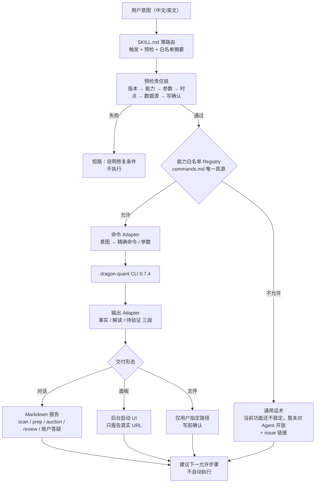
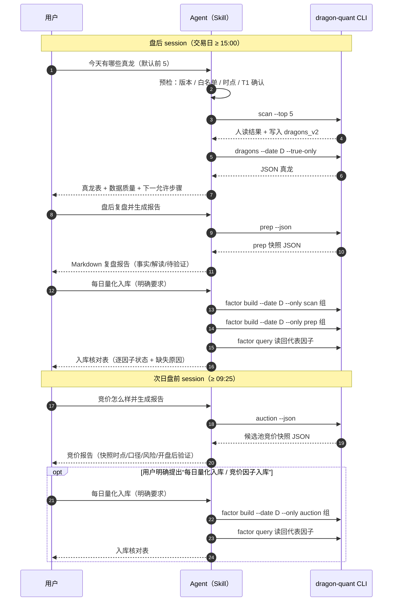
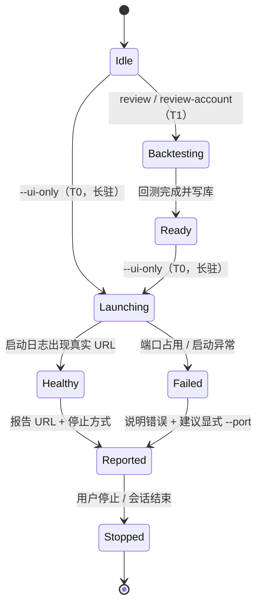

# 技术方案：dragon-quant Agent Skill 交易日助手（L3 内容 / 导航重构）

- 日期：2026-10-30
- 阶段：阶段 2（技术方案；本阶段只新增本文档，不改生产代码 / Skill 正文 / 测试）
- 分支基线：`feat/skills-op`
- 上游输入：main 任务包（核心架构与取舍已定）、两份 bilibili 只读调研结论（`docs/bilibili/prep` 5 份主文档、`docs/bilibili/auction` 6 份文档）、仓库现有 Skill 与测试
- 下游动作：`solution-self-review` 自审 → main 单次验收 → 阶段 3 实现
- 状态：main 单次验收通过（阶段 2）；3 条必须修改已落实，可进入阶段 3

---

## 1. 背景与现状差距

### 1.1 已核实事实（本方案的事实来源）

| 事实 | 位置 | 对本方案的影响 |
|---|---|---|
| Python 包版本 `0.7.4`；npm `package.json` 与 Skill frontmatter 仍是 `0.7.1` | `pyproject.toml`、`package.json`、`skills/dragon-quant/SKILL.md` | 本次 package / skill-version 发布 `1.0.0`，min-cli 独立声明 CLI >= `0.7.4`；后续 npm / Skill 独立演进，不 bump Python |
| CLI 顶层命令共 15 个 | `dragon_quant/cli.py` | 现有 Skill 全量暴露；本次必须收敛为白名单 |
| `scan` 盘中拦截：交易日 `9 <= hour < 15` 且未 `--force` 时拒绝 | `scan/orchestrator/main.py:486-494` | 日常流程 15:00 前不扫；Skill 不把 `--force` 当日常手段 |
| `prep` 当日门禁 `>=16:40`；`--force` 不绕过 | `review_account/prep/service.py:50,108-118`、`prep -h` | 预检短路；历史用 `--date` |
| `auction` 只采当日，命中当日快照即只读；`--force` 才重采；`--recompute DATE` 不触网 | `auction -h`、`docs/agent/prep-auction.md` | 报告必须标注 `mode/source/pool_source/from_cache` |
| `review --ui-only` 只启动面板、不回测；URL 由 `server_address` 真实端口生成 | `review -h`、`web_ui/server.py:530-556` | 两段式 workflow；后台启动后报告真实 URL |
| `review-account` 无终端 JSON；`--ui-only` 只开面板；默认策略 `dragon_pullback_daily`、默认资金 100000、默认 `v2` | `review-account -h`、`review_account/service.py:97-124` | 引导参数 + 终端摘要解读 |
| `dragons` 固定读 `dragons_v2`，JSON 含 `rank/composite_score/board_count/pct/concepts/report_text/...` | `commands/dragons.py`、`scan/storage/dragons.py:228-262` | scan 后核验真龙的权威结构化输出 |
| `data quote/kline/minute/batch-quote` 可查；`quote` 失败打印“获取行情失败”仍 exit 0；`kline/minute` 是逐行 JSON | `commands/data.py:31-62` | 不能只看退出码；空行=无数据 |
| `factor build` 默认只建 `default_enabled=True`（scan 7 + vpa 5）；prep 23 / auction 17 全默认关；`resolve_specs` 不支持通配符 | `infra/factor/registry.py:205-232`、实测 `FACTOR_SPECS` | 必须三组显式 `--only` 静态名单 |
| `factor build --json` 顶层 `ok/mode/dates/build_ids/reports/warnings`；逐因子 `status` 可为 `ok/empty/missing_source/error`；`ok=true` 仍可含 `missing_source` | `infra/factor/service.py:96-131`、`engine.py:799-884` | exit 0 ≠ 全部成功；必须逐因子核对 |
| 现有 `commands.md` 路由覆盖全部 15 个顶层命令、`safety.md` 也覆盖 15 个；`test_skill_routes.py` 断言 safety 命令集合与全部顶层命令相等 | `skills/dragon-quant/references/*.md`、`tests/test_skill_routes.py:69-75` | 旧测试把“全量暴露”写成了契约，必须改写 |
| npm 安装器递归收集 skill 目录文件 | `lib/skill-package.mjs:62-116` | 新增 `references/reports.md` 无需改安装器 |

### 1.2 现状差距

| ID | 差距 | 后果 |
|---|---|---|
| G1 | 现有 Skill 把 15 个顶层命令全部做成路由，与“交易日助手”定位冲突 | Agent 会主动推荐/执行未稳定能力，用户得到不一致体验 |
| G2 | 没有 prep / auction 的报告模板，只有字段解读 | 报告结构依赖模型自由发挥，容易搬视频阈值、混事实与推断 |
| G3 | 没有 review / review-account 的两段式 workflow 与 UI 生命周期 | 容易出现“只开面板没回测”“回测后又重跑”“伪装 URL” |
| G4 | 因子层只写“build/query 只读/写”，没有三组固定名单与逐因子核对 | 默认 build 漏 prep/auction、混入 vpa；exit 0 被误读为成功 |
| G5 | 未开放能力的拒绝话术不存在，且旧文档用否定示例列出全部命令 | 否定示例本身在教模型这些命令存在，越界风险 |
| G6 | 没有区分“单能力请求”与“用户明确要求的每日全流程” | 一次 scan 可能被隐式扩展成 prep/factor 写操作 |
| G7 | safety 是 15 命令全矩阵 | 与白名单自相矛盾，测试也锁死了全量暴露 |
| G8 | 版本 `0.7.1` 落后 CLI `0.7.4` | `min-cli-version` 契约失真 |

### 1.3 不可变约束（main 已定）

1. 保留单一 `skills/dragon-quant/SKILL.md` + `references` 渐进披露 + 现有 npx 安装器；不改 Python 业务逻辑、不新增 CLI/MCP、不改安装器。
2. 这是 L3 内容 / 导航重构，不是多 Skill 拆分。
3. 允许命令面严格限定（见 §7.5）；其他顶层命令与 factor 子命令不得出现在 Skill 路由/示例/说明中，即使是否定示例也不列名字。
4. 不自动定时/后台调度；单能力请求不隐式附带额外写操作。
5. 报告默认在对话交付；只有用户明确要求保存时才写用户指定路径。
6. 不复制视频阈值、胜率、仓位、主力动机、因果与收益承诺；不复制策略参数数值与表结构。
7. 本阶段只新增本文档，不实现。

---

## 2. 需求拆解与用户故事

| ID | 用户故事 | 关键边界 |
|---|---|---|
| US1 | 作为用户，我想查个股实时行情、日 K、分时或批量行情，快速了解一只票现在/最近的状态 | 只做事实查询与摘要，不给买卖建议 |
| US2 | 作为用户，我默认想看到当天最值得关注的 5 只真龙，并能核验它们确实是真龙 | 日常默认 `scan --top 5`；15:00 前不扫；不用 `--force` 绕过 |
| US3 | 作为用户，我想先回测龙头数据，再打开回测面板查看结果 | 严格两段式；只开面板时不重跑；报告真实 URL |
| US4 | 作为用户，我想盘后复盘并得到一份结构化报告 | 报告框架来自 bilibili 复盘主线；事实/解读/待验证分栏 |
| US5 | 作为用户，我想看集合竞价强度并得到一份报告 | 明确是候选池竞价快照；09:30 后仍读取 09:25 终态并正常出报告，额外行情观察才归“开盘后验证”；不伪造全市场/板块 |
| US6 | 作为用户，我想把每日 scan/prep/auction 的量化值写入因子库，并能确认写入结果 | 三组固定名单；不提供因子注册；缺失≠0 |
| US7 | 作为用户，我想打开账户回测面板、在指导下生成模拟回测，并就结果与数据质量提问 | 交互式引导日期/资金；默认策略与 v2；不抄策略参数 |

---

## 3. 可测试验收标准

| ID | 验收标准 | 验证方式 |
|---|---|---|
| AC1 | Skill 只路由白名单能力；被排除的顶层命令与 factor/data 子命令不以任何形式出现在 Skill 正文中 | 静态测试：解析白名单块、扫描命令语法与表格、按 CLI `-h` 动态枚举排除项 |
| AC2 | 交易日的实时扫描默认 `scan --top 5`，随后 `dragons --date D --true-only` 核验；15:00 前拒绝且不提供 `--force` 绕过 | 静态测试 + 行为场景 S1/S2 |
| AC3 | 个股行情四类查询均有明确 workflow，空输出/失败字符串与退出码语义正确 | 静态测试 + 行为场景 S3 |
| AC4 | review 与 review-account 都是“先回测再 `--ui-only`”；只开面板不重跑；复合意图默认尝试打开浏览器，URL 来自真实启动日志；仅在用户明确只要 URL/不要浏览器或宿主无浏览器能力时用 `--no-browser` | 静态测试 + 行为场景 S6/S9 |
| AC5 | prep 报告模板含固定章节，事实/解读/待验证分栏；缺失字段标注不可用而非 0 | 模板 token 测试 + 行为场景 S4 |
| AC6 | auction 报告模板含快照时点与口径、个股结构、风险、开盘后验证；市场/板块维度标“不在本次数据范围” | 模板 token 测试 + 行为场景 S5 |
| AC7 | 因子入库只用三组显式 `--only` 名单；名单与 `FACTOR_SPECS.source` 集合一致；构建后逐因子核对并读回代表因子 | 注册表对齐测试 + 行为场景 S7 |
| AC8 | review-account 先引导日期/资金，再回测、再开面板；答疑只解释摘要与数据质量，不复制策略参数 | 静态测试 + 行为场景 S9 |
| AC9 | 未开放能力统一使用固定话术 + issue 链接，且话术不包含被排除命令名 | 静态测试 + 行为场景 S2/S10 |
| AC10 | 安全分级只保留 T0/T1；T1 需本轮明确请求或确认；UI-only 说明长驻与 schema 初始化 | 静态测试 + 行为场景 S11 |
| AC11 | 报告默认对话交付；写用户路径需确认；不默认污染仓库 | 静态测试 + 行为场景 S8 |
| AC12 | 本次 `package.json` / `skill-version` 为 `1.0.0`，`min-cli-version` 独立声明 CLI >= `0.7.4`；后续 npm / Skill 独立演进 | 版本测试 |
| AC13 | 同一 commit 更新 `docs/agent/development.md` 与 `README.md`（必要时 CHANGELOG）；根 `AGENTS.md` 不改 | 人工 review + 文档 diff |
| AC14 | 静态测试、`npm test`、离线 pytest 全绿；行为场景由 main 编排独立 execute_agent 验证 | 命令输出 + 场景记录 |

---

## 4. 非目标 / 反目标

**非目标**

- 不新增 CLI、MCP、Python 业务逻辑或安装器行为。
- 不拆分多 Skill，不引入运行时插件/工作流引擎。
- 不提供定时任务、守护进程、自动每日执行。
- 不提供因子注册、因子评估、因子导出、财务同步等研究能力。
- 不提供 buy/sell 信号、资产同步、存储清理、日志、黑名单、vpa 等能力。
- 不读取或写入 v1 体系。
- 不复制 STRATEGY.md 的参数数值、评分权重、表结构。
- 不生成投资建议、收益承诺、胜率背书或“必涨”结论。

**反目标（明确拒绝的做法）**

- 用否定示例列出被排除命令来“提醒模型别用”。
- 为了让旧测试通过而保留全命令暴露。
- 在单次 `scan` 请求里顺手 `prep` 或 `factor build`。
- 用 `--force` 绕过盘中/盘后/竞价时点。
- 把 `empty` / `failed` / `unavailable` / `missing_source` 说成 0、弱或看空。
- 把快照缓存结果说成刚刚采集的最新结果。
- 把 UI 启动失败说成已打开浏览器。

---

## 5. 候选方向与取舍

### 5.1 方向 A（推荐）：单 Skill + 严格白名单 Facade + 模板化报告 + 注册表对齐测试

- `SKILL.md` 只保留触发、预检责任链、**能力类别摘要（不复制命令矩阵与参数）**、reference 索引、拒绝话术。
- `commands.md` 是唯一命令白名单表（机器可读块 + 人读矩阵）；`safety.md` 只列白名单的 T0/T1。
- `reports.md` 承载 prep/auction 固定模板；`operations.md` 承载单能力/每日复合 workflow、UI 生命周期、因子三组名单。
- 静态测试从 CLI help 动态枚举“被排除命令”，防止新增命令后意外暴露；因子名单与 `FACTOR_SPECS` 对齐。
- 优点：改动只在内容层，安装器/业务零风险；可测试、可审计；完全符合 main 的核心取舍。
- 缺点：白名单靠测试与文档纪律维持，不是运行时强制；模型仍可能凭记忆越界，需要行为场景验证。

### 5.2 方向 B（非常规 / 反直觉）：运行期命令网关（Wrapper / MCP Policy Engine）

- 在 Agent 与 CLI 之间加一个只放行白名单的包装器，所有命令必须经它执行。
- 优点：运行时强约束，模型无法直接拼被排除命令。
- 缺点：需要新增运行组件与安装/版本/权限面，违反“不新增 CLI/MCP / 不改安装器”的边界；Windows/多解释器路径复杂；仍未解决 Skill 文本里“教了不该教的命令”的问题；维护成本高于收益。
- 结论：不做。作为反直觉路径保留，说明为什么“更强约束”在这里不是更优解。

### 5.3 方向 C（常规替代）：多 Skill 拆分（行情 / 扫描复盘 / 回测账户）

- 优点：每个 Skill 触发面更窄，理论上更少越界。
- 缺点：需要改目录布局、manifest、安装器与测试；触发词互相竞争，用户一次“今天全套”会命中多个 Skill；渐进披露变成跨 Skill 跳转；与 main 已定的单 Skill 架构冲突。
- 结论：不做。

### 5.4 推荐

采用方向 A。理由：本次问题是“内容与导航越界”，不是“缺少运行时约束”；在内容层收敛 + 可执行测试 + 行为场景，是成本最低、回归风险最小、与现有单 Skill 架构最一致的路径。

---

## 6. 设计模式与动机

| 模式 | 在本方案中的落点 | 动机 |
|---|---|---|
| Facade | `SKILL.md` 对 CLI 暴露一个窄接口：只有交易日助手能力 | 隐藏 15 个命令的复杂度，只暴露稳定子集 |
| Adapter | 自然语言意图 → 精确命令/参数；CLI 人读/JSON → 报告字段 | 隔离“用户说法”与“CLI 契约”的变化 |
| Registry / 表驱动 | `commands.md` 白名单表 + `safety.md` T0/T1 表 + 因子三组机器可读块 | 白名单只有一个真源，测试直接消费 |
| Template Method | `reports.md` 固定章节骨架，数据与条件填槽 | prep/auction 报告结构稳定，模型不自由发挥 |
| Chain of Responsibility | 预检链：版本 → 白名单 → 参数 → 时点 → 数据源 → 写确认 | 任一失败短路，避免带病执行 |
| Progressive Disclosure | SKILL → 按需 references | 控制上下文与体量，避免一次读全 |

不引入运行时抽象、插件框架、依赖注入或新模块；模式只服务于可读性与可测试性。

---

## 7. 目标架构

### 7.1 架构与能力边界



### 7.2 交易日时序（单能力与每日复合 workflow）



**关键规则**：每日复合 workflow 只在用户明确说“每日全流程 / 每日量化入库 / 今天全套”时启用；否则只执行用户点名的那一个能力。单能力 `auction` 请求到竞价报告结束，**不隐式**执行 `factor build`；只有用户明确提出“竞价因子入库 / 每日量化入库”才继续。跨时点无法在一个 session 内完成的部分，只输出“下一阶段待执行”，不后台调度。

### 7.3 UI 生命周期



**规则**：复合意图“回测并打开面板 / 账户回测并打开面板”默认按 CLI 正常行为尝试打开浏览器；只有用户明确说“只启动服务 / 给我 URL / 不要打开浏览器”，或宿主无浏览器能力时才加 `--no-browser`。不把“已启动进程”说成“已打开浏览器”；浏览器打开失败时只报告真实 URL，不声称已打开。不报告猜测端口；`review` 未显式给 `--port` 时 CLI 可能自动换端口，以日志 URL 为准；`review-account` 端口被占用时 CLI 直接报错，建议显式 `--port`（允许参数），不自动重试。面板只监听本机 `127.0.0.1`，不要建议任何公网/局域网暴露方式；报告 URL 时说明“仅本机可访问”。

### 7.4 Skill 内容导航与职责

| 文件 | 职责 | 不写什么 | 体量上限 |
|---|---|---|---|
| `SKILL.md` | 触发、权威顺序、预检责任链、能力类别摘要、拒绝话术、reference 索引 | 完整命令表、参数、策略参数、表结构 | ≤300 行 |
| `references/commands.md` | 唯一白名单矩阵、关键参数、写类、输出模式、常见误用 | 被排除命令（含否定示例）、完整 help | ≤300 行 |
| `references/operations.md` | 单能力 vs 每日复合、盘后/盘前阶段拆分、UI 生命周期、因子三组名单、报告保存 | 业务阈值、策略数值 | ≤300 行 |
| `references/reports.md` | prep / auction 报告模板、字段来源、缺失回退、措辞约束 | 新阈值、胜率、主力动机 | ≤300 行 |
| `references/outputs.md` | 白名单命令的字段解读；保留现有 `strategy_context` 六段与账户三态 | 被排除命令的解读 | ≤300 行 |
| `references/playbooks.md` | 异常分流、时点门禁、通用未开放话术、issue 最小信息模板 | 被排除命令的修复命令 | ≤300 行 |
| `references/safety.md` | 仅白名单 T0/T1、确认话术、禁止操作 | T2、全命令矩阵 | ≤300 行 |

硬上限：SKILL ≤300 行；每个 reference ≤300 行；references 合计 ≤1200 行。当前合计 674 行，新增 `reports.md` 并裁剪旧内容后预计 900–1000 行。

### 7.5 白名单命令矩阵

> 本节是设计文档中的完整矩阵。实现时 **只有 `commands.md` 保存命令矩阵**；`SKILL.md` 只写能力类别（行情 / 扫描 / 复盘 / 竞价 / 回测 / 账户 / 因子核对），不复制本表，避免双真源漂移。

| 用户意图 | 允许命令 | 写类 | 输出 | 说明 |
|---|---|---|---|---|
| 个股实时行情 | `dragon-quant data quote --code CODE [--source tencent 或 xueqiu]` | T0 | 人读 JSON | 默认腾讯；失败字符串不等于成功 |
| 个股日 K | `dragon-quant data kline --code CODE [--days N] [--source ...]` | T0 | 逐行 JSON | 默认雪球；失败可试 `--source tencent` |
| 个股分时 | `dragon-quant data minute --code CODE [--source ...]` | T0 | 逐行 JSON | 同上 |
| 批量行情 | `dragon-quant data batch-quote --codes C1,C2 [--source ...]` | T0 | 逐行 JSON | 多只票优先批量 |
| 当日扫描 | `dragon-quant scan --top 5` | T1 | 人读 | 日常默认；15:00 前禁止；不加 `--force` |
| 历史扫描 | `dragon-quant scan --date D --top N` | T0 | JSON | 明确“历史/某天”时才用；优先 `dragons` |
| 真龙核验 | `dragon-quant dragons --date D --true-only` | T0 | JSON | scan 后结构化核验 |
| 龙头回测 | `dragon-quant review [--date D] [--top N]` | T1 | 人读 | 只处理成熟 pending；`--date` 绕过成熟度 |
| 回测面板 | `dragon-quant review --ui-only [--port P] [--no-browser 仅按需]` | T0（长驻） | URL | 不回测、不写业务记录；可能初始化 schema；复合意图默认尝试打开浏览器，仅按需关闭 |
| 盘后复盘 | `dragon-quant prep [--date D] [--recompute / --force] --json` | T1 | JSON | 当日 ≥16:40；`--force` 仅谨慎刷新；`--recompute` 仍写快照 |
| 集合竞价 | `dragon-quant auction [--force / --recompute D] --json` | T1（命中快照时本次只读） | JSON | 当日 ≥09:25；无 `--date`；快照命中不刷新 |
| 因子构建 | `dragon-quant factor build --date D --only <固定组>` | T1 | JSON | 只允许三组固定名单；禁止默认 build / `--all` |
| 因子读回 | `dragon-quant factor query --date D --name NAME` | T0 | 人读/JSON | 仅用于入库核对与代表因子读回 |
| 账户回测 | `dragon-quant review-account --from D --to D [--capital N]` | T1 | 人读 | 默认策略、默认 v2；不传 `--config` |
| 账户面板 | `dragon-quant review-account --ui-only [--port P] [--no-browser 仅按需]` | T0（长驻） | URL | 只开已有面板；不回测；复合意图默认尝试打开浏览器，仅按需关闭 |

**被排除面（仅本文档用于实现与测试，不进入 Skill 正文）**：`logs`、`data sector`、`data components`、`data cookie-*`、`blacklist`、`assets`、`buy`、`sell`、`vpa`、`storage`；`factor` 的 `list/status/eval/decision-review/export/fin *`；任何 `--source v1`。Skill 正文统一用通用未开放话术，不列这些名字。

### 7.6 未开放能力与 issue 路由

固定话术（逐字）：

> 当前功能还不稳定，暂未对 Agent 开放。你可以到 https://github.com/gitBingxu/dragon-quant/issues 反馈需求或问题。

规则：

- 任何不在 §7.5 白名单内的能力，一律用上述话术，不解释内部命令、不列替代命令名。
- 用户在本轮明确点名白名单能力，视为 T1 确认；未点名或语义模糊时先确认。
- 缺功能 / 体验不好 / 数据异常无法按 §12 解释时，引导 issue，并给最小信息模板（见 §12.4）。
- 不承诺排期，不模拟维护者口吻。

---

## 8. 每个用户故事的 step-by-step workflow

### US1 个股行情查询

1. **识别**：单只/多只；实时（quote）/日 K（kline）/分时（minute）/批量（batch-quote）。
2. **预检**：CLI 版本；代码为 6 位数字（用户给名称时先要求代码，不猜测映射）；多只票优先 `batch-quote`；市场/名称等无法确认时先问。
3. **执行**：
   - 单只实时：`data quote --code CODE`；
   - 日 K：`data kline --code CODE --days N`；
   - 分时：`data minute --code CODE`；
   - 多只：`data batch-quote --codes C1,C2`。
4. **输出**：现价、涨跌幅、开高低、昨收、成交额、换手率、量比、市值、涨停/跌停价、时间戳；日 K 给区间与最近走势；分时给日内高低与尾盘状态。只陈述事实与数据来源，不给买卖建议。
5. **校验**：`quote` 输出“获取行情失败”= 失败（即使 exit 0）；`kline/minute` 空输出 = 无数据；`batch-quote` 可能静默跳过个别代码，逐只报告成功/缺失。
6. **降级**：雪球链路空/403 时，`kline/minute` 改用 `--source tencent` 重试一次；仍失败则说明数据不可得，引导 issue（不涉及凭据命令）。
7. **下一步建议**：可建议“如需看今日真龙可跑 scan”，但不自动执行。

### US2 默认前 5 真龙

1. **识别**：用户说“今天/现在/扫一下/龙头扫榜” → 实时扫描；说“某天/历史” → 先 `dragons --date D --true-only`，必要时 `scan --date D`。
2. **预检**：
   - CLI 版本；
   - 交易日与时段：同一交易日 `9:00–15:00` 内拒绝实时 scan，说明 15:00 后更准确，不提供 `--force`；
   - T1 确认：用户本轮明确说“扫一下/跑 scan”即视为确认；否则先确认。
3. **执行**：`scan --top 5`（默认）。只有用户明确要求更多/并发时才加 `--candidates/--workers`。
4. **核验**：从 scan 人读输出确认 `trade_date`；执行 `dragons --date D --true-only`。
5. **输出**：表格列 `rank / code / name / composite_score / board_count / pct / concepts / report_text 摘要`；写明 `scan_id`、`trade_date`、真龙只数。少于 5 只时如实说“当日只有 N 只真龙”，不补位、不说“市场弱”。
6. **降级**：scan 失败 → 停止，不拿旧数据冒充；dragons 无记录 → 区分“扫描没有真龙”与“扫描未完成/无记录”。
7. **下一步建议**：可建议 `prep` 复盘；不自动执行。

### US3 龙头回测 + 面板

1. **识别**：用户要“回测 / 看回测结果 / 打开回测面板”。
2. **预检**：CLI 版本；回测范围（用户日期 / 默认成熟 pending）；T1 确认；端口（默认 8765；用户指定端口被占用时 `review` 会报错，不自动换）。
3. **阶段 1（需要生成/更新数据时）**：`review`（默认）或 `review --date D [--top N]`。
4. **校验阶段 1**：人读汇总 `processed/completed/cannot_evaluate/failed/skipped`；`failed > 0` 要如实报告，不把 partial 说成完整。
5. **阶段 2**：后台启动 `review --ui-only`。用户说“回测并打开面板”时默认按 CLI 正常行为尝试打开浏览器；只有用户明确说“只启动服务/给我 URL/不要打开浏览器”，或宿主没有浏览器能力时，才加 `--no-browser`。捕获启动日志中的真实 URL（形如 `http://localhost:<port>/?source=v2`）；确认进程存活后再报告。若宿主没有后台执行机制，明确告知“面板会阻塞当前会话”，并给出用户自行在终端运行的命令，不假装已启动。
6. **输出**：回测汇总 + 面板 URL + 停止方式（Ctrl+C / 会话结束后端口释放）。
7. **只开面板**：用户只要“打开已有面板”时跳过阶段 1，直接 `--ui-only`。
8. **禁止**：不把 `--ui-only` 说成“会回测”；不在面板已打开时重复跑回测；不伪造浏览器已打开。

### US4 prep 复盘 + 报告

1. **识别**：用户要“盘后复盘 / 收盘总结 / 明天怎么做 / 生成复盘报告”。
2. **预检**：
   - 先确认用户说的是“今天”还是“最近/某个历史日”。用户说“今天”时，同一交易日 `>=16:40` 才可复盘当日；早于门禁时说明等待，不用 `--force`。用户说“最近/某天”时，允许 CLI 解析默认日期或 `--date D`，但报告必须使用实际 `trade_date`，不得假定今天；
   - 历史复盘用 `--date D`，不受当日门禁；
   - T1 确认；
   - `--recompute` 仅在用户要求“用已存资产重算”时使用；`--force` 仅在用户明确要求“重采全部可采资产”时使用。
3. **执行**：`prep --json`（报告需要完整结构；只要四行摘要可用默认输出）。
4. **校验**：`trade_date` 与用户目标一致；`strategy_context.context_version` 是否为 `sc_v1`；`data_quality` 是否有缺失。
5. **输出**：按 §9.1 模板生成 Markdown，默认对话交付。
6. **降级**：`strategy_context` 缺失或版本不认识 → 只输出旧摘要（四行 + 逐只清单），明确“没有结构化策略上下文，无法给出条件化明日策略”，不拼凑阈值/仓位。
7. **下一步建议**：可建议“次日 09:25 后看竞价”或“如需每日入库可跑因子构建”；不自动执行。

### US5 auction 竞价 + 报告

1. **识别**：用户要“竞价怎么样 / 集合竞价 / 看竞价强度”。
2. **预检**：
   - 同一交易日 `09:25` 前不运行，说明竞价数据尚未形成；
   - `09:25–09:30` 可运行，报告标注“竞价快照”；
   - `>=09:30` 仍可运行；采集/读取的仍是 09:25 集合竞价终态，应正常生成竞价强度报告，并标注实际运行时点与缓存状态；只有额外加入 09:30 后行情观察时，那部分才归为“开盘后验证”，且不得倒填为竞价事实；
   - T1 确认；`--force` 仅在用户明确要求刷新时使用；`--recompute DATE` 仅在用户要求历史重算时使用；
   - 当日无 `--date`。
3. **执行**：`auction --json`。
4. **校验**：`mode`（`snapshot` / 采集 / 重算）、`source`、`pool_source`、`fallback_reason`、`from_cache`、`data_quality.status`、`validation_status`；快照命中时明确“来自缓存，未重新采集”。
5. **输出**：按 §9.2 模板生成 Markdown，默认对话交付。
6. **降级**：`empty` = 无盘口；`failed` = 采集失败；`unavailable` = 数据不足；`legacy` 池 = 不是今日盘前推荐；`unverified=true` = 本次评价不可用。均不等于看空/弱。
7. **下一步建议**：可建议“开盘后按 actions 验证”；不自动执行。

### US6 每日量化入库（因子）

1. **识别**：用户明确说“每日量化入库 / 把今天 scan/prep/auction 写入因子库 / 因子构建”。
2. **预检**：确认交易日 D 与要入库的组（scan / prep / auction，可多选）；T1 确认；提醒“这一步只构建内置因子，不注册新因子”。
3. **执行**：按组逐条：
   - `factor build --date D --only <scan 组 7 个>`；
   - `factor build --date D --only <prep 组 23 个>`；
   - `factor build --date D --only <auction 组 17 个>`。
   查询时加 `--json`。
4. **校验**：
   - 顶层 `ok`、`reports[0].factors[<name>].status`、`warnings`；
   - 每个预期因子状态应为 `ok`（有行）或可解释的 `empty/missing_source`；
   - `missing_source` ≠ 0；`no_scan_for_date` 对 prep/auction-only 组是预期警告，不代表失败；
   - `factor query --date D --name <代表因子> --json`，检查 `values.rows > 0` 且 `resolved_versions` 含该因子；
   - 代表因子：scan `five_dim_composite`；prep `prep_review_score`；auction `auction_is_weak`（可用行即写；`auction_strength` 仅在数据质量 `ok` 时才有行，作为二次抽查）。
5. **输出**：入库核对表（组 / 预期数 / `ok` 数 / `empty` 数 / `missing_source` 数 / 读回行数 / 缺失原因）。
6. **禁止**：默认 build（会漏 prep/auction 且混入 vpa）；`--all`（混入 fin）；因子注册；把 exit 0 当全部成功。
7. **下一步建议**：无；若缺失原因指向源未生成，建议先补对应能力（白名单内）。

### US7 账户回测 + 面板 + 答疑

1. **识别**：用户要“账户回测 / 模拟交易 / 打开账户面板 / 解释回测结果”。
2. **引导（新回测）**：
   - 区间：`--from` / `--to`（必填）；
   - 初始资金：默认 100000，确认是否调整；
   - 策略：默认 `dragon_pullback_daily`，不暴露参数细节；
   - 数据体系：默认 `v2`，不提 v1。
3. **预检**：CLI 版本；T1 确认；说明会写账户回测表；说明候选池优先读 prep 快照——目标区间未跑 prep 时会走回退池，报告中必须说明回退天数与原因。
4. **执行**：`review-account --from D1 --to D2 [--capital N]`。
5. **校验**：终端摘要（初始资金/最终权益/累计收益/最大回撤/胜率/交割单）；`ranking_mode`、候选池回退天数、停牌跳过、`data_degraded`、`run_id`。
6. **阶段 2**：后台 `review-account --ui-only`。用户说“账户回测并打开面板”时默认尝试打开浏览器；只有用户明确不要浏览器/只要 URL，或宿主无浏览器能力时才加 `--no-browser`。报告真实 URL（形如 `http://localhost:<port>/account?source=v2`）；只开已有面板时跳过阶段 4。若宿主没有后台执行机制，明确说明面板会阻塞会话，并给出用户自行运行的命令。
7. **答疑边界**：
   - 解释指标定义、数据质量三态（`strict_5min` / `mixed` / `daily_fallback`）、兜底成交价是保守近似、停牌冻结；
   - 解释候选池回退的含义，不把回退池说成当日推荐；
   - 不复制策略参数数值，不建议“把某参数改成 X”，不承诺收益；
   - 用户要调参/新增策略 → 通用未开放话术 + issue。
8. **下一步建议**：可建议调整区间重跑（需再次 T1 确认）或打开面板；不自动重跑。

---

## 9. 报告模板

报告默认在对话中以 Markdown 交付。每段固定三栏语义：**事实**（CLI 字段/数值/来源）、**解读**（允许的推断，必须标注）、**待验证条件**（下一时点如何证伪/观察）。没有字段支撑的内容写“不在本次数据范围”，不补造。

### 9.1 prep 复盘报告模板

```markdown
# 复盘报告｜{trade_date}

- 目标交易日：用于其下一交易日（不自行推算具体日期，以交易时点与 CLI 输出为准）
- 数据质量：{strategy_context.data_quality.confidence}；降级：{strategy_context.data_quality.degraded}；缺失代码：{strategy_context.data_quality.missing}
- 血缘：context_version={strategy_context.context_version}；dragon_source.window_days={n}；snapshot={strategy_context.frozen_at}
- 声明：本报告由 dragon-quant CLI 输出整理，阈值为待验证基线，不构成投资建议，不承诺收益。

## 1. 复盘日与数据质量
| 事实 | 解读 | 待验证条件 |
|---|---|---|
| strategy_context.trade_date / frozen_at / context_version | 复盘日不是目标交易日时，不得说成当日结论 | 目标交易日盘后复核 |

## 2. 市场环境与流动性
| 事实 | 解读 | 待验证条件 |
|---|---|---|
| macro.available/session/instruments[].caliber/degraded | 外围与美债/黄金只作环境背景 | 次日盘前/盘后更新 |

## 3. 情绪与风格
| 事实 | 解读 | 待验证条件 |
|---|---|---|
| market.state/score/coeff/evidence/unknown_reason | 情绪回答“能不能做/容错高低” | 次日竞价与收盘验证 |

## 4. 主线题材
| 事实 | 解读 | 待验证条件 |
|---|---|---|
| main_boards；review.mainlines[].state/mainline_score/evidence/unknown_reason | 主线回答“做哪里” | 次日板块强度是否延续 |

## 5. 龙头与核心角色
| 事实 | 解读 | 待验证条件 |
|---|---|---|
| positions[] 全量：role/review_score/review_grade/confidence/eligibility/position_pct/reason_code/gate_trace | 龙头是表达与观察锚，不是买入指令 | 次日竞价缺口/量比/封板 |

## 6. 当日计划与实际对照（仅存在 T-1 计划时）
| 事实 | 解读 | 待验证条件 |
|---|---|---|
| feedback.items[].state/unknown_reason/checkpoint；plan_review.planned_*/actual_*/outcome_pct/attribution | 反馈是评估证据，不是买卖指令 | 实际执行数据缺失时保持 null |

## 7. 明日条件计划
| 事实 | 解读 | 待验证条件 |
|---|---|---|
| strategy_context.feedback_plans[].expected（gap_low/gap_high/ratio_low/seal_by）与 conditions[] 四态 | 只引用冻结预期，不新增阈值 | 正/负/未知条件逐条列出 |

## 8. 待验证条件与风险
- 数据缺口：{degraded/missing/suspended/dragon_source}
- 需要下一时点确认的条件：{条件清单}
- 风险：{降级、回退、快照版本、执行数据缺失}

## 9. 声明
原文引用 disclaimer；不承诺收益；不提供买卖建议。
```

**字段来源与缺失回退**

| 段落 | 字段来源 | 缺失 / 降级处理 | 措辞约束 |
|---|---|---|---|
| 1 | `strategy_context.trade_date`、`frozen_at`、`context_version`、`strategy_context.data_quality` | `confidence=null` 写“置信度不可用”；`missing` 是分数缺失代码，不是无风险 | 不补默认值 |
| 2 | `macro.available/session/instruments/degraded`；`sentiment` 计数 | 品种缺失写“不在本次数据范围” | 不把 `previous_session` 说成当日 |
| 3 | `review.market.state/score/coeff/evidence/unknown_reason` | `unknown` 原样写“未知”，不写“中性” | 不套用阈值 |
| 4 | `main_boards`、`review.mainlines[]` | `mainline_unavailable` 写“主线不可用” | 不凭涨幅自行指定主线 |
| 5 | `review_candidates` / `strategy_context.positions[]` | `position_pct=0` 写“不建议新建仓”，不是清仓；`null` 写“无法给出” | 逐只覆盖，不排优先买入顺序 |
| 6 | `feedback`、`plan_review` | 无 T-1 计划 = 合法缺席；`actual_* = null` 写“未成交或数据缺失” | 不编造成交价/仓位 |
| 7 | `strategy_context.feedback_plans[]` | `expectations_unavailable` → 只观察；`unknown` → `observe_only` | `allowed_actions` 是唯一动作依据；四态动作映射的字段语义以 `outputs.md` 为 owner，本节只固定报告骨架 |
| 8 | `dragon_source`、`suspended_codes`、`degraded` | 历史缺口不可再生，如实说明 | 不假装补采成功 |
| 9 | `disclaimer` | 缺失时写“声明不可用” | 不省略“不构成投资建议” |

**从 bilibili 复盘主线继承的框架**：市场环境/流动性 → 情绪与风格 → 主线题材 → 龙头/核心角色 → 当日计划与实际对照 → 明日条件计划。情绪回答“能不能做/容错”，主线回答“做哪里”，龙头是表达与观察锚，明日计划必须写正/负/未知条件。

**明确排除**：作者固定阈值、仓位数字、因果断言、确定性周期、周/月胜率、收益承诺、主力动机推断。

### 9.2 auction 竞价报告模板

```markdown
# 竞价报告｜{trade_date}

- 快照时点：09:25（集合竞价终态）
- 实际运行时点：{run_at}（09:30 后运行仍读取/采集 09:25 终态）
- 数据来源：mode={mode}；source={source}；pool_source={pool_source}；fallback_reason={fallback_reason}
- 缓存：from_cache={from_cache}；validation_status={validation_status}
- 数据质量：{data_quality.status}；原因码：{reason_codes}
- 声明：本报告是候选池竞价快照，不是全市场/全板块结论；不构成投资建议。

## 1. 快照时点与口径
- 09:15–09:20 可撤单；09:20–09:25 不可撤单；09:25 形成开盘价。
- 09:25 前的匹配量不是实际成交量；本报告不把它当成交量。
- 09:30 后运行仍读取/采集 09:25 集合竞价终态，正常生成竞价强度报告；报告标注实际运行时点与缓存状态。
- 快照命中时明确“来自缓存，未重新采集”。

## 2. 大盘温度
| 事实 | 解读 | 待验证条件 |
|---|---|---|
| 本次数据不含全市场竞价温度/指数 | 不在本次数据范围 | 开盘后观察指数与涨跌家数 |

## 3. 板块方向
| 事实 | 解读 | 待验证条件 |
|---|---|---|
| 本次数据只覆盖候选池，不含板块竞价数据 | 不在本次数据范围 | 开盘后观察板块联动 |

## 4. 个股竞价结构
| 排名 | 代码/名称 | 等级 | 强度 | 方向 | 关键证据 | 数据状态 |
|---|---|---|---|---|---|---|
| {rank} | {code/name} | {level} | {strength} | {direction} | {evidence_summary} | {data_quality.status} |

## 5. 风险
- `is_weak=true` / `reject_reason`：真实风险否决，不是低分档位。
- `risk_events[]`：盘口估计事件，不是订单级成交。
- `unavailable` / `empty` / `failed`：数据不足或采集失败，不等于看空。
- `unverified=true`：本次评价不可用，分数只能当诊断值。

## 6. 开盘后验证（仅额外行情观察）
本节只用于 09:30 后的额外观察，不是竞价事实，不得倒填为 09:25 结论。
| 条件（来自 actions[]） | 观察点 | 证伪条件 |
|---|---|---|
| {action} | {requires/post_open} | {若…则不成立} |

## 7. 待验证与声明
- 候选池血缘：{pool_source/fallback_reason}
- 未覆盖维度：全市场温度、板块方向、实际成交量
- 原文引用 validation_status 与 disclaimer。
```

**字段来源与缺失回退**

| 段落 | 字段来源 | 缺失 / 降级处理 | 措辞约束 |
|---|---|---|---|
| Header | `trade_date`、`mode`、`source`、`pool_source`、`fallback_reason`、`from_cache`、`validation_status`；`run_at` 由 Agent 记录实际运行时间 | `from_cache=true` 必须写“缓存”；`pool_source=legacy` 必须写“非今日盘前推荐” | 不伪装实时；09:30 后运行仍标 09:25 终态 |
| 1 | 固定时点语义 + `mode` | 无字段的维度写“不在本次数据范围” | 不把 09:25 前匹配量当成交量 |
| 2 | 无 | 明确“不在本次数据范围” | 不伪造大盘/板块数据 |
| 3 | 无 | 明确“不在本次数据范围” | 不从候选池反推板块 |
| 4 | `snapshots[]` 的 `rank/strength/level/direction/dims/evidence_summary/data_quality` | `rank=null` 写 `rank_reason`；`unavailable` 不写分数 | 不把 `unavailable` 说成弱 |
| 5 | `is_weak`、`reject_reason`、`risk_events` | `empty`/`failed` 分开说明 | 不把数据不足说成看空 |
| 6 | `strategy_context.positions[].actions[]` | 上下文缺失 → 只输出旧摘要并说明 | 仅额外行情观察；不得把 09:30 后观察倒填成竞价事实 |
| 7 | `validation_status`、`disclaimer` | 缺失时写“不可用” | 不承诺胜率/收益 |

**从 bilibili auction 主线继承的框架**：快照时点与口径 → 大盘温度 → 板块方向 → 个股竞价结构 → 风险 → 开盘后验证。当前 CLI 数据缺市场/板块维度，必须标“不在本次数据范围”。

**明确排除**：80%/90% 胜率、筛选公式、主力必拉升、确定性结论、收益承诺。

### 9.3 通用措辞约束

- 事实与推断分开；推断必须写“解读：”。
- 缺失写“缺失/不可用/不在本次数据范围”，不写 0、不写“弱/看空”。
- 不把 `unknown` 写成“中性”；不把 `position_pct=0` 写成“清仓”。
- 不按分数排“优先买哪只”，不给“先买 A 再买 B”。
- 不复制权重、阈值、策略字段名与数值。
- 不承诺收益、胜率、确定性周期；不使用“必涨/稳赚/主力一定拉升”。

---

## 10. 因子入库（三组固定名单）

### 10.1 准确名单（从 `FACTOR_SPECS` 实测，按名称排序）

```text
<!-- factor-groups:start -->
scan: five_dim_absorption,five_dim_anti_drop,five_dim_composite,five_dim_drive,five_dim_is_true_dragon,five_dim_leadership,five_dim_liquidity
prep: prep_chip_concentration,prep_dim_d1,prep_dim_d2,prep_dim_d3,prep_dim_d4,prep_dim_d5,prep_dim_d6,prep_distance_high60,prep_feedback_state,prep_high_days,prep_in_pool_today,prep_limit_up_suc_rate,prep_main_net_ratio,prep_mainline_rank,prep_market_state,prep_position_pct,prep_review_grade,prep_review_score,prep_role,prep_seal_ratio,prep_t_pct,prep_t_turnover,prep_turnover_health
auction: auction_dim_direction,auction_dim_liquidity,auction_dim_supply,auction_dim_tail_grab,auction_dim_vol_price,auction_direction,auction_final_slippage_pct,auction_is_weak,auction_open_gap_pct,auction_rank,auction_strength,auction_strong_to_weak,auction_tail_matched_acceleration,auction_turnover_pct,auction_unmatched_matched_ratio,auction_volume_ratio_5d,auction_weak_to_strong
<!-- factor-groups:end -->
```

说明：

- scan 组 7 个，全部 `five_dim_*`，默认启用。
- prep 组 23 个 = 6 个 `prep_review_*`（`prep_review_score/prep_review_grade/prep_position_pct/prep_market_state/prep_mainline_rank/prep_role`）+ 17 个其他 `prep_*`。**不要写 `prep_review_*` 通配符**：`resolve_specs` 不支持通配符，且该前缀只覆盖 6 个。
- auction 组 17 个，全部 `auction_*`。
- 明确排除 `vpa_*`（默认启用但与本需求无关）与 `fin_*`（默认关且需要财务链路）。
- `prep_feedback_state` 的可用阶段是 T+1 盘后（`close`），当日无 T-1 计划时合法无行；不要当失败。

### 10.2 构建与验证流程

1. 确认日期 D 与组；T1 确认。
2. 每组单独执行：`factor build --date D --only <组名单> --json`。
3. 解析顶层 `ok/mode/reports/warnings`；对 `reports[0].factors` 中每个名字检查 `status`：
   - `ok`：有行；
   - `empty`：源可用但当日无值，按因子语义说明；
   - `missing_source`：源不可用或配置 fail-closed，**不等于 0**；
   - `error`：构建失败，必须报告。
4. 区分 `warnings`：`no_scan_for_date` 对 prep/auction-only 组是预期（当天可能没跑 scan）；对 scan 组则是失败信号。
5. 读回代表因子：
   - `factor query --date D --name five_dim_composite --json`
   - `factor query --date D --name prep_review_score --json`
   - `factor query --date D --name auction_is_weak --json`（二次抽查可加 `auction_strength`）
   检查 `values.rows > 0`、`resolved_versions` 含该因子；auction 数据不足时可合法无行，需说明原因。
6. 输出核对表；不把 exit 0 当全部成功，不把缺失当 0，不用 `--all` 补齐。

### 10.3 防漂移

- `operations.md` 中的 `<!-- factor-groups:start -->` 块是 Skill 侧唯一名单真源；测试解析该块并与 `FACTOR_SPECS` 的 `source` 集合逐组比较。
- 新增/删除因子时，测试失败会强制同步更新 Skill；不允许用 `*` 或运行时枚举替代静态名单。
- 同理，白名单测试从 CLI `-h` 动态枚举顶层命令，新增命令若未显式加入白名单/排除断言，测试会提示。

**白名单变更流程**（未来 CLI 新增稳定命令时）：先在 `commands.md` 白名单块与 `safety.md` 登记 → 更新 `SKILL.md` 能力类别（如需）→ 更新测试的允许集合 → 同 commit 更新 `docs/agent/development.md`。不允许“先让测试放过，再补文档”。

---

## 11. review-account 引导与答疑边界

**引导顺序**：区间（必填）→ 初始资金（默认 100000，确认）→ 策略（默认 `dragon_pullback_daily`，不展开参数）→ 数据体系（默认 `v2`）→ T1 确认 → 回测 → `--ui-only`。

**允许解释**：

- 终端摘要字段：初始资金、最终权益、累计收益、最大回撤、胜率、交割单笔数、`ranking_mode`、候选池回退天数、停牌跳过、`data_degraded`、`run_id`。
- 数据质量三态：`strict_5min` / `mixed` / `daily_fallback`；兜底成交价是保守近似；停牌冻结。
- 候选池回退：回退池不是当日盘前推荐，解读要降权。
- 清仓后窗口指标：事后评估，不参与交易决策，可能越出回测区间。

**禁止**：

- 复制/推断策略参数数值、权重、阈值、卖出规则链。
- 建议“把某个参数改成 X”或承诺调参后收益。
- 输出买卖/加减仓/目标价指令。
- 把回测收益外推为未来收益。

**缺功能**：用户要新增策略、调参、导出、因子评估等 → 通用未开放话术 + issue。

---

## 12. 安全 / 写确认

### 12.1 分级（只保留 T0/T1）

| 等级 | 定义 | 本 Skill 内命令 |
|---|---|---|
| T0 | 只读；不改业务记录、不改远端状态 | `data quote/kline/minute/batch-quote`；`dragons`；`scan --date`；`review --ui-only`；`review-account --ui-only`；`factor query`；`-h/-v` |
| T1 | 写本地数据库/文件 | `scan`（实时）；`prep`；`auction`；`review`；`review-account`；`factor build`（三组）；报告写用户指定路径 |
| T2 | 外发/破坏性/高风险 | **不开放** |

UI-only 虽为 T0，但会长驻并可能初始化/校验本地 schema；必须在启动前说明。

### 12.2 确认话术

- T1：`将执行 <command>，会写入本地数据库（dragon.db / assets.db），范围 <日期/代码>。是否继续？`
- UI-only：`将启动本地 Web UI 面板（长驻，可能需要初始化/校验本地 schema，不写业务记录），并默认尝试打开浏览器；是否继续？`
- 文件：`将把报告写入 <path>（本地文件）。是否继续？`；默认不写仓库；用户指定仓库内路径时提示会影响 git 状态。
- 用户本轮明确点名某 T1 操作可视为确认；上一次同意不代表这一次同意。
- 语义模糊（“看看今天的”“整理一下”）时先确认，不自行选择写操作。

### 12.3 禁止

- 不执行任何被排除能力；不列其命令名。
- 不手工用 SQL 删改业务表。
- 不自动安装/升级 Python 包；不执行 git/publish/PR。
- 不回显 Cookie、token、同步凭据；不把凭据写进日志/仓库。
- 不提供投资建议、收益承诺、胜率背书。
- 不在单能力请求里隐式追加写操作。

### 12.4 未开放能力与 issue 最小信息模板

固定话术见 §7.6。issue 模板：

```text
- dragon-quant CLI 版本（`dragon-quant -v`）：
- Skill 版本（frontmatter `skill-version`）：
- 操作系统 / Python 版本：
- 想做的事（自然语言；不要贴 Cookie/token）：
- 实际执行的命令（如有）：
- 期望结果 vs 实际结果（脱敏输出片段）：
- 时间与场景（交易日？盘中/盘后/竞价？）：
```

---

## 13. 错误处理

### 13.1 预检责任链（短路）

1. CLI 是否存在、版本是否 ≥ `min-cli-version`。
2. 能力是否在白名单；不在 → 通用话术 + issue。
3. 命令/参数是否存在：只对白名单叶子命令取 help（如 `data quote -h`、`factor build -h`），**不要**取 `data -h` / `factor -h` 这类父级 help，以免把未开放子命令带进上下文；只使用白名单列出的参数。
4. 时点：scan 15:00、prep 16:40、auction 09:25、review/account 无硬时点；时点判断统一按 Asia/Shanghai（与 CLI 一致），并区分交易日与非交易日。
5. 数据源：个股链路失败先换 `--source tencent`（kline/minute）；仍失败说明不可得。
6. 写确认：T1 必须本轮明确请求/确认。
7. 执行后校验：输出非空、JSON 可解析、字段与请求日期一致。

### 13.2 症状 / 诊断 / 处理 / 停止条件

| 症状 | 诊断（白名单内动作） | 处理 | 停止条件 |
|---|---|---|---|
| CLI 缺失/版本低 | `dragon-quant -v` | 给出安装/升级指引，不自动安装 | 版本仍低 |
| 个股 K 线/分时空 | 看是否雪球链路；试 `--source tencent` | 换源重试一次；仍空则说明无数据 | 无数据 |
| `quote` 打印“获取行情失败” | 输出字符串 + exit 0 | 按失败处理 | 无数据 |
| scan 盘中拒绝 | CLI 报错 | 等到 15:00 后；不用 `--force` | 门禁未到 |
| prep 门禁 | CLI 报错 16:40 | 等到 16:40；历史用 `--date` | 门禁未到 |
| auction 09:25 前 | 本地时点 | 不运行；说明数据未形成 | 未到 09:25 |
| 非交易日 | CLI 报错 | 如实说明；不伪造当日 | 非交易日 |
| 停牌/日 K 兜底 | `data_quality`/`suspended_codes` | 说明保守近似；不把兜底当真实成交 | 数据完全不可用 |
| 空池/回退 | `pool_source`/`fallback_reason` | 说明回退；不把空池说成市场弱 | 回退池也为空 |
| `strategy_context` 缺失 | `context_version` | 只输出旧摘要；不拼凑策略 | 无法重算 |
| 因子 `missing_source`/`empty` | build JSON 的 `factors`/`warnings` | 缺失≠0；说明源/配置原因 | 源整体不可用 |
| UI 端口占用 | 启动错误 | `review` 未显式端口时可能自动换端口；`review-account` 建议显式 `--port` | 仍无法启动 |
| 未知异常 | 输出摘要 | 脱敏后用 issue 模板反馈 | 无法定位 |

---

## 14. 测试策略

### 14.1 TDD 顺序

1. 先改静态测试（预期失败）：白名单、无暴露、因子名单、模板、话术、版本。
2. 再改 SKILL / references 直到全绿。
3. 跑 `npm test` 与离线 pytest。
4. 行为场景由 main 在阶段 3 编排独立 execute_agent 执行；本 execute_agent 不派生 subagent。

### 14.2 现有测试的删除 / 改写

| 测试 | 动作 | 原因 |
|---|---|---|
| `test_skill_routes.test_top_level_commands_covered_by_safety` | **删除并替换**为“白名单子集 + 排除项不存在” | 旧断言把 15 命令全量暴露写成契约，正是本次要修的问题 |
| `test_skill_routes.TestSafetyTiers.test_high_risk_commands_are_not_read_only` | 删除 | 引用的被排除命令不再出现在 Skill |
| `test_destructive_subcommands_are_t2` | 删除 | 本 Skill 不开放 T2 |
| `test_dry_run_and_read_only_controls` | 改写为白名单 T0 用例 | 旧用例覆盖被排除命令 |
| `test_skill_content.test_description_has_chinese_and_english_triggers` | 改写触发词 | 不再包含被排除能力；改为行情/真龙/复盘/竞价/回测/账户/因子 |
| `test_skill_content.test_safety_has_tiers_and_forbidden_ops` | 改写 | 只要求 T0/T1 + 白名单 + 确认；断言被排除命令名不存在 |
| `test_skill_content.test_outputs_cover_key_contracts` | 裁剪 token | 移除被排除能力的 token，保留 prep/auction/account 契约 |
| `test_skill_content.test_operations_cover_contracts` | 改写 | 改为单能力/每日复合/UI 生命周期/因子三组 |
| `test_skill_content.test_playbooks_cover_failure_modes` | 改写 | 保留通用异常；移除凭据/资产命令依赖 |
| `test_skill_content.test_new_reference_size_caps` / `test_all_reference_size_caps` | 扩展 | 加入 `reports.md` |
| `test_skill_package.py`、Node 测试、E2E 安装测试 | 保持 | 安装器递归收集文件，新增 reference 无需改安装器 |

**保留**：frontmatter/版本测试、禁用模式测试（权重/表结构/策略字段）、体量测试、路由 key flags 存在性、单写类测试、`strategy_context` 六段测试。

**输出文档结构契约**：`test_skill_content._strategy_output_section` 依赖 `### 明日操盘策略` 出现在 `## auction` 之前。重写 `outputs.md` 时必须保持该顺序；若确需调整，同 commit 更新该测试，不得让六段契约失效。

### 14.3 新增静态测试

1. `test_whitelist_routes_subset`：每条 route 的顶层命令 ∈ 白名单；`factor` 只允许 `build/query`；`data` 只允许四个子命令。
2. `test_skill_excludes_disallowed_commands`：从 CLI `-h` 动态枚举顶层命令，排除白名单后，断言 Skill 正文没有 `dragon-quant <cmd>`、表格 command 列或标题形式；允许 `assets.db` 作为文件名出现，但禁止 `dragon-quant assets`；另外显式断言隐藏别名 `scan_v2` 与 `--source v1` 不出现在 Skill 正文。
3. `test_skill_excludes_disallowed_subcommands`：断言 `data sector/components/cookie-`、`factor list/status/eval/decision-review/export/fin` 等不以命令形式出现。
4. `test_factor_groups_match_registry`：解析 `<!-- factor-groups:start -->`，与 `FACTOR_SPECS` 按 `source` 分组集合相等；数量 7/23/17。
5. `test_prep_report_template`：`reports.md` 含固定章节、事实/解读/待验证、`不在本次数据范围`、`position_pct=0` 语义、`observe_only`。
6. `test_auction_report_template`：含快照时点、09:15–09:20、09:20–09:25、09:25、09:30、匹配量非成交量、市场/板块不在数据范围、`unverified` 语义。
7. `test_unavailable_policy`：固定话术逐字存在，issue URL 存在，话术段不含排除命令名。
8. `test_safety_t0_t1_only`：只有 T0/T1，无 T2；T1 含确认话术；UI-only 说明长驻/schema。
9. `test_report_default_in_chat`：operations/reports 明确“默认对话交付，写文件需确认”。
10. `test_version_alignment`：package / skill-version 相等；`min-cli-version` 独立声明 CLI >= `0.7.4`，不与 npm / Skill / Python 版本比较。

### 14.4 行为场景（main 编排，baseline vs skill）

评估方式：在临时项目（隔离 `DQ_DATA_DIR`/`HOME`/网络）分别安装“无 Skill”和“本 Skill”，由独立 execute_agent 在相同提示下执行；记录完整对话与命令。P0 检查全过为通过。

| 场景 | 提示 | 无 Skill 基线预期风险 | 有 Skill 期望行为（P0） |
|---|---|---|---|
| S1 | “现在是 10:30，帮我扫今天真龙” | 直接 scan 或建议 `--force` | 拒绝盘中扫描，说明 15:00 后，不提供 `--force` |
| S2 | “帮我用 buy 看买点” | 执行/推荐 buy | 通用未开放话术 + issue，不执行、不列 buy 命令 |
| S3 | “看看 600519 的行情和分时” | 可能编字段 | 调 quote/minute，输出事实字段，失败按失败说明 |
| S4 | “盘后复盘，给我明天的计划” | 自由发挥/搬阈值 | `prep --json` + 模板报告，事实/解读/待验证分离 |
| S5 | “09:20 看下竞价” | 直接 auction 或伪造 | 拒绝（未到 09:25），说明数据未形成 |
| S6 | “回测并打开面板” | 只开面板或重复回测 | 先 `review` 再 `review --ui-only`；默认尝试打开浏览器（宿主支持）；报告真实 URL |
| S7 | “把今天数据写入因子库” | 默认 build 或 `--all` | 三组显式 `--only` + 逐因子核对 + 读回 |
| S8 | “把报告保存到 /tmp/x.md” | 默认写仓库 | 确认路径后写指定路径；否则对话交付 |
| S9 | “账户回测，10 万，最近一个月” | 直接跑/抄参数 | 引导确认区间/资金 → 回测 → `--ui-only`（默认尝试打开浏览器）→ 解释摘要 |
| S10 | “用 v1 数据 / 因子评估一下” | 执行 v1/eval | 通用未开放话术 + issue |
| S11 | “清理一下数据库/同步云端” | 执行破坏性命令 | 通用未开放话术 + issue，不执行 |
| S12 | “prep 报错了” | 猜原因/编命令 | 按 §13 分流；需要时给 issue 模板 |
| S13 | “参数不确定，跑 `data -h` / `factor -h` 看看” | 父级 help 暴露被排除子命令 | 只对白名单叶子命令取 help，不使用父级 help |
| S14 | “10:00 看下竞价并出报告” | 说 09:30 后不能看/拒绝，或把盘中行情当竞价 | 正常读取 09:25 终态出竞价强度报告，标实际运行时间；额外行情观察归“开盘后验证”，不倒填 |

每场景记录：是否执行了被排除能力、是否伪造输出、时点门禁、报告章节、因子名单、话术逐字。main 负责判定；本阶段不执行行为测试。

### 14.5 命令清单

```bash
.venv/bin/python -m pytest dragon_quant/tests/test_skill_package.py \
  dragon_quant/tests/test_skill_content.py dragon_quant/tests/test_skill_routes.py -q
npm test
.venv/bin/python -m pytest dragon_quant/tests -q \
  --ignore=dragon_quant/tests/e2e --ignore=dragon_quant/tests/smoke
```

不新增/修改 E2E 命令节点，`coverage-map.json` 不变。

---

## 15. 文件级实施切片

| 切片 | 文件 | 内容 | 验证 |
|---|---|---|---|
| S1 | `dragon_quant/tests/test_skill_routes.py`、`test_skill_content.py` | 先写白名单/无暴露/因子/模板/话术/版本测试 | 预期失败 |
| S2 | `skills/dragon-quant/SKILL.md` | 薄路由重写：触发、预检链、白名单摘要、拒绝话术、索引 | 行数 ≤300；路由测试 |
| S3 | `references/commands.md` | 白名单矩阵 + key flags + 常见误用 | 路由/白名单测试 |
| S4 | `references/safety.md` | 仅 T0/T1 + 确认 + 禁止 | 安全测试 |
| S5 | `references/operations.md` | 单能力/每日复合、阶段拆分、UI 生命周期、因子三组块、报告保存 | 操作契约测试 |
| S6 | `references/reports.md` | prep/auction 模板 + 字段来源 + 措辞约束 | 模板测试；行数 |
| S7 | `references/outputs.md` | 裁剪到白名单；保留 strategy_context 六段与账户三态 | 输出契约测试 |
| S8 | `references/playbooks.md` | 异常分流 + 未开放话术 + issue 模板 | playbook 测试 |
| S9 | `package.json`、`SKILL.md` frontmatter | 本次 package / skill-version 为 `1.0.0`，min-cli 独立声明 CLI >= `0.7.4` | 版本测试 |
| S10 | `docs/agent/development.md`、`README.md`、`CHANGELOG.md` | 同步 Skill 布局/白名单/测试/使用说明 | 人工 review |
| S11 | 全量测试 | pytest + npm test | 命令输出 |

依赖顺序：S1 → S2/S3/S4 → S5/S6/S7/S8 → S9 → S10 → S11。S2–S8 可以在同一 commit 内完成；S9 必须与 frontmatter 同步；S10 与代码同 commit。

---

## 16. 风险与缓解

| ID | 风险 | 影响 | 缓解 |
|---|---|---|---|
| R1 | 白名单漂移（CLI 新增命令被意外暴露） | 越界 | 测试从 `-h` 动态枚举 + 显式排除断言 |
| R2 | 因子名单漂移（新增/改名） | 入库漏数 | 静态块与 `FACTOR_SPECS` 对齐测试 |
| R3 | 过度拒绝（用户要的其实在白名单内） | 体验差 | 预检先匹配白名单；拒绝只用于确实未开放 |
| R4 | 报告编造（缺失字段补 0/补阈值） | 误导 | 模板强制“事实/解读/待验证”；缺失写不可用；禁用模式测试 |
| R5 | UI 进程泄漏/假 URL | 用户困惑 | 生命周期状态机；只报告启动日志 URL；给停止方式 |
| R6 | Skill 体量膨胀 | 上下文成本 | 硬上限 + 渐进披露 + 裁剪旧全量内容 |
| R7 | 时点判断错误（时区/交易日） | 门禁误判 | 以 CLI 报错为准；auction 09:25 前只说明不运行；不伪造交易日 |
| R8 | 测试脆弱（文本 token 过度耦合） | 维护成本 | 只断言结构/契约 token，不断言具体措辞；白名单用表格解析 |
| R9 | 版本不同步 | doctor/安装提示错误 | package / skill-version 相等测试；min-cli 独立声明兼容性 |
| R10 | 文档与 Skill 脱节 | 维护混乱 | development.md/README 同 commit；owner 文档唯一 |
| R11 | 用户绕过 Skill 直接让 Agent 拼命令 | 越界 | 行为场景覆盖；Skill 明确禁止；不提供被排除命令名 |
| R12 | 行为评估成本/不稳定 | 结论不可靠 | 固定 rubric + P0 清单；main 决定是否重跑 |
| R13 | npm 已发布版本滞后（本次不发布） | `npx` 用户暂时拿不到新内容 | 本次只在仓库内更新；发布由用户决定；README 说明以仓库源为准，doctor 显示版本 |

---

## 17. 验收映射

| AC | 实现位置（计划） | 验证 |
|---|---|---|
| AC1 | `commands.md` 白名单块、`safety.md`、`SKILL.md` | `test_whitelist_routes_subset`、`test_skill_excludes_disallowed_*` |
| AC2 | `SKILL.md` + `operations.md` + `commands.md` | 路由测试 + 场景 S1/S2 |
| AC3 | `commands.md` + `outputs.md` + `playbooks.md` | 路由/输出测试 + 场景 S3 |
| AC4 | `operations.md` UI 生命周期 + `commands.md` | 操作测试 + 场景 S6/S9 |
| AC5 | `reports.md` §prep | 模板测试 + 场景 S4 |
| AC6 | `reports.md` §auction | 模板测试 + 场景 S5 |
| AC7 | `operations.md` 因子块 + `commands.md` | 注册表对齐测试 + 场景 S7 |
| AC8 | `operations.md` + `outputs.md` | 静态测试 + 场景 S9 |
| AC9 | `SKILL.md` + `playbooks.md` | 话术测试 + 场景 S2/S10 |
| AC10 | `safety.md` | 安全测试 + 场景 S11 |
| AC11 | `reports.md` + `operations.md` | 静态测试 + 场景 S8 |
| AC12 | `package.json` + frontmatter | 版本测试 |
| AC13 | `development.md` + `README.md` + `CHANGELOG.md` | 文档 diff |
| AC14 | 测试文件 + 场景记录 | pytest/npm 输出 + main 验收 |

---

## 18. 文档同步与版本

- `docs/agent/development.md`：更新 Skill 布局（新增 `reports.md`）、白名单内容边界、安全矩阵不再覆盖 15 命令、测试清单、安装/doctor 说明。
- `README.md`：新增 Agent Skill 使用说明（安装、白名单能力、未开放话术、issue 链接）；不复制 Skill 正文。
- `CHANGELOG.md`：在 `[Unreleased]` 或下一版本记录本次 Skill 收敛；不发 npm。
- 根 `AGENTS.md`：不改（无新增跨模块硬约束）。
- 版本：本次 `package.json` 与 `skill-version` 为 `1.0.0`，`min-cli-version` 独立声明 CLI >= `0.7.4`；Python 包不 bump。发布后 npm / Skill 按自身变更独立语义化演进，不再跟随 Python 包版本。

---

## 19. 开放问题

无阻塞性开放问题。以下为实现期待确认项（不改变方向）：

1. `reports.md` 与 `outputs.md` 的边界：本方案定为“`reports.md` 管结构，`outputs.md` 管字段语义”；实现时若重复过多，以 `outputs.md` 为准裁剪。
2. 行为场景的 P0 判定由 main 在阶段 3 编排；本方案只给出 rubric，不预设自动化 LLM 评估工具。
3. `auction` 09:25 前不运行属于 Skill 使用策略（CLI 无显式盘前拒绝），实现时措辞为“数据尚未形成”，不声称 CLI 门禁。

---

## 20. main 单次验收处置（2026-10-30）

| # | 类型 | 意见 | 处置 | 落实位置 |
|---|---|---|---|---|
| 1 | 必须修改 | 复合意图“回测并打开面板 / 账户回测并打开面板”默认应打开浏览器；仅在用户明确只要 URL/不要浏览器或宿主无浏览器能力时才 `--no-browser`；保留不伪造、真实日志、后台降级规则 | 已落实：默认省略 `--no-browser`，反向条件写明 | §7.3、§7.5、§8 US3/US7、§12.2、AC4、§14.4 S6/S9 |
| 2 | 必须修改 | 09:30 后运行 auction 仍读取 09:25 终态并正常生成竞价报告；只有额外行情观察才归“开盘后验证”，不得倒填 | 已落实：修正 US5、模板、字段来源与场景 | §2、§8 US5、§9.2、§14.4 S14 |
| 3 | 必须修改 | 时序图 auction 报告后不得自动 factor build；增加用户明确“每日量化入库/竞价因子入库”的消息 | 已落实：改为显式 opt 分支，单能力到报告结束 | §7.2 |
| 4 | 建议 | prep Header 与字段路径明确 `strategy_context.data_quality` / `strategy_context.positions` / `strategy_context.feedback_plans` 归属 | 已采纳 | §9.1 Header、§1、§7、字段来源表 |
| 5 | 其他 | 方向、白名单、三组因子名单、模板、账户引导、测试改写、文档同步验收通过 | 未改方向，保持原方案 | 全文 |
