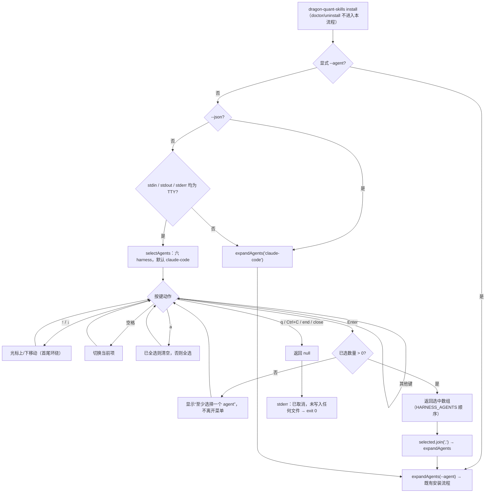
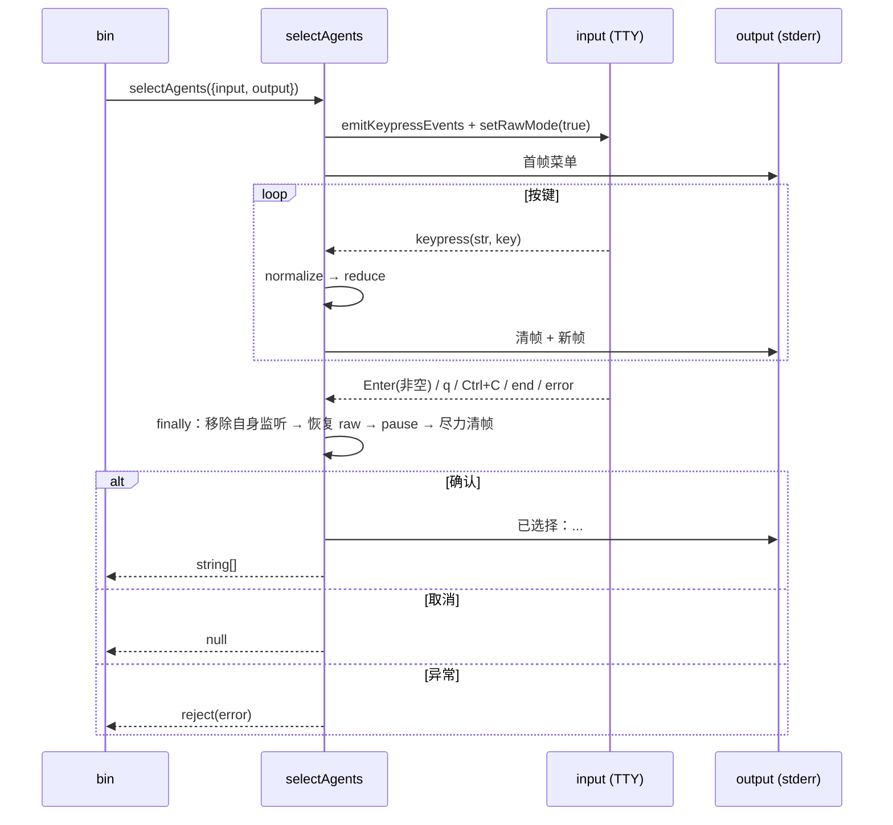

# 技术方案：裸 `install` 的 TTY 交互式 Agent 多选

- 日期：2026-10-30
- 阶段：阶段 2（技术方案；本阶段不写生产实现、不 commit）
- 上游方案：`docs/solutions/2026-10-30-multi-agent-skill-install-design.md`（多 Agent 安装目标，阶段 2）
- 任务来源：main 要求为现有 `dragon-quant-skills install` 增加裸 `install` 的终端多选
- 核心方向：main 已定（见 §10），本方案只在框架内完善接口、键盘契约、清理语义、测试与文档，不改变方向

---

## 1. 背景与目标

`install` 目前无 `--agent` 时固定安装 `claude-code`，用户想装其他 harness 必须记住六个名称并用逗号拼写。本方案在**真正的交互终端**里把裸 `install` 变成一次六 harness 多选（默认选中 `claude-code`），同时保证所有非交互场景（CI、管道、`--json`、显式 `--agent`、`doctor`、`uninstall`）行为与输出完全不变。

### 1.1 用户故事

| ID | 用户故事 |
|---|---|
| US1 | 我在终端运行 `npx dragon-quant-skills install`，看到六个真实 harness 的多选菜单，`claude-code` 默认勾选；直接 Enter 与旧默认行为一致。 |
| US2 | 我用 ↑/↓ 移动、空格勾选多个 harness、Enter 确认，安装器一次写入我选中的所有目标目录。 |
| US3 | 我按 `q` 或 Ctrl+C 取消，进程 exit 0，且不写任何文件（包括不创建 skills 根目录）。 |
| US4 | 我在 CI、脚本、管道（如 `jq`）、`--json`、`--agent ...` 或 `doctor`/`uninstall` 场景下，不发生任何交互，stdout 结构与退出码与旧版一致（版本号字符串除外）。 |
| US5 | 我把 stdout 或 stderr 重定向到文件时不会被菜单污染或卡住：任一标准流非 TTY 就跳过交互；菜单和提示只走 stderr，stdout 永不含菜单。 |

### 1.2 可测试验收标准

| ID | 验收标准 | 验证方式 |
|---|---|---|
| AC1 | 仅当 `command === "install"`、未显式给 `--agent`、非 `--json`、`stdin.isTTY === true` **且** `stdout.isTTY === true` **且** `stderr.isTTY === true` 时进入交互；其余组合一律跳过并沿用默认 `claude-code`（含仅 stderr 被重定向的 `2>log` 场景）。显式 `--agent ""` 视为“已指定”，跳过交互后由 `expandAgents` 报 usage 错误；`--dry-run` 仍属于 `install`，三流均为 TTY 时正常弹菜单 | `test/agent-select.test.mjs` `shouldPromptInstall` 矩阵（含 `agentArg === ""`、`command !== "install"`、stdin/stdout/stderr 任意单边非 TTY）；`test/cli.test.mjs` 非 TTY 子进程用例 |
| AC2 | 菜单只列 `HARNESS_AGENTS` 六项（不含 `agents`），默认仅选中 `claude-code`；直接 Enter 只安装 `claude-code` | `test/agent-select.test.mjs` 假流 Enter 用例 + 真实安装断言 |
| AC3 | ↓ 移动 + 空格可多选；返回数组恒按 `HARNESS_AGENTS` 顺序，重复按空格可反选 | `test/agent-select.test.mjs` 纯 reducer + 假流；`test/cli.test.mjs` 集成用例写两个真实目录 |
| AC4 | `a` 在全选与清空之间切换；清空后 Enter 不离场 | `test/agent-select.test.mjs` |
| AC5 | 空选择 Enter 不 resolve，输出“至少选择一个 agent”提示，后续按键仍可继续 | `test/agent-select.test.mjs`（断言 promise 未 settle + Enter 后才 resolve） |
| AC6 | `q` / Ctrl+C / 输入流 `end`/`close` 均返回 `null`；CLI exit 0、不写文件、stderr 输出取消说明 | `test/agent-select.test.mjs`；`test/cli.test.mjs` 集成用例断言无目录 |
| AC7 | confirm / cancel / 抛错三条路径都在 `finally` 恢复 raw mode（`setRawMode(previousRaw)`）、移除自身监听并 `pause()`；异常不会把终端留在 raw mode | `test/agent-select.test.mjs` 记录 `rawCalls` 与监听器数量 |
| AC8 | 菜单与提示只写注入的 `output`（CLI 传 `process.stderr`）；stdout 仅保留既有安装摘要，`--json` 时 stdout 仍是纯 JSON | 假流断言 output/stderr 含菜单、stdout 不含；现有 JSON 键测试保持通过 |
| AC9 | 通过 `main(argv, io)` 注入假 TTY 流真实跑通“选择 → 安装两个目录 → exit 0” | `test/agent-select.test.mjs` 集成用例（临时 target + 隔离 home） |
| AC10 | `package.json` 与 `skill-version` 升至 `1.2.0`，`min-cli-version` 保持 `0.7.4`；零新增依赖（仅 `node:readline`）；README / development / CHANGELOG 同 commit 更新 | grep 断言 + 人工 diff；`npm test`、`test/packaging.test.mjs` 通过 |

### 1.3 非目标

- 不在菜单里显示 `agents` 兼容别名，不做别名折叠/说明。
- 不做 scope（project/global）选择、`--target-dir` 编辑、dry-run 开关等第二层交互；这些仍由参数决定。
- 不做模糊搜索、分页、鼠标、颜色主题、alt-screen、记住上次选择。
- 不给 `doctor` / `uninstall` 增加交互；不改变 `--agent` / `all` 的既有语义。
- 不改变 manifest schema、安装状态机、冲突/`--force`、JSON 顶层键与 `agents[]` 结构。
- 不引入任何 npm 运行时依赖或外部可执行程序（fzf/peco 等）。
- 不新增 Windows 专项 PTY 验证；ANSI/raw mode 的 Windows 差异登记为残余风险。
- 不做 i18n；界面文案固定中文，与现有 CLI 一致。

---

## 2. 候选设计与取舍

### 2.1 方案 A（推荐）：零依赖 readline keypress 状态机 + 可注入流

用内置 `node:readline` 的 `emitKeypressEvents` 把 raw 字节适配成 `keypress(str, key)`，在新增 `lib/agent-select.mjs` 里维护一个小状态（cursor + selected Set + message），逐键重绘菜单；`input` / `output` 作为参数注入。

**优点**：零新依赖；↑/↓/空格/a/Enter/q 与 main 的键盘契约一一对应；纯 reducer + 流适配两层都可用 `node:test` 覆盖；渲染只走注入 output，天然满足 stdout 隔离。
**缺点**：需要自己处理 raw mode 与 ANSI 光标回退；`emitKeypressEvents` 的流内监听器生命周期依赖 Node 行为，必须在 `finally` 显式收尾并写测试锁定。

### 2.2 方案 B（常规替代）：逐项 Y/n 问卷

用 `readline/promises` 的 `rl.question`，对六个 harness 依次问“是否安装？(y/N)”，默认只对 claude-code 答 y。

**优点**：不需要 raw mode，异常路径更少，跨平台最稳。
**缺点**：六次往返、无法一眼看到全部选项与当前选择，与 main 已定的“↑/↓ + 空格 + Enter”键盘契约不兼容；用户想全选也要按六次。**不采用**。

### 2.3 方案 C（非常规）：引入现成 TUI / 调外部选择器

使用 `@inquirer/prompts` / `prompts` 之类的 checkbox 组件，或在有 `fzf` 时把六项交给 `fzf --multi` 子进程。

**优点**：交互体验最好，代码最少。
**缺点**：破坏安装器零依赖与 `npm pack` 白名单约束；引入供应链与 CI 环境不确定性；无 `fzf` 时仍要回落实现，等于两套路径。**不采用**。

### 2.4 方案 D（反直觉）：不弹 UI，扫描已有客户端目录自动预选

检测项目/用户目录下已存在的 `.claude` / `.agents` / `.hermes` / `.dsh` / `.pi` / `skills` 目录，自动决定安装集合，完全不交互。

**优点**：零交互、CI 友好。
**缺点**：把“目录存在”错误等同于“用户想装”；容易被无关目录、`foreign` 安装和仓库内 OpenClaw 的 `skills/` 误导；用户无法显式全选或排除；与 main 的交互需求直接冲突。**不采用**，仅作为“默认选择可由状态推导”的反例记录。

### 2.5 对比与结论

| 维度 | A readline 状态机 | B Y/n 问卷 | C 外部 TUI | D 自动探测 |
|---|---|---|---|---|
| 符合键盘契约 | 完整 | 不兼容 | 完整 | 无交互 |
| 新增依赖 | 0 | 0 | ≥1 | 0 |
| 跨平台风险 | 中（raw/ANSI） | 低 | 中 | 低 |
| 可测试性 | 高（纯 reducer + 假流） | 中 | 低（需 PTY/fake bin） | 高 |
| 结论 | **推荐** | 不采用 | 不采用 | 不采用 |

测试实现也对比过一种非常规做法：用 `script(1)` / `node-pty` 起真实 PTY。跨平台差、CI 不稳定且引入依赖，**不采用**；改用可注入流 + 纯 reducer 覆盖同等契约。

---

## 3. 推荐架构

### 3.1 设计模式与动机

- **Strategy（交互策略选择）**：`shouldPromptInstall` 是策略选择点——交互式 `selectAgents` 与无交互默认 `"claude-code"` 是两条可替换路径，最终都汇入同一个 `expandAgents` 校验与安装循环。动机：新增交互不改变既有安装主流程，也不在 `install` 里长出第二套分支树。
- **Adapter（流适配）**：`readline.emitKeypressEvents` 把 TTY 原始字节适配成 `keypress` 事件；注入的 `input`/`output` 把真实 `process.stdin`/`process.stderr` 与测试 fake 流适配成同一接口。动机：交互逻辑与终端实现解耦，测试不需要 PTY。
- **纯函数 reducer**：`normalizeSelectionKey` + `reduceSelection` 把“按键 → 状态/结果”变成无 IO 的纯函数，`selectAgents` 只做外壳。动机：键盘契约可以逐条断言，渲染与清理逻辑变小。
- **刻意不用**：不引入状态机库、UI 框架、事件总线、DI 容器；六项固定列表不需要滚动模型。

### 3.2 模块边界与函数签名（新增 `lib/agent-select.mjs`）

```js
import readline from "node:readline";
import { HARNESS_AGENTS } from "./paths.mjs";

// 1) 条件判断：只做纯判定，不触流
export function shouldPromptInstall({
  command, agentArg, jsonMode, stdin, stdout, stderr,
}) -> boolean
// true 当且仅当 command === "install" && agentArg === undefined &&
// !jsonMode && stdin?.isTTY === true && stdout?.isTTY === true && stderr?.isTTY === true
// 三流缺一即跳过：菜单写 stderr，stderr 非 TTY 时交互不可见，必须回落默认 claude-code

// 2) 纯状态：初始 cursor=0，selected 为 defaultSelected ∩ agents，message=null
//    agents 必须为非空且无重复数组，否则抛编程错误（bin 恒传 HARNESS_AGENTS）
export function createSelectionState(agents, defaultSelected = ["claude-code"])
  -> { cursor: number, selected: Set<string>, message: string | null }

// 3) 键盘归一化：readline 的 (str, key) → 动作或 null（忽略）
export function normalizeSelectionKey(str, key)
  -> "up" | "down" | "toggle" | "toggle-all" | "confirm" | "cancel" | null

// 4) 纯 reducer：不修改入参；返回新 state 或带 result
export function reduceSelection(state, agents, action)
  -> { state, result?: string[] | null }
//   confirm 且非空 → { state, result: [按 agents 顺序] }
//   confirm 且为空 → { state: {...message:"至少选择一个 agent。"} }（无 result）
//   cancel        → { state, result: null }
//   其他动作      → { state: { ...state, message: null }, result: undefined }（任何后续按键清除提示）

// 5) IO 外壳
export async function selectAgents({
  agents = HARNESS_AGENTS,
  defaultSelected = ["claude-code"],
  input = process.stdin,
  output = process.stderr,
} = {}) -> Promise<string[] | null>
```

返回/取消语义：

- **成功**：`string[]`，恒为 `agents` 顺序、无重复、长度 ≥ 1；调用方用 `selected.join(",")` 喂给既有 `expandAgents`。
- **取消**：`null`，不抛错；调用方 exit 0 且不进入任何写盘流程。
- **异常**：reject；调用方转成带 `--agent` 提示的 IO 错误（exit 1）。
- `selectAgents` 本身不判断 TTY；TTY 判定唯一入口是 `shouldPromptInstall`，避免两处条件漂移。

`bin/dragon-quant-skills.mjs` 的集成缝：

```js
export async function main(argv = process.argv.slice(2), io = {}) {
  const stdin  = io.stdin  ?? process.stdin;
  const stdout = io.stdout ?? process.stdout;
  const stderr = io.stderr ?? process.stderr;
  const home   = io.home   ?? os.homedir();
  const env    = io.env    ?? process.env;
  // 既有 printUsage / printJson / fail 改为接收 { stdout, stderr } 流上下文
}
```

- 默认参数保持现有 CLI 行为；`isDirectInvocation()` 直接调用仍用真实流。
- `io.home` / `io.env` 只为测试隔离（避免读真实 HOME），不改变解析语义。
- `cwd` 仍取 `process.cwd()`；集成测试用 `--target-dir`，不依赖 chdir。
- `printUsage` / `printJson` / `fail` 改为接收一个 `{ stdout, stderr }` 流上下文，而不是继续追加位置参数（`fail` 已有 6 个参数，再加流参数容易在调用点错序）。
- `detectCliSafe(pythonArg, env)` 透传 `io.env`；`detectCli` 只用它查 `DQ_PYTHON`，不改变 PATH 探测顺序。
- 门禁调用点：`shouldPromptInstall({ command, agentArg: values.agent, jsonMode, stdin, stdout, stderr })`，仅返回 `true` 时才进入 `selectAgents`；返回 `false` 直接走 `expandAgents(values.agent ?? "claude-code")`。

### 3.3 条件流程



> 交互发生在 `expandAgents` 之前、roots 解析与自托管守卫之前；因此取消路径天然零写入，仓库根选到 `openclaw` 时仍由既有自托管预检在写盘前 exit 2。

### 3.4 键盘契约

`normalizeSelectionKey(str, key)` 按以下顺序判定（前面的优先）：

| 输入 | readline `key` 形态 | 动作 | 行为 |
|---|---|---|---|
| Ctrl+C | `key.ctrl === true && key.name === "c"` | `cancel` | 关闭菜单、返回 `null` |
| ↑ | `key.name === "up"` | `up` | cursor 上移；首项再上移到末项（环绕） |
| ↓ | `key.name === "down"` | `down` | cursor 下移；末项再下移到首项（环绕） |
| 空格 | `key.name === "space"` | `toggle` | 切换 cursor 所在项 |
| `a` / `A` | `key.name === "a"` 且无 ctrl/meta | `toggle-all` | `selected.size === agents.length` 时清空，否则全选 |
| Enter | `key.name === "return"` 或 `"enter"` | `confirm` | 空选择则停留并提示；否则返回数组 |
| `q` / `Q` | `key.name === "q"` 且无 ctrl/meta | `cancel` | 返回 `null` |
| 其他（含 Ctrl+A、Esc、Tab、粘贴文本） | — | `null` | 忽略，不重绘 |

流事件契约：`input` 的 `error` → reject；`end` / `close` 未决策 → 视为取消返回 `null`。不做 Ctrl+D 显式绑定（raw 模式下它不是 EOF），也不做 SIGINT 处理（raw mode 下 Ctrl+C 到达为按键；若 raw 设置失败则退回系统 SIGINT，进程直接退出、不写文件）。

### 3.5 渲染契约

- 全部写入 `output`（CLI 中为 `process.stderr`），stdout 不被触碰。
- 门禁要求 `stdin` / `stdout` / `stderr` 三者均为 TTY；任一流程被重定向（如 `2>log`）都不进入菜单，直接按默认 `claude-code` 安装，避免“菜单不可见却在等待按键”。
- 首帧：

```text
选择要安装的 Agent（↑/↓ 移动，空格切换，a 全选/清空，Enter 确认，q 取消）：
  [x] claude-code
> [ ] codex
  [ ] openclaw
  [ ] hermes
  [ ] deepseek
  [ ] pi
```

- `>` 标记 cursor 行，`[x]` / `[ ]` 表示选中；列表恒为 `HARNESS_AGENTS` 顺序。
- 重绘：若上一帧渲染了 `n` 行，先写 `\x1b[${n}A\x1b[0J` 再写新帧；行数 = 表头 + agent 行数 + 可选提示行。
- 空选择 Enter 时提示行固定为 `至少选择一个 agent。`，任何后续按键清除提示。
- 确认时先清帧，再写 `已选择：claude-code, codex`（单行、stderr）。
- 取消时只清帧；`已取消，未写入任何文件。` 由 bin 打印，避免两处重复。
- 不做颜色，不使用 alternate screen；输出不换行错位，结束后终端光标停在正常行首。

### 3.6 清理与错误契约



实现约束：

1. **raw mode**：设置前记录 `previousRaw = input.isRaw === true`；仅当 `typeof input.setRawMode === "function"` 时设置 `true`。`finally` 中若确实设置过，恢复 `setRawMode(previousRaw)`；恢复失败（流已销毁）吞掉异常，不改变结果。
2. **监听器**：只移除本模块添加的 `keypress` / `error` / `end` / `close` 监听；`readline.emitKeypressEvents` 自身的流内监听器不动（其状态按流缓存，调用方不应在同一流上二次交互；CLI 进程只交互一次）。测试用新流实例，避免跨用例污染。
3. **流状态**：开始时 `input.resume?.()` 确保流式；`finally` 中 `input.pause?.()`，让进程可正常退出。
4. **重入保护**：内部 `settle()` 只生效一次；先完成清理收尾，再 resolve/reject，重复按键不产生第二个结果。
5. **渲染/写流异常**：`output.write` 或 reducer 抛错时 reject；`finally` 仍执行 raw 恢复与监听移除；清帧写失败被吞掉，避免掩盖原始错误。
6. **取消优先**：`q` / Ctrl+C / `end` / `close` 一律返回 `null` 而非抛错，保证“取消 = exit 0”。

bin 的错误映射：

| 情况 | bin 行为 | 退出码 |
|---|---|---|
| 确认选择 | `agentSpec = selected.join(",")`，继续 `expandAgents` → roots → 安装 | 0（后续照旧） |
| `null` | stderr 写 `已取消，未写入任何文件。`，直接 return | 0 |
| reject | `fail(command, "io", "交互选择失败：<msg>", "可改用 --agent NAME[,NAME...]，或加 --json 跳过交互", false, 1)` | 1 |
| 选择到 `openclaw` 且在包根 | 既有自托管预检 exit 2（交互已在写盘前结束） | 2 |

---

## 4. 文件级改动

| 文件 | 改动 |
|---|---|
| `lib/agent-select.mjs`（新增） | `shouldPromptInstall` / `createSelectionState` / `normalizeSelectionKey` / `reduceSelection` / `selectAgents`；只依赖 `node:readline` 与 `./paths.mjs` 的 `HARNESS_AGENTS` |
| `bin/dragon-quant-skills.mjs` | `main(argv, io)` 增加可注入 `stdin`/`stdout`/`stderr`/`home`/`env`；`printUsage`/`printJson`/`fail` 接收目标流；在互斥校验后、`expandAgents` 前插入 TTY 条件与 `selectAgents` 调用；取消返回 0；交互异常转 `io` 错误；USAGE 增加一句“裸 install 在终端中交互选择” |
| `test/agent-select.test.mjs`（新增） | `shouldPromptInstall` 矩阵、reducer 键盘契约、假流 Enter/多选/a/空选择/q/Ctrl+C、raw 恢复与监听清理、渲染只写 output、`main(io)` 集成（选择两个 agent → 真实两目录 → exit 0；q → 零写入） |
| `test/cli.test.mjs` | 新增非 TTY 断言：裸 `install` 在 `spawnSync` 下不出现菜单、仍装 `claude-code`；`--agent` / `--json` / `doctor` / `uninstall` 不出现菜单；现有用例不改语义 |
| `test/packaging.test.mjs` | 增加一条断言：tarball 包含 `lib/agent-select.mjs`（防新增模块漏打包）；其余不变 |
| `package.json` | `version` → `1.2.0` |
| `skills/dragon-quant/SKILL.md` | `metadata.skill-version` → `1.2.0`；`min-cli-version` 保持 `0.7.4`；正文不变 |
| `README.md` | Agent Skill 段补充裸 `install` 的交互说明、键盘、非交互跳过条件与 `--agent`/`--json` 绕过方式 |
| `docs/agent/development.md` | 安装段更新交互策略、可注入流边界、清理契约、测试清单与版本 |
| `CHANGELOG.md` | `[Unreleased]` 增加交互式多选与 `1.2.0` |
| `docs/solutions/2026-10-30-interactive-agent-select-design.md` | 本方案 |

不改：`lib/install.mjs`、`lib/uninstall.mjs`、`lib/manifest.mjs`、`lib/skill-package.mjs`、`lib/python.mjs`、`lib/paths.mjs`、`skills/dragon-quant/references/*`、Python 业务代码、根 `AGENTS.md`（无新增跨模块硬约束）。

---

## 5. TDD 与验收映射

### 5.1 TDD 顺序

1. **RED**：`test/agent-select.test.mjs` 写 `shouldPromptInstall` 矩阵与 `reduceSelection` 键盘契约（纯函数，无 IO）。
2. **GREEN**：实现 `shouldPromptInstall` / `createSelectionState` / `normalizeSelectionKey` / `reduceSelection`。
3. **RED**：假流用例（默认 Enter、↓+空格、a 全选/清空、空选择拒绝、q/Ctrl+C、raw 恢复、监听清理、output 隔离）。
4. **GREEN**：实现 `selectAgents` 外壳与 finally 清理。
5. **RED**：`main(io)` 集成用例（两目录真实安装、取消零写入）。
6. **GREEN**：bin 接入 `shouldPromptInstall` + `selectAgents` + io 注入。
7. **RED/GREEN**：`test/cli.test.mjs` 非 TTY 跳过断言；`test/packaging.test.mjs` 新模块入包断言。
8. **REFACTOR**：版本号、README、development、CHANGELOG；跑全量 `npm test` 与 Python skill 测试。

**集成测试的模块加载契约**：bin 的 `PACKAGE_ROOT` 在模块求值时读取 `DQ_SKILLS_PACKAGE_ROOT`。`test/agent-select.test.mjs` **不要静态 import bin**，二选一：

- (a) 使用仓库真实包根（不设置该 env），只断言安装产物存在，不比较包版本；
- (b) 先设置 `process.env.DQ_SKILLS_PACKAGE_ROOT = FIXTURE_PACKAGE`，再用 `await import(pathToFileURL(BIN))`，且该测试文件只做一次动态 import（模块缓存后 env 不再生效）。

集成用例必须传 `--target-dir`、隔离 `io.home` / `io.env`、`--python /nonexistent/python`，避免读真实 HOME 或探测真实 CLI。


### 5.2 验收 → 实现 / 测试映射

| AC | 实现 | 测试 |
|---|---|---|
| AC1 | `shouldPromptInstall` + bin 条件分支 | `agent-select.test.mjs` 矩阵（含 agentArg 为 `""` 视为显式、stdin/stdout/stderr 任一非 TTY）；`cli.test.mjs` 非 TTY |
| AC2 | `createSelectionState` 默认 `["claude-code"]`；列表 = `HARNESS_AGENTS` | 假流 Enter；断言 `.claude` 存在、`.agents` 不存在 |
| AC3 | `reduceSelection` down/toggle；返回按 agents 顺序 | 纯 reducer 断言 + 假流；集成写 `.claude` 与 `.agents` 两目录 |
| AC4 | `toggle-all` 分支 | 纯 reducer + 假流 |
| AC5 | `confirm` 空选择只设置 message | 假流：第一次 Enter 后 promise 仍 pending，再按键后 Enter resolve |
| AC6 | `cancel` 动作与 `end`/`close` 事件 | 假流 `q` / Ctrl+C / `input.end()`；集成 `q` 后目录不存在 |
| AC7 | `finally` 恢复 raw + 移除监听 + pause | `rawCalls` 断言；`input.listenerCount("keypress") === 0`；`isPaused() === true`；output 抛错路径 |
| AC8 | `output` 注入，bin 传 stderr | 假流收集 output；集成断言 stdout 无菜单；现有 JSON 键测试 |
| AC9 | `main(argv, io)` | 集成用例：临时 target + 隔离 home + `--python /nonexistent/python` |
| AC10 | 版本与文档 | grep `1.2.0` / `0.7.4` / 无 `dependencies`；`npm test` 与 packaging |

### 5.3 必须保留的现有测试

- manifest 六态、install/uninstall 冲突与 `--force`、symlink/路径穿越、Python CLI 探测、doctor 检查、`npm pack` 白名单。
- 默认 `claude-code`、`--global` 隔离 HOME、`--target-dir`、dry-run 零写入、多选去重、`all` 顺序、自托管守卫。

---

## 6. 风险与缓解

| 风险 | 影响 | 缓解 |
|---|---|---|
| 异常/崩溃后终端留在 raw mode | 用户终端按键无回显 | 所有退出路径统一 `finally` 恢复；confirm/cancel/抛错三类测试锁定 |
| `emitKeypressEvents` 流内监听器残留 | 进程不退或跨用例污染 | 自身监听显式移除 + `input.pause()`；同一流只交互一次；测试用新流实例 |
| CI/管道误触交互导致挂起 | 自动化卡住 | 门禁要求 stdin / stdout / stderr 三流均为 TTY；`spawnSync` 非 TTY 用例锁定；`--json` / `--agent` 永远跳过 |
| 自动化脚本继承 TTY（Makefile、`npm run`、任务运行器） | 裸 `install` 在开发者终端里等待输入而“挂住” | 本期按 main 已定条件不额外探测调用方，也不新增 `--no-input`；README/development 明确“自动化必须传 `--agent` 或 `--json`” |
| 任一标准流被重定向（`>out`、`2>log`、管道到 `jq`） | 交互不可见或机器输出被污染 | 三流 TTY 门禁使三者缺一即跳过并回落默认 `claude-code`；需要其他目标显式传 `--agent` |
| Windows 终端 raw mode / ANSI 差异 | 箭头键或重绘异常 | 沿用零依赖 readline；登记残余风险，不做本期专项验证 |
| 用户误按 `a` 后直接 Enter | 一次装六个 | 列表明确标出 `[x]`；`a` 再按一次清空；README 说明 |
| `openclaw` 在包根被选中 | 源目录风险 | 既有自托管预检在写盘前 exit 2；交互不改变该保护 |
| 版本号误导 Python 用户 | 误以为需 Python 1.2.0 | `min-cli-version` 保持 `0.7.4`；README/CHANGELOG 重申独立版本策略 |
| 非 TTY 环境读 `process.stdin` 报错 | 安装失败 | 门禁先判 `isTTY`，不触流；默认路径无 IO |

---

## 7. 兼容性与迁移

- 显式 `--agent`、`--json`、`doctor`、`uninstall`、所有非 TTY 调用完全不变（含退出码与 stdout 结构）。
- 裸 `install` 在 TTY 下从“静默装 claude-code”变为“默认选中 claude-code 的菜单”；直接 Enter 结果一致，属于交互增强而非语义破坏。
- 裸 `install --dry-run` / `install --global` 同样弹菜单：确认后分别沿用 dry-run 零写入与 global 路径语义；取消仍 exit 0 零写入。
- 三流 TTY 门禁：`stdin` / `stdout` / `stderr` 任一不是 TTY（如 `2>log`、管道到 `jq`、CI）就跳过交互，裸 `install` 按默认 `claude-code` 执行；需要其他目标请显式传 `--agent`。
- 由 Makefile、`npm run` 等**非人类但仍继承 TTY** 的脚本调用时，必须显式传 `--agent` 或 `--json`；本期不新增 `--no-input`，见 §6 风险表。
- 不迁移任何配置/manifest；不保存选择历史。
- `agents[]` JSON、warnings、backup_path、manifest 均不改。

---

## 8. 交付后文档同步（同 commit）

- `README.md`：交互示例、键盘、跳过条件（`--agent` / `--json` / stdin、stdout、stderr 任一非 TTY）、取消零写入。
- `docs/agent/development.md`：安装段增加交互策略与 `lib/agent-select.mjs` 边界、清理契约、测试清单、`1.2.0` 版本。
- `CHANGELOG.md`：`[Unreleased]` 增加“裸 install 交互式多选”条目与版本。
- 根 `AGENTS.md` 不改（无新增跨模块硬约束）。

---

## 9. main 决定落实表

| # | main 决定 | 本方案落点 |
|---|---|---|
| 1 | 仅裸 `install` + stdin/stdout/stderr 三流 TTY + 非 `--json` 才弹六 harness 菜单，默认 claude-code，别名不显示 | §3.2 `shouldPromptInstall`、§3.3、§3.5 |
| 2 | ↑/↓、空格、a、Enter、q/Ctrl+C；空选择不离场；取消 exit 0 零写入 | §3.4、§3.3、§3.6 |
| 3 | `--agent` / `--json` / 任一非 TTY 跳过并沿用默认；doctor/uninstall 不弹；CI 向后兼容 | §1.2 AC1、§7 |
| 4 | 零依赖 Node readline；独立 `lib/agent-select.mjs`；流可注入；bin 只判 TTY + 调用；选完走 `expandAgents`；JSON 不变 | §3.2、§3.3、§4 |
| 5 | 提示走 stderr；raw mode/listener 必须恢复，错误不留 raw | §3.5、§3.6 |
| 6 | 版本 1.2.0 / min-cli 0.7.4；README/development/CHANGELOG 同步 | §4、§8 |
| 7 | 测试覆盖默认 Enter、多选、a、空选择、q/Ctrl+C、raw 恢复、跳过条件、真实两目录安装；npm test 与 tarball 不受影响 | §5、§4 |
| 8 | Strategy（TTY vs 非 TTY）/ Adapter（readline 流适配），不引 UI 框架 | §3.1 |

---

## 10. 残余风险

- 六个客户端仍无真实加载 E2E；本期只保证安装与选择交互，不改变既有残余风险。
- 真实 TTY 的 raw mode / 箭头键行为未在 Windows 与非常规终端（tmux、IDE 内嵌终端）逐项实测；测试以假流锁定契约。
- 任一标准流被重定向时不会进入交互，裸 `install` 回落默认 `claude-code`；需要多选必须显式 `--agent`。
- SIGTERM / SIGKILL / 终端进程崩溃不会执行 `finally`，可能残留 raw mode；SIGKILL 无法捕获，属终端 CLI 通用限制。raw 模式下 Ctrl+C 已作为按键处理，不走信号路径。
- 同一 `process.stdin` 上二次调用 `selectAgents` 不受支持（Node keypress 解码器按流缓存）；CLI 每次进程只交互一次。
- Node 22.20～24.x 之间 `emitKeypressEvents` 内部监听器实现有差异；本方案只依赖公开的 `keypress` 事件与 `setRawMode`，清理只针对自身监听器。
