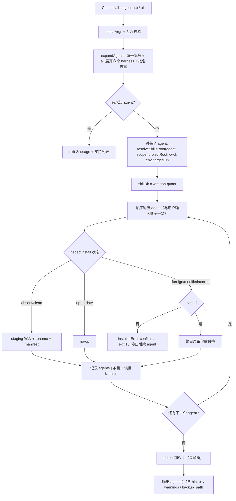

# 技术方案：dragon-quant-skills 多 Agent 安装目标

- 日期：2026-10-30
- 阶段：阶段 2（技术方案；本阶段不写生产实现、不 commit）
- 上游调研：`docs/research/2026-10-30-multi-agent-skill-install-research.md`（阶段 1 APPROVE）
- 任务来源：用户要求 install 同时支持 openclaw / hermes / deepseek-harness / pi / claude-code / codex，并允许 `--agent claude-code,hermes` 多选
- 核心方向：main 已定（见 §12），本方案只在框架内完善接口、路径、提示、错误与测试，不改变方向

---

## 1. 背景与目标

现有安装器只注册了 `claude-code` 与通用目录别名 `agents`：`AGENT_TARGETS` 两条记录、`resolveSkillsRoot` 按 `.claude/skills` / `.agents/skills` 拼路径，install/doctor 的输出对所有 Agent 都写死 Claude 的优先级与 `/reload-skills` 提示。本方案把注册表扩展到六个真实 harness，并让路径解析与提示按目标区分。

### 1.1 用户故事

| ID | 用户故事 |
|---|---|
| US1 | 作为 Hermes / Codex / OpenClaw / DeepSeek / Pi 用户，我运行 `npx dragon-quant-skills install --agent hermes`（或对应名称），skill 落到该客户端的官方项目目录，并得到该客户端正确的 trust / reload 提示。 |
| US2 | 作为同时使用多个客户端的用户，我运行 `--agent claude-code,hermes`，一次写入两个目录，重复名称自动去重，doctor 与 uninstall 对同样的多选生效。 |
| US3 | 我运行 `--agent all`，得到六个真实 harness（claude-code,codex,openclaw,hermes,deepseek,pi）的安装，而不是把兼容别名 `agents` 当成第七个目标重复写 `.agents/skills`。 |
| US4 | 我用 `--global --agent openclaw/deepseek/pi` 时，安装根遵循官方环境变量覆盖（`OPENCLAW_STATE_DIR` / `DSH_HOME` / `PI_CODING_AGENT_DIR`），未设置时落到官方默认用户目录。 |
| US5 | 我在 Pi 项目中运行 `--agent pi`，skill 落到当前工作目录的 `.pi/skills`（不向上找 git root）；OpenClaw 以 workspace（默认当前工作目录）为基准；`--target-dir` 始终可覆盖二者。 |
| US6 | 我沿用旧的 `--agent agents` 时行为不变；默认 `--agent` 仍是 `claude-code`；manifest schema、状态机、冲突与 `--force` 语义不变。 |
| US7 | 我看到的提示不再被 Claude 规则污染：Codex 只说明同名可并存，Hermes 提示 trust，Pi 提示 `/reload`，DeepSeek 说明自动发现，其余使用已核实或通用重载提示。 |

### 1.2 可测试验收标准

| ID | 验收标准 | 验证方式 |
|---|---|---|
| AC1 | 六个 harness 的项目级路径精确等于调研矩阵：`<projectRoot>/.claude/skills`、`<projectRoot>/.agents/skills`、`<workspace>/skills`、`<projectRoot>/.hermes/skills`、`<projectRoot>/.dsh/skills`、`<cwd>/.pi/skills` | `test/paths.test.mjs` 精确字符串断言 |
| AC2 | 六个 harness 的用户级路径精确：`~/.claude/skills`、`~/.agents/skills`、`${OPENCLAW_STATE_DIR:-~/.openclaw}/skills`、`~/.hermes/skills`、`${DSH_HOME:-~/.dsh}/skills`、`${PI_CODING_AGENT_DIR:-~/.pi/agent}/skills` | `test/paths.test.mjs` 注入 `home` / `env` |
| AC3 | 三个 env 覆盖只在 global 生效；相对 env 路径按 cwd 解析；`~/` 前缀展开为 home；空字符串视为未设置 | `test/paths.test.mjs` + `test/cli.test.mjs`（global 写入与 doctor `--all-scopes` 均命中 env 路径） |
| AC4 | Pi 项目按 cwd、OpenClaw 项目按 workspace（默认 cwd），不套用 git projectRoot；`--target-dir` 对两者始终优先 | `test/paths.test.mjs` + `test/cli.test.mjs` |
| AC5 | `--agent claude-code,hermes` 真实写入两个目录；JSON `agents` 含两条且各有目标专属 `hints` | `test/cli.test.mjs` 文件存在断言 |
| AC6 | `all` 精确展开六个 harness 且不含 `agents`；显式多选按名去重；`agents` 单独仍兼容 | `test/paths.test.mjs`、`test/cli.test.mjs` |
| AC7 | doctor / uninstall 支持多选；doctor 的 `reload.hint` 按目标生成；codex 文案不含 Claude precedence，claude-code 仍含；install 的跨 scope 警告能识别 env 覆盖的 global 安装 | `test/doctor.test.mjs`、`test/cli.test.mjs` |
| AC8 | 多目标顺序执行、错误即停，已写目标保留；重跑幂等，不引入事务框架 | `test/cli.test.mjs` 部分失败用例 |
| AC9 | `npm pack` 内容仍只含白名单；本地 tarball 多选安装成功 | `test/packaging.test.mjs` |
| AC10 | 在 dragon-quant 仓库根（包自身 `skills/` 是源目录）运行 `--agent openclaw` 项目 install/uninstall 时被预检拒绝，不进入 foreign/`--force` 流程 | `test/cli.test.mjs` 自托管守卫用例 |
| AC11 | `package.json` 与 `SKILL.md` 版本升至 `1.1.0`，`min-cli-version` 保持 `0.7.4`，零新增依赖；README / development / CHANGELOG 同 commit 更新 | 反向/正向 grep 断言 + 人工 diff |

### 1.3 非目标

- 不做交互式多选 UI；只保留 `--agent NAME[,NAME...]`。
- 不调用 openclaw / hermes / pi / dsh / codex 的原生安装器，不新增可执行依赖。
- 不自动执行 `hermes skills trust`、不修改 Pi project trust、不写任何客户端配置。
- 不做多目标事务回滚；沿用“顺序执行、错误即停”。
- 不承诺六个客户端真实加载 E2E；只以测试锁定官方路径与文案。
- 不改 manifest schema、状态机、写操作确认、CLI 探测、skill 正文内容、Python 业务逻辑。
- 不为 DeepSeek developer preview 的未来变更做兼容层；当前官方路径由测试锁定。
- 不新增 Windows 专项验证；既有 Windows 残余风险不变。

---

## 2. 候选设计与取舍

### 2.1 方案 A（推荐）：数据驱动目标注册表 + 单一解析器

在 `lib/paths.mjs` 的 `AGENT_TARGETS` 中扩展字段：`projectBase`（`projectRoot` / `cwd` / `workspace`）、`projectRel`、`global`（`homeRel` 或 `env + defaultRel + rel`）、`hints`（按 scope 的提示数组）、`sameName`（跨 scope 同名说明）。`expandAgents` 与 `resolveSkillsRoot` 读取同一张表；install/doctor/uninstall 继续共用。

**优点**：零新依赖；新增目标只加一条数据；路径、提示、测试可遍历同一真源；install/doctor/uninstall 不会各自分叉。
**缺点**：注册表字段变多，需要文档与测试约束字段语义；数据表不是强类型，靠测试兜底。

### 2.2 方案 B：每个 Agent 一个 Adapter 模块（类/接口）

`lib/agents/claude.mjs`、`hermes.mjs`、`pi.mjs` 各自实现 `paths()` / `hints()`，由工厂汇总。

**优点**：目标差异大时扩展性好；类型/职责边界清晰。
**缺点**：六个目标都是“拼目录 + 一句提示”，为不存在的未来差异引入类继承/工厂，违反“优先简单”；文件数与测试面翻倍；main 已定共用 `AGENT_TARGETS` 注册表。**不采用**。

### 2.3 方案 C（非常规/反直觉）：统一写 `.agents/skills` 或全部软链

只安装到跨客户端通用的 `.agents/skills`，或安装一次后向各客户端目录建 symlink。

**优点**：一次写入、路径最少、看似“零配置”。
**缺点**：调研已证明 OpenClaw 的最高优先级是 `<workspace>/skills`、Hermes 用户主目录是 `~/.hermes/skills`、DeepSeek 读 `.dsh/skills`、Pi 原生项目读 `.pi/skills`；统一目录会落到低优先级或根本不被发现。symlink 会被现有安装器的 `lstat` 安全检查拒绝，且各客户端是否跟随 symlink 未验证。**不采用**，但保留“路径以官方目录为准”的内核。

### 2.4 对比与结论

| 维度 | A 注册表 | B 每目标 Adapter | C 通用目录/软链 |
|---|---|---|---|
| 官方路径覆盖 | 完整 | 完整 | 不完整 |
| 实现复杂度 | 低 | 高 | 最低但有安全/发现缺陷 |
| 与现有代码一致性 | 高（扩展现有表） | 低（新抽象） | 中 |
| 测试可遍历 | 是 | 需逐个模块 | 只能测通用目录 |
| 结论 | **推荐** | 不采用 | 不采用 |

---

## 3. 推荐架构

### 3.1 设计模式与动机

- **Registry（目标注册表）**：`AGENT_TARGETS` 是路径、env、提示、同名说明的唯一真源；install/doctor/uninstall 与测试都遍历它。动机：消除三处 if/else 与文档三份漂移。
- **Adapter（路径适配）**：`resolveSkillsRoot` 把六种客户端布局适配成统一的 `skillsRoot`；`projectBase` 与 `global` 是适配参数，不引入类层次。动机：隔离“客户端目录差异”这一唯一变化点。
- **Strategy（base 选择策略）**：`projectBase = projectRoot | cwd | workspace` 是数据化策略，解析器只做一次分支。动机：Pi/OpenClaw 的非常规基准不用散落在调用方。
- **Progressive Disclosure（按目标披露提示）**：提示只对本次选中的 Agent 输出，并区分 project/global；不在通用文案里堆六套客户端规则。README 给总表、`development.md` 给实现契约、本方案给设计推演，按需阅读。
- **刻意不用**：不引入事务/回滚框架、不引入插件系统、不新增依赖、不把提示做成可执行脚本。遵循“优先简单”。

### 3.2 目标注册表接口

`lib/paths.mjs` 导出：

```js
export const HARNESS_AGENTS = [
  "claude-code", "codex", "openclaw", "hermes", "deepseek", "pi",
];

export const AGENT_TARGETS = {
  "<name>": {
    projectBase: "projectRoot" | "cwd" | "workspace",
    projectRel: string,               // POSIX 风格相对路径，如 ".hermes/skills"
    global:
      | { homeRel: string }           // 直接挂在 home 下
      | { env: string, defaultRel: string, rel: string },
    hints: {
      project: string[],              // 可含 {projectRoot} 占位符
      global: string[],
    },
    sameName: string | null,          // 跨 scope 同名说明；null = 用通用文案
  },
};

export function expandAgents(value: string): string[];
export function resolveSkillsRoot({
  agent, scope, projectRoot, home, cwd, env, targetDir,
}): string;
export function getAgentHints(agent, { scope, projectRoot }): string[];
export function getSameNameNote(agent): string | null;
```

`getAgentHints` 负责把 `{projectRoot}` 占位符替换为实际项目根；未提供 `projectRoot` 时保留字面量 `<projectRoot>`，避免向用户输出 `undefined`。提示数组按 scope 返回副本，调用方不得修改注册表原数据。

`HARNESS_AGENTS` 是 `all` 的唯一有序真源；`agents` 不在其中，避免与 `codex` 同根重复。字段级注册表：

| agent | projectBase | projectRel | global |
|---|---|---|---|
| `claude-code` | projectRoot | `.claude/skills` | `{ homeRel: ".claude/skills" }` |
| `codex` | projectRoot | `.agents/skills` | `{ homeRel: ".agents/skills" }` |
| `agents` | projectRoot | `.agents/skills` | `{ homeRel: ".agents/skills" }` |
| `openclaw` | workspace | `skills` | `{ env: "OPENCLAW_STATE_DIR", defaultRel: ".openclaw", rel: "skills" }` |
| `hermes` | projectRoot | `.hermes/skills` | `{ homeRel: ".hermes/skills" }` |
| `deepseek` | projectRoot | `.dsh/skills` | `{ env: "DSH_HOME", defaultRel: ".dsh", rel: "skills" }` |
| `pi` | cwd | `.pi/skills` | `{ env: "PI_CODING_AGENT_DIR", defaultRel: ".pi/agent", rel: "skills" }` |

### 3.3 解析语义

```js
resolveSkillsRoot({ agent, scope, projectRoot, home, cwd, env, targetDir })
```

1. 校验 `agent` 存在、`scope ∈ {project, global}`；未知 → throw（CLI 转 exit 2）。
2. **global**：
   - `targetDir` 同时出现 → throw（现有约束）。
   - `global.env`：
     - `env?.[name]` 为非空字符串时：`~` / `~/` 展开为 `home`；相对路径按 `cwd`（缺省 `process.cwd()`）解析为绝对；再拼 `global.rel`。
     - 未设置或空串：`path.join(home, global.defaultRel, global.rel)`。
   - 无 `env`：`path.join(home, global.homeRel)`。
3. **project**：
   - `targetDir` 存在 → `path.join(path.resolve(targetDir), projectRel)`（始终优先，Pi/OpenClaw 也如此）。
   - 否则按 `projectBase` 选基准：`cwd` / `workspace` → `path.resolve(cwd ?? process.cwd())`；`projectRoot` → `path.resolve(projectRoot ?? cwd ?? process.cwd())`。
   - 再拼 `projectRel`。
4. env 覆盖**只用于 global**；project 忽略 env。

调用方（`bin/dragon-quant-skills.mjs`）始终传入 `cwd: process.cwd()`、`env: process.env`；`projectRoot` 仍为 `--target-dir > git root > cwd`。Pi/OpenClaw 在无 `--target-dir` 时因此使用真实 cwd，而不是 git root。

**必须覆盖的调用点**：除主解析循环外，install 的“另一 scope 已安装”警告与 doctor 的 `--all-scopes` 其它 scope 目标解析也必须传 `cwd` / `env`；否则 OpenClaw / DeepSeek / Pi 的 global 安装会被解析到错误默认目录，导致漏报或误报遮蔽。

`expandAgents`：

- 逗号分隔、trim、忽略空项。
- `all` 在**原位置**展开为 `HARNESS_AGENTS`（不含 `agents`），再按名去重；因此 `all,agents` = 六个 + `agents`，`all,claude-code` = 六个。
- 未知名称 → `unknown agent: <name>`；空列表 → `unknown agent: (empty)`。

### 3.3.1 自托管守卫（防止覆盖包内 skill 源目录）

OpenClaw 的项目目标是无前缀的 `<workspace>/skills`。当用户在 dragon-quant 仓库根运行安装器时，该路径恰好等于包内 `skills/` 源目录；现有 `foreign` 状态会拒绝普通安装，但 `install --force` / `uninstall --force` 会把源目录整体移走，存在数据丢失风险。因此在 bin 的 project 解析完成后，对 **install 与 uninstall** 两条写命令增加一条窄预检：

```js
if (agent === "openclaw" && scope === "project" && !targetDir &&
    path.resolve(roots.get(agent)) === path.join(PACKAGE_ROOT, "skills")) {
  // exit 2: 拒绝自托管覆盖
}
```

- 只命中“当前包根 = 当前工作区且使用 openclaw 项目安装”这一种情况；npx 消费场景（cwd 为用户项目、PACKAGE_ROOT 为 npx 缓存）不会触发。
- 预检必须在**所有选中 agent 的 roots 解析完成后、任何写操作之前**遍历执行，这样 `--agent all` 在仓库根会整体 exit 2，而不是先写完 claude/codex 再在 openclaw 处失败。
- 拒绝信息提示：到消费项目运行，或用 `--target-dir` 指向临时 workspace。
- 不改变 `AGENT_TARGETS` 路径，不改变 install 状态机；`--force` 也不能绕过。doctor 只读，不受影响。

### 3.4 多选安装流程



关键规则：

- 顺序 = `expandAgents` 输出顺序；`all` 顺序固定为六 harness 顺序。
- 单个 agent 失败立即停止，**已写的 agent 不回滚**；错误 JSON 仍是现有 `{ok:false, error}` 形态，不携带部分结果。
- 重跑幂等：已写目标进入 `up-to-date`，未写目标继续。

### 3.5 目标专属提示

提示数据放在注册表 `hints`，只对选中目标输出：

| agent | project scope | global scope |
|---|---|---|
| `claude-code` | 运行 `/reload-skills` 或重启会话 | 同左 |
| `codex` | 重启 Codex 会话以发现新 skill | 同左 |
| `agents` | 重启会话或按客户端方式重新加载 | 同左 |
| `openclaw` | 说明以 workspace 为基准、默认 cwd、可用 `--target-dir` 指定；重启会话刷新 | 重启 OpenClaw 会话 |
| `hermes` | `hermes skills trust <projectRoot>` | 重启 Hermes 会话 |
| `deepseek` | developer preview；自动发现 skills 根的直接子项，无需手动重载 | 同左 |
| `pi` | 需在客户端 trust 该目录；编辑后 `/reload`；默认当前工作目录、不向上查找 | 运行 `/reload` |

约束：

- 不发明未核实的命令；Hermes 只写 `hermes skills trust <projectRoot>`，Pi 只写 `/reload`，DeepSeek 不写命令。
- `hints` 不进入 manifest，不改变安装状态。
- 跨 scope 同名说明：`claude-code` 保留 `Enterprise > personal(global) > project`；`codex` 只写“不合并同名、可同时出现在选择器中”；其他 agent 用通用“可能按客户端优先级遮蔽，可用 `--all-scopes` 检查”。

### 3.6 doctor 行为

- `runDoctor` 继续接收 `targets`（含 `agent` / `scope` / `skillDir`）与 `projectRoot`。
- `scope.shadowing` 的 detail 按被遮蔽 agent 追加 `getSameNameNote(agent)`；codex 不再出现 Claude 文案。
- `reload.hint` 保持单一 check id 与 `pass` 状态，detail 由当前 targets 去重后的 `getAgentHints(agent, {scope, projectRoot})` 拼成；hermes project 使用实际 `projectRoot`。
- doctor JSON 顶层键与 install 条目结构不变。
- `--all-scopes` 对每个选中 agent 追加另一 scope 目标，沿用现有逻辑。

### 3.7 install JSON / 文本

- 顶层键不变：`ok` / `command` / `scope` / `agents` / `warnings` / `backup_path`。
- `agents[]` 条目**只增** `hints: string[]`（现有键与类型不变）；`warnings` 仍保留空数组以兼容。
- 文本模式：逐条打印 `- agent: state → path`；非 dry-run 时随后打印 `提示（agent）：...`；跨 scope 警告改用目标专属说明。
- dry-run：JSON `agents[].hints` 为空数组，文本只打印最终路径与“未写入”，不打印重载提示（避免把“将来执行”误读成“已生效”）。

---

## 4. 项目 / 用户路径表（完整）

| agent | project base | project 最终目录 | global base | global 最终目录 |
|---|---|---|---|---|
| `claude-code` | projectRoot | `<projectRoot>/.claude/skills` | home | `~/.claude/skills` |
| `codex` | projectRoot | `<projectRoot>/.agents/skills` | home | `~/.agents/skills` |
| `agents` | projectRoot | `<projectRoot>/.agents/skills` | home | `~/.agents/skills` |
| `openclaw` | workspace（默认 cwd，`--target-dir` 覆盖） | `<workspace>/skills` | `OPENCLAW_STATE_DIR` 或 `~/.openclaw` | `${OPENCLAW_STATE_DIR:-~/.openclaw}/skills` |
| `hermes` | projectRoot | `<projectRoot>/.hermes/skills` | home | `~/.hermes/skills` |
| `deepseek` | projectRoot | `<projectRoot>/.dsh/skills` | `DSH_HOME` 或 `~/.dsh` | `${DSH_HOME:-~/.dsh}/skills` |
| `pi` | cwd（`--target-dir` 覆盖） | `<cwd>/.pi/skills` | `PI_CODING_AGENT_DIR` 或 `~/.pi/agent` | `${PI_CODING_AGENT_DIR:-~/.pi/agent}/skills` |

最终 skill 目录均为 `<skillsRoot>/dragon-quant`。`--target-dir` 的语义是“基准目录”，不是最终 skill 目录。

---

## 5. 命令行契约

```bash
dragon-quant-skills install   [--project|--global] [--agent NAME[,NAME...]]
                              [--target-dir DIR] [--python PATH] [--dry-run] [--force] [--json]
dragon-quant-skills doctor    [--project|--global|--all-scopes] [--agent NAME[,NAME...]]
                              [--target-dir DIR] [--python PATH] [--json]
dragon-quant-skills uninstall [--project|--global] [--agent NAME[,NAME...]]
                              [--target-dir DIR] [--dry-run] [--force] [--json]
dragon-quant-skills version   [--json]
```

- 默认 `--agent claude-code`；默认 scope 仍为 project。
- 支持名称：`claude-code` / `codex` / `openclaw` / `hermes` / `deepseek` / `pi` / `agents` / `all`。
- `--global` 与 `--target-dir` 互斥；`--global` 与 `--project` 互斥。
- 未知 agent → exit 2，提示中列出全部支持名称。
- `--target-dir` 对人类文案解释为“项目根目录；Pi 与 OpenClaw 表示工作目录/workspace”。

---

## 6. 错误处理

| 场景 | 行为 | 退出码 |
|---|---|---|
| 未知 agent（含空列表） | usage 错误，列出支持名称，不写盘 | 2 |
| `--global` + `--target-dir` | usage 错误 | 2 |
| 仓库根自托管：openclaw 项目目标 = 包内 `skills/` | install / uninstall 写命令预检拒绝，提示 `--target-dir` 或到消费项目运行；`--force` 不可绕过；doctor 只读不受限 | 2 |
| env 覆盖为空串 | 视为未设置，回落官方默认目录 | 0 |
| env 覆盖为相对路径 | 按 cwd 解析为绝对路径 | 0 |
| env 覆盖指向不存在目录 | `mkdirSync recursive` 创建；权限失败按 IO 错误 | 0 / 1 |
| 多选第 N 个目标冲突/IO 失败 | 立即停止，exit 1；1..N-1 已写目标保留 | 1 |
| 多选重跑 | 已写目标 `up-to-date`，未写目标继续 | 0 |
| `codex,agents` 同时选中 | 同一目录处理两次，第二次通常 `up-to-date`；`--force` 会再次备份替换 | 0 / 1 |
| Heremes/Pi trust 未完成 | 安装仍成功；仅提示，不自动修改 | 0 |
| DeepSeek developer preview 变更 | 当前路径由测试锁定；变更需后续方案更新 | — |

多目标失败不引入事务或回滚：manifest/状态机保持不变；错误 JSON 只报告失败项，部分成功结果需通过重新运行或 doctor 观察。用户可用 `doctor --agent ...` 收敛。

---

## 7. 文件级改动

| 文件 | 改动 |
|---|---|
| `lib/paths.mjs` | 扩展 `AGENT_TARGETS`；新增 `HARNESS_AGENTS`、`getAgentHints`、`getSameNameNote`；`expandAgents` 原位展开 `all`；`resolveSkillsRoot` 增加 `cwd` / `env` 并实现 `projectBase` 与 env 解析 |
| `bin/dragon-quant-skills.mjs` | usage 与错误提示支持列表；调用解析器传 `cwd` / `env`（含 install 跨 scope 警告与 doctor `--all-scopes` 两处其它 scope 解析）；openclaw 自托管预检；install 输出/JSON 增加目标 `hints`；跨 scope 警告改为目标专属文案 |
| `lib/doctor.mjs` | `scope.shadowing` 使用 `getSameNameNote`；`reload.hint` 由选中 targets 的 `getAgentHints` 生成 |
| `test/paths.test.mjs` | 六目标 project/global、三 env、Pi/OpenClaw base、targetDir 优先、all 集合与别名 |
| `test/cli.test.mjs` | 多选真实两目录、global env、pi cwd、all 六目录、doctor/uninstall 多选、目标提示、部分失败、agents 兼容 |
| `test/doctor.test.mjs` | codex 无 Claude precedence、claude 保留、hermes trust、pi reload、deepseek 自动发现 |
| `test/packaging.test.mjs` | tarball 多选安装（claude-code,hermes）与幂等/冲突链路 |
| `package.json` | `version` → `1.1.0` |
| `skills/dragon-quant/SKILL.md` | `metadata.skill-version` → `1.1.0`；正文与 `min-cli-version: 0.7.4` 不变 |
| `README.md` | Agent Skill 段增加多 Agent 示例、目标路径表、env 与 trust/reload 说明 |
| `docs/agent/development.md` | 安装段更新为注册表/六目标/提示/测试/版本契约 |
| `CHANGELOG.md` | `[Unreleased]` 记录多 Agent 安装目标与版本 |
| `docs/solutions/2026-10-30-multi-agent-skill-install-design.md` | 本方案 |

不改：`lib/install.mjs`、`lib/uninstall.mjs`、`lib/manifest.mjs`、`lib/skill-package.mjs`、`lib/python.mjs`、`skills/dragon-quant/references/*`、`MANIFEST.in`、根 `AGENTS.md`、Python 业务代码。

---

## 8. TDD 与验收映射

### 8.1 TDD 顺序

1. **RED**：`paths.test.mjs` 写六目标 project/global、env、cwd、targetDir、all/别名用例。
2. **GREEN**：实现注册表与 `resolveSkillsRoot` / `expandAgents`。
3. **RED**：`doctor.test.mjs` 写目标提示与 codex 同名说明用例。
4. **GREEN**：实现 `getAgentHints` / `getSameNameNote` 并接入 doctor。
5. **RED**：`cli.test.mjs` 写多选、env global、pi cwd、all、部分失败、uninstall/doctor 多选用例。
6. **GREEN**：接入 bin 的 `cwd` / `env` / `hints`。
7. **RED/GREEN**：`packaging.test.mjs` 改为 tarball 多选并跑通。
8. **REFACTOR**：版本号、README、development、CHANGELOG；跑全量 `npm test` 与 Python skill 测试。

**测试隔离**：`test/cli.test.mjs` 的 `run()` helper 必须显式把 `OPENCLAW_STATE_DIR` / `DSH_HOME` / `PI_CODING_AGENT_DIR` 置空（除非用例覆盖），否则开发者本机已设置这些变量时，默认路径断言会失败。`test/paths.test.mjs` 通过显式 `env` 参数注入，不读 `process.env`。

### 8.2 验收 → 实现 / 测试映射

| AC | 实现 | 测试 |
|---|---|---|
| AC1 / AC2 | `AGENT_TARGETS` + `resolveSkillsRoot` | `paths.test.mjs` 六目标精确路径 |
| AC3 | `resolveSkillsRoot` global env 分支 + bin 其它 scope 解析传 env | `paths.test.mjs` 三 env + 空串/相对/`~/`；`cli.test.mjs` global env 安装、doctor `--all-scopes` 命中 env 路径、跨 scope 警告命中 env 路径 |
| AC4 | `projectBase` + `targetDir` 优先 | `paths.test.mjs` Pi/OpenClaw；`cli.test.mjs` cwd 安装 |
| AC5 | bin 多选循环 + `agents[].hints` | `cli.test.mjs` 两目录与 JSON hints |
| AC6 | `expandAgents` + `HARNESS_AGENTS` | `paths.test.mjs`/`cli.test.mjs` all、去重、agents |
| AC7 | doctor `getAgentHints` / `getSameNameNote` | `doctor.test.mjs` 四类文案；`cli.test.mjs` 多选 doctor/uninstall |
| AC8 | 现有顺序循环不变 | `cli.test.mjs` 部分失败保留已写目标、重跑幂等 |
| AC9 | 无打包改动 | `packaging.test.mjs` 白名单 + 多选 E2E |
| AC10 | bin 自托管预检（install/uninstall） | `cli.test.mjs`：`cwd = DQ_SKILLS_PACKAGE_ROOT` + `--agent openclaw`（含 `--force`）→ exit 2，源 `SKILL.md` 不变 |
| AC11 | 版本与文档 | grep 断言 `1.1.0` / `0.7.4` / 无 dependencies；人工 diff |

### 8.3 必须保留的现有测试

- manifest 六态、install/uninstall 冲突与 `--force`、symlink/路径穿越、Python CLI 探测、doctor 现有检查、npm pack 白名单。
- 默认 `claude-code`、`--global` 隔离 HOME、`--target-dir` 绝对路径、dry-run 零写入。

---

## 9. 风险与缓解

| 风险 | 影响 | 缓解 |
|---|---|---|
| `codex` 与 `agents` 同根 | 同时选中时同一目录处理两次；`--force` 备份两次 | `all` 不展开 `agents`；显式同选按用户意图执行，第二次通常 `up-to-date`；文档说明 |
| 多目标部分失败 | 前几个目标已写、后几个未写 | 明确“顺序执行、错误即停、不回滚”；重跑幂等；doctor 收敛；不引入事务框架 |
| OpenClaw 项目根 = `<cwd>/skills` | 在 dragon-quant 仓库内运行会把源目录 `skills/` 当目标 | §3.3.1 自托管预检直接 exit 2（`--force` 不可绕过）；普通 foreign 仍拒绝；文档提示在仓库内用 `--target-dir` 指向临时 workspace |
| Pi 不向上找 git root | 用户在子目录运行会装到子目录 | 文档与提示明确“默认当前工作目录”；`--target-dir` 指定项目根 |
| env 覆盖语义 | 用户期望 project 也生效 | 明确 env 只用于 global；project 用 cwd/projectRoot；测试锁定 |
| Hermes/Pi trust 未自动完成 | 安装成功但客户端不加载 | 只提示官方命令，不修改 trust/配置；不承诺真实加载 E2E |
| DeepSeek developer preview | 官方路径可能变化 | 路径由测试锁定；变更走新方案；文档标注 preview |
| 提示文案发明命令 | 用户执行不存在命令 | 只用调研核实文案；测试断言关键 token；未核实的客户端用通用重载提示 |
| 版本与 Python 包解耦 | 用户误以为 1.1.0 需要 Python 1.1.0 | 保留 `min-cli-version: 0.7.4`；README/CHANGELOG 明示独立版本策略 |
| 六客户端未真实加载验证 | 文档承诺过度 | 只承诺官方目录映射；残余风险如实登记 |

---

## 10. 兼容性与迁移

- 现有 `--agent claude-code` / `--agent agents` / 默认安装行为不变。
- 现有 manifest 的 `agent` 字段仍写选中名称（`agents` 与 `codex` 各自记录），不迁移旧 manifest。
- 已安装的 `agents` 目录可继续升级；新装 `codex` 会识别同一目录并正常 `up-to-date`/升级。
- `all` 行为变更（从两项变为六项）是本期唯一破坏性 CLI 语义变化；在 CHANGELOG 与 README 明示。
- 无 Python 包版本联动；npm 发布仍由维护者手动执行。

---

## 11. 交付后文档同步

同一 commit 更新：

- `README.md`：多 Agent 安装示例、六目标路径表、env 覆盖、trust/reload 差异、仓库内 OpenClaw 注意事项；并明示 `all` 会在项目根创建 OpenClaw 的 `skills/`（不希望时请显式列出目标）。
- `docs/agent/development.md`：注册表字段、解析优先级、提示来源、测试清单、版本策略。
- `CHANGELOG.md`：`[Unreleased]` 增加多 Agent 安装目标与 1.1.0。
- 根 `AGENTS.md` 不改（无新增跨模块硬约束；npm 安装器仍由 `development.md` 拥有）。

---

## 12. main 已定方向落实表

| # | main 决定 | 本方案落点 |
|---|---|---|
| 1 | 保留零依赖 Node 安装器与文件边界；沿用多选去重；共用注册表 | §3.2、§3.3、§7 |
| 2 | 新增五目标，保留 claude-code/agents；all 只展开六 harness | §3.2、§3.3、§10 |
| 3 | 路径严格按调研矩阵；env 覆盖只用于 global | §3.3、§4 |
| 4 | `resolveSkillsRoot` 注入 cwd/env；targetDir 优先；Pi/OpenClaw 基准 | §3.3、§4 |
| 5 | 提示目标感知；Hermes trust / Pi reload / DeepSeek watcher；不发明命令 | §3.5、§3.6 |
| 6 | 不改 manifest/状态机/写确认/CLI 探测；顺序执行错误即停 | §3.4、§6 |
| 7 | 版本 1.1.0，min-cli 0.7.4，Skill 内容不变 | §7、§8.2 |
| 8 | 六目标路径、env、cwd、all、多选、提示、打包测试；文档同步；零依赖 | §8、§11 |
| 9 | 不承诺六客户端真实加载；trust 不自动修改 | §1.3、§9 |

---

## 13. 残余风险

- 六个客户端均未做真实加载 E2E；路径与提示只由官方文档 + 单测锁定。
- Hermes / Pi 的 trust 流程未自动化，用户可能装完仍看不到 skill。
- DeepSeek Harness 处于 developer preview，后续破坏性变更可能使 `.dsh/skills` 失效。
- OpenClaw workspace 与 cwd 不一致时需用户显式 `--target-dir`；安装器无法自动发现 workspace。
- Windows 下 env 路径、`.cmd` shim 与目录 rename 仍未专项验证，沿用既有 Windows 残余风险。
- 多目标失败无回滚；用户需重跑或 doctor 收敛。
