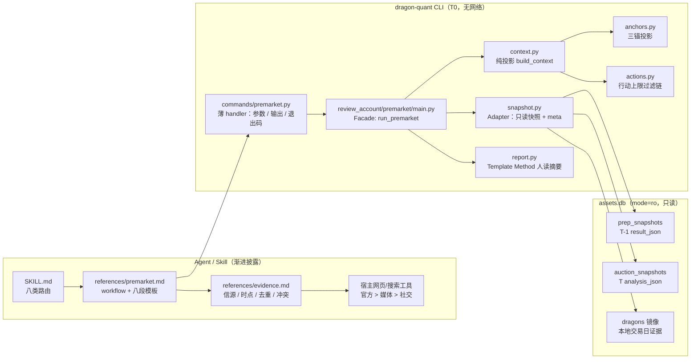
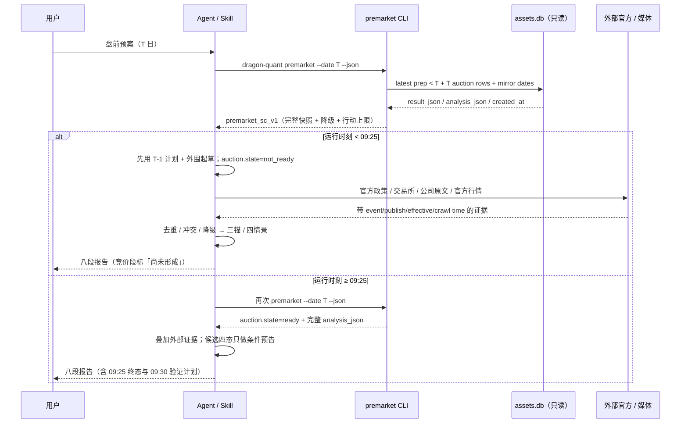
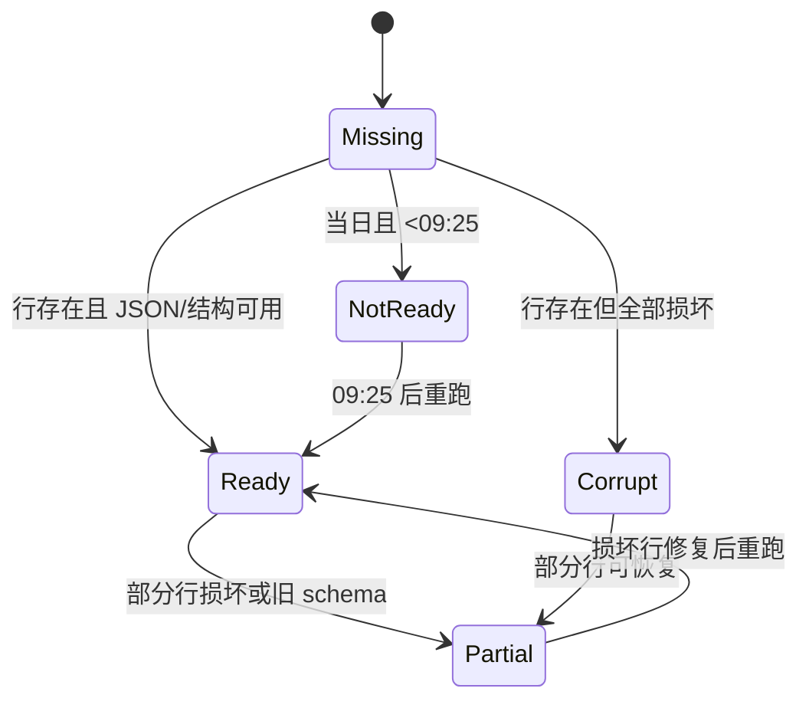
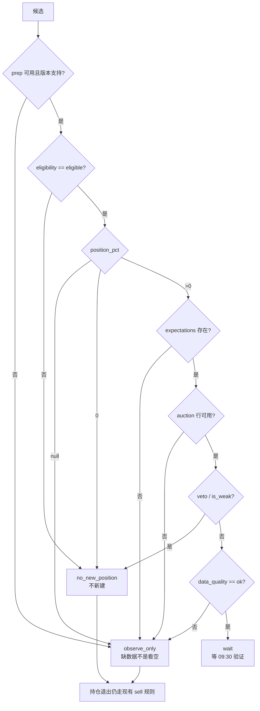

# 技术方案：盘前预案（只读 premarket 上下文 + 外部证据 + 八段固定模板）

- 日期：2026-10-30
- 阶段：阶段 2（技术方案；本阶段只新增本文档，不改生产代码 / Skill 正文 / 测试）
- 分支基线：`feat/skills-op`
- 上游输入：`docs/research/2026-10-30-premarket-plan-research.md`（PASS，9.0/10）、`docs/agent/prep-auction.md`、`docs/agent/development.md`、现有 `skills/dragon-quant` 与 CLI/storage 代码
- 下游动作：`solution-self-review` 自审 → main 单次验收 → 阶段 3 实现
- 状态：待自审

---

## 1. 背景与目标

### 1.1 已核实事实（本方案的事实来源）

| 事实 | 位置 | 对本方案的影响 |
|---|---|---|
| `prep` 默认会采集并**写** `prep_snapshots`；`--recompute` 不触网但仍写快照 | `review_account/prep/service.py::run_prep` | 盘前不能用 `prep --date` 取上下文，否则会产生新的过夜快照写入 |
| `prep` 快照 `version=0.8`，完整结果含 `review` / `review_candidates` / `strategy_context` / `feedback` / `plan_review` | `prep/service.py::_compute_all`、`prep/review/orchestrator.py` | 权威输入是完整 `result_json`，不是兼容投影 `candidates[]` |
| `auction` 的 `auction_snapshots.analysis_json` 是 v2 完整证据（含 `risk_events` / `data_quality` / `raw_factors` / `windows` / `actions`） | `infra/assets/db.py`、`auction/serialize.py` | 必须直接嵌入完整 `analysis_json`，不能只读 CLI 摘要 |
| `auction_snapshots` **不持久化** `from_cache` / 池来源；`strategy_context.pool` 只在 CLI 输出中存在 | `auction/collect.py`、`auction/context.py` | 盘前只能标 `cache.status="unknown"`，不能伪造缓存状态 |
| 既有只读 API 的 `create=False` 只保证「库不存在时不建库」，但 `_ensure_schema` 仍会执行 `CREATE TABLE IF NOT EXISTS` 并 `commit`；`_connect_readonly`（`mode=ro`）才是零 DDL / 零 sidecar 的纯读连接 | `infra/assets/db.py::_connect(create=False)` / `_connect_readonly` / `_ensure_schema` | 盘前必须走 `_connect_readonly` 的只读变体，否则在残缺旧库上可能建表，违反 T0 / 无新表 |
| 交易日历 `tdx_trade_dates` 需要 TDX 网络；仓库没有本地交易日历缓存 | `infra/market_calendar.py` | 离线无法证明「T-1 是紧邻前一交易日」，必须显式降级而不是猜 |
| `auction` 的 T-1 池规则是 `eligibility=="eligible" ∧ position_pct>0` | `market.py::prep_snapshot_for`、`docs/agent/prep-auction.md` | 盘前可据此**只读重建**预期池，不需要重算评分 |
| Skill 目前是七类白名单，`references/commands.md` 与 `safety.md` 是唯一路由/安全真源 | `skills/dragon-quant/**`、`test_skill_routes.py` | 新增第八类必须同步路由、安全矩阵、测试与版本 |
| 当前 Python `0.7.4`；npm / Skill `1.2.0`；`min-cli-version=0.7.4` | `pyproject.toml`、`_version.py`、`package.json`、`SKILL.md` | 本次 Python `0.8.0`、npm / Skill `1.3.0`、`min-cli-version=0.8.0` |

### 1.2 目标

给 Agent 一个**完整、冻结、可审计的盘前上下文**：T-1 盘后计划 + T 日 09:25 竞价证据 + 结构化缺口，配合 Agent 侧的外部证据流程和固定八段模板，形成「事实 / 工作假设 / 行动」分离的盘前预案。Python 不接外网、不重算、不写库、不新造评分。

### 1.3 不可变方向（main 已定，本方案不得擅改）

1. 新增只读顶层命令 `dragon-quant premarket [--date YYYYMMDD] [--json]`：T0、只读（`create=False` / `mode=ro`）、无网络、无重算、无新表。
2. JSON 带 `context_version=premarket_sc_v1`、`trade_date`、`run_at`，嵌入严格早于 T 的最近 `prep_snapshots.result_json` 与 T 日 `auction_snapshots.analysis_json` 完整快照及存储 meta。
3. 缺 prep / 缺 auction / 损坏 / 未到 09:25 / 缓存状态未知，全部是**结构化降级、exit 0**；参数错误 exit 2；运行错误 exit 1。
4. Agent 负责当日外围与新闻（官方/一手优先），Python 不接外网、不逆向登录；需要登录时提示用户，缺失就降级。
5. 新增 Skill references `premarket.md`（workflow + 八段固定模板）与 `evidence.md`（信源、时点、去重、冲突、降级）；白名单从七类升八类，T0。
6. 行动只取 `allowed_actions` 与 T-1 `eligibility` / `position_pct`、隔夜硬风险、auction veto、`data_quality`、账户闸门的交集；不新造评分、买卖枚举或收益承诺。
7. 三锚是**投影方法**，不是新指标；不盘中换锚，不用候选池冒充全市场。
8. 版本：Python `0.8.0`；npm / Skill `1.3.0`；`min-cli-version` `0.8.0`；E2E coverage-map / golden / 文档按实际同步。

---

## 2. 用户故事

| ID | 用户故事 | 关键边界 |
|---|---|---|
| US1 | 作为盘前使用者，我想用一条只读命令拿到 T-1 完整计划和 T 日竞价完整证据，不必记 SQL、不必担心写快照 | `premarket` 只读、无网络、`mode=ro`；缺数据也返回结构 |
| US2 | 作为使用者，我想知道每个时点：T-1 计划何时冻结、竞价何时形成、快照何时写入、我这次何时运行 | `frozen_at` / `as_of` / `last_time` / `created_at` / `run_at` 五个时点分开 |
| US3 | 作为使用者，我想看到短线、趋势、情绪三类锚，以及正常/超预期/低于预期/无法判断四种情景 | 三锚只做投影；每类只留主锚和必要负锚；同一股票只留一卡 |
| US4 | 作为使用者，我想逐只看到候选的 T-1 资格、仓位三态、冻结预期、竞价证据、四态条件与允许动作 | 动作只来自既有枚举；`0` 不是清仓；`null` / `unknown` 只观察 |
| US5 | 作为使用者，我想知道隔夜政策、公告、外围行情是否改变计划，以及证据等级和时点 | 外部证据由 Agent 采集；官方原文优先；媒体未核原文不得硬否决 |
| US6 | 作为使用者，我想在 09:25 前先拿到不含竞价的预案，09:25 后补读竞价再定稿 | 09:25 前 `auction.state=not_ready`，exit 0；09:25 后重跑读取终态 |
| US7 | 作为维护者，我想新增能力不破坏既有 prep/auction/CLI/Skill 契约 | 不改旧 JSON 键序、不改旧 golden、不新增表；新命令独立 golden |

---

## 3. 可测试验收标准

| ID | 验收标准 | 验证方式 |
|---|---|---|
| AC1 | `dragon-quant premarket` 是只读 T0 顶层命令：只用 `_connect_readonly`（`mode=ro`，零 DDL / 零 sidecar）、不构造 provider、不调用任何 `save_*`、不新增表/列 | 单元：patch `_connect_readonly` 断言使用、patch `_connect(create=True)` / `save_*` 抛错；`sqlite_master` 前后一致；架构测试禁止 `infra.provider` / `socket` / `urllib` / `requests` / `pandas` import |
| AC2 | `-h` / `import dragon_quant` / `premarket -h` 在空 `DQ_DATA_DIR` 下不创建任何数据目录、DB、WAL/SHM、缓存 | B1 子进程测试：临时根前后文件清单一致 |
| AC3 | `--date` 支持 `YYYYMMDD` / `YYYY-MM-DD` / `YYYY/MM/DD`；非法格式或未来日期 exit 2；缺省取 Asia/Shanghai 当日 | 单元：参数矩阵 + 退出码 |
| AC4 | prep 选择**严格早于 T 的最近快照**；绝不选 T 当日或未来快照；`strictness` / `proven_gap` 不伪装成已确认 T-1；`created_at` / `frozen_at` / `run_at` 不混淆 | 单元：seed T-1 / T / 未来三条快照，断言只选 T-1；`frozen_at` 缺失即 null；时点字段断言 |
| AC5 | 完整嵌入 `prep_snapshots.result_json` 与 T 日 `auction_snapshots.analysis_json`，不是 CLI 摘要或兼容投影 | 单元 + E2E：断言 `review` / `review_candidates` / `strategy_context` / `risk_events` / `data_quality` / `raw_factors` / `windows` / `actions` 均在 |
| AC6 | 缺 prep / 缺 auction / JSON 损坏 / 未到 09:25 / 周末 / 旧 schema / 部分行损坏 / 只读表缺失 / `frozen_at` 缺失，均为结构化降级、exit 0；`data_quality.degraded` 给出稳定原因码 | 单元：每种场景一个用例；E2E：真实子进程退出码 |
| AC7 | 参数错误 exit 2；运行错误 exit 1；`--json` 错误保持 JSON 到 stdout，默认错误写 stderr；默认 human 摘要固定行序 | 单元 + E2E |
| AC8 | 三锚投影只从快照字段取值：短线=主线 leader/vanguard + 正负锚；趋势=mainstay/capacity（指数缺失标 null）；情绪=正负锚 + 市场宽度；按 code 去重 | 单元：anchor 投影快照测试；无新增代码 |
| AC9 | 行动上限只做既有枚举的交集：`position_pct=0` / 非 eligible / `expectations` 缺失 / auction veto → 不新建或只观察；`null` / 数据不足 → 只观察；数据齐全 → `wait` 等验证；`exit_via_sell_rules` 仅归现有 sell 规则 | 单元：过滤链真值表 |
| AC10 | 不发明动作：所有输出动作 ⊆ `execute_plan` / `execute_partial` / `downgrade_half` / `wait_pullback` / `cancel_entry` / `exit_via_sell_rules` / `observe_only` / `wait` | 单元：枚举子集断言 |
| AC11 | 不重算：不调用 `run_prep` / `run_auction` / 评分函数；池只按 `eligibility ∧ position_pct>0` 过滤重建 | 单元：patch 评分入口抛错；池重建断言 |
| AC12 | 缓存状态不能伪造：`auction.cache.status="unknown"`，原因 `not_persisted_in_snapshot`；不当作降级 | 单元 + 文档断言 |
| AC13 | Skill 白名单升八类；新增 `references/premarket.md`（八段模板）与 `evidence.md`（信源/时点/去重/冲突/降级）；`commands.md` / `safety.md` 同步；`SKILL.md` 版本 `1.3.0` / `min-cli` `0.8.0` | `test_skill_*` 全量；模板 token / 顺序 / 体量测试 |
| AC14 | 八段模板固定顺序，每段事实/工作假设/行动分离；候选表含角色、血缘、资格、仓位三态、冻结预期、公告证据等级、竞价字段、veto、四态条件、允许动作、09:30 验证、持仓退出归属 | 模板结构测试 + 行为场景 |
| AC15 | 外部证据按「官方政策/交易所/公司原文 > 官方行情/汇编 > 财联社等媒体 > 第三方行情 > 社交线索」分级；保存 event/publish/effective/crawl time、URL、来源级别；媒体未核原文不得直接硬否决；外围缺失只降情景覆盖 | `evidence.md` token 测试 + 行为场景 |
| AC16 | E2E coverage-map 从 53 节点 / 15 顶层命令同步为 54 / 16；新增命令映射真实测试；新增 premarket golden；旧 golden 不改 | `test_coverage_map.py` + `test_architecture_baseline.py` |
| AC17 | 版本与文档同步：`pyproject.toml` / `_version.py` `0.8.0`；`package.json` / `skill-version` `1.3.0`；`min-cli-version` `0.8.0`；`README` / `CHANGELOG` / `docs/agent/{premarket,development,prep-auction,architecture}.md` / 根 `AGENTS.md` 索引同一 commit | 版本测试 + 文档 diff |
| AC18 | 真实外部网站（FRED / SGX / Treasury / Nikkei / KRX / LBMA / 财联社等）不作为 CI 依赖；测试全离线 | 测试命令 + 无网络 harness |

---

## 4. 非目标 / 反目标

**非目标**

- 不新增数据表 / 列 / schema 迁移；不进入 `infra/factor`。
- 不接外网、不调 provider、不做 Cookie 登录、不逆向任何私有 APP 接口。
- 不重算 prep / auction / 评分；不重新生成候选池、不重新排序。
- 不新增评分、买卖枚举、收益预测、胜率背书、自动交易。
- 不开放 `buy` / `sell` 命令，不自动下单，不做账户实盘接入。
- 不提供全市场竞价、全市场涨跌分布、板块竞价广度、宽基指数实时行情（离线不可得）。
- 不做定时任务 / 守护进程 / 后台自动每日执行。
- 不修改既有 `prep` / `auction` JSON 契约与旧 golden；不改旧 CLI 行为。

**反目标（明确拒绝）**

- 用 `prep --date` / `prep --recompute` 冒充只读上下文（仍会写快照）。
- 让 Agent 直查 SQLite 拼装上下文。
- 只消费 `prep --json` / `auction --json` 的 CLI 投影，丢掉完整 veto / 窗口 / 转换证据。
- 为了「上下文完整」把缺失数据填成 0、中性或「无风险」。
- 把缓存 / 旧宏观 / T-1 外围说成「今天」。
- 用媒体转述直接硬否决候选，或把社交帖当事实。
- 把 `position_pct=0` 说成清仓，把 `unknown` 说成看空。
- 为了让所有候选都「可买」而新造买点或追价规则。

---

## 5. 候选方案与取舍

### 5.1 方案 A（推荐）：新增只读命令 + 纯上下文构建 + 存储 Adapter + Skill 渐进披露

`commands/premarket.py` 薄入口 → `review_account/premarket/` 用例模块（Facade + Adapter + 纯投影）→ 复用 `infra.assets.db` 只读 API；Skill 新增两份 references 承载外部证据与八段模板。

**优点**

- 严格 T0：只走 `_connect_readonly`（`mode=ro`）、无 provider、无写库；从结构上避免 `prep --date` 的写入副作用。
- 完整证据：直接嵌入 `result_json` 与 `analysis_json`，不丢 veto / `data_quality` / `windows` / `actions`。
- 可测试：上下文构建是纯函数；存储读取是 Adapter；CLI 只做 I/O；golden 只新增不改旧。
- 与现有架构一致：`cli → commands → feature 门面 → 用例`；不新增表、不进入因子层。
- Skill 渐进披露：`premarket.md` 与 `evidence.md` 只在盘前场景加载，不膨胀 `SKILL.md`。

**缺点 / 成本**

- 新增一个顶层命令，需要同步 coverage-map、版本、文档与 Skill 测试。
- 完整 JSON 体积大于 CLI 摘要（但盘前只读一次，可接受）。
- 外部证据仍由 Agent 采集，Python 不能保证覆盖率。
- 离线无法证明「紧邻前一交易日」，只能诚实标注（见 §8.2）。

### 5.2 方案 B（常规替代）：给 `prep` 增加 `--context-only` / `--no-write`

复用 `prep` 命令，增加不写快照的模式，并让它顺带读取 T 日 auction 快照。

**拒绝理由**

- `prep` 的既有语义是「盘后写快照」，增加 no-write 模式会让 Agent 和 cron 都难以判断是否安全；一旦参数拼错就写库。
- `prep --date T` 的时点门禁、资产采集、prev 注入都围绕 T-1 盘后设计，塞入 T 日竞价会形成跨阶段耦合。
- 仍要新增大量分支与测试，收益不如独立命令清晰。

### 5.3 方案 C（非常规）：在 prep/auction 阶段物化一张「盘前上下文」派生行

在 T-1 `prep` 或 T `auction` 时把合并后的盘前上下文写入新表 / 新 JSON 键，`premarket` 只读这一行。

**为什么反直觉但值得评估**：读路径 O(1)，Agent 不需要 join；概念上像物化视图。

**拒绝理由**

- 明确违反「无新表」。
- T-1 prep 运行时 T 日竞价尚未发生，物化结果必然缺竞价；T 日 auction 运行时又需要回写，形成双写与失效管理。
- 把派生字段冻结，无法满足「嵌入完整原始快照、由 Agent 现场解释」的要求。
- 任何算法/模板变更都要回填历史派生行，维护成本高于读时投影。

### 5.4 方案 D（反模式，明确不做）：Skill 直接串 `prep --json` + `auction --json`，由模型合并

**拒绝理由**

- `prep` 默认写快照，`auction` 也可能写资产；T0 无法保证。
- CLI 投影缺字段（转换 null/false、完整 veto、pre/tail 窗口）。
- 模型侧合并不确定、不可回放，无法写稳定测试。

### 5.5 推荐结论与设计模式

采用**方案 A**。模式与动机：

- **Facade**：`review_account/premarket/main.py` 暴露 `run_premarket`，`commands/premarket.py` 只做参数/输出/退出码；Agent 与测试只依赖一个入口。
- **Adapter**：`snapshot.py` 把异构的 `prep_snapshots` / `auction_snapshots` / `dragons` 镜像行适配成统一的 `SourceEnvelope`（`available` / `state` / `created_at` / `error` / `degraded`），隔离存储细节。
- **Template Method**：`report.py` 用固定八段顺序渲染人读摘要；Skill `premarket.md` 用同一顺序的 Markdown 模板，保证 CLI 与报告骨架不漂移。
- **Progressive Disclosure**：JSON 嵌入完整快照供按需读取；`SKILL.md` 只路由，`premarket.md` / `evidence.md` 按场景加载。
- **Specification（轻量过滤链，不是策略引擎）**：行动上限按固定顺序的谓词过滤（数据 → 资格 → 仓位 → 竞价存在 → veto → 质量），每个谓词只返回「阻断原因」，不引入新评分或新买卖规则。

---

## 6. 架构设计

### 6.1 组件与依赖方向



依赖方向：

- `commands/premarket.py` 只 import `review_account.premarket` 与 `commands._shared`；不 import `infra.assets` / provider / SQLite。
- `review_account/premarket/*` 可 import `infra.assets.db` / `infra.assets.dragons_mirror` / `review_account.auction.context.as_of`；**禁止** import `infra.provider.*`、`infra.factor.*`、`socket`、`urllib`、`requests`、`pandas`。
- **零 DDL 只读**：premarket 只使用 `_connect_readonly`（`mode=ro`、不执行 WAL PRAGMA、不执行 `_ensure_schema`、设置 `busy_timeout=5000`）的读取路径。实现方式为给 `get_previous_prep_snapshot` / `list_auction_snapshots` / `dragons_mirror.list_dragon_trade_dates` 增加向后兼容的 `readonly: bool = False` 关键字（默认行为不变），或新增 `*_readonly` 变体；premarket 只调用 `readonly=True`。缺表 / 锁等待超时 / `sqlite3.OperationalError` 由 Adapter 捕获为 `missing` / `read_error`，绝不自动建表。
- `review_account/premarket/*` **不得**调用 `prep_frozen_at` 伪造时点；`frozen_at` 只从 `result.strategy_context.frozen_at` 原样读取，缺失即 `null` + 原因。
- `context.py` / `anchors.py` / `actions.py` / `report.py` 是纯函数：不读时钟、不读环境、不触 I/O；`run_at` / `now` 由 Facade 注入。
- 不修改 `prep` / `auction` 领域代码；只读它们已经持久化的产物。

### 6.2 模块职责

| 模块 | 职责 | 明确不做 |
|---|---|---|
| `commands/premarket.py` | argparse 结果 → `run_premarket`；human/JSON 输出；exit 0/1/2 | 不做 SQL、不解析快照、不做行动判断 |
| `premarket/main.py` | 解析日期、取时钟、调用 snapshot、组装 context、返回 dict | 不重算、不写库、不构造 provider |
| `premarket/snapshot.py` | 读取 prep / auction / mirror；捕获读取与 JSON 错误；输出 `SourceEnvelope` | 不解释业务、不评分 |
| `premarket/context.py` | `premarket_sc_v1` 顶层结构、时点、兼容性、数据质量 | 不新增数值、不重排候选 |
| `premarket/anchors.py` | 三锚投影与去重 | 不选新股票、不做全市场推断 |
| `premarket/actions.py` | 行动上限过滤链；复制冻结 `allowed_actions` | 不新增动作、不预测收益 |
| `premarket/report.py` | 固定顺序 human 摘要 | 不输出完整报告（完整八段由 Skill 生成） |
| `premarket/__init__.py` | 公共导出 `run_premarket` / `build_context` / `CONTEXT_VERSION` | 不含逻辑 |

### 6.3 公共入口签名（设计契约，阶段 3 实现）

```python
# review_account/premarket/main.py
def run_premarket(trade_date: str, *, now: datetime, services=None) -> dict: ...

# review_account/premarket/context.py
CONTEXT_VERSION = "premarket_sc_v1"
def build_context(
    prep: dict, auction: dict, *,
    trade_date: str, run_at: str, local_trade_days: list[str] | None = None,
) -> dict: ...

# review_account/premarket/report.py
def render_report(context: dict) -> list[str]: ...
```

`services` 只用于注入 `clock`（测试/FixedClock）；`providers` 必须为 `None`。`run_premarket` 内部不构造任何 provider。

---

## 7. 数据时序与状态

### 7.1 时点关系

| 时点 | 来源 | 含义 | 不得混用为 |
|---|---|---|---|
| `run_at` | `clock.now(Asia/Shanghai)` | 本次 Agent/CLI 运行时刻 | 不是数据时点 |
| `info_cutoff` | 默认等于 `run_at`；报告可写更早 | 本次报告信息截止 | 不是市场收盘 |
| `prep.frozen_at` | **只**取 `result.strategy_context.frozen_at`；缺失即 `null` + `frozen_at_reason` | T-1 盘后决策阶段时点（确定性 16:40） | 不是 T 日盘前；**不得**用 `prep_frozen_at()` 合成 |
| `prep.created_at` | `prep_snapshots.created_at` | 快照行最后写入时间 | 不是决策时点 |
| `auction.as_of` | `T09:25:00+08:00`（由 `trade_date` 推导） | 竞价终态语义时点 | 不是实际运行时刻 |
| `auction.ready_at` | 同上 | 09:25 数据最早可用时点 | 不是首次采集时间 |
| `auction.positions[].evidence.last_time` | `analysis_json.evidence.last_time` | 盘口最后一笔时间 | 不是快照写入时间 |
| `auction.positions[].created_at` | `auction_snapshots.created_at` | 快照行写入时间 | 不是竞价终态时间 |

### 7.2 数据时序



### 7.3 来源状态



状态定义：

- `prep.state`：`ready` / `missing` / `corrupt` / `read_error` / `unsupported_schema`。
- `auction.state`：`ready` / `partial` / `not_ready` / `missing` / `corrupt` / `read_error`。
- `data_quality.status`：`ok` / `degraded` / `unavailable`（见 §8.4）。

---

## 8. 日期、T-1 严格性、错误与降级

### 8.1 日期解析

- `--date` 接受 `YYYYMMDD` / `YYYY-MM-DD` / `YYYY/MM/DD`，复用 `commands._shared.normalize_cli_date`，再用 `datetime.strptime("%Y-%m-%d")` 严格校验。
- 缺省 `--date`：取 `clock.now(Asia/Shanghai)` 的日期（与 `resolve_trade_date(None)` 同口径）。
- 非法格式 / 不存在的日期 / 未来日期：`PremarketError` → exit 2。
- 非交易日：离线无法可靠判断，不硬拒绝；返回 `trading_day_verified=false` + `auction.state=missing/not_ready`，exit 0，报告写明「若今日非交易日，本报告不适用」。
- 历史 T：不做 09:25 时点门禁（历史竞价已定型）；只读已存快照。

### 8.2 严格 T-1 的离线语义（重要设计影响点）

**问题**：项目现有「严格 T-1」实现（`market.prep_snapshot_for`）需要 TDX 交易日历，属于网络调用；`premarket` 被定为无网络，仓库也没有本地交易日历缓存。因此**离线无法证明**「T-1 是紧邻前一交易日」。

**本方案的定义**：

- `prep.trade_date = max(prep_snapshots.trade_date) where trade_date < T`；字段 `strictness="latest_strictly_before"`。
- 绝不读取 `trade_date >= T` 的快照；绝不自比、绝不用未来快照。
- `age_calendar_days = (T - prep.trade_date).days`，只作展示，不推断是否 T-1；`trade_date` 缺失时为 `null`。
- `proven_gap`：读取本地 `assets.db.dragons` 镜像的交易日集合；若存在 `prep.trade_date < d < T` 的镜像日期，则**可证明** prep 不是紧邻前一交易日 → `proven_gap=true`，`strictness="proven_not_t_minus_1"`，降级 `prep_not_strict_t_minus_1`。若不存在，`proven_gap=null`（离线不能证明，不当作正常）。
- 本方案**不输出** `strict_t_minus_1=true` 这种「已确认」字段，避免把「未发现 gap」伪装成「已确认 T-1」；只输出 `strictness` 与 `proven_gap`。

**为什么不直接拒绝**：盘前预案在 T-2 快照（T-1 未跑 prep）时仍可能有用，但必须显式降级，让 Agent 知道计划不是最新。若 main 要求精确「紧邻前一交易日」，需要新增本地交易日历资产/缓存（新数据源，超出本方案范围），届时可作为后续迭代。

### 8.3 空 / 损坏 / 未到 09:25 / 旧 schema

| 场景 | 检测 | 输出 | 退出码 |
|---|---|---|---|
| 库不存在 / 无 prep 行 | `get_previous_prep_snapshot` 返回 `(None, trade_date=None)` | `prep.state=missing`，`data_quality.degraded += prep_missing` | 0 |
| prep JSON 损坏 | `meta.error` 非空 | `prep.state=corrupt`，`prep_missing` 不重复；`prep_corrupt` | 0 |
| prep 读取异常（DB 损坏/权限） | Adapter `except Exception` | `prep.state=read_error`，`prep_read_error` | 0 |
| prep 版本非 `0.8` | `result.version != "0.8"` | 仍嵌入；`prep.schema_supported=false`，`prep_schema_unsupported` | 0 |
| prep `review` 缺失 / `enabled=false` | `result.review` 缺失或 `enabled is False` | 仍嵌入；`prep.review_available=false`，`prep_review_unavailable` / `prep_review_disabled` | 0 |
| `strategy_context.frozen_at` 缺失 | 键缺失 / 非字符串 | `prep.frozen_at=null` + `frozen_at_reason="strategy_context_missing"`；`prep_frozen_at_missing`；不合成时点 | 0 |
| 没有 auction 行（历史） | `list_auction_snapshots` 为空 | `auction.state=missing`，`available=false`，`auction_missing` | 0 |
| 当日、工作日且 `<09:25` | `trade_date == today` 且 `now.weekday() < 5` 且 `now < 09:25` | `auction.state=not_ready`，`available=false`，`auction_not_ready_before_0925`；若已有行则放 `positions[]` 且逐只 `usable=false`、`pre_ready_rows_present=true` | 0 |
| 当日且周末 | `trade_date == today` 且 `now.weekday() >= 5` | `auction.state=missing`，`available=false`，`auction_weekend` | 0 |
| 只读表不存在 / DB 残缺 | `mode=ro` 下 `sqlite3.OperationalError` | `prep/auction.state=read_error` 或 `missing`，`*_read_error`；绝不建表 | 0 |
| 全部 auction 行损坏 | 所有行 `error` 非空 | `auction.state=corrupt`，`auction_all_rows_corrupt` | 0 |
| 部分 auction 行损坏 | 部分行 `error` 非空 | `auction.state=partial`，`auction_corrupt_rows`，损坏 code 单列 | 0 |
| auction 旧 schema | 行缺 `data_quality` | 行标 `legacy_schema`，`auction_legacy_schema_rows` | 0 |
| auction 配置不一致 | 多个 `config_version` / `config_hash` | `auction.config.mixed=true`，`auction_config_mixed` | 0 |
| 预期池 code 不在快照 | 重建池 − 快照 code | `auction.pool.missing_codes`，`auction_pool_coverage_gap` | 0 |
| 参数错误 | 日期格式 / 未来日期 | `{"ok": false, "error": ...}` | 2 |
| 运行错误 | 未预期异常 | `{"ok": false, "error": ...}` | 1 |

### 8.4 数据质量状态

- `unavailable`：`prep.available=false` 且 `auction.available=false`（`ok=false`，exit 0）。
- `degraded`：至少一个来源可用，但存在任一降级原因码。
- `ok`：prep 可用 + 版本支持 + `review_available=true`，auction `state=ready`，且无降级原因码。
- `plan_usable = prep.available ∧ prep.schema_supported ∧ prep.review_available`（空候选仍是合法计划）。
- `auction_usable = auction.available ∧ auction.state ∈ {ready, partial}`；`not_ready` / `missing` / `corrupt` / `read_error` 一律 `false`，候选行动上限随之降为 `observe_only`。
- `cache.status="unknown"` 与 `trading_day_verified=false` **不进入** `degraded`（它们是已知限制，不是本次数据缺失），放在 `notes`，避免每次运行都被迫降级。

### 8.5 稳定降级原因码

`prep_missing` / `prep_corrupt` / `prep_read_error` / `prep_schema_unsupported` / `prep_review_unavailable` / `prep_review_disabled` / `prep_config_missing` / `prep_frozen_at_missing` / `prep_not_strict_t_minus_1`

`auction_missing` / `auction_not_ready_before_0925` / `auction_weekend` / `auction_all_rows_corrupt` / `auction_corrupt_rows` / `auction_read_error` / `auction_legacy_schema_rows` / `auction_config_missing` / `auction_config_mixed` / `auction_pool_unavailable` / `auction_pool_coverage_gap`

---

## 9. 命令接口与 JSON schema

### 9.1 CLI

```bash
dragon-quant premarket                    # T=今天，human 摘要
dragon-quant premarket --date 20261030    # 指定 T
dragon-quant premarket --json             # 完整 JSON
dragon-quant premarket --date 2026-10-30 --json
```

- 顶层命令 `premarket`，注册为 `LazyCommand(..., needs_providers=_never_providers)`。
- 无 `--recompute` / `--force` / `--pool` / `--days`；盘前不需要也不允许这些语义。
- `--json` 错误：JSON 到 stdout；默认错误：stderr。
- 退出码：0 成功（含降级）；1 运行错误；2 参数错误。

### 9.2 顶层 JSON 结构（`premarket_sc_v1`）

键序固定如下，E2E golden 逐键比对：

```jsonc
{
  "ok": true,
  "context_version": "premarket_sc_v1",
  "generated_by": "premarket",
  "source": "v2",
  "trade_date": "2026-10-30",
  "run_at": "2026-10-30T09:06:12+08:00",
  "info_cutoff": "2026-10-30T09:06:12+08:00",
  "trading_day_verified": false,
  "compatibility": {
    "premarket": "premarket_sc_v1",
    "prep_schema": "0.8",
    "prep_supported": true,
    "auction_schemas": ["2"],
    "auction_supported": true
  },
  "as_of": {
    "prep_frozen_at": "2026-10-29T16:40:00+08:00",
    "auction_as_of": "2026-10-30T09:25:00+08:00",
    "auction_ready_at": "2026-10-30T09:25:00+08:00"
  },
  "prep": {
    "available": true,
    "state": "ready",
    "trade_date": "2026-10-29",
    "strictness": "latest_strictly_before",
    "proven_gap": null,
    "age_calendar_days": 1,
    "created_at": "2026-10-29 16:52:11",
    "frozen_at": "2026-10-29T16:40:00+08:00",
    "frozen_at_reason": null,
    "schema_version": "0.8",
    "schema_supported": true,
    "review_available": true,
    "review_config": {
      "config_version": "review_baseline_v1",
      "config_hash": "…",
      "review_version": "review_v1"
    },
    "result": { /* 完整 prep result_json，含 review / review_candidates / strategy_context / feedback / plan_review / dragon_source */ }
  },
  "auction": {
    "available": true,
    "state": "ready",
    "trade_date": "2026-10-30",
    "as_of": "2026-10-30T09:25:00+08:00",
    "ready_at": "2026-10-30T09:25:00+08:00",
    "row_count": 12,
    "pre_ready_rows_present": false,
    "corrupt_codes": [],
    "legacy_schema_codes": [],
    "created_at": {
      "min": "2026-10-30 09:26:01",
      "max": "2026-10-30 09:26:04"
    },
    "config": {
      "config_versions": ["auction_v2_baseline"],
      "config_hashes": ["…"],
      "semantics_versions": ["auction_semantics_v1"],
      "validation_status": ["baseline_unvalidated"],
      "mixed": false
    },
    "cache": {
      "status": "unknown",
      "reason": "not_persisted_in_snapshot"
    },
    "pool": {
      "available": true,
      "source": "derived_from_prep_review_candidates",
      "rule": "eligibility==eligible AND position_pct>0",
      "prep_trade_date": "2026-10-29",
      "eligible_codes": ["600001", "600003"],
      "snapshot_codes": ["600001", "600002", "600003"],
      "missing_codes": [],
      "extra_codes": ["600002"],
      "reconstructed": true,
      "fallback_observed": null,
      "note": "extra_codes 只说明快照含非 T-1 推荐 code，不据此判定 auction 回退"
    },
    "positions": [
      {
        "code": "600001",
        "name": "龙头A",
        "planned": true,
        "usable": true,
        "created_at": "2026-10-30 09:26:01",
        "error": null,
        "analysis": { /* 完整 analysis_json v2；即 row − {trade_date, created_at, error} */ }
      }
    ],
    "unplanned_codes": ["600002"]
  },
  "gates": {
    "data": {"status": "degraded", "reasons": ["…"]},
    "hard_risk": {
      "status": "external_required",
      "prep_known": ["per-candidate risk_level / risk_announcement / warnings"],
      "overnight_external": "agent_evidence_required"
    },
    "account": {
      "status": "unknown",
      "reason": "not_provided_by_cli",
      "requires": ["existing_positions", "risk_budget", "max_position"]
    }
  },
  "market": {
    "state": "strong",
    "score": 0.72,
    "coeff": 1.0,
    "anchors": {"risk": {}},
    "evidence": [],
    "unknown_reason": null
  },
  "anchors": {
    "method": "prep_review_projection_v1",
    "scope": "candidate_and_mainline_scope_not_full_market",
    "dedupe": "one_card_per_code; short_term > trend > sentiment",
    "short_term": {
      "mainline_leaders": [{"board_name": "机器人", "code": "600001", "role": "leader"}],
      "positive": [{"code": "600001", "reason": "市场最高 4 板"}],
      "negative": [{"code": "600010", "reason": "昨日涨停今日 -8.0%"}]
    },
    "trend": {
      "index": null,
      "index_missing_reason": "not_in_snapshot",
      "mainstay": [{"board_name": "机器人", "code": "600003"}],
      "capacity": [{"board_name": "AI算力", "code": "600005"}]
    },
    "sentiment": {
      "positive": [{"code": "600001", "reason": "市场最高 4 板"}],
      "negative": [{"code": "600010", "reason": "昨日涨停今日 -8.0%"}],
      "breadth": {
        "as_of": "2026-10-29",
        "up_cnt": 2100,
        "down_cnt": 950,
        "limit_up_cnt": 62,
        "limit_down_cnt": 3,
        "broken_rate": 0.016,
        "yesterday_premium_pct": 5.67,
        "promotion_rate": 0.667,
        "max_board_height": 4
      }
    }
  },
  "portfolio": {"sum_pct": 12.0, "warning": null, "same_mainline_counts": {"机器人": 2}},
  "candidates": [
    {
      "code": "600001",
      "name": "龙头A",
      "order": 1,
      "mainline": {"board_name": "机器人", "rank": 1, "state": "strengthening"},
      "role": "leader",
      "prep": {
        "source_trade_date": "2026-10-29",
        "eligibility": "eligible",
        "position_pct": 0.04,
        "position_basis": ["factor", "value"],
        "reason_code": null,
        "review_score": 70.3,
        "review_grade": "B",
        "confidence": 0.7,
        "risk_level": "low",
        "gate_trace": [],
        "warnings": [],
        "facts": { /* candidates[].facts：T-1 涨停/资金/公告事实 */ },
        "expectations": {"gap_low": -0.02, "gap_high": 0.04, "ratio_low": 0.8, "seal_by": "10:00"},
        "allowed_actions_by_state": {
          "confirmed": ["execute_plan", "execute_partial"],
          "weakened": ["downgrade_half", "wait_pullback"],
          "invalidated": ["cancel_entry", "exit_via_sell_rules"],
          "unknown": ["observe_only"]
        },
        "default_allowed_actions": ["execute_plan", "execute_partial"]
      },
      "auction": {
        "present": true,
        "status": "scored",
        "strength": 69.9,
        "level": "中",
        "direction": "neutral",
        "rank": 1,
        "is_weak": false,
        "reject_reason": null,
        "data_quality": {"status": "ok", "completeness": 1.0, "reason_codes": []},
        "risk_event_codes": [],
        "evidence": {"last_time": "09:25:00", "official_open_px": 10.4},
        "raw_factors": {"official_open_gap_pct": 0.0, "auction_turnover_pct": 6.56},
        "reference_prices": {"prev_close": 10.0, "official_open": 10.4},
        "windows": {"core": ["09:20:00", "09:25:00"]},
        "actions": [{"kind": "await_confirmation", "requires": "post_open", "text": "若…则观察…"}],
        "unknown_reason": null,
        "created_at": "2026-10-30 09:26:01"
      },
      "action_ceiling": {
        "status": "wait",
        "allowed_now": ["wait"],
        "blocked_by": [],
        "after_verification": {
          "confirmed": ["execute_plan", "execute_partial"],
          "weakened": ["downgrade_half", "wait_pullback"],
          "invalidated": ["cancel_entry", "exit_via_sell_rules"],
          "unknown": ["observe_only"]
        },
        "requires": ["open_verification", "external_evidence_check", "account_gate"],
        "position_exit": "existing_sell_rules_only"
      },
      "execution_constraints": {
        "limit_up_type": "换手板",
        "one_line_board": false,
        "open_num": 0,
        "prev_close": 10.0,
        "official_open": 10.4,
        "gap_pct": 4.0,
        "slippage_estimate": null,
        "t_plus_1": true
      }
    }
  ],
  "data_quality": {
    "status": "degraded",
    "plan_usable": true,
    "auction_usable": true,
    "degraded": ["auction_pool_coverage_gap"],
    "coverage": {
      "prep_rows": 1,
      "auction_rows": 12,
      "expected_pool_codes": 2,
      "snapshot_codes": 3,
      "candidates": 10
    },
    "notes": [
      "cache_status_unknown：auction_snapshots 未持久化 from_cache",
      "trading_day_unverified：离线无交易日历"
    ]
  },
  "disclaimer": "只读盘前上下文，不构成投资建议；阈值为待验证基线，不承诺收益。"
}
```

### 9.3 字段语义要点

- `prep.result` 是**原样嵌入**的完整 `result_json`；不裁剪、不重算、不把 `review_candidates` 换成兼容投影。
- `auction.positions[].analysis` 是**原样嵌入**的完整 `analysis_json` v2：实现上等于 `list_auction_snapshots(with_meta=True)` 返回行减去 envelope 键 `{trade_date, created_at, error}`，保留行内的 `code`（与列 `code` 同值）；不裁剪、不重命名、不补默认值。
- `auction.available` 只表示「是否可直接用于盘前竞价判断」：`state ∈ {ready, partial}` 才为 `true`；`not_ready` / `missing` / `corrupt` / `read_error` 均为 `false`。`not_ready` 时若已有行，仍放入 `positions[]` 并逐只 `usable=false`、`pre_ready_rows_present=true`，供审计但不参与行动。
- `candidates[]` 是供报告使用的**只读 join 视图**：按 `review_candidates` 顺序，不重新排序；不新增分数；`facts` 来自 `result.candidates[].facts`（若存在）。完整原值仍在 `prep.result` 与 `auction.positions[].analysis`，join 视图不复制整份 `analysis`。
- `auction.unplanned_codes[]` 是快照中存在但不在 T-1 `review_candidates` 的 code 列表；对应行仍在 `positions[]` 且 `planned=false`。只观察，不当作新候选，也不据此推断全市场。
- `gates.account` 在 CLI 中永远是 `unknown`；账户闸门由 Agent 在报告层与用户确认，CLI 不猜。顶层不再重复 `account` 字段。
- `ok` 表示「命令成功返回结构」，不表示「数据完整」；数据完整性看 `data_quality.status`。

### 9.4 human 输出契约（默认，非 `--json`）

固定行序，缺失值写「不可用 / 未知」，不补 0、不写中性：

```text
盘前预案上下文｜{trade_date}
信息截止：{info_cutoff}（run_at={run_at}）；T0 只读：不写库、不触网、不重算
T-1 复盘：{prep.trade_date 或 不可用}；frozen_at={prep.frozen_at 或 不可用}；created_at={prep.created_at 或 不可用}；version={prep.schema_version 或 未知}；review_config={config_version 或 缺失}；strictness={strictness 或 不可用}；proven_gap={true/null}
T 竞价：state={auction.state}；available={auction.available}；as_of={auction.as_of}；rows={row_count}；created_at={min..max 或 不可用}；cache=unknown（快照行未持久化 from_cache）
数据质量：{data_quality.status}；plan_usable={plan_usable}；auction_usable={auction_usable}；degraded={degraded}
市场（T-1）：state={market.state}；score={market.score}；coeff={market.coeff}
主线（T-1）：{board_name=state；...} 或 主线不可用
候选：{n} 只；eligible={n}；position>0={n}；0={n}；null={n}
行动上限：wait={n}；observe_only={n}；no_new_position={n}
提示：
- {逐条 notes / degraded 说明；无则写「无」}
声明：{disclaimer}
```

- `--json` 不输出上述摘要；默认模式不输出 JSON。
- human 摘要是 Agent 的快速校验视图，不是八段报告；八段报告由 Skill 生成。
- 任何单行生成异常只降级该行为「不可用（render_error）」，不改变退出码（与 prep/auction 展示失败同策略）。

---

## 10. 三锚投影与候选行动上限

### 10.1 三锚投影规则

| 锚 | 取值来源 | 正常 | 异常示例 | 缺失处理 |
|---|---|---|---|---|
| 短线 | `review.mainlines[].role_map.leader/vanguard` + `review.anchors.positive`；必要时 `negative` | 龙头/先锋与高标正锚同步走强、晋级/封板符合冻结预期 | 高开低走、strong_to_weak、负锚同步下杀 | 主线不可用 → `mainline_unavailable`，只留正负锚 |
| 趋势 | `role_map.mainstay/capacity`；宽基/风格指数离线不可得 | 中军/容量核心与指数同向承载 | 容量不跟、放量回落 | `trend.index=null` + `index_missing_reason=not_in_snapshot`；不得用候选池冒充指数 |
| 情绪 | `review.anchors.positive/negative` + `sentiment` 市场宽度 | 赚钱效应扩散、涨停/溢价/晋级健康 | 高标瓦解、跌停/炸板扩散、正负锚同弱 | 宽度字段缺失 → 对应键 `null`，不补 0、不写中性 |

去重：同一 code 只保留一张卡，优先级 `short_term > trend > sentiment`；`role=null` 的诊断标的不获得角色卡。锚只做投影：不新增股票、不新增阈值、不做全市场推断。盘中不换锚；若锚失效，报告写「锚失效」，不得换成支持原观点的另一个锚。

### 10.2 行动上限过滤链



规则：

1. `prep` 不可用 / 版本不支持 / `review_available=false` → 全部 `observe_only`。
2. `eligibility != "eligible"` → `no_new_position`，原因 `eligibility_<value>`。
3. `position_pct is None` → `observe_only`（数据/置信不足，不是看空）；`position_pct == 0` → `no_new_position`（明确不新建，**不是清仓**）。
4. `expectations` 缺失（`feedback_plans[].unknown_reason="expectations_unavailable"`，含 `role=null` 诊断标的）→ `observe_only`，原因 `expectations_unavailable`。
5. 无 auction 行 / `state` 不可用 / 本只行损坏 → `observe_only`。
6. `is_weak=true` 或 `status="vetoed"` → `no_new_position`，原因 `auction_veto:<reject_reason>`。
7. auction `data_quality.status != "ok"` → `observe_only`（可评价但不完整不当作看空）。
8. 以上全通过 → `wait`：09:30 前不宣布 `confirmed`；`after_verification` 原样复制冻结的 `allowed_actions_by_state`，Agent 只能按观察到的状态取对应集合。

`allowed_now` 与 `after_verification` 的边界：

- `wait`：`allowed_now=["wait"]`；`after_verification` 复制冻结集合。
- `no_new_position` / `observe_only`：`allowed_now=["observe_only"]`；`after_verification` 四态统一为 `["observe_only"]`，不复制空集合；`no_new_position` 用 `blocked_by` 区分「明确不新建」与「数据不足只观察」。
- 任何情况下 `position_exit="existing_sell_rules_only"`；`premarket` 不输出买卖指令。

`action_ceiling.status` 只有 `wait` / `observe_only` / `no_new_position` 三态；`after_verification` 的四态（confirmed / weakened / invalidated / unknown）来自冻结 `conditions`，不是 CLI 新造。`exit_via_sell_rules` 始终只归现有 `sell` 规则；`premarket` 不开放买卖命令。

### 10.3 四态与盘前边界

- `confirmed` 的冻结条件包含 `sealed_by<=seal_by_or_close_is_strong`，需要盘中/收盘数据；**09:25 不得宣布 confirmed**。
- `weakened` 可在 09:25 用缺口/量比未达标做条件预告，但具体 margin 由现有 feedback 规则在 T+1 收盘判定，Agent 不得自造阈值。
- `invalidated` 的完整判定（收盘跌破前收、炸板次数等）属于 T+1 收盘反馈；盘前只写触发条件。
- `unknown`：auction 或预期缺失 → 只观察，不新建。
- `gap_high` 只作追价警戒/等待复核；不发明新买点。

### 10.4 组合与执行约束

- `portfolio.sum_pct` 是单票仓位机械和，**不可相加当一次买入**；`warning=sum_exceeds_100` 时报告开头提示。
- `same_mainline_counts` 只做集中度提示，不做相关性模型。
- `execution_constraints` 只用既有事实：`limit_up_type` / `open_num` / `prev_close` / `official_open` / `gap_pct`；`slippage_estimate` 保持 `null`，不编造成本。
- `t_plus_1=true` 固定提示；一字板/涨停不可成交只从 `limit_up_type` 与 auction 价格事实推断，缺失写「未知」。

---

## 11. 外部证据流程（Skill `evidence.md`）

### 11.1 信源层级

1. 政策原文、监管/交易所/公司公告与 PDF（政府网、交易所、巨潮、公司官网）。
2. 官方指数、财政、央行、合约数据（FRED、SGX、US Treasury、Nikkei、KRX、LBMA/CME）。
3. 官方汇编与法定披露平台。
4. 财联社等授权媒体（发现线索，不替代原文）。
5. 第三方行情（Yahoo 等，必须标第三方与时点）。
6. 社交帖/博客（只作待核实线索）。

### 11.2 每条证据必须保存

`claim`、`source_name`、`source_level`、`url`、`event_time`、`publish_time`、`effective_time`、`first_seen`（crawl time）、`retrieved_at`、`instrument`/`company`、`correction_of`（更正/补充版本链）、`verification_status`（`official_original` / `official_quote` / `media_unverified` / `social_lead` / `not_available` / `login_required`）。

### 11.3 去重与冲突

- 同一公告按官方 ID / PDF URL / 公司+公告编号去重；多家转载算一条来源。
- 更正/补充保留版本链，不覆盖旧版本；报告引用最新有效版本并注明旧版本。
- 冲突时高层级来源优先；只有媒体转述、未核原文 → `media_unverified`，**不得直接硬否决**候选，只能降低情景覆盖或写「待核实」。
- 外围缺失只降低情景覆盖，不填中性、不当作利好。
- 时区/口径：美股用美国观测日；日经/KOSPI 在 A 股盘前是盘中快照；A50 保留合约月/会话/最后价类型；10Y 是官方 CMT 日频；黄金 LBMA/COMEX/XAU 分列，不混算。

### 11.4 登录与降级

需要登录时提示用户授权；不逆向私有 APP 接口、不伪造 Cookie、不回显凭据。宿主无网页工具时写「本环境无法获取，覆盖率为 0」，并降低情景覆盖；不得假装已核验。

---

## 12. 固定八段报告模板（Skill `premarket.md`）

每段固定三栏：**事实**（CLI 字段/数值/来源/时点）、**工作假设**（明确标注为假设，可被证伪）、**行动**（只来自 `allowed_actions` 与交集；无行动写「不交易/观察」）。每段末尾单列「待验证/证伪」。

```markdown
# 盘前预案｜{trade_date}

- 信息截止：{info_cutoff}（run_at={run_at}）
- 本报告只读、不自动交易、不构成投资建议、不承诺收益。
- 数据质量：{data_quality.status}；plan_usable={plan_usable}；auction_usable={auction_usable}
- 降级：{degraded}；已知限制：cache_status_unknown / trading_day_unverified

## 1. 信息截止与覆盖

| 事实 | 工作假设 | 行动 |
|---|---|---|
| T={trade_date}；T-1 prep={prep.trade_date}；frozen_at={prep.frozen_at}；created_at={prep.created_at}；version={prep.schema_version}；config={prep.review_config} | 假设 T-1 计划仍是当前有效计划；若 proven_gap=true 则假设不成立 | 若 prep 不可用或 proven_gap=true，只观察，不新建 |
| auction.state={auction.state}；as_of={auction.as_of}；rows={auction.row_count}；created_at={auction.created_at}；cache={auction.cache.status} | 09:25 终态才可作为竞价事实；缓存状态未知 | 09:25 前只写「尚未形成」；09:25 后重跑 |
| 外部覆盖：政策={...}；交易所={...}；公司公告={...}；官方行情={...}；媒体={...}；社交={...} | 未覆盖的来源不能当作无风险 | 缺失只降情景覆盖，不填中性 |

**待验证/证伪**：…

## 2. 市场与账户总闸门

| 事实 | 工作假设 | 行动 |
|---|---|---|
| 数据闸门：{gates.data.status}；降级：{gates.data.reasons} | 数据不足时任何结论都不可执行 | 只观察 / 不新建 |
| T-1 硬风险：{prep 已知 risk_level/risk_announcement/warnings}；隔夜外部硬风险：{Agent 证据} | 媒体未核原文不构成硬否决 | 有硬风险 → 取消/不新建；持仓退出走现有 sell 规则 |
| T-1 市场：{market.state}/{market.score}/{market.coeff}；隔夜外围/新闻增量：{证据} | 外围只调整情景与风险预算，不给个股加分 | 按当前规则选择：按计划观察 / 降档 / 只观察 / 不新建 |
| 账户闸门：{account.status}（未知=不知道） | 账户风险约束未知时不得声称可执行仓位 | 未知就写未知；不归一、不机械相加 |
| 组合：sum_pct={portfolio.sum_pct}；warning={portfolio.warning}；same_mainline={...} | 单票仓位独立，合计不是一次买入 | 集中度提示；不给优先买入顺序 |

**待验证/证伪**：…

## 3. 三类锚与四种情景

| 锚 | 事实 | 工作假设 | 行动 |
|---|---|---|---|
| 短线 | mainline leaders={...}；positive={...}；negative={...} | 龙头/先锋与正锚共振则情绪延续 | 只作为观察锚；锚失效则写失效，不换锚 |
| 趋势 | mainstay={...}；capacity={...}；index=null（不在快照） | 中军/容量承载趋势；指数需外部官方行情 | 指数缺失只降趋势覆盖 |
| 情绪 | positive/negative={...}；breadth={limit_up/down/broken/premium/promotion/max_height} | 宽度只描述 T-1，不是 T 日实时 | 不把 T-1 宽度当 T 日结论 |

| 情景 | 可观察表现 | 行动 |
|---|---|---|
| 正常 | 锚与冻结预期一致；竞价/开盘未触发否决 | 按 `allowed_actions` 的条件计划观察/验证 |
| 超预期 | 锚同步走强、容量跟随；但 gap_high 之上 | 只列追价警戒/等待复核，不发明新买点 |
| 低于预期 | 锚走弱、负锚下杀、缺口/量比未达标 | 降档/取消新建；持仓退出走现有 sell 规则 |
| 无法判断 | 关键数据缺失、auction unknown、外部未覆盖 | 只观察，不新建；写明缺什么 |

**待验证/证伪**：…

## 4. 主线与角色复核

| 事实 | 工作假设 | 行动 |
|---|---|---|
| 主线：{review.mainlines[].state/score/role_map/evidence}；T-1 状态={state} | 隔夜公告是否改变逻辑；媒体转述未核原文不算改变 | 逻辑未变 → 沿用；逻辑被证伪 → 降档/只观察 |
| 角色：leader/vanguard/mainstay/capacity/follower 在竞价中的相对表现={auction positions} | 候选池不等于板块竞价广度 | 缺失写未知；不从候选池反推全市场 |

**待验证/证伪**：…

## 5. 候选逐只条件表

**5A 事实与血缘**

| 代码/名称 | 角色 | 原始入选/T-1 血缘 | T-1 eligibility | position_pct | position_basis | 冻结预期 gap_low/gap_high/ratio_low/seal_by | 新增公告/证据等级 | 竞价 gap/ratio/换手/转换 | auction status / veto / data_quality | 09:30 后验证 | 持仓退出归属 |
|---|---|---|---|---|---|---|---|---|---|---|---|
| {code/name} | {role} | {prep.trade_date / in_pool / dragon_source} | {eligible/not_qualified/unknown} | {>0 / 0 / null} | {position_basis} | {expected} | {official/media_unverified/none} | {raw_factors/evidence} | {status/is_weak/reject_reason/data_quality} | {requires} | 现有 sell 规则 |

每只另附 `gate_trace` 与 `warnings` 原文摘要；不把 `gate_trace` 重新解释成新评分，也不省略 `data_insufficient` / `hard_risk` 等原因。

**5B 四态条件与行动**

| 代码 | confirmed 触发 | weakened 触发 | invalidated 触发 | unknown 触发 | 当前可做（action_ceiling） | 验证通过后 allowed_actions | 阻断原因 |
|---|---|---|---|---|---|---|---|
| {code} | gap/ratio/seal 条件 | gap/ratio 未达标 | 深度低开/跌破前收/炸板/主线跌出 | 数据缺失/预期缺失 | wait / observe_only / no_new_position | 原样引用冻结集合 | {blocked_by} |

**动作交集**：只取 `allowed_actions` ∩（`eligibility` / `position_pct` / 隔夜硬风险 / auction veto / `data_quality` / 账户闸门）。`position_pct=0` 写「不建议新建仓，不是清仓」；`null` 写「无法给出，只观察」；`unknown` 只 `observe_only`；`gap_high` 之上只写追价警戒。

**待验证/证伪**：…

## 6. 组合与执行约束

| 事实 | 工作假设 | 行动 |
|---|---|---|
| 新开仓上限来源：逐只 position_pct；组合 sum_pct/warning；同主线计数 | 单票仓位独立，不归一 | 只列观察 vs 允许进入开盘验证；不把全部候选写成待命买入 |
| 执行：limit_up_type/open_num/prev_close/official_open/gap_pct；一字板/T+1/滑点未知 | 不可成交与滑点不能补造 | 不可成交 → 不新建；滑点未知写未知 |
| 已有持仓：account.status=unknown | 持仓退出不属于「取消新建」 | 退出走现有 sell 规则 |

**待验证/证伪**：…

## 7. 开盘后验证时间表

| 时点 | 观察 | 证伪/行动 |
|---|---|---|
| 09:25 | 正式开盘价、竞价末点、转换、veto、data_quality | 数据不足 → unknown/observe_only；不得倒填 |
| 09:30–10:00 | 分时量价、收复/跌破、板块共振、可成交性 | 未达 confirmed 条件 → weakened/unknown；不提前宣布 confirmed |
| 之后 | 封板/炸板/破昨收/退出规则 | 持仓退出走现有 sell 规则 |
| 盘后 | 计划 vs 实际 vs 执行 | 区分市场/模式/执行/数据问题；系统只在盘后计算反馈，不宣称实时已判定 |

**待验证/证伪**：…

## 8. 无法交易与盘后归因

| 事实 | 工作假设 | 行动 |
|---|---|---|
| 无合格候选 / 全部只观察 / 正确回避 | 「不交易」是有效结果 | 不为了填满模板而强行找标的 |
| 漏报/误报/数据缺失/新闻证伪 | 单日收益不能倒改盘前事实 | 记录归因，留待盘后复核 |

**待验证/证伪**：…

## 附录：外部证据清单

| claim | source_name | source_level | url | event_time | publish_time | effective_time | first_seen | verification_status | 用于段落 |
|---|---|---|---|---|---|---|---|---|---|

## 声明

原文引用 `disclaimer`；阈值为待验证基线，不构成投资建议，不承诺收益。
```

模板硬约束：

- 事实/工作假设/行动三栏分开；推断必须写在「工作假设」。
- 缺失写「缺失/不可用/不在本次数据范围」，不补 0、不写「弱/看空/中性」。
- 不按分数排「优先买哪只」，不给「先买 A 再买 B」。
- 不复制评分权重、策略参数、表结构。
- 四态只做条件预告；confirmed/invalidated 的完整判定属于 T+1 收盘反馈。
- 外围缺失只降情景覆盖；媒体未核原文不得硬否决。

---

## 13. Skill 变更

### 13.1 白名单与路由

- `SKILL.md`：七类 → 八类；新增第 8 类「盘前预案」；执行前检查与未开放话术同步改为八类。
- `references/commands.md` 新增行：

| intent | command | key_flags | write_class | output | notes |
|---|---|---|---|---|---|
| 盘前预案 | dragon-quant premarket | --date --json | T0 | human/json | 只读；不写库；缺数据降级 exit0 |

- `references/safety.md` 新增行：`premarket | --date --json | T0 | 只读；不写库；缺数据降级 exit0`。
- `test_skill_routes.py` 的 `ALLOWED_TOP` 加 `premarket`；`test_safety_commands_are_whitelist_only` 自动对齐。

### 13.2 报告与工作流

- 新增 `references/premarket.md`：盘前 workflow + 八段固定模板 + 候选表字段 + 行动交集 + 四态边界 + 体量上限。
- 新增 `references/evidence.md`：信源层级、时点字段、去重、冲突、降级、登录提示、证据附录。
- `references/operations.md`：次日盘前 session 先 `premarket --json`（T0），09:25 前出无竞价版，09:25 后重跑补竞价；八类 workflow 增加第 8 类。**premarket 不会自动运行 `auction`**：若 `auction.state=missing/not_ready`，先按 T-1 计划出稿；只有用户明确要求时才运行 `auction`（T1）并重跑 `premarket`。
- `references/reports.md`：顶部加一行指针「盘前预案八段模板见 `premarket.md`」，不复制正文。
- `references/outputs.md`：盘前字段语义由 `premarket.md` 拥有；`outputs.md` 只加一行交叉引用，避免重复。
- `SKILL.md`「明日操盘策略」改为优先 `premarket --json`（T0）；不得为了拿上下文而运行会写库的 prep；只有本轮已有 prep 输出时才复用。

### 13.3 版本

- `package.json` → `1.3.0`；`SKILL.md` `skill-version` → `1.3.0`；`min-cli-version` → `0.8.0`。
- Python `pyproject.toml` / `_version.py` → `0.8.0`。

---

## 14. 测试策略

### 14.1 单元 / 集成

| 文件 | 覆盖 |
|---|---|
| `dragon_quant/tests/test_premarket_context.py` | T-1 严格性、时点、完整快照、缺失/损坏/旧 schema/09:25/周末、池重建、三锚、行动上限真值表（含 expectations 缺失）、枚举子集、不重算、缓存 unknown、只读无 DDL、B1 |
| `dragon_quant/tests/test_premarket_cli.py` | `--date` 矩阵、exit 0/1/2、human/JSON 通道、JSON 键序、错误 JSON、无 provider、无写库 |
| `dragon_quant/tests/test_architecture_rules.py` | `review_account/premarket/*` 禁止 import provider/network/factor/pandas；`commands/premarket.py` 薄入口 |
| `dragon_quant/tests/test_commands.py` | 顶层命令集合、懒加载、provider policy（`PROVIDER_NEVER` 加 `premarket`） |
| `dragon_quant/tests/test_skill_routes.py` | 八类白名单、safety 对齐、路由参数存在 |
| `dragon_quant/tests/test_skill_content.py` | `REFS` 加两份；八类声明；模板八段顺序/候选字段/行动交集 token；信源层级/时点/去重/冲突/降级 token；体量 ≤300 行/份、总量 ≤1200 行；禁用策略字段 |
| `dragon_quant/tests/test_skill_package.py` | skill-version == package version（1.3.0） |

### 14.2 E2E

新增 `dragon_quant/tests/e2e/test_premarket.py`：

1. 正常：seed v0.8 prep（T-1）+ v2 auction（T）→ `--date 20261030 --json` → 新 golden `golden/premarket/context.json` 逐键比对；exit 0。
2. 缺 prep：只 seed auction → `prep.state=missing`，`data_quality.degraded`，exit 0。
3. 缺 auction：只 seed prep → `auction.state=missing`，exit 0。
4. 损坏：prep `result_json` 非法 JSON；auction 部分行非法 JSON → 结构化降级，exit 0。
5. 09:25 前：FixedClock 09:10，`--date 今天` → `auction.state=not_ready`，exit 0；09:26 → `ready`。
6. 未来日期 / 非法日期 → exit 2；无 stdout 业务输出。
7. 无网络 / 无写库：real subprocess + sandbox 网络拦截；DB 行数、主文件 mtime 不变；无新表。
8. B1：空数据根下 `premarket -h` / `import` 不创建文件。
9. coverage-map：新增 `premarket` 节点（`-h` / `--help` / `--date` / `--json`），节点数 54 / 顶层 16；所有测试映射真实。
10. 旧 golden 不改；新增 golden 只在批准行为变更时更新；`architecture_baseline.json` 只更新 golden 哈希。

### 14.3 文档同步测试

- `dragon_quant/tests/e2e/test_independent_entries.py` 的 `>= 0.7.4` → `>= 0.8.0`。
- `dragon_quant/tests/e2e/test_cli_global.py` 的版本断言当前已陈旧（`0.7.2` vs 仓库 `0.7.4`），本次随版本 bump 同步为 `0.8.0`。
- `coverage-map.json` 的 `node_count` / `top_level_count` / `nodes` / `description` 同步；`test_coverage_map.py` 的测试名与断言同步。

### 14.4 真实外部网站

FRED / SGX / US Treasury / Nikkei / KRX / LBMA / 财联社等**不做 CI 依赖**；`evidence.md` 只定义流程与证据字段。任何外部抓取失败都只降情景覆盖。

---

## 15. 文件改动清单

### 15.1 Python

| 文件 | 变更 |
|---|---|
| `dragon_quant/cli.py` | 新增 `premarket` subparser（`--date` / `--json`），help/epilog |
| `dragon_quant/commands/__init__.py` | `COMMANDS["premarket"] = LazyCommand(..., needs_providers=_never_providers)` |
| `dragon_quant/commands/premarket.py` | 新增薄 handler |
| `dragon_quant/review_account/premarket/__init__.py` | 新增公共导出 |
| `dragon_quant/review_account/premarket/main.py` | 新增 `run_premarket` |
| `dragon_quant/review_account/premarket/snapshot.py` | 新增只读 Adapter |
| `dragon_quant/review_account/premarket/context.py` | 新增 `premarket_sc_v1` 构建 |
| `dragon_quant/review_account/premarket/anchors.py` | 新增三锚投影 |
| `dragon_quant/review_account/premarket/actions.py` | 新增行动上限过滤链 |
| `dragon_quant/review_account/premarket/report.py` | 新增 human 摘要渲染 |
| `dragon_quant/infra/assets/db.py` | 为 `get_previous_prep_snapshot` / `list_auction_snapshots` 增加向后兼容的 `readonly=True` 路径（`_connect_readonly`，跳过 `_ensure_schema`） |
| `dragon_quant/infra/assets/dragons_mirror.py` | 为 `list_dragon_trade_dates` 增加 `readonly=True` 路径（仅用于 `proven_gap`） |
| `dragon_quant/_version.py` / `pyproject.toml` | `0.8.0` |

### 15.2 Skill

`skills/dragon-quant/SKILL.md`；`references/commands.md`、`safety.md`、`operations.md`、`reports.md`、`outputs.md`（指针）；新增 `references/premarket.md`、`references/evidence.md`；`package.json` `1.3.0`。

### 15.3 测试

`test_premarket_context.py`、`test_premarket_cli.py`、`test_architecture_rules.py`、`test_commands.py`、`test_skill_routes.py`、`test_skill_content.py`、`e2e/test_premarket.py`、`e2e/fixtures/seed_builders.py`、`e2e/coverage-map.json`、`e2e/test_coverage_map.py`、`e2e/test_cli_global.py`、`e2e/test_independent_entries.py`、`e2e/golden/premarket/context.json`、`tests/fixtures/architecture_baseline.json`。

### 15.4 文档 / 版本

`docs/agent/premarket.md`（新 owner）；`docs/agent/prep-auction.md`（一行指针）；`docs/agent/development.md`（七类→八类、references、版本、coverage 54/16）；`docs/agent/architecture.md`（目录树/命令导航/公共入口）；`README.md`（稳定性表、Agent Skill 八类、快速使用）；`CHANGELOG.md`（Unreleased）；根 `AGENTS.md`（索引一行）。

---

## 16. 实施顺序（阶段 3）

1. `snapshot.py` + `context.py` + `anchors.py` + `actions.py` 纯函数与单元测试（先 red 后 green）。
2. `commands/premarket.py` + 注册 + help + CLI 测试（exit/通道/无 provider）。
3. `report.py` human 摘要 + 测试。
4. Skill 两份 references + 路由/安全/版本 + 测试。
5. 文档与版本同步。
6. E2E fixture / golden / coverage-map / baseline。
7. 全量命令：单元、Skill、E2E、`npm test`、B1。

---

## 17. 风险与缓解

| 风险 | 影响 | 缓解 |
|---|---|---|
| 离线无法证明紧邻 T-1 | 可能用 T-2 计划 | `strictness=latest_strictly_before` + `proven_gap` 单边检测 + 显式降级；报告写「严格早于 T 的最近快照」 |
| auction 不持久化 `from_cache` | 缓存状态无法还原 | `cache.status=unknown` + 原因；不伪造；若 main 要求真实缓存状态，需 auction 持久化（后续） |
| 完整 JSON 体积大 | Agent 上下文成本 | human 摘要默认；`--json` 才全量；Skill 按需读字段 |
| 外部证据依赖宿主工具/登录 | 覆盖率不稳定 | 只降情景覆盖；提示用户授权；不逆向、不伪造 |
| 无全市场竞价/指数 | 趋势锚与广度不完整 | `trend.index=null`、`market_scope` 明示；不拿候选池冒充全市场 |
| 旧测试已有陈旧版本断言 | 版本 bump 后失败 | 同 commit 同步 `test_g2` / `test_independent_entries` |
| coverage-map / baseline 变更 | E2E 门禁红 | 新节点映射真实测试；只更新新增 golden 哈希；不改旧 golden |
| WAL sidecar / 只读 DDL | 只读命令在旧库上可能建表或创建 `-wal/-shm` | 已改为 `_connect_readonly`（`mode=ro`、跳过 `_ensure_schema`）；B1 断言空数据根不创建；单元断言 `sqlite_master` 前后一致 |
| 非交易日无法离线判断 | 周末/节假日误用 | `trading_day_verified=false` + 报告提示；不硬拒绝 |

---

## 18. 需求方未覆盖的影响点 / 待 main 确认

1. **严格 T-1 的离线口径**：本方案定义为「严格早于 T 的最近快照」，并用本地 `dragons` 镜像做 `proven_gap` 单边证明。若 main 要求「紧邻前一交易日」的硬校验，需要新增本地交易日历资产（新数据源），不在本方案范围。
2. **auction 缓存状态**：`auction_snapshots` 不持久化 `from_cache`，本方案只能输出 `unknown`。若要求真实缓存标记，需要 auction 侧新增持久化键（超出本方案）。
3. **账户闸门**：CLI 没有账户/持仓/风险预算数据，本方案只输出 `account.status=unknown`；报告层由 Agent 与用户确认。若要求 CLI 读账户表，属于扩大范围。
4. **外部证据**：完全由 Agent 侧完成；Python 不接外网。若要求 CLI 直接抓官方源，违反 T0/无网络方向。
5. **未来日期 / 非交易日**：未来日期 exit 2；工作日非交易时段按 `not_ready`，周末按 `missing`，均结构化降级 exit 0。若 main 要求非交易日 exit 2，需要本地日历。
6. **只读存储 API**：本方案建议给 `get_previous_prep_snapshot` / `list_auction_snapshots` / `list_dragon_trade_dates` 增加向后兼容的 `readonly=True` 路径（`_connect_readonly`）。若 main 不允许改 storage API，则只能退回 `create=False`，并接受「残缺旧库仍可能执行 `CREATE TABLE IF NOT EXISTS`」的残余风险；这与「无新表」的字面要求冲突。
7. **`frozen_at` 缺失**：本方案选择输出 `null` + 原因，不用 `prep_frozen_at()` 合成；若 main 认为 v0.8 快照的确定性时点可合成，需要显式批准，避免把不完整快照伪装成有时间戳的计划。

---

## 19. 验收标准映射

| AC | 实现位置（计划） | 验证方式 |
|---|---|---|
| AC1 | `commands/premarket.py`、`commands/__init__.py`、`premarket/snapshot.py` | 单测 patch `_connect` / `save_*`；架构规则测试 |
| AC2 | `commands/premarket.py`、`cli.py` | B1 子进程文件清单 |
| AC3 | `premarket/main.py` 日期解析 | 参数矩阵单测 |
| AC4 | `premarket/snapshot.py` prep Adapter | T-1/T/未来快照 seed 单测 |
| AC5 | `premarket/context.py` 嵌入 `result` / `analysis` | 单测 + E2E golden |
| AC6 | `premarket/snapshot.py` / `context.py` 降级码 | 场景单测 + E2E 退出码 |
| AC7 | `commands/premarket.py` 错误通道 | CLI 单测 + E2E |
| AC8 | `premarket/anchors.py` | 投影快照单测 |
| AC9 | `premarket/actions.py` | 过滤链真值表单测 |
| AC10 | `premarket/actions.py` | 枚举子集断言 |
| AC11 | `premarket/main.py` 只读编排 | patch 评分入口抛错 |
| AC12 | `premarket/context.py` cache 块 | 单测 + 文档 token |
| AC13 | `skills/dragon-quant/**` | `test_skill_*` |
| AC14 | `references/premarket.md` | 模板结构测试 |
| AC15 | `references/evidence.md` | token 测试 + 行为场景 |
| AC16 | `e2e/coverage-map.json`、`golden/premarket/` | coverage / baseline 测试 |
| AC17 | 版本与文档 diff | 版本测试 + 人工 review |
| AC18 | 测试命令 | 离线 pytest / `npm test` |

---

## 20. 声明

本方案只读消费既有快照，不构成投资建议，不承诺收益；所有阈值与评分都是待验证基线。盘前预案的价值在于把「依据哪一条何时可得的信息、满足什么条件、被什么条件否决、何时验证」写清楚，并允许「不交易」是有效结果。
