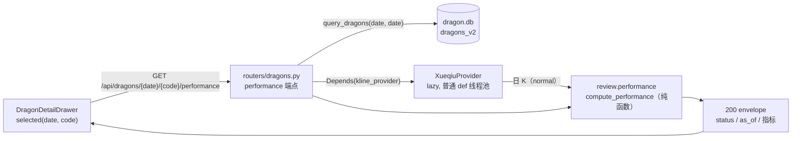
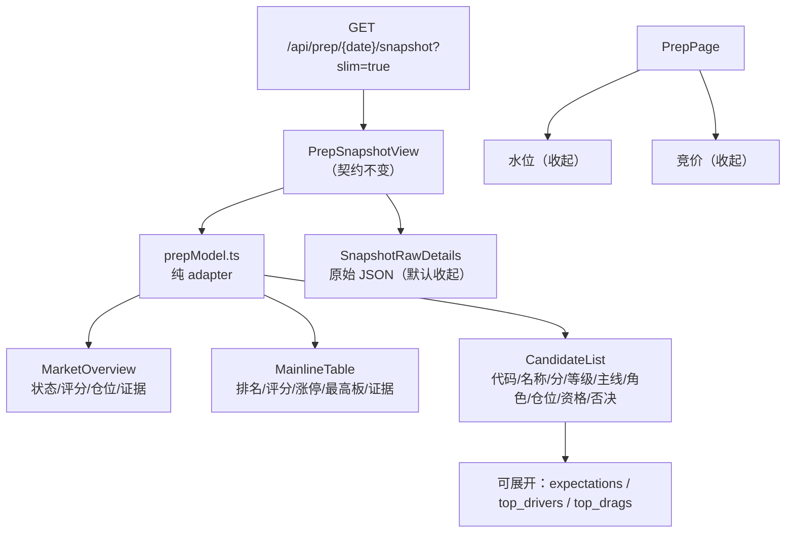
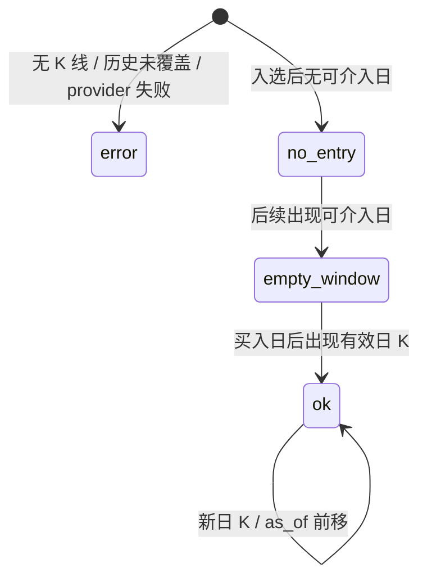
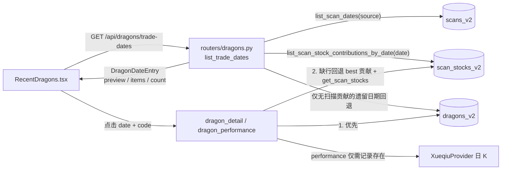

# dashboard 结果呈现精修 · 技术方案（2026-10-31）

> 范围：`web_ui` 总览 / 龙头抽屉 / 复盘页的**展示层**精修 + 一个只读绩效端点。
> 上游：`archived_md/web_ui/2026-10-31-web-ui-dashboard-design.md`（web_ui 架构与 API 契约）。
> 本文只记录本次增量，不重写旧方案；冲突处以本文为准并在实现 commit 同步归档设计。

## 0. 结论摘要

- 总览卡片文案/排序调整、近几日榜单支持本地展开、抽屉移除双口径回测卡片并新增**独立的「入选后表现」**。
- 入选后表现由新端点 `GET /api/dragons/{trade_date}/{code}/performance` + 纯计算服务提供：宽松口径入场语义、窗口从买入日到**最新可用日 K**，与固定 5 日 `_window_metrics` **完全隔离**；不写 DB、不改 `review` 结果、不改 CLI。
- 复盘页用前端 adapter 把快照投影成「结果优先」展示模型；原始 JSON / 水位 / 竞价默认收起。**后端快照字段与 prep 算法零改动**。
- 无新增依赖；主题 token、红涨绿跌、终端风布局保持不变；`dist` 在实现阶段同批重建。
- **增量（2026-11-01，见 §12）**：近几日卡片改读**原始扫描真龙榜**，展示被 `dragons_v2` 5 日去重排除的当日真龙；总览表 / 回测池 / `dragons_v2` 完全不变，卡片项明细与绩效在缺 `dragons_v2` 行时回退当日扫描贡献。

## 1. 验收标准映射

| # | 用户验收项 | 实现落点 | 验证 |
|---|---|---|---|
| 1 | 总览去 description；「已完成」→「已回测」；待回测副文案；胜率 tooltip；筛选按钮靠右 | `pages/dragons/DragonsPage.tsx`、`SummaryCards.tsx`、`FilterBar.tsx`、`components/HintIcon.tsx` | 前端契约测试 + Playwright 手动验收 |
| 2 | 近日榜单「只」→「支」；默认 3 支、超 3 支底部居中展开；后端 `items` 全量、`preview` 前三兼容 | `routers/dragons.py`、`RecentDragons.tsx`、`api/dragons.ts` | 后端单测 + 前端契约测试 |
| 3 | 抽屉移除双口径 review 卡片；新增入选后表现（买入日/价、最大收益、最大回撤、最新日 K）；独立 API；绩效失败不阻塞；报告原文默认 open | `review/performance.py`、`routers/dragons.py`、`DragonDetailDrawer.tsx` | 纯函数单测 + API 单测 + 前端契约测试 |
| 4 | 复盘页结果优先；候选可展开预期/drivers；宏观等次级；原始 JSON/水位/竞价默认收起 | `pages/prep/prepModel.ts`、`SnapshotSection.tsx` 等 | 前端契约测试 + Playwright 手动验收 |
| 5 | 保持 v2、双主题 token、红涨绿跌、终端风、无新增依赖；同步 README/owner docs/归档设计/dist | 见 §8 | 文档 diff + `npm run build` + dist 入库检查 |
| 6 | 近几日卡片展示当日**原始扫描真龙**（含被 5 日去重排除的 rank1）；10/29 应显示青岛食品 1 / 天顺风能 2 / 中国卫星 3 | `routers/dragons.py::list_trade_dates`（§12.2） | 后端单测 + E2E D7 |
| 7 | 总览表、回测统计、`dragons_v2` 与固定 5 日 review 完全不变，仍遵守 5 日去重 | 不改 `scan/storage/*`、`review/*`；仅新增 web_ui 只读视图（§12.3） | 回归单测 + E2E 断言回测池条数不变 |
| 8 | 卡片项可点击：明细优先 `dragons_v2`，缺行回退当日扫描贡献；绩效只需扫描入选记录存在；两者皆无才 404 | `routers/dragons.py::dragon_detail` / `dragon_performance`（§12.4） | 后端单测 + E2E D7 明细/绩效 200 |

## 2. 核心决策（候选与推荐）

### 2.1 绩效计算放在哪里

| 候选 | 做法 | 评价 |
|---|---|---|
| **A（推荐）** | 纯计算服务 `dragon_quant/review/performance.py` + `web_ui` 薄路由 + `deps` 注入 provider | 领域语义留在 `review` 包；纯函数可单测；网络 I/O 与计算分离；复用 `find_entry_day` |
| B | 扩展 `GET /api/dragons/{date}/{code}` 明细，同请求内计算 | 选型简单，但网络失败会拖慢/污染明细；DB 数据与实时 K 线混在一个响应；违反「绩效失败不阻塞」 |
| C（非常规） | 新增通用 `/api/klines`，前端用 TS 重算 | 看似少写后端，实则把 `find_entry_day`/有效 bar/峰值口径复制到第二语言；与 review 必然漂移；还暴露原始 K 线 |
| D | review/scan 时预计算并落表 | 需要改 DB/CLI/回填，且与「固定 5 日回测不变」冲突；本需求明确禁止 |

**推荐 A。** 设计模式落点：

- **Ports & Adapters / DI**：`compute_performance` 是纯函数（Port，**必须显式传入 `as_of`**，不读时钟），路由通过 `Depends(kline_provider)` 注入 Xueqiu 适配器（Adapter）、通过 `Depends(clock_module)` 解析缺省 `as_of`；provider/时钟都可被测试替换。沿用现有 `deps.benchmark_provider()` 的 lazy import 模式，新增 `kline_provider()` 以避免与账户基准端点语义耦合。
- **Strategy（字段回退链）**：复盘 adapter 用 `review.X ?? legacy.X` 的显式回退，不把版本判断散落在 JSX。
- **Presenter / Adapter**：`prepModel.ts` 把快照 JSON 投影为展示模型，UI 只消费展示模型。
- **Composition**：`HintIcon` / `CollapsibleSection` 是可组合的小组件，不引入 UI 库或全局状态。
- 刻意**不**引入：全局 store、通用表格抽象、前端计算金融公式、服务端分页。按全局约定「能三行相似代码就不封装」。

### 2.2 绩效失败的错误形状

- 推荐：**记录存在时一律 200**，数据/传输问题用 `status="error"` + `error` 文本表达；400 只给参数错误，404 只给记录不存在。
- 理由：这是抽屉内的**局部增强**，不是主查询。200 让前端在「入选后表现」卡片内独立降级、提供重试，不会把整个抽屉打成错误态。
- 备选 503：更 RESTful，但前端仍要区分「抽屉失败」与「绩效失败」，且会与现有 `{error, detail}` 兜底处理器耦合；本期不采用。

## 3. 架构与数据流

### 3.1 绩效请求



关键点：

- 明细请求与绩效请求**并行、互不等待**；绩效异常只影响绩效卡片。
- 绩效端点只读 `dragons_v2` 或当日原始扫描贡献判断记录存在（§12.4），不读/写 review 字段。
- provider 调用发生在普通 `def` 端点（anyio 线程池），不阻塞事件循环。

### 3.2 复盘页展示投影



顺序：日期选择 → 市场结果 → 主线结果 → 候选结果 → 次级（宏观/反馈）→ 原始 JSON → 水位 → 竞价。**只改渲染顺序与折叠，不新增请求、不改快照字段。**

## 4. 接口定义

### 4.1 近几日榜单：`GET /api/dragons/trade-dates?source=v2&limit=10`

`DragonDateEntry` 增加 `items`，`preview` 语义不变：

```python
class DragonDateEntry(BaseModel):
    trade_date: str
    count: int
    preview: list[DragonPreview]   # 现有契约：前 3 支，保持
    items: list[DragonPreview]     # 新增：全量，按同一排序
```

- 排序：`rank`（NULL 最后）→ `composite_score` 降序 → `code` 升序；`preview == items[:3]`。
- **数据来源（2026-11-01 增量，详见 §12）**：不再逐日 `get_dragons`，而是读原始扫描真龙榜（`scans_v2` + `scan_stocks_v2`），使被 5 日去重排除的当日真龙仍出现在卡片；日期来源同时覆盖「当日全部被去重」的情况。逐日一次只读查询的数量级不变（`limit` 仍由 `clamp_limit(..., maximum=50)` 约束）。
- 日期无任何原始真龙且 `dragons_v2` 也无行时不生成空卡片；仅有 `dragons_v2` 行的遗留日期回退 `get_dragons`。
- 前端本地展开，不追加网络请求；`items` 缺失时回退 `preview`（防御旧后端）。

### 4.2 入选后表现：`GET /api/dragons/{trade_date}/{code}/performance`

参数：

| 参数 | 必填 | 说明 |
|---|---|---|
| `trade_date` | 是 | `YYYYMMDD` 或 `YYYY-MM-DD`；龙头入选日 |
| `code` | 是 | 股票代码 |
| `as_of` | 否 | `YYYYMMDD` / `YYYY-MM-DD`；观测截止日，缺省由路由用 `clock_module.now(ZoneInfo("Asia/Shanghai"))` 解析为当天，响应回显生效值 |

绩效口径固定为**宽松**，不接收 `caliber` / `source`（v2 固定）。

响应模型（新端点 pydantic，键名稳定）：

```python
class DragonPerformance(BaseModel):
    trade_date: str
    code: str
    caliber: Literal["loose"] = "loose"
    status: Literal["ok", "no_entry", "empty_window", "error"]
    as_of: str
    buy_date: str | None = None
    buy_price: float | None = None
    max_return_since_entry: float | None = None
    max_drawdown_since_entry: float | None = None
    peak_date: str | None = None
    latest_bar_date: str | None = None
    bars_in_window: int | None = None
    bars_after_entry: int | None = None
    error: str | None = None
```

状态与 HTTP 契约：

| 场景 | HTTP | `status` | `error` |
|---|---|---|---|
| 正常 | 200 | `ok` | `null` |
| 入选后无任何可介入日（持续一字板 / 停牌 / 尚无后续交易日） | 200 | `no_entry` | `null` |
| 已找到买入日，但买入日之后没有有效日 K | 200 | `empty_window` | `null` |
| 无 K 线 / K 线未覆盖入选日 / provider 传输失败 | 200 | `error` | 具体原因 |
| 日期非法、`as_of < trade_date` | 400 | — | `{error:"invalid_request", detail}` |
| `dragons_v2` 行与当日原始扫描贡献**均不存在** | 404 | — | `{error:"not_found", detail}` |

> **不返回 `max_return_5d` / `max_drawdown_5d` 键**，避免把固定 5 日回测改名冒充「至最新日 K」。契约测试显式断言这一点。

### 4.3 前端 API 类型

`api/dragons.ts` 新增：

```ts
export type PerformanceStatus = "ok" | "no_entry" | "empty_window" | "error";
export interface DragonPerformance { /* 与 §4.2 一一对应 */ }
export function fetchDragonPerformance(tradeDate: string, code: string, asOf?: string)
  : Promise<DragonPerformance>;
```

`DragonDateEntry` 增加 `items: DragonPreview[]`。

## 5. 纯计算服务语义

文件：`dragon_quant/review/performance.py`（新增；无 DB、无 provider import、无副作用）。

### 5.1 输入与有效性

- 输入：`klines: list[dict | KBar]`、`trade_date: str`、`as_of: str`（**必填**；缺省值由路由解析，服务本身不读时钟/环境）。
- 归一化：`KBar → dict` 复用 `infra.market_calendar.kbar_to_dict`；按 `date` 升序，同日重复保留最后一条。
- **有效 bar**：逐字对齐 `review.main._is_valid_bar`：
  - 非 dict / 缺 OHLC → 无效；
  - `min(open, high, low, close) <= 0` → 无效；
  - `high < low` → 无效；
  - `open` 或 `close` 不在 `[low, high]` → 无效；
  - `volume <= 0 且 high == low`（停牌占位）→ 无效。
- 为避免 `web_ui → review.main` 的 provider 依赖，有效 bar 逻辑在 `performance.py` 本地实现；单测用同一组 bar 对 `review.main._is_valid_bar` 做 parity 断言，防止漂移。
- **与 review 宽松入场的细微差异（有意）**：`review._loose_review` 直接在原始 klines 上找首个 `high != low`；performance 先过滤无效 bar 再找。正常数据两者入场日一致；若存在「high != low 但 OHLC 非法」的坏 bar，performance 会跳过它（更严格），review 可能仍在那天入场。该差异写入 `known_issues`，parity 测试只保证有效性判定一致，不强行让入场日相同。
- **未来 bar**：`date > as_of` 的 bar 在入场搜索前丢弃；`as_of < trade_date` 直接 400。
- **历史覆盖**：若 `min(有效 bar 日期) > trade_date` → `status="error"`，「历史数据不足（K 线未覆盖入选日）」，不拿最近窗口冒充入场。
- `as_of` 缺省由路由解析：`clock_module.now(ZoneInfo("Asia/Shanghai")).date().isoformat()`；测试一律显式传入 `as_of`。
- provider 请求根数：`days = min(1500, max(90, (as_of - trade_date).days + 30))`，`fq_type="normal"`（与 review 一致）；超过 1500 天的历史由「历史覆盖」检查显式报错，不静默错算。

### 5.2 入场

```text
entry = find_entry_day(有效 bar, trade_date)
      = 第一个 date > trade_date 且 high != low 的 bar
buy_date  = entry.date
buy_price = entry.low
```

- 连续一字板（`high == low`）自动跳过；全部跳过 → `no_entry`。
- 不做严格口径（首个交易日开盘价）计算；本端点只服务宽松口径。

### 5.3 窗口与公式

设：

- `post = { b | buy_date < b.date <= as_of }`
- `peak = argmax(b.high) over post`；**并列时取最早日期**（与 review 的稳定排序 `max` 行为一致）
- `draw = { b | buy_date <= b.date <= peak.date }`

则：

```text
max_return_since_entry   = round((peak.high - buy_price) / buy_price * 100, 2)
max_drawdown_since_entry = round((min(draw.low) - buy_price) / buy_price * 100, 2)
latest_bar_date          = max(b.date) over { b | buy_date <= b.date <= as_of }
bars_in_window           = len({ b | buy_date <= b.date <= as_of })
bars_after_entry         = len(post)
```

**买入日峰值边界（必须按此实现并测试）**：

- 峰值只看 `buy_date` **之后**的 bar；买入日自身的高点**不计入**最大收益。这与固定 5 日 `_window_metrics` 的 `future_dates = date > buy_date` 一致。
- 回撤窗口包含 `buy_date`；因 `buy_price == entry.low`，买入日自身贡献 0 回撤，不会制造负回撤。
- 峰值之后的新低不进入回撤窗口（与既有「买入日 → 最大收益出现日」语义一致）；文档与 tooltip 明确这一点。
- 不依赖交易日历、不跳过 T+1；窗口完全由「买入日 → `as_of` 的实际有效 bar」决定（这是与固定 5 日 `_window_metrics` 的核心区别）。
- `post` 为空 → `empty_window`，`buy_date`/`buy_price`/`latest_bar_date(=buy_date)` 仍返回，`peak_date` 与两个指标为 `null`。
- `no_entry` 时 `buy_*` / `peak_*` / 指标为 `null`，`latest_bar_date` 为有效 bar 的最大日期（若有），`bars_in_window=0`、`bars_after_entry=0`。



> 状态是「请求时点的数据快照」；同一 `(trade_date, code)` 随着新交易日推进可从 `no_entry` → `empty_window` → `ok`，端点不缓存状态。

### 5.4 与固定 5 日回测的隔离

- 不 import / 不调用 `review.main._window_metrics`、`_loose_review`、`_strict_review`。
- 不读/写 `dragons_v2` review 字段、不写 `dragon_review_strict`、不动 `review` CLI。
- 仅复用公开的 `find_entry_day` 与 `kbar_to_dict`；有效 bar 逻辑本地实现 + 与 `_is_valid_bar` 的 parity 测试，防止两边漂移。
- 指标命名用 `*_since_entry`，前端标签用「至最新日 K」，不出现「5 日」字样。

## 6. 前端设计

### 6.1 总览

| 位置 | 改动 |
|---|---|
| `DragonsPage.tsx` | 删除 `PageHeader` 的 `description`；其余 eyebrow/title 保留 |
| `SummaryCards.tsx` | 「已完成」→「已回测」；「待回测」`sub` 固定为「入选满 5 个交易日后回测」；移除动态 `pendingSub` |
| `SummaryCards.tsx` | 宽松/严格胜率使用 `HintIcon`，分别解释「首个 high≠low 日最低价买入」/「首个交易日开盘价买入，一字板不顺延」 |
| `FilterBar.tsx` | 操作按钮行改为右对齐（`justify-end`），保留查询/重置/更多筛选 |

### 6.2 近几日榜单

- 单位「只」→「支」；描述文案改为「点击个股查看五维评分与入选后表现」。
- 每张日卡默认渲染 `items.slice(0, 3)`；`items.length > 3` 时在卡片底部**居中**渲染展开/收起按钮：
  - 收起：「展开全部 N 支」+ chevron down；
  - 展开：「收起」+ chevron up；
  - 展开状态用页面局部 `Set<string>`（按 `trade_date`）管理，不请求后端。
- 每张卡只发一次 `trade-dates` 请求（页面级一次），不按日追加。

### 6.3 龙头抽屉

- **移除**「严格 / 宽松口径对照」整段与 `ReviewCard` / `ReviewRow`；保留徽标（真伪/否决/**当前口径**）、Meta、概念、五维、否决原因、扫描报告原文。口径徽标保留的原因：抽屉由某一行打开，行内指标仍受总览口径影响，徽标提供上下文；绩效卡单独标注「宽松口径」，不混用。
- 新增「入选后表现」卡（位于 Meta 之后、概念之前）：
  - 独立请求 `fetchDragonPerformance(date, code)`，与明细请求并行；effect **只依赖 `selected.date/code`，不依赖 `caliber`**，切换口径不重复拉绩效。
  - 独立 loading / error 状态；HTTP/网络失败只写绩效卡的 `perfError`，不动抽屉全局 error。
  - `ok`：买入日、买入价、最大收益（至最新日 K）、最大回撤、最新日 K 截止日；附「窗口 N 根 / 买入后 M 根」脚注。
  - `no_entry`：「入选后无可介入日（连续一字板 / 停牌 / 尚无后续交易日）」。
  - `empty_window`：「已买入，暂无后续日 K」，仍展示买入日/价。
  - `error` / HTTP 失败：卡内错误文案 + 「重试」按钮。
  - 收益/回撤沿用 `fmtPct` + `pnlClass`（红涨绿跌）。
- 扫描报告原文用 `CollapsibleSection defaultOpen`，可收起；不在每次重渲染时强制打开。

### 6.4 复盘页结果优先

- 新增 `pages/prep/prepModel.ts`（纯函数，无 React）：
  - `buildMarketView(snapshot)`：`review.market` 优先，缺失回退 `sentiment`；输出状态、评分、系数、仓位建议、仓位区间、证据、组合 warning、partial/unknown_reason。
  - `buildMainlineViews(snapshot)`：`review.mainlines` 优先，缺失回退 `main_boards`；输出排名、主线名、评分、涨停数、最高板、证据、状态。
  - `buildCandidateViews(snapshot)`：`review_candidates` 优先，缺失回退 `candidates`；输出代码、名称、分、等级、主线、角色、仓位、资格、否决原因、预期、drivers/drags。
  - `buildSecondaryViews(snapshot)`：宏观、反馈、计划复盘、锚点、降级信息。
  - 空值一律 `null` → UI 显示「—」；**不写 0/50 冒充**。
- 展示映射：
  - 市场状态：`strong` 强 / `neutral` 中性 / `weak` 弱 / `ice` 冰点 / `unknown` 数据不足。
  - 角色：`leader` 龙头 / `vanguard` 先锋 / `mainstay` 中军 / `capacity` 容量 / `follower` 跟风 / `diagnostic_non_mainline` 非主线诊断 / `null` —。
  - 资格：`eligible` 可参与 / `not_qualified` 不合格 / `unknown` 数据不足。
  - 仓位三态：`null` 数据不足 / `0` 不建议新建仓 / `>0` 显示百分比。
  - 否决/原因：`reason_code` → `ignore_reason` → `warnings` 的优先级，不编造。
- `SnapshotSection` 拆为：
  - 结果区：`MarketOverview`、`MainlineTable`、`CandidateList`（候选行 `<details>` 展开预期 + drivers/drags）；
  - 次级区：宏观/反馈等用 `CollapsibleSection` 默认收起；
  - 原始区：`SnapshotRawDetails` 保留现有逐块 `<details>`（默认收起）。
- `PrepPage`：日期选择保持顶部；结果区之后依次是原始 JSON、水位、竞价；水位/竞价用 `CollapsibleSection` 默认收起。**请求逻辑不变**（仍按所选日期加载）。

### 6.5 主题与无障碍

- 只用现有 token/工具类；不新增 CSS 依赖，不使用 Tailwind 斜杠透明度表达主题色。
- `HintIcon`：`button` + `aria-label` + `aria-describedby`，tooltip `role="tooltip"`；`mouseenter/focus` 打开，`mouseleave/blur/Escape` 关闭；键盘可达。窄视口/边缘卡片用 `align="start" | "end"` 把 tooltip 锚到图标左/右边缘，避免居中定位横向溢出（390px 实测左卡片由 -20.3px 修正为 85.7px，右卡片右缘 277.7px，均 < 390px）。
- `StatCard` 容器从 `overflow-hidden` 改为 `overflow-visible`（背景渐变不受影响），避免 tooltip 被裁剪。
- `CollapsibleSection` 用原生 `<details>/<summary>`，自带键盘与屏幕阅读器语义；`defaultOpen` 用受控 state 防止重渲染强制展开。

## 7. 测试策略（TDD）

### 7.1 后端纯函数（先 RED）

新增 `dragon_quant/tests/test_review_performance.py`：

- 入场：首个 `high != low`、买入价 = 最低价；连续一字板跳过；`no_entry`。
- 峰值：买入日高点不计入；买入日后新高 → 最大收益；并列峰值取最早日期。
- 回撤：买入日低价计入但为 0；峰值前新低进入；峰值后新低不进入。
- 空窗口：只有买入日 → `empty_window`；买入日后无有效 bar。
- 有效 bar：负价 / `high < low` / OHLC 越界 / 零成交平盘 被过滤。
- 未来 bar：`date > as_of` 被丢弃；`as_of < trade_date` 抛错/400 语义。
- 历史覆盖：`min(date) > trade_date` → `error`。
- parity：同一组 bar 上 `is_valid_daily_bar` 与 `review.main._is_valid_bar` 结果一致（测试内 import 私有函数，仅用于防漂移）。
- 契约：返回 dict 不含 `max_return_5d` / `max_drawdown_5d`。

### 7.2 API（先 RED）

扩展 `dragon_quant/tests/test_web_backend.py`：

- `trade-dates`：`items` 全量、`preview == items[:3]`、排序、`count` 不变。
- performance：用 `dependency_overrides[kline_provider]` 注入假 provider：
  - 200 `ok` / `no_entry` / `empty_window` / `error` 分支；
  - 404 记录不存在；400 日期非法 / `as_of < trade_date`；
  - provider 抛异常 → 200 `status="error"`；
  - 响应键集精确断言，且不含 `max_return_5d`。
- 复用 `_find_dragon_row` helper 后，detail 端点回归不变。

### 7.3 E2E

- `dragon_quant/tests/e2e/test_dashboard.py` D5：补 `trade-dates.items` 断言（与 `preview` 关系、全长）。
- 新增 **D6（必须）**：用 `env_override={"DQ_E2E_SCENARIO": <perf scenario>}` 启动 dashboard，场景含 `xueqiu.get_kline`，断言 performance 端点 `ok`、`as_of` 与键集；全程 fake provider、无网络。绩效端点是本期唯一新增 API，必须有 E2E 冒烟，不能只靠单测。
- 同步 `dragon_quant/tests/e2e/coverage-map.json` 的 `independent_entries.web.tests` 增加 D6；本期**不新增 CLI 命令/parser 节点**，`parser_snapshot.node_count=54`、`top_level_count=16` 保持不变，只改 web 测试列表。
- 既有 W1–W9 / D1–D5 不改断言，确保冻结契约不漂移。
- **§12 增量**：新增 D7（原始扫描榜含被去重 rank1、回测池不变、明细/绩效不 404），见 §12.5.2。

### 7.4 前端零依赖契约

新增 `dragon_quant/tests/test_web_frontend_results.py`（对齐 `test_web_frontend_theme.py` 的纯文本扫描模式）：

- 源码：`DragonsPage` 无 `description=`；`SummaryCards` 含「已回测」「入选满 5 个交易日后回测」「aria-describedby」「role="tooltip"」；`HintIcon` 含 `onMouseEnter`/`onMouseLeave`/`onFocus`/`onBlur`/`Escape` 与 `align` 边缘对齐（`left-0` / `right-0`）；`RecentDragons` 含 `items`、「支」、展开/收起文案；`DragonDetailDrawer` 不再含 `ReviewCard`，含绩效字段与默认展开的报告；`FilterBar` 含 `justify-end`；prep adapter 含三段 fallback 选择器；`SnapshotSection` 证据列表使用下标限定 key。
- dist：构建后断言新文案/关键键进入 JS，旧「严格 / 宽松口径对照」文案不再出现；`test_web_frontend_theme.py` 继续守护主题 token 与资产引用。
- 手动验收：用 Playwright 打开 `dashboard`，覆盖 hover + Tab 聚焦 tooltip、近几日展开/收起、抽屉绩效错误降级、复盘页折叠顺序；截图留档（阶段 3 自测证据）。

### 7.5 门禁命令（阶段 3 自测）

```bash
.venv/bin/python -m pytest dragon_quant/tests/test_review_performance.py \
  dragon_quant/tests/test_web_backend.py -q
.venv/bin/python -m pytest dragon_quant/tests -q \
  --ignore=dragon_quant/tests/e2e --ignore=dragon_quant/tests/smoke
.venv/bin/python -m pytest dragon_quant/tests/e2e/test_dashboard.py -q
npm --prefix web_ui/frontend run build
.venv/bin/python -m pytest dragon_quant/tests/test_web_frontend_results.py \
  dragon_quant/tests/test_web_frontend_theme.py -q
```

## 8. 文档与 dist 同步

| 文件 | 改动 |
|---|---|
| `docs/agent/review.md` | 新增「入选后表现」端点：`review/performance.py` 纯计算、宽松口径、至最新日 K、`status/as_of`、不写库、不改固定 5 日回测；`trade-dates` 增 `items`；抽屉不再展示双口径卡片 |
| `docs/agent/development.md` | Web UI 段落补绩效端点与白名单增量：`dragon_quant.review.performance`、`dragon_quant.infra.clock`（仅路由解析 `as_of`）、`XueqiuProvider` 复用（绩效端点）；前端契约测试文件；`dist` 同批重建 |
| `docs/agent/prep-auction.md` | **改**：加一句「dashboard 复盘页为展示投影，不改快照字段/算法/CLI」；不新增快照契约 |
| `docs/agent/architecture.md` | **不改**：`review/` 目录已存在，仅新增文件，目录树无变化 |
| `archived_md/web_ui/2026-10-31-web-ui-dashboard-design.md` | §5.2 白名单补 `review.performance` / `infra.clock` / XueqiuProvider 绩效用途；§6.3.2 补 `items` 与 performance 端点；§8.2/8.4 补抽屉与复盘页展示；§11.1/11.3 补测试与 D6 |
| `README.md` | dashboard 行/说明补一句：总览支持榜单展开与入选后表现，复盘页结果优先 |
| `CHANGELOG.md` | `[Unreleased]` Added/Changed 记录本次端点和展示精修 |
| `web_ui/dist/**` | `npm --prefix web_ui/frontend run build` 后同 commit 入库 |
| `AGENTS.md` | **不改**：无新增跨模块硬约束；根 20 KB / 240 行门禁不动 |

> 归档设计是 web_ui API 的 owner 文档，必须与实现同一 commit 更新；`docs/solutions/` 本文在功能合入前按全局约定再询问是否归档。

## 9. 风险与缓解

| 风险 | 影响 | 缓解 |
|---|---|---|
| Xueqiu Cookie 失效 / 传输失败 | 绩效不可用 | 独立端点 + 200 `status="error"` + 卡内重试；明细不受影响 |
| 不复权价格（`normal`）遇除权除息 | 收益/回撤失真 | 与 review 现有口径一致；文档标注；后续若需要再加 qfq 开关（非本期） |
| 盘中最后一根日 K 未收盘 | 指标随盘中变化 | 展示 `latest_bar_date`；建议盘后查看；本期不引入收盘判定 |
| 旧快照缺 `review` / `review_candidates` | 复盘页空白 | adapter 回退到 `sentiment` / `main_boards` / `candidates`；缺值显示「—」 |
| tooltip 被卡片裁剪 | 键盘/鼠标不可见 | `StatCard` 改 `overflow-visible`；Playwright 手动验收 |
| `items` 使响应变大 | 极限 limit=50 时体积上升 | 本地仪表盘可接受；仍为逐日一次查询；后续可加专用聚合只读函数 |
| 峰值并列 / 峰值后回撤 | 与用户直觉不一致 | 公式与边界写入文档 + tooltip + 单测；与 review 语义一致 |
| 历史 K 线未覆盖入选日 | 静默错算入场日 | `min(date) > trade_date` 显式 `error`，不冒充 |
| 坏 bar（`high != low` 但 OHLC 非法）导致入场日与 review 不一致 | 绩效与固定 5 日回测在异常数据下可能不同 | 属有意的「有效 bar」语义；写入 `known_issues`，正常数据 parity 测试保证一致 |
| 抽屉反复打开触发重复 provider 请求 | 雪球限流/延迟 | 本期单用户本地工具，按需请求不预取；不写库/不加缓存，若出现限流再评估进程内 TTL 缓存（非本期） |
| `dist` 与源码不同步 | 线上仍是旧 UI | 构建与前端源码同 commit；契约测试守护 |
| 指标命名混淆 | 把 5 日收益当至最新 | `*_since_entry` 命名 + 不返回 `max_return_5d` + 契约断言 |

> §12 增量的风险（扫描表清理、best 规则漂移、count 口径变化等）见 §12.6。

## 10. 实施顺序（给阶段 3）

1. 纯函数 `review/performance.py` + `test_review_performance.py`（RED → GREEN）。
2. `routers/dragons.py`：`items`、`_find_dragon_row`、performance 端点；`deps.py` 注入 `kline_provider` / `clock_module`（缺省 `as_of`）；扩展 `test_web_backend.py`。
3. 前端 `api/dragons.ts` 类型与请求；`HintIcon`、`CollapsibleSection` 组件。
4. 总览页四处（PageHeader / SummaryCards / FilterBar / RecentDragons）。
5. 抽屉：移除双口径卡片、新增绩效卡、报告默认展开。
6. 复盘页：`prepModel.ts` + 结果组件 + 折叠重排。
7. `npm run build` 重建 dist；新增前端契约测试；跑 E2E + 手动 Playwright 验收。
8. 同步 owner docs / 归档设计 / README / CHANGELOG；加载 `code-self-review` 回报。

## 11. 非目标

- 不修改固定 5 日 `review` 回测、`dragon_review_strict`、DB schema、CLI 参数。
- 不给 prep 快照新增后端字段，不修改 `prep` 算法/采集/快照版本。
- 不引入新依赖、不引入 JS 测试框架、不做服务端分页、不做绩效持久化/缓存。
- 不新增按日榜单请求；不在前端重算金融公式。
- 不处理鉴权/远程访问/多 worker。

## 12. 增量附录：近几日原始扫描榜兼容 5 日去重（2026-11-01）

### 12.1 背景与目标

用户实测 2026-10-29：`scan_stocks_v2` 的当日真龙为青岛食品 rank1、天顺风能 rank2、中国卫星 rank3；青岛食品因 10-26 已 rank1 入选且本次排名未提升，被 `dragons_v2` 的 5 日去重规则排除，导致「近几日榜单」卡片只显示 2/3。用户要求卡片展示全部当日真龙，同时**不改回测池与 5 日去重语义**。

目标：

- `GET /api/dragons/trade-dates` 的 `items` / `preview` 改读**原始扫描真龙榜**；10/29 明确应为 `[青岛食品 1, 天顺风能 2, 中国卫星 3]`。
- 总览表、回测统计、`dragons_v2` 物化、固定 5 日 `review` / CLI / DB 一行不改。
- 卡片项可点击：明细优先 `dragons_v2` 行，缺行时回退当日扫描贡献；绩效只需确认当日扫描入选记录存在，不要求 `dragons_v2` 行；两处都不存在才 404。

### 12.2 候选设计与推荐

| 候选 | 做法 | 评价 |
|---|---|---|
| **A（推荐）** | 路由层组合只读视图：`trade-dates` 用 `scan_repository` 的 `list_scan_dates` + `list_scan_stock_contributions_by_date` 组装卡片；明细/绩效增加「扫描贡献回退」 | 不动存储与回测；复用既有公共只读 API；去重规则留在物化层，不扩散到展示层；改动集中在一个路由文件 |
| B | 让 `dragons.get_dragons` / `dragons_v2` 也包含被去重行 | 直接污染回测池与总览统计，违反「5 日去重完全不变」，否决 |
| C（非常规） | 前端按日请求 `/api/scans/{id}/stocks` 后自行合并 | 产生 N 次额外请求，并把「真龙过滤 / best 贡献 / 排序」复制到 TS，必然与后端漂移，否决 |
| D | 新建 `recent_scan_dragons` 物化表或后台预计算 | 需要 DB schema、回填与同步任务；与「不改 DB / 不新增资产」冲突，本期否决 |

**推荐 A。** 设计模式落点：

- **Adapter**：路由把「原始扫描贡献」适配成既有的 `DragonDateEntry` 契约，前端与 `api/dragons.ts` 零改动。
- **Facade**：`deps.scan_repository()` 只暴露 `scans.py` 的公共只读函数，路由不拼 SQL、不建连接。
- **Composition over inheritance**：明细/绩效的「dragon 行 → 扫描贡献」是显式回退链，不引入 repository 基类或通用查询层。
- 刻意不引入：跨模块「龙头视图」抽象、缓存、分页、前端重算。按全局约定「能三行相似代码就不封装」；只有当第三个消费方出现时才考虑把贡献选择规则提取为公共只读函数。

### 12.3 架构与数据流



关键点：

- **卡片数据源与回测数据源分离**：卡片读原始扫描贡献；总览/回测仍读 `dragons_v2`。两者共用 5 日 gate 的**结果**，但展示层不复制 gate 规则。
- **一次日期列表 + 每日一次贡献查询**：请求数量级与现状相同（`limit ≤ 50`），不新增按日 HTTP 请求，不在前端合并。
- **只读**：不写库、不改 schema、不触发扫描、不改 `scan_top_n` 语义。

### 12.4 接口与边界

#### 12.4.1 `trade-dates` 数据来源

日期列表：

1. `scan_dates = scans.list_scan_dates(source=src)`（含当日全部被去重、`dragons_v2` 无行的日期）。
2. `dragon_dates = dragons.list_dragon_trade_dates(source=src)`（兼容仅有历史龙头的遗留数据）。
3. 取并集，按日期降序**逐日构建并收集非空条目，直到收满 `limit` 个或日期耗尽**。不得先截断日期再丢弃空条目——否则最近若干日若都是「只有候选、无真龙」的扫描，会少返回卡片。
4. 既无原始真龙也无 dragons 行的日期跳过，不渲染 0 支卡片。

单日条目构建：

1. `contribs = scans.list_scan_stock_contributions_by_date(date, source=src)`。
2. 过滤（与 `rebuild_dragons_for_date` 的入选口径一致）：
   - `is_true_dragon is not False`（`None` 视为未知但保留，与物化层一致）；
   - `rank is not None`；
   - `rank <= scan_top_n`。
3. 多日/多次扫描按 `code` 选**最佳贡献**：`rank` 最小（`None` 视为 9999）→ `composite_score` 最高（`None` 视为 0）→ `scan_created_at` 最新。
4. 对选中行复用现有 `_preview_sort`：`rank`（`None` 最后）→ `composite_score` 降序 → `code` 升序。
5. 输出 `count = len(items)`、`items = 全量`、`preview = items[:3]`；键集与 §4.1 完全一致。
6. 若该日期**没有**可用扫描贡献（例如 v1 历史数据或扫描表被清理），回退 `dragons.get_dragons(date, src)`，保持旧行为；有贡献时**不调用** `get_dragons`。

边界：

- `source` 参数保留；v2 是唯一目标。取不到扫描贡献时回退既有 dragons 行，不为 v1 新增分支。
- 同一股票在连续两日都 rank1 但因 gate 被去重时，两天的卡片**都会展示它**——这是原始榜单的真实语义，按日期区分，属于预期行为。
- `count` 现在表示「当日原始真龙支数」，可能与 `/api/summary.total` / `dragons_v2` 当日行数不同；这正是本需求要解耦的两组口径。

#### 12.4.2 明细 `GET /api/dragons/{trade_date}/{code}`

响应模型不变。查询顺序：

1. 保留现有按 `caliber` 过滤的 `dragons.query_dragons`（优先 `dragons_v2` 行，行为不变）。实现时把该查询抽为 `_find_dragon_row(day, code, src, caliber)`，明细与绩效共用。
2. 无行 → `_find_scan_contribution(day, code, src)`：在当日贡献中按 §12.4.1 的过滤与 best 规则选该 `code` 的贡献。
3. 仍无 → 404 `{error:"not_found"}`。

回退时的字段映射（响应结构不变）：

| 字段 | 来源 |
|---|---|
| `trade_date` / `code` / `name` | 贡献行（`scan_date` / code / name） |
| `scan_id` / `rank` / `composite_score` / `board_count` / `concepts` / `report_text` / `is_true_dragon` | 贡献行 |
| `quote`（open/close/high/low/pct/turnover/amount/market_cap） | 贡献行对应 `*_px` 等字段 |
| `dims` / `reject_reason` | `scans.get_scan_stocks(scan_id)` 中匹配 `code` 的行；复用现有 `_dims`，**不复制五维提取** |
| `dims_source` | 有扫描行 → `scan_stocks`；有 `scan_id` 但无匹配 → `scan_stocks_missing` |
| `review_loose` | 全 `None`（未回测/未物化，不伪造） |
| `review_strict` / `derived_status` | `None` |
| `caliber` | 仍按 `resolve_caliber` 解析，契约不变 |

说明：若 `dragons_v2` 有物理行但被当前 `caliber` 过滤掉，现有查询会返回无行，此时同样走扫描回退，`review_*` 为空。这是「优先可见的 dragons 行」的既有语义，不改为绕过 caliber 查询。

#### 12.4.3 绩效 `GET /api/dragons/{trade_date}/{code}/performance`

- 增加 `scan_repository` 依赖；记录存在性 = `_find_dragon_row(...)` 命中 **或** `_find_scan_contribution(...)` 命中。
- 存在后计算链路完全不变（§5）：仍以 `trade_date + code + as_of` 拉日 K，宽松入场，窗口至最新有效日 K。
- 404 条件改为「两处记录都不存在」；400（日期非法 / `as_of < trade_date`）与 200 `status="error"` 降级均不变。
- 不为绩效新增 DB 写入、缓存或 `dragons_v2` 回填。

### 12.5 测试策略（TDD）

#### 12.5.1 后端单测（`dragon_quant/tests/test_web_backend.py`，先 RED）

扩展 fake：`FakeScans` 增加 `list_scan_dates` / `list_scan_stock_contributions_by_date`；既有用例按新数据源调整，**不是 golden 变更**。

- **去重场景还原**：构造「扫描 3 支真龙、dragons 仅 2 行」→ `items` 长度 3、rank 1..3、`preview == items[:3]`、`count == 3`；断言 `list_trade_dates` 在有贡献时未调用 `get_dragons`（spy）。
- **日期来源**：某日期 `dragons.list_dragon_trade_dates` 为空但扫描贡献存在 → 该日期仍出现（当日全部被去重）。
- **截断边界**：最近若干个扫描日只有非真龙/无贡献，更早日期有真龙 → 仍应收满 `limit` 个非空卡片，不得因先截断而少返回。
- **过滤**：`is_true_dragon=False`、`rank=None`、`rank > scan_top_n` 均被排除；`is_true_dragon=None` 保留。
- **best 贡献**：参数化覆盖 `rank` 小优先、`rank` 相同比 `composite_score`、再相同比 `scan_created_at`；同 `code` 只出一条。
- **排序契约**：rank → score 降序 → code；`preview` 与 `items` 关系不变。
- **回测池不变**：新增用例断言 `/api/dragons` 与 `/api/summary` 输出不因 `trade-dates` 数据源改变而变化（同一 fake 下 count/summary 键值断言）。
- **明细回退**：dragons 无行、贡献存在 → 200，`scan_id`/rank/dims/reject_reason 来自扫描，`review_loose` 全 `None`，`dims_source=="scan_stocks"`；两处都无 → 404。
- **绩效回退**：dragons 无行、贡献存在 + 假 provider → 200 `ok`；两处都无 → 404；400/`status="error"` 回归不变。
- **遗留回退**：扫描贡献为空、dragons 有行 → 卡片仍来自 `get_dragons`，旧用例不下线。
- **既有用例改造**：`test_trade_dates_items_full_and_preview_prefix` 的 4 行数据改为由 `FakeScans` 贡献提供（保留排序/前缀断言）；`test_dragons_frozen_contract_and_new_endpoints` 通过 union 仍得到 2 个日期。两者都是**测试数据源调整**，不是 golden/契约变更。

#### 12.5.2 E2E（`dragon_quant/tests/e2e/test_dashboard.py`）

- `seed_builders.scan_db_seed` 增加可选 `stocks` / `top_n` 参数（默认值保持现有行为，D5 不变），供去重场景注入。
- 新增 **D7**（fake provider、无网络）：
  - 扫描 2026-08-17：600001 rank1、600003 rank2、600004 rank3，均为真龙；`dragons_v2` 仅物化 600003/600004（模拟 600001 被 5 日去重）。
  - 扫描 2026-08-18：600005 rank1 真龙；`dragons_v2` 无该日行（模拟当日全部被去重）。
  - 断言 `trade-dates`：08-17 有 3 支且首条 `rank=1 code=600001`；08-18 仍出现且含 600005。
  - 断言回测池不变：`/api/dragons?date_from=20260817&date_to=20260817` 仍只有 2 行；`/api/summary` 的 `total` 不因卡片口径变化。
  - 断言明细：`GET /api/dragons/20260817/600001` → 200、`dims_source=="scan_stocks"`、`review_loose.buy_date is None`。
  - 断言绩效：`DQ_E2E_SCENARIO=scenario_dashboard_perf.json` 下 `GET /api/dragons/20260817/600001/performance` → 200 `ok`（该 fixture 已有 600001 日 K）。
  - 断言 404：两处都不存在的 code。
- `coverage-map.json`：`independent_entries.web.tests` 增加 D7；**无 CLI/parser 变化**，`parser_snapshot.node_count` / `top_level_count` 保持不变。D5 既有断言按新语义核对（其 600002 `is_true_dragon=False` 不再进入卡片，仍可通过明细访问）。

#### 12.5.3 前端与 dist

- `RecentDragons.tsx` 与 `api/dragons.ts` **无需改动**（`items` / `preview` 契约不变）；不新增前端契约测试。
- 因此 `web_ui/dist/**` **本增量不重建、不修改**。若实现中确需前端文案/类型调整，再按原流程 `npm run build` 并同 commit 入库。

### 12.6 风险与缓解

| 风险 | 影响 | 缓解 |
|---|---|---|
| 扫描表被清理而 `dragons_v2` 保留 | 历史卡片少条目 | 日期取并集；无贡献日期回退 `get_dragons`；不在本期新增扫描保留策略 |
| 路由内 best 规则与物化层漂移 | 卡片与回测口径不一致 | 规则仅 3 个键、单测逐项钉住并在注释交叉引用 `rebuild_dragons_for_date`；出现第三个消费方再提取公共只读函数 |
| `count` 语义变化（原始真龙数 vs 回测池条数） | 用户误把卡片数当回测样本数 | 卡片标签仍为「支」；摘要/回测统计不改；文档明确两组口径 |
| 同一股票连续多日出现在卡片 | 看起来像重复 | 属原始榜单真实语义，按日期展示；去重只在回测池发生 |
| `is_true_dragon=None` 被保留 | 极旧数据可能展示非真龙 | 与物化层 `is not False` 口径一致；未知不等于否决 |
| 明细回退时 `review_*` 为空 | 前端若假定有值会显示异常 | 当前抽屉不渲染 review 字段；契约测试断言空值可序列化 |
| `caliber` 过滤导致已有行被判「缺行」 | 明细回退到扫描视图 | 保持现有查询语义；回退结果仍可展示五维与绩效，不绕过口径混淆数据 |
| 每日一次贡献查询在 `limit=50` 时耗时 | 本地仪表盘变慢 | 与现状同量级（每日一次 join 查询）；本期不做缓存/分页，按需再评估 |

### 12.7 文档与 dist 同步

| 文件 | 改动 |
|---|---|
| 本文 | §0 / §1（新增验收 6–8）/ §3.1 / §4.1 / §4.2 / §12 |
| `archived_md/web_ui/2026-10-31-web-ui-dashboard-design.md` | §6.3.2 补 `trade-dates` 原始扫描数据源与日期并集；补明细/绩效的扫描贡献回退与 404 条件；§5.2 白名单**不变**（无新模块） |
| `docs/agent/review.md` | 说明近几日卡片读原始扫描真龙榜、回测池仍 5 日去重；绩效存在性判断含扫描贡献 |
| `README.md` | dashboard 说明补一句「近几日榜单展示当日原始真龙（含被 5 日去重排除项）」 |
| `CHANGELOG.md` | `[Unreleased]` Changed/Fixed 记录卡片口径修正与回退 |
| `docs/agent/scan.md` / `AGENTS.md` | **不改**：扫描、物化、5 日 gate 与跨模块硬约束均未变化 |
| `web_ui/dist/**` | **不改**：前端源码无变化 |
| `coverage-map.json` | 仅 web 测试列表加 D7；parser / 顶层命令计数不变 |

### 12.8 非目标

- 不修改 `dragons_v2` 物化、5 日去重 gate、`review` 回测/统计、`dragon_review_strict`、DB schema、CLI 参数。
- 不新增按日 HTTP 请求、不在前端重算/合并筛选、不新增依赖或缓存层。
- 不把 `scan_stocks_v2` 的原始榜单写回 `dragons_v2`，也不新增「展示用」物化表。

### 12.9 实施顺序

1. 扩展 `test_web_backend.py` fake 与 RED 用例（去重展示、日期来源、best、回退、回归）。
2. `routers/dragons.py`：`_best_scan_contributions` / `_find_scan_contribution`、`trade-dates` 数据源与日期并集、`_find_dragon_row` 抽取。
3. 明细/绩效接入扫描回退与 404 条件调整。
4. `seed_builders.scan_db_seed` 可选参数 + E2E D7 + coverage-map。
5. 同步 §12.7 文档；不重建 dist；跑后端/E2E 门禁后加载 `code-self-review` 回报。
