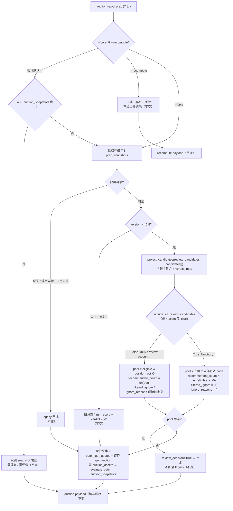

# auction 复用 prep 0.8 完整候选池 · 技术方案（2026-11-01）

> 阶段 2 产物。范围：T 日 `auction --pool prep` 在**严格 T-1** `prep` 0.8 快照存在时，竞价采集不再按 prep 的 `eligibility` / `position_pct` 收窄，而是采集 `review_candidates` 中**全部带有效 code** 的标的；`auction` 自身的竞价强度评分、排名、否决、快照契约均不变。
>
> 上游输入（照收，不推翻）：
> - main 任务包：用户已确认需求与验收标准（见 §1.1 原文）、当前事实核对、main 已定核心框架与取舍（轻量「策略参数」隔离，不复制第二套 loader/pipeline）。
> - owner 文档：`docs/agent/prep-auction.md` §集合竞价采集 `auction`（54–74 行，尤其 65 行候选池口径）、§快照口径（第 38 行 `review_candidates` / `position_pct` 三态语义）。
> - 代码契约：`dragon_quant/review_account/market.py`（`_review_decision_branch` / `collect_candidates_ex`）、`dragon_quant/review_account/candidate_view.py`（`project_candidates` / `is_review_eligible`）、`dragon_quant/review_account/auction/collect.py`（`run_auction` 池解析）。
>
> 本文只写方案：阶段 2 不改产品代码 / 测试代码 / owner 文档，不跑测试，不执行任何 git 操作。阶段 3 按 §10 顺序实施，文档同步在同一 commit 完成。

---

## 0. 结论摘要

1. **只改一处集合判定**：给 `market._review_decision_branch` 与 `market.collect_candidates_ex` 增加关键字参数 `include_all_review_candidates: bool = False`；仅 `auction/collect.py` 显式传 `True`。默认 `False` 时 `buy` / `review-account` / `simulator` / `live_trade` 逐字段不变。
2. **完整池口径 = `review_candidates` 主集合中所有 `code` 为非空字符串的条目**（含 `position_pct=0` / `null`、`eligibility=not_qualified` / `unknown`）。**不含** `project_candidates` 为 `review_max_codes` 截断而补齐的 raw-only 行——依据见 §3.2（这是对 main 措辞「全部 `project_candidates` 视图」的收窄解释，需 main 在验收时确认）。
3. **不新增字段/类/配置项/CLI 参数**；`auction` JSON 顶层键与顺序零变化（collect 26 / empty 17 / recompute 16 / snapshot 27 键）。`recommended_count` 仍表示 prep **实际推荐只数**（`eligible ∧ position_pct>0`），与池大小解耦。
4. **空池语义保持**：有效 0.8 决策（`review_decision=True`）时池为空**绝不回落 legacy**；`review_candidates` 为空（含 `review.enabled=false`）→ 空池 + `fallback_reason="no_eligible"`，与今天行为一致。
5. **0.7 及更早、显式 `--pool legacy`、快照缓存命中、`--force` / `--recompute`、日历/读取异常回退**全部不受影响。

---

## 1. 范围、验收标准映射与非目标

### 1.1 验收标准映射（用户已确认，原文照录）

| # | 验收标准（任务包原文） | 本方案落点 | 阶段 3 验证 |
|---|---|---|---|
| A1 | T 日 `auction --pool prep` 完整复用严格 T-1 `prep` 0.8 快照的 `review_candidates`：所有带有效 code 的候选都进入竞价采集，包括 `position_pct=0/null`、`eligibility=not_qualified/unknown` | §3.1 决策表 + `_review_decision_branch(include_all_review_candidates=True)` 的 pool 判定 | `test_auction_pool.py` 新增/改写用例（T1/T2/T5） |
| A2 | 不是取消 auction 自身的竞价强度评分/排名；只是不再按 prep 资格和仓位过滤，也不新增 prep 分数过滤 | 只改 pool 集合来源；`evaluate_batch` / `rank` / veto / 快照 v2 全链路不动 | 既有 `test_auction_service.py` / `test_auction_scoring` 回归 + T10 键序断言 |
| A3 | 有效 0.8 快照候选列表本身为空：保持空池，不回退 legacy | §3.2 决策表第 3 行；`review_decision=True` 分支保持不变 | T3（`review_candidates=[]` 且 `candidates[]` 非空） |
| A4 | 快照缺失 / 读取异常 / 日历异常等既有 legacy 回退不变 | 回退分支代码零改动 | 既有 `test_no_snapshot_falls_back` / `test_snapshot_read_error_falls_back` / `test_calendar_failure_falls_back` 回归 |
| A5 | 旧版（≤0.7）prep 快照历史行为不变 | `version < 0.8` 分支零改动 | 既有 0.6/0.7 用例回归（T6） |
| A6 | 只改变 auction；`buy` / `review-account` 继续只消费 `eligible ∧ position_pct>0` | 参数默认 `False`，仅 `collect.py` 传 `True`；`buy/strategy/*` 自身还有 `is_review_eligible` 守卫 | T7/T8/T9（market 层默认值矩阵）+ 既有 `test_verdicts.py` 回归 |
| A7 | 不改 auction JSON 顶层键契约；同步测试和 `docs/agent/prep-auction.md`（文档在阶段 3 改） | §7 契约不变性 + §11 文档同步清单 | 既有 `COLLECT_KEYS` / `EMPTY_KEYS` / `SNAPSHOT_KEYS` 断言 + T10 |
| A8 | 普通快照缓存语义、`--force` / `--recompute`、显式 `--pool legacy` 不变 | 这三条路径均不经过 0.8 分支 | 既有 `test_snapshot_cache` / `test_explicit_legacy_skips_prep_snapshot` 回归 |

### 1.2 非目标（明确不做）

- 不改 `prep` 计算、`review_candidates` 生成、`eligibility` / `position_pct` / `gate_trace` 口径与阈值。
- 不改 `auction` 评分器、维度、veto、`strength` / `level` / `rank` 语义、快照 v2 字段。
- 不改 `buy` / `sell` / `review-account` / `simulator` / `live_trade` 的池语义。
- 不新增 `StrategyConfig` 字段、不新增 CLI 参数、不新增类 / 抽象层 / 第二套 loader。
- 不改 `candidate_view.py`（`project_candidates` 结构适配职责不掺业务过滤）。
- 不改人读渲染文案（`report.py`）、不改 `strategy_context` 结构。
- 不回填/重算历史 `auction_snapshots`；不改变「旧快照不可横向对比」的既有结论。
- 不新增 prep 分数过滤（用户明确要求）。

---

## 2. 候选设计与推荐

### 2.1 方案 A（推荐，main 已定框架）：共享函数 + 默认关闭的策略参数

在唯一数据流 `market.collect_candidates_ex` 上增加 `include_all_review_candidates: bool = False`，透传给 `_review_decision_branch`，仅 auction 传 `True`。

- **设计模式：参数化策略（Strategy via parameter）+ 模板方法骨架**。`collect_candidates_ex` 保持固定骨架（读快照 → 分支判定 → 注解 → 排序 → 返回 ctx），「候选集合怎么选」作为一个布尔策略点；变更被隔离在一个条件里，不产生第二份 loader / pipeline。
- **动机**：消除重复（复用同一 snapshot→project→annotate 流）、隔离变化（只有 auction 这一个消费方需要全池）、面向既有接口而非实现（`collect_candidates_ex` 已是 auction/buy/回测共用入口）。
- **权衡**：布尔参数是「最少抽象」的形态；若未来出现第三种集合策略（如「只要仓位>0 不看 eligibility」），再考虑提成枚举。当前不预先抽象。

### 2.2 方案 B（不推荐）：新增 `collect_candidates_for_auction()` 包装函数，内部重读快照并自建全池

- 做法：`collect.py` 调新函数，该函数再次 `prep_snapshot_for` + `project_candidates`，自行筛全池，然后再调 `collect_candidates_ex` 拿注解。
- **否决理由**：同一次执行读两次快照、投影两次（重复 I/O + 两处 code 集合判定可能漂移）；要么复制 `_review_decision_branch` 逻辑（main 明确禁止），要么把 `ctx` 里的 `views` 暴露出去（污染上下文契约）。收益（签名更「干净」）远小于成本。

### 2.3 方案 C（反直觉，不推荐）：把集合判定下沉到 `project_candidates`，加 `mode="all"`

- 做法：投影层多一个 `mode`，直接返回全池主集合，market 只透传。
- **否决理由**：`project_candidates` 的职责是「结构适配 + 旧字段映射」（见 `candidate_view.py` 文档字符串），可买/可池集合是**业务口径**；下沉会让投影函数承担业务过滤，且其返回值被 `prep/service.py`、dashboard、factor 共用，扩大影响面。`code` 集合判定与投影同源的好处（少 3 行去重校验）不足以抵消职责混淆。

### 2.4 推荐结论

**采用方案 A**。它同时满足 main 的四条取舍（不复制 loader、不新增配置字段、不新建类、非 0.8 分支不受影响），并在 §3.2 明确一个 main 未展开的边界（raw-only 截断行）。

---

## 3. 精确口径

### 3.1 输入与术语

- **0.8 分支**：`_snapshot_version(snap["version"]) >= 0.8`（字符串 `"0.8"` 解析为 float 后比较）。
- **主集合（main set）**：`project_candidates(review_candidates, candidates[], day)` 的输出，其中 `code` 为非空字符串的行。顺序 = `review_candidates` 顺序（即 review 排序，`rank` 1-based）；同 code 重复时保留首个（`project_candidates` 已按 `seen` 去重）。
- **推荐集合（recommended）**：主集合中 `is_review_eligible(view) is True` 的行 = `review_eligible=True` = `eligibility=="eligible" ∧ position_pct>0`。
- **raw-only 行**：`project_candidates` 为「`candidates[]` 有、`review_candidates` 无」的代码补齐的行（`review_max_codes` 截断 → `ignore_reason="review_pool_truncated"`；review 不可用 → `"review_unavailable"`），`review_eligible=False`。

### 3.2 池判定决策表（0.8 分支）

| # | 条件 | `include_all_review_candidates` | pool | `recommended_count` | `filtered_ignore` | `ignore_reasons` | `fallback_reason` |
|---|---|---|---|---|---|---|---|
| 1 | `review_candidates` 不是 list（损坏 / `review.enabled=false` 的旧形态 / 缺字段） | 任意 | 空 | 0（无 views） | 0 | `[]` | `review_missing`（早退，保持现状） |
| 2 | 主集合非空 | `False`（buy/review-account 默认） | recommended | `len(pool)` | `count(position_pct==0)`（现有定义） | 非推荐行的 `ignore_reason` | `None` |
| 3 | 主集合非空 | `True`（仅 auction） | **主集合全部** | `len(recommended)` | **`0`** | **`[]`** | `None` |
| 4 | 主集合为空（`review_candidates=[]` 或全部无有效 code） | `False` | 空 | 0 | 0 | `[]` | 有 `eligibility=="eligible"` 条目 → `all_ignored`；否则 `no_eligible` |
| 5 | 主集合为空 | `True` | 空 | 0 | 0 | `[]` | **`no_eligible`** |

**为什么 `True` 时 pool 只取主集合、不含 raw-only 行（2026-11-01 main 单次验收已确认，见 §13）**：

1. 用户验收标准原文限定「完整复用……的 `review_candidates`：所有带有效 code 的候选」，`review_candidates` 是唯一权威；raw-only 行不是 `review_candidates` 的条目，而是被截断的兜底投影。
2. 验收标准另外要求「有效 0.8 快照候选列表本身为空：保持空池」。若把 `project_candidates` 的全部视图（含 raw-only）当池，则 `review_candidates=[]` 但 `candidates[]` 非空（review 关闭 / 损坏降级）时会得到**非空池**，直接违反该条。
3. 属性收益：新池 ⊇ 旧池（旧池 = recommended ⊆ 主集合），auction 永远不会因本改动**丢掉**任何原有候选；同时不把「prep 明确截断」的代码重新拉回采集（截断是 `review_max_codes` 的保护，重新拉回会让池上限失效）。

main 已于 2026-11-01 裁决不纳入 raw-only 行（§13）；若未来需要纳入，应新增独立参数（例如 `include_raw_only`），不复用本布尔参数，以免把「review 关闭」误判成「有候选」。

**`fallback_reason` 在完整池模式下的精确语义**：

- `None`：池非空（这是本次改动的常态——`position_pct=0` 的候选不再导致空池）。
- `no_eligible`：池为空，即 `review_candidates` 中**没有任何带有效 code 的条目**（不是「资格不足」，是「无条目可采」）。沿用既有原因码，不新增契约值。
- `all_ignored` 在完整池模式下**不可达**（不存在「被资格过滤」的候选），代码保留以维持 `False` 分支与 0.7 历史口径。

**`filtered_ignore` / `ignore_reasons` 在完整池模式下的精确语义**：

- `filtered_ignore = 0`：该字段语义是「被池过滤剔除的只数」；完整池没有剔除。
- `ignore_reasons = []`：空池分支（`collect.py:371`）会把它转成 `ignore_reason_count=0` + 空样本；完整池模式下空池只可能是「无有效条目」，本来就没有原因样本，语义自洽。
- 两者**均不出现在 auction JSON 顶层**（`collect.py` 只在 empty payload 里输出 `ignore_reason_count` / `ignore_reason_samples`），因此 `True` 模式的取值变化不构成对外契约变化。

### 3.3 `recommended_count` 的精确定义（两模式统一）

`recommended_count = len([view for view in main_set if is_review_eligible(view)])`，即 prep **实际推荐的只数**（`eligible ∧ position_pct>0`）。恒等于 `False` 模式的旧 `len(pool)`（数值不变），在 `True` 模式下与 `candidate_codes`（池大小）解耦：

- 场景：prep 推荐 1 只、池内共 5 只 → `recommended_count=1`、`candidate_codes=5`。
- 场景：prep 推荐 0 只、池内 5 只 → `recommended_count=0`、`candidate_codes=5`（这正是本次需求的目标场景：prep 不建议新建仓，但竞价仍要看全池）。

---

## 4. 数据流与分支（Mermaid）



> 图中只有 `J` 的判断与 `L` 的集合来源是本次新增；`F` / `H` / `C1` / `R` / `O` 的语义完全不变。

---

## 5. 接口与实现落点

### 5.1 `dragon_quant/review_account/market.py`

```python
def _review_decision_branch(snap: dict, day: str, ctx: dict,
                            snapshot_date: Optional[str],
                            *,
                            include_all_review_candidates: bool = False,
                            ) -> tuple[list[dict], dict[str, dict], bool]:
    """0.8 分支：默认 eligible ∧ position>0；auction 可传 True 取主集合全部有效 code。

    返回 ``(pool, verdict_map, has_review_decision)``。``has_review_decision=True``
    时调用方必须尊重空池（不回落 legacy）。
    """
```

实现要点（伪代码，等价改写，不复制新流程）：

```python
    views = project_candidates(review_candidates, raw, day)
    views = [view for view in views if isinstance(view, dict) and view.get("code")]
    verdict_map = {view["code"]: view for view in views}
    recommended = [view for view in views if is_review_eligible(view)]
    ctx["recommended_count"] = len(recommended)          # 两模式同一语义

    if include_all_review_candidates:
        codes = {item.get("code") for item in review_candidates
                 if isinstance(item, dict)
                 and isinstance(item.get("code"), str) and item["code"]}
        pool = [view for view in views if view.get("code") in codes]
        ctx["filtered_ignore"] = 0
        ctx["ignore_reasons"] = []
    else:
        pool = recommended
        ctx["filtered_ignore"] = sum(
            1 for item in review_candidates
            if isinstance(item, dict) and item.get("position_pct") == 0)
        ctx["ignore_reasons"] = [
            view.get("ignore_reason") for view in views
            if not is_review_eligible(view) and view.get("ignore_reason")]

    ctx["pool_source"] = "prep"
    if pool:
        ctx["fallback_reason"] = None
    elif include_all_review_candidates:
        ctx["fallback_reason"] = "no_eligible"           # 无有效 code 可采
    elif any(isinstance(item, dict) and item.get("eligibility") == "eligible"
             for item in review_candidates):
        ctx["fallback_reason"] = "all_ignored"
    else:
        ctx["fallback_reason"] = "no_eligible"
    return pool, verdict_map, True
```

`collect_candidates_ex` 签名（新增一个关键字参数，既有位置参数不变）：

```python
def collect_candidates_ex(calendar: list[str], day: str, cfg, loader,
                          auction_loader=None, factor_loader=None, *,
                          include_all_review_candidates: bool = False
                          ) -> tuple[list[dict], dict]:
```

并在 0.8 分支调用处透传：

```python
        pool, verdict_map, review_decision = _review_decision_branch(
            snap, day, ctx, snapshot_date,
            include_all_review_candidates=include_all_review_candidates)
```

文档字符串补一段：该参数**只影响 0.8 分支**；仅 `auction` 传 `True`；0.7 及更早、legacy 回退、`pool` 注解、排序、因子注解均不受影响。

### 5.2 `dragon_quant/review_account/auction/collect.py`

`run_auction` 内的调用（约 316 行）改为：

```python
                candidates, ctx = collect_candidates_ex(
                    calendar, trade_date, cfg, candidate_loader(source),
                    include_all_review_candidates=True)
```

并补一行注释：**T 日竞价需要 prep 全池（含 position 0/null、not_qualified/unknown），不按 prep 资格/仓位过滤；`recommended_count` 仍由共享函数按 prep 实际推荐只数给出。**

其余（`by_code` 构造、legacy top-up 条件 `not ctx.get("review_decision")`、行情/盘口/评分/快照写入、payload 组装）**零改动**。

### 5.3 不改动的文件

`candidate_view.py`、`auction/{scoring,report,context,recompute,serialize}.py`、`buy/*`、`strategy/*`、`prep/*`、`commands/*`、`web_ui/*`。

---

## 6. 错误 / 边界处理

| 场景 | 行为 | 依据 |
|---|---|---|
| `review_candidates` 含非 dict / `code` 缺失 / 空串 / 非字符串 | 跳过（不进主集合） | `project_candidates` 已有校验，新代码用同一校验条件 |
| `review_candidates` 重复 code | 保留首个（review 排序靠前） | `project_candidates` 的 `seen` 去重 |
| `candidates[]` 缺失 / 非 list | 主集合仍可建立（name/facts 为空，不影响 code） | `project_candidates(raw=[])` 已支持 |
| `review_candidates=[]` 且 `candidates[]` 非空（review 关闭 / 降级） | 空池、`no_eligible`、不回落 legacy | §3.2 第 4/5 行；与今天结果一致 |
| `position_pct` 为 `0` / `null` / `"0"`（字符串）/ 缺失 | 一律进池；`recommended_count` 不计入 | A1 口径；`_num` 只认 int/float，字符串视为 `null` |
| 0.8 快照但 `review_decision=True` 且池空 | 不回落 legacy（`collect.py:331` 条件不变） | A3 |
| 快照缺失 / 读取异常 / 日历异常 | legacy 回退不变 | A4 |
| `version` 非法（如 `"abc"`） | `_snapshot_version → None` → 走旧分支 | 现有逻辑 |
| `version` 为 `0.9` / `"1.0"` | `>= 0.8` → 完整池模式 | 前向兼容 |
| 池内某只 `get_auction` 抛错 / 返回空 | 分别进 `failed` / `empty`，不中断整批 | 现有逐只隔离 |
| 池变大导致行情批量/盘口请求变多 | 上限 = `review_max_codes`（默认 60），不新增请求类型 | §9.1 |

---

## 7. 兼容性与契约

- **JSON 顶层键**：collect 26 / empty 17 / recompute 16 / snapshot 27 键与顺序**零变化**（`test_auction_service.py` / `e2e/test_auction.py` 的 `*_KEYS` 常量即契约，阶段 3 不改这些常量）。
- **字段值语义变化（预期内）**：`candidate_codes`、`saved_count`、`empty`、`snapshots[]` 会因池变大而变大；`recommended_count` 语义不变但可能小于 `candidate_codes`。
- **`strategy_context`**：`pool.candidate_codes` 计数随池变；结构不变。
- **旁路消费方（按 code 查找，不受池变大影响）**：`prep` 的 `auction_feedback` 采集器只按 `prev_plan.positions[].code` 取同日本地资产（`prep/collectors.py:740` 之后按 code 过滤），多出的竞价行被自然忽略，只是减少 TDX 补采；dashboard 竞价页按当日 `auction_assets` / `auction_snapshots` 逐行投影，行数变多、字段不变；`market._default_auction_loader` 只被 `collect_candidates_ex` 的 A 注解按 code 查找，`ranking_mode` 只看 `auction_rows > 0` / `verified > 0`（`priority.ranking_mode`），不随行数改变结论。
- **ctx（内部）**：新增参数不新增 ctx 键；`filtered_ignore` / `ignore_reasons` / `fallback_reason` 的取值在 `True` 模式下按 §3.2 定义。
- **buy / review-account**：默认 `False`，`pool` / `ctx` 逐字段不变；此外 `review_account/strategy/buy.py`、`checks.py` 仍有 `is_review_pool and not is_review_eligible → 拒绝` 的守卫，双保险。
- **缓存语义**：当日已存 `auction_snapshots` 命中时仍直接只读返回——**新池策略不会自动刷新当日快照**，需 `auction --force`；历史快照不可横向对比（既有结论，文档已写明）。
- **数据源/依赖**：不新增第三方依赖、不改 `StockProvider`、不改 DB schema。

---

## 8. 测试策略

### 8.1 单元测试矩阵

| ID | 层级 | 输入（0.8 快照） | 调用 | 期望 |
|---|---|---|---|---|
| T1 | market / auction | A: eligible + 4.0；B: eligible + 0；C: not_qualified + 0；D: unknown + null | `collect_candidates_ex(..., include_all_review_candidates=True)` | pool = {A,B,C,D}；`recommended_count=1`；`filtered_ignore=0`；`ignore_reasons=[]`；`fallback_reason=None` |
| T2 | market | 重复 code、`code=""`、`code=None`、`code=123` | 同上 `True` | 池内 code 唯一且仅为非空字符串；不抛异常 |
| T3 | auction | `review_candidates=[]`，`candidates[]` 有 A | `run_auction(pool="prep")` | `pool_empty=True`、`candidate_codes=0`、`pool_source="prep"`、`fallback_reason="no_eligible"`、零行情/零盘口调用 |
| T4 | auction | `version=0.8` 无 `review_candidates` | 同上 | `fallback_reason="review_missing"`、空池、不回落（既有用例保留） |
| T5 | market | `review_candidates=[A]`，`candidates[]=[A, X]`（X 为截断 raw-only） | 同上 `True` | pool 仅 {A}；X 不入池 |
| T6 | auction | `version=0.6` + `verdict` | 同上 | 旧口径：eligible 且非 ignore（既有用例保留） |
| T7 | market | A eligible+4；B eligible+0；C not_qualified+0 | `collect_candidates_ex(...)`（默认） | pool={A}；`recommended_count=1`；`filtered_ignore=2`（两条 position==0）；`ignore_reasons` 含 B/C 的原因；`fallback_reason=None` |
| T8 | market | 同 T7 | `include_all_review_candidates=True` | pool={A,B,C}；`recommended_count=1`；`filtered_ignore=0`；`ignore_reasons=[]` |
| T9 | market | A ignore（0.7 快照） | 默认 | `all_ignored` + legacy 回退（既有用例回归） |
| T10 | service | 0.8 快照 + 全池 | `run_auction` | `list(payload)==COLLECT_KEYS`；`candidate_codes` = 全池；`recommended_count` = 推荐数；`saved_count` = 全池 |
| T11 | auction | 显式 `--pool legacy` | 同上 | 不读 prep 快照（既有用例回归） |
| T12 | auction | 当日有可用 `auction_snapshots` | 同上（无 `--force`） | `mode="snapshot"`、零 provider 调用（既有用例回归） |

### 8.2 需要改写的既有用例

- `dragon_quant/tests/test_auction_pool.py::test_review_pool_uses_eligibility_and_position` → 改为 `test_review_pool_uses_all_review_candidates`：期望 `calls["auction"] == ["A","B","C"]`、`recommended_count==1`。
- `dragon_quant/tests/test_auction_pool.py::test_review_pool_empty_does_not_fallback` → 语义分裂为两条：
  1. `test_position_zero_candidate_is_collected_without_fallback`：A(`position 0`) 被采集，`fallback_reason=None`，`pool_empty=False`；
  2. `test_empty_review_candidates_keeps_empty_pool`：`review_candidates=[]` → 空池 + `no_eligible` + 不回落。
- 其余用例（`test_review_missing_does_not_fallback`、0.6/0.7、legacy、缓存、`--days`）**不改**。

### 8.3 需要新增的用例

- T2 / T5 / T7 / T8（market 层，直接调 `collect_candidates_ex`）：其中 T7/T8 建议放 `dragon_quant/tests/test_verdicts.py`，作为「buy/shared 默认行为」的回归锚点。
- T10（service 层，`test_auction_service.py` 的 0.8 分支契约补充）。

> 夹具风险：T1/T5/T7/T8/T10 都用手工构造的 0.8 快照。若 `review_candidates` 的字段集漂移（例如将来把 `position_pct` 改名），这些用例会「照旧通过」却不再覆盖真实形态。缓解：新增用例里对每只 review 条目断言必需字段存在（`eligibility` / `position_pct` / `review_score` / `gate_trace`），并在 `test_candidate_view.py` 既有投影用例上保持真实 `project_candidates` 调用（不 mock 投影层）。

### 8.4 阶段 3 执行命令（自测证据来源）

```bash
.venv/bin/python -m pytest dragon_quant/tests/test_auction_pool.py \
  dragon_quant/tests/test_verdicts.py dragon_quant/tests/test_auction_service.py \
  dragon_quant/tests/test_candidate_view.py dragon_quant/tests/test_priority.py -q

.venv/bin/python -m pytest dragon_quant/tests -q \
  --ignore=dragon_quant/tests/e2e --ignore=dragon_quant/tests/smoke

.venv/bin/python -m pytest dragon_quant/tests/e2e/test_auction.py \
  dragon_quant/tests/e2e/test_architecture_rules.py -q
```

> E2E 不做改动：`test_auction.py` 的 prep 种子固定 `version="0.6"`（`seed_builders.py:545`），不会进入 0.8 分支；golden 无需更新。若阶段 3 发现 golden 变化，说明改动越界，必须回溯而不是更新 golden。

---

## 9. 风险与缓解

### 9.1 池变大 → 请求量与耗时上升（主要风险）

- 影响：`batch_get_quotes` 仍是整批一次请求；**逐只 `get_auction` 是串行**，池上限由 `review_max_codes`（默认 60）约束。典型日池从「推荐数（常 0-5）」升到「详细池（可达数十）」。
- 缓解：上限是既有详细池上限，不新增请求类型；逐只失败隔离不变；不引入并发（避免改动采集并发模型与反爬边界）。
- 残留：9:25 后串行拉取数十只盘口的耗时可能显著增加。本方案不改并发，登记为 `residual_risks`；若实测不可接受，另开需求（并发/限速）——属于范围外。

### 9.2 语义误读：`recommended_count` 被当成池大小

- 缓解：两模式统一按 `is_review_eligible` 计算；T1/T7/T8/T10 断言；文档 §3.3 与 owner 文档同步说明「推荐只数 ≠ 采集只数」。

### 9.3 空池原因码语义漂移（`all_ignored` 不可达）

- 缓解：完整池模式固定 `no_eligible`；`all_ignored` 保留给 `False` 分支。人读输出仍显示「回退：no_eligible」——**这是既有文案形态**（`report._format_empty` 无条件前缀「回退：」），本次不改渲染；登记为 MINOR。

### 9.4 越界影响 buy / 回测

- 缓解：默认 `False`；`collect_candidates` 包装不带该参数；`buy/strategy` 另有 `is_review_eligible` 守卫；T7/T9 与既有 `test_verdicts.py` 回归。

### 9.5 当日缓存导致「改了没效果」的误判

- 缓解：文档与交付报告明确——验证需 `auction --force`；`recompute` 只重算已存资产，不会扩池。

### 9.6 截断边界（`review_max_codes`）

- 完整池不等于完整详细池：超过 60 只的代码仍是 raw-only，不入竞价池。与 prep 资产截断口径一致，不额外扩上限。

### 9.7 架构/依赖规则

- 不新增 import、不改分层方向：`market.py` 只多一个布尔参数；`collect.py` 仍是唯一传 `True` 的调用方。`test_architecture_rules.py` 的 auction 调用白名单（`_AUCTION_COLLECT_CALLS` 已含 `collect_candidates_ex`）无需变更。

---

## 10. 阶段 3 实施顺序

0. 载入 `code-self-review` 前置：确认工作区干净、只在本需求分支改动。
1. `market.py`：改 `_review_decision_branch`（签名 + 池判定 + ctx 语义）与 `collect_candidates_ex`（签名 + 透传 + docstring）。
2. `collect.py`：调用处传 `include_all_review_candidates=True` + 注释。
3. 测试：改写 T1 两条用例、新增 T2/T3/T5/T7/T8/T10。
4. 跑 §8.4 三组命令，保留真实输出摘要。
5. 文档同步（§11），与代码同 commit；commit / 分支 / push 由用户控制，不主动执行。
6. 自测通过后 `code-self-review`，再回报 main 单次验收。

---

## 11. 阶段 3 文档同步清单

| 文档 | 改动 |
|---|---|
| `docs/agent/prep-auction.md`（65 行「候选池」段） | 0.8 口径改为：`auction` 取 `review_candidates` **全部带有效 code** 条目（含 `position_pct=0/null`、`eligibility=not_qualified/unknown`），不再按 prep 资格/仓位过滤；`buy`/`review-account` 仍只取 `eligible ∧ position_pct>0`（共用入口默认关闭）；`recommended_count` 仍表示 prep 实际推荐只数；`review_candidates` 为空保持空池不回落 legacy；不新增 prep 分数过滤。 |
| 同上，**必须同批修正的失真句** | 现有 65 行结尾「与 `buy`/`review-account` 共用 `market.collect_candidates_ex`，**保证 code 集合一致**」在本改动后不再成立，须改为「共用同一入口与同一条 snapshot→project→annotate 数据流；候选取集合由 `include_all_review_candidates` 隔离：auction 取全池，`buy`/`review-account` 仍取 `eligible ∧ position_pct>0`」。 |
| 同上，66 行「回退」段 | 补一句原因码在完整池模式下的语义：池为空只可能是 `review_candidates` 无有效 code 条目（`no_eligible`），`all_ignored` 仅在 `buy`/回测的旧口径下可达。 |
| `docs/agent/prep-auction.md`（可选，52 行「auction 缓存」） | 补一句：池口径变更后，当日已存快照不会自动刷新，需 `auction --force`。 |
| `README.md` | **无需改**：README 未描述 auction 候选池口径（仅列命令与模块定位）。 |
| root `AGENTS.md` | **无需改**：未新增跨模块硬约束。 |

> 编辑提示：`prep-auction.md` 第 54–62 行存在与 46–52 行重复的「prev 注入与派生清理（0.8）」小节（既有文档瑕疵，与本需求无关）。阶段 3 只改 65–66 行，**不要顺手删除重复段**，避免把无关改动揉进同一 commit。

---

## 12. 待 main 确认 / 登记项

1. **【已确认，2026-11-01 main 单次验收】raw-only 截断行不入池**：本方案依据验收标准把「完整池」收窄为 `review_candidates` 主集合（§3.2 理由 1–3）。main 裁决：**按用户已验收的 `review_candidates` 主集合口径实施，不含 `project_candidates` 补齐的 raw-only 行；这不是偏离，而是对用户验收标准的准确落实；`review_candidates` 为空时保持空池。** 本项关闭，不再需要追加参数。
2. **【MINOR，不阻塞】** 完整池模式下 `fallback_reason` 的 `all_ignored` 不可达；人读空池文案仍带「回退：」前缀（既有形态，未改渲染）。
3. **【残留风险】** 池扩大使逐只 `get_auction` 串行耗时上升（上限 60 只），本方案不改并发。
4. **【操作提示】** 验证本改动必须 `auction --force`；普通运行命中当日缓存时不会体现新池。

---

## 13. main 单次验收记录（2026-11-01）

- **结论**：阶段 2 通过，无「必须修改」项，方案定稿，进入阶段 3。
- **裁决 1（口径确认）**：按用户已验收的 `review_candidates` 主集合口径实施；不含 raw-only 行；空 `review_candidates` 保持空池。§12.1 已关闭。
- **建议 2（不阻塞，维持现状）**：空池人读文案前缀与逐只串行采集继续登记为 `known_issues` / `residual_risks`，本需求不扩大范围。
- **阶段 3 强制项**：
  1. 同 commit 修正 owner 文档 `docs/agent/prep-auction.md` 中「与 `buy`/`review-account` 共用 `collect_candidates_ex`，保证 code 集合一致」的失真表述（改写口径见 §11），并补 §11 列出的原因码语义。
  2. 按 §8 测试矩阵验证**默认 `False` 的共享行为不变**（T7/T9 + 既有 `test_verdicts.py` 回归），以及完整池模式 T1–T5/T10。
- **处置人**：execute_agent（阶段 3 实施时按本条留痕，`main_acceptance` 逐条记录）。
