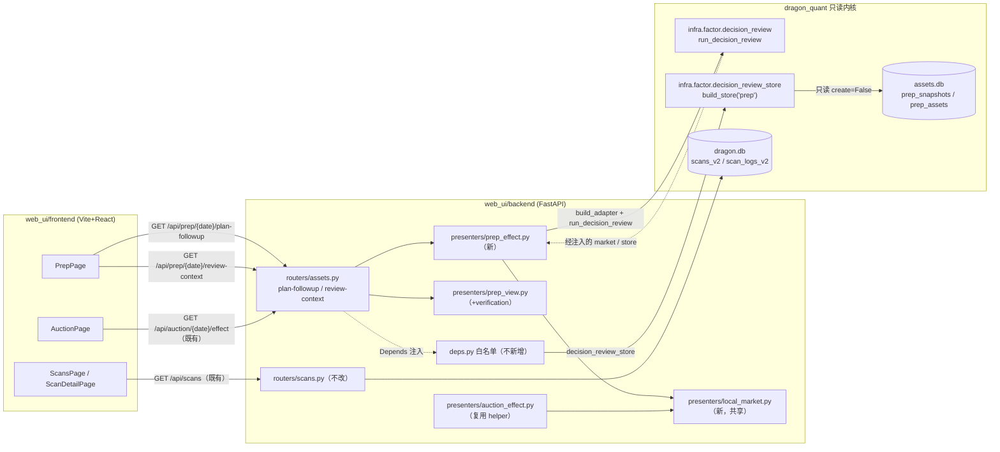
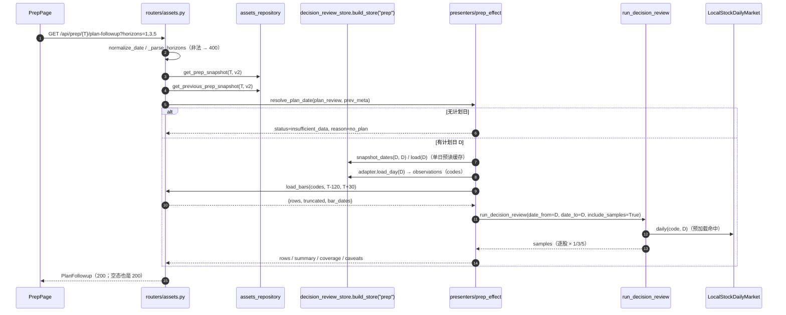
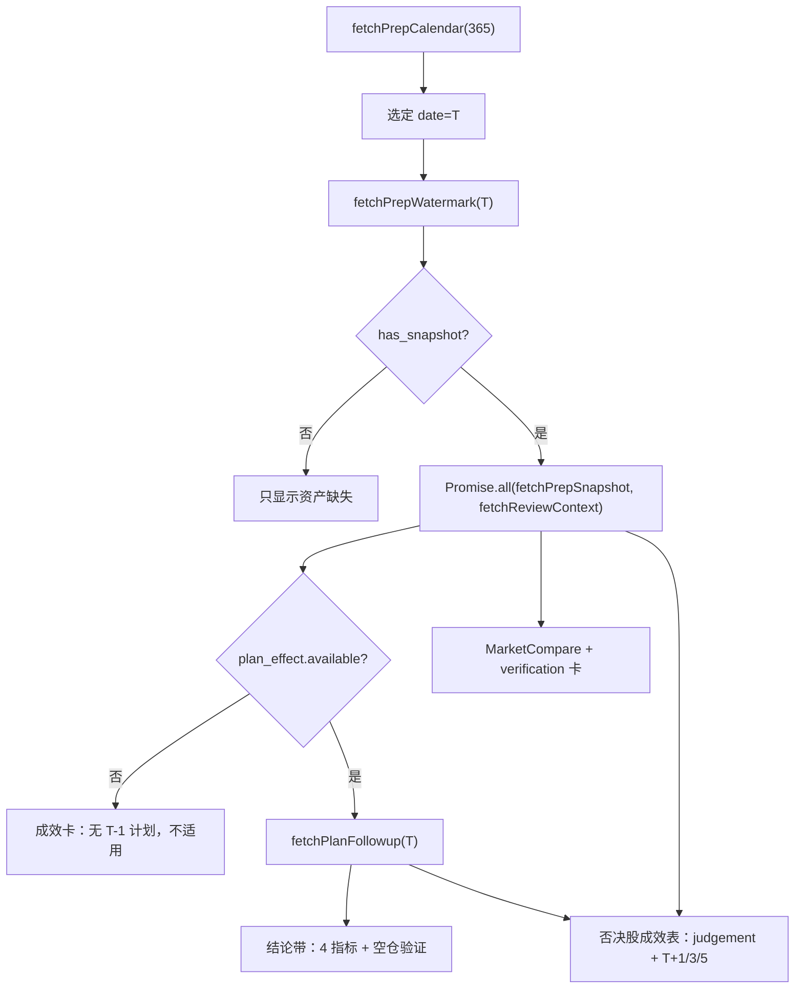

# dashboard 核心问题直答 · 技术方案（2026-11-01）

> 阶段 2 产物。范围：dashboard 三页（扫描 / 复盘 / 竞价）围绕「这一天到底是否正常、成效到底如何」的信息重构——后端新增 `plan-followup` 端点与空仓验证判定，前端加健康带、结论带、否决股成效表、竞价屏效压缩。
>
> 上游输入（照收，不推翻）：
> - main 任务包：用户四条核心期待 + 已确认产品决策（净收益口径、本地市场指标、扫描健康带、不做 mockup）+ main 已定框架（改动一后端 3 项、改动二前端 6 项、硬约束 5 条）。
> - owner 文档：`docs/agent/development.md`（Web UI 构建 / 测试 / 分发）、`docs/agent/prep-auction.md`（prep 资产与快照口径、dashboard 只读投影边界）。
> - 代码契约：`dragon_quant/infra/factor/decision_review.py`（`build_adapter` / `run_decision_review`）、`dragon_quant/infra/factor/decision_review_store.py`（`build_store`）、`web_ui/backend/presenters/auction_effect.py`（最接近的参照实现）、`web_ui/backend/presenters/prep_view.py`（`_build_plan_effect` / `_market_side`）、`web_ui/backend/routers/assets.py`、`web_ui/backend/deps.py`。
>
> 本文只写方案：阶段 2 不改产品代码、不改 owner 文档、不跑测试、不执行任何 git 操作。阶段 3 按 §13 顺序实施；文档同步在阶段 3 同一 commit 完成，commit / 分支由用户控制。

---

## 0. 结论摘要

1. **「被否股后续涨跌」用新端点 `GET /api/prep/{trade_date}/plan-followup`**：内部以**计划日 D（不是评估日 T）**为样本锚点，调用 `build_adapter("prep", store)` + `run_decision_review(..., include_samples=True)`，行情用 `LocalStockDailyMarket` 只读 `prep_assets.stock_daily`。**零新增收益计算逻辑、零阈值改动、零 provider、零写库**。逐股输出 T+1/3/5（= 评估日开盘 → 第 N 个交易日后开盘，扣 13bp 往返成本）。
2. **plan 分组契约疑点已定论**：`decision_review_store.build_store("prep")` 存在且 `PrepSnapshotAdapter` 支持 `0.7/0.8`；`deps.decision_review_store` 返回的是模块对象，路由侧 `store.build_store("prep")` **无需新增白名单**。prep 分组 = `position_pct==0 → not_recommended` / `>0 且 eligibility==eligible → recommended` / 其余 → `data_insufficient`，与 `plan_review.no_trade`（`planned_position==0`）同集合（正常路径）。
3. **空仓验证判定放在后端**：`prep_view._build_plan_effect` 的 `market_comparison` 新增 `verification`（结论 key + 依据数字），规则表集中为一个纯函数；这是用户批准的**新判定口径**（现有代码刻意只陈述事实），方案 §5.4 显式记录规则、动机与「这是产品决策」。
4. **前端屏效重构**：扫描页顶部健康带（一次 `fetchScans` 首行 + 纯前端相对时间）；扫描详情错误置顶 + 真龙行置顶高亮 + 五维 `MiniBar`；复盘页结论带 + 否决股成效表 + 空仓验证卡 + 运行异常 ≤5 条默认展开；竞价页删除逐股 `<details>`、T+1/3/5 并入主表三列、强弱差升为成效区置顶 KPI。
5. **诚实原则贯穿**：任何缺快照 / 缺计划 / 缺本地日 K / 未来交易日未到，一律「待评估」并给原因码；不写 0、不补算、不伪造样本。
6. **无新依赖、无 DB schema、无 CLI/评分/交易决策变化**；改前端必须同批 `npm --prefix web_ui/frontend run build`。

---

## 1. 范围、验收标准映射与非目标

### 1.1 验收标准映射（对应用户四条期待 + main 框架）

| # | 验收标准（任务包原文要点） | 本方案落点 | 阶段 3 验证 |
|---|---|---|---|
| A1 | 扫描页：这一天扫描是否正常完成、什么时刻完成、中间有没有错误、当日结果展示 | §6.1 健康带（状态/扫描日/完成时刻/距今/当日速览）、§6.2 详情错误置顶 | 后端不改 + 前端契约测试（文案/组件）+ 页面人工确认 |
| A2 | 复盘页：数据资产是否获取到、过程有没有问题 | §6.3 结论带（资产完备 / 异常数）+ 既有 `RunOverview` 保留 + 运行异常 ≤5 默认展开 | 前端契约测试 + 既有 `test_web_backend` 回归 |
| A3 | 复盘页：**被否掉的股票后续是涨了还是跌了** | §4.1 `plan-followup` + §6.4 否决股成效表（judgement + T+1/3/5） | presenter 单测（正向/缺 bars/缺计划）+ 端点单测 + E2E D11 |
| A4 | 复盘页：**空仓建议第二天是否真的市场大跌** | §4.2 `market_comparison.verification` + §5.4 规则表 + §6.5 验证卡 | `prep_view` 纯函数单测（8 个分支）+ 端点断言 |
| A5 | 复盘页：成效总览 | §6.3 结论带四指标（推荐 T+1 / 否决 T+1 / 强弱差 / 有效样本）+ 既有分组对照保留 | 前端契约测试 + followup `summary` 单测 |
| A6 | 竞价页：资产/过程/成效 + 屏效 | §6.6 删 `<details>`、T+1/3/5 三列、强弱差 KPI 置顶 | 前端契约测试 + dist 文案 |
| A7 | 页面高级感、屏效高 | §6.7 MiniBar / 单行空态 / 去重卡片；不缩字号（≥1rem） | 前端契约测试（禁 `<14px`）+ light/dark 人工确认 |
| A8 | 硬约束：web_ui 零 sqlite3 / 零连接 / 零写库、只走 deps 白名单 | §3.1 只读边界（仅用已注入的 `decision_review_store` / `local_bars_loader` / `assets_repository`） | `test_assets_router_never_references_providers` + 架构规则测试 |
| A9 | 硬约束：改前端必须同批 build dist | §9.5、§12 | `npm --prefix web_ui/frontend run build` + dist 契约测试 |
| A10 | 硬约束：主题色禁止斜杠透明度；红涨绿跌独立；不做 v1 回退 | §6.7 token 规则 + 新增/改动文件不得出现 `bg-white/` 之类 | 新增前端契约断言（正则可直读源码） |
| A11 | 硬约束：缺数据一律「待评估」 | §5.5 降级矩阵 + §8 | 单测覆盖空态 / `exclusion_reason` / `not_evaluable` |
| A12 | 文档同步 | §12 `development.md` + `prep-auction.md` 同 commit | 文档 diff 人工核对 |

### 1.2 非目标（明确不做）

- 不新增 CLI 命令/参数，不改 `prep` / `auction` 采集器、`prep_snapshots` / `auction_snapshots` 字段与版本。
- 不改 `review` 评分、`position_advice` 阈值（80/5/30/10）、`eligibility` / 闸门、`buy` / `sell` / `review-account`。
- 不新增 DB 表 / 字段 / 索引；不新增 `deps.py` 白名单函数（复用现有的三个）。
- 不在前端重算收益或分组；前端只做「按 code join + 展示」。
- 不引入指数日线、不加第二套价格口径、不补算涨停价。
- 不做 mockup、不引入新 npm 依赖（不允许图表库）。
- 不恢复 v1：新端点不提供 `source` 参数，固定 v2。
- 不新增统一运行历史表；未落库的扫描崩溃仍不伪造。
- 不给扫描页加「重新扫描」按钮（dashboard 只读）。

---

## 2. 候选设计与推荐

### 2.1 「被否股后续涨跌」的实现路径

| 方案 | 做法 | 优点 | 缺点 / 风险 |
|---|---|---|---|
| **A（推荐）** | 新端点 `plan-followup`；锚定计划日 D，`build_adapter("prep", store)` + `run_decision_review(include_samples=True)`；行情 `LocalStockDailyMarket` 读本地 `stock_daily` | 与竞价成效**同一内核**，口径天然一致；阈值/分组/成本不在 web_ui 复制；新增代码只是窗口裁剪 + 投影（≈180 行） | 需要一次计划日快照读；单日样本 stats 只能描述不能下结论（用 caveat + 只暴露 valid/mean/median 规避） |
| B | 在 `prep` 计算段把 T+1/3/5 收益写进快照 | 前端零计算 | **违反只读与快照冻结口径**：T+3/T+5 在当日不可能已知，回填会改历史快照；改动采集/计算/因子血缘，收益为负 |
| C（非常规） | 复用 `/api/auction/{date}/effect`，把 prep 计划股塞进 auction 快照池 | 零新后端代码 | **伪造数据**：auction 分组语义（strong/weak/vetoed）与 prep（recommended/not_recommended）不同源，等于篡改证据；直接违背诚实原则。否决 |
| D（非常规） | 前端分别调用 `/snapshot` + 多次 `/api/dragons/.../performance` 自己拼 | 后端零改动 | 需触网（雪球 provider），单只一次请求 N+1；且口径与 decision-review 不同（不复用成本/可成交剔除），产生第二套收益口径。否决 |

**推荐 A**，理由：唯一同时满足「零新收益口径、零阈值、只读、可测试」的路径；与已有 `auction_effect` 形成同一 Adapter 家族，维护成本最低。

### 2.2 「空仓验证」的判定位置

| 方案 | 做法 | 评价 |
|---|---|---|
| **A（推荐）** | 后端 `prep_view` 纯函数产出 `verification`，前端只渲染 | 规则表集中、可单测、前端零口径；与「判定只在后端」既有约定一致 |
| B | 前端拿 `prev/current` 数字自行判定 | 规则散落到 TSX，难测、易与后端口径漂移；违背 main 已定框架 |
| C | 写进 `prep` 计算段（快照新增字段） | 改快照 schema / 版本语义，且「次日」需 T 日数据，属于展示层判定，不该进快照。否决 |

**推荐 A**。规则表见 §5.4，动机：这是用户显式批准的**产品判定**（现有代码刻意只陈述事实），因此必须集中、留痕、可回归。

### 2.3 共享 helper 的落点（本方案自治决定）

- 把 `LocalStockDailyMarket`、`LOCAL_CAVEATS`、`shift_day`（原 `_shift`）从 `presenters/auction_effect.py` **提升**到新文件 `presenters/local_market.py`；`auction_effect.py` 改为 `from .local_market import ...` 并在 `__all__` 继续导出，保证 `dragon_quant/tests/test_dashboard_local_market.py` 的既有 import 不破。
- `_CachingWindowStore` 留在 `auction_effect`（它的语义是「窗口多日缓存」）；prep 侧只需要**单日预读缓存** `_PreloadedStore`，写在 `prep_effect.py` 内部。
- 理由：只抽真正被两处复用的东西；不为「未来可能有第三个 presenters」造抽象基类。

### 2.4 设计模式（动机）

| 模式 | 落点 | 动机 |
|---|---|---|
| Adapter | `PrepSnapshotAdapter`（既有）+ `LocalStockDailyMarket` | 把异构快照 / 本地日 K 适配成 `run_decision_review` 的鸭子类型输入，让 web_ui 不感知快照结构 |
| Template Method | `run_decision_review`（既有） | 骨架（枚举日 → 观测 → 标签 → 聚合）固定，来源差异只在适配器 |
| Strategy | `SOURCE_GROUP_SPECS`（既有）+ **验证规则表**（本次新增 `_classify_verification`） | 把「不同建议方向 × 不同市场状态」的分支收敛成一张显式表，改规则只改一处；避免 if 树散落在 JSX |
| Facade / Presenter | `prep_effect.run_plan_followup` | 路由只解析参数与响应；窗口裁剪、覆盖统计、caveats 收在一处纯函数 |

不引入 Repo/Service 新层：现有 `deps.py` + `presenters/` 已经够用，加层只会增加跳转成本。

---

## 3. 架构与数据流

### 3.1 只读边界



- `web_ui` 内**零 `sqlite3`、零自建连接、零写库**。新端点只使用三个既有依赖：`assets_repository`（读 `plan_review.plan_date` / 前日快照 meta）、`decision_review_store`（`build_store("prep")` 读计划日快照）、`local_bars_loader`（读 `prep_assets.stock_daily`）。
- 不 import 任何 provider；断言由既有 `test_assets_router_never_references_providers` 守护（新增代码不得出现 `provider` / `kline_provider` / `XueqiuProvider` 字样）。

### 3.2 新端点的数据流（时序）



**为什么 bar 窗口锚 `T` 而不是 `D`**：`stock_daily` 是「按资产日期写入的 120 日窗口资产」，未来收益必须来自**评估日之后**写入的资产。`[T-120, T+30]` 与竞价成效一致，覆盖 `D+1 … D+6` 开盘（`D≈T-1`）。

**为什么样本锚 `D`**：`plan_review` 是「计划日冻结的决策 → 评估日兑现」，分组（recommended / not_recommended）属于计划日快照。若锚 T（评估日）会拿到评估日自己的候选池，与「被否股」无关。

### 3.3 页面数据流（复盘页）



`fetchPlanFollowup` 只在有计划时触发（二级 effect，依赖 `context`），避免无计划的日子白读快照。

---

## 4. 接口定义

### 4.1 `GET /api/prep/{trade_date}/plan-followup`

| 项 | 值 |
|---|---|
| 方法 / 路径 | `GET /api/prep/{trade_date}/plan-followup` |
| 日期参数 | `trade_date`：评估日 `T`，接受 `YYYY-MM-DD` 与 `YYYYMMDD`（`params.normalize_date`），非法 → 400 `invalid_request` |
| `horizons` | 逗号分隔，仅 `{1,3,5}` 的非空子集；缺省 `1,3,5`；其它 → 400 `invalid_request`（复用 `_parse_horizons`） |
| `source` | **无**（固定 v2，不接受 `source` 参数） |
| 空态 | 一律 200；缺失/不可评估用 `status/reason/待评估` 表达，不 404 |
| 依赖 | `assets_repository`、`decision_review_store`、`local_bars_loader` |

响应（`PlanFollowup`）：

```jsonc
{
  "status": "ok",                       // "ok" | "insufficient_data"
  "reason": null,                       // 见 §5.5 原因码
  "trade_date": "2026-11-01",           // 评估日 T
  "plan_date": "2026-10-31",            // 计划日 D（样本锚点）
  "plan_date_source": "plan_review",     // "plan_review" | "previous_snapshot" | null
  "data_source": "local_stock_daily",
  "cost_bps": 13.0,
  "horizons": [1, 3, 5],
  "rows": [
    {
      "code": "600002",
      "name": "跟风B",
      "group": "not_recommended",        // recommended | not_recommended | data_insufficient
      "score": 62.5,                     // review_score，可 null
      "level": "一般",                    // review_grade，可 null
      "horizons": {
        "1": {
          "entry_date": "2026-11-01",
          "exit_date": "2026-11-02",
          "net_return_pct": -1.13,
          "outcome": "down",            // up | down | flat | null
          "exclusion_reason": null       // 见 §5.6
        },
        "3": { "...": "..." },
        "5": {
          "entry_date": null, "exit_date": null,
          "net_return_pct": null, "outcome": null,
          "exclusion_reason": "insufficient_horizon"   // 未来交易日未到 = 待评估
        }
      }
    }
  ],
  "summary": [
    {
      "horizon": 1,
      "groups": [
        {"group": "recommended", "label": "推荐", "valid": 3, "excluded": 0,
         "mean_net_return_pct": 2.84, "median_net_return_pct": 2.1},
        {"group": "not_recommended", "label": "明确不推荐", "valid": 5, "excluded": 0,
         "mean_net_return_pct": -1.02, "median_net_return_pct": -0.8},
        {"group": "data_insufficient", "label": "数据不足", "valid": 0, "excluded": 2,
         "mean_net_return_pct": null, "median_net_return_pct": null}
      ],
      "spread": 3.86                       // 推荐均值 − 不推荐均值；任一缺失 → null
    }
  ],
  "local_coverage": {
    "plan_codes": 10, "loaded_codes": 9, "codes_with_bars": 9,
    "bar_dates": 6, "truncated": false
  },
  "warnings": ["calendar_fallback: 用个股日 K 并集代替指数交易日历…"],
  "caveats": ["行情只读本地日 K；打开页面不联网，缺数据一律「待评估」", "..."]
}
```

**字段口径**

- `rows`：来自 `run_decision_review` 的 `samples`，按 `(group_order, code)` 排序；`group_order = recommended → not_recommended → data_insufficient`。`name/score/level` 来自 `review_candidates`（缺失为 `null`，不补名——补名由前端用 `review-context.plan_names` 完成，避免两份补名规则）。
- `MAX_PLAN_CODES = 120` **只作用于日 K 加载的 codes 切片**（防御 `review_max_codes` 被调大）；`rows` 仍包含计划日快照的全部观测，超出切片的股票自然得到 `exclusion_reason="missing_bar"`（待评估），不静默消失。默认池 60 只，实际不会触发。
- `horizons`（`rows[].horizons`）：键为 `"1"|"3"|"5"`，只包含请求的 horizon。
- `summary`：由 `run_decision_review` 的 `groups` / `spreads` 投影，**只暴露** `valid / excluded / mean / median`；**不暴露** `direction_hit_rate / above_reference / quality`——单日样本的命中率不具备策略含义，暴露即误导。
- `spread`：`recommended.mean − not_recommended.mean`（与竞价「强弱差」同构），任一缺失 → `null`。
- `caveats`：`LOCAL_CAVEATS` + prep 追加三条（§5.2）。

### 4.2 `review-context` 增量：`market_comparison.verification`

`PlanEffect.market` 的结构从 `MarketComparison` 扩展为：

```jsonc
{
  "prev": { "available": true, "trade_date": "2026-10-31", "state": "neutral",
            "score": 70.0, "coeff": 1.0, "position_advice": "正常", "position_pct": 0.5 },
  "current": { "available": true, "trade_date": "2026-11-01", "state": "strong",
               "score": 80.0, "coeff": 1.2, "position_advice": "正常", "position_pct": 0.5 },
  "score_change": 10.0,                  // 既有字段，语义不变（来自 review.market.score_change）
  "verification": {                      // 新增，恒存在
    "conclusion": "wrong",               // correct | wrong | neutral | not_evaluable
    "reason": null,                      // conclusion=not_evaluable 时的稳定原因码
    "advice": "empty",                   // empty（前日 position_pct==0）| hold（>0）| null
    "prev_trade_date": "2026-10-31",
    "current_trade_date": "2026-11-01",
    "evidence": {
      "prev_state": "neutral", "current_state": "strong",
      "prev_score": 70.0, "current_score": 80.0, "score_change": 10.0,
      "limit_up_cnt": 88, "limit_down_cnt": 3,
      "broken_rate": 0.183, "yesterday_premium_pct": 2.4
    }
  }
}
```

**为什么 verification 自己算 `score_change` 而不复用既有字段**：既有 `score_change` 直接取 `review.market.score_change`，当某一日快照没有 `review.market` 时 `_market_side.score` 会回退 `sentiment.temperature_score`，两个数字不同源。验证必须同源比较，否则「温度下降」可能是口径漂移。因此：

- `_temperature(snapshot)` 返回 `(score, state, basis)`：`basis ∈ {"review", "sentiment", None}`。
- `verification.evidence.score_change` 仅当两侧 `basis` 相同且都非空时给出，否则 `null` + `conclusion="not_evaluable"`, `reason="temperature_basis_mismatch"`。
- 既有 `market.score_change` 原样保留（前端 `MarketCompare` 表继续展示），二者语义在文档中写明不同。

### 4.3 前端新增 TS 类型（`src/api/assets.ts`）

```ts
export type VerificationConclusion = "correct" | "wrong" | "neutral" | "not_evaluable";
export type PlanAdvice = "empty" | "hold";

export interface VerificationEvidence {
  prev_state: string | null;
  current_state: string | null;
  prev_score: number | null;
  current_score: number | null;
  score_change: number | null;
  limit_up_cnt: number | null;
  limit_down_cnt: number | null;
  broken_rate: number | null;
  yesterday_premium_pct: number | null;
}

export interface MarketVerification {
  conclusion: VerificationConclusion;
  reason: string | null;
  advice: PlanAdvice | null;
  prev_trade_date: string | null;
  current_trade_date: string | null;
  evidence: VerificationEvidence;
}

// MarketComparison 增一个必填字段
export interface MarketComparison {
  prev: MarketSide;
  current: MarketSide;
  score_change: number | null;
  verification: MarketVerification;
}

export interface PlanFollowupCell {
  entry_date: string | null;
  exit_date: string | null;
  net_return_pct: number | null;
  outcome: "up" | "down" | "flat" | null;
  exclusion_reason: string | null;
}

export interface PlanFollowupRow {
  code: string;
  name: string | null;
  group: "recommended" | "not_recommended" | "data_insufficient";
  score: number | null;
  level: string | null;
  horizons: Record<string, PlanFollowupCell | undefined>;
}

export interface PlanFollowupGroup {
  group: PlanFollowupRow["group"];
  label: string;
  valid: number;
  excluded: number;
  mean_net_return_pct: number | null;
  median_net_return_pct: number | null;
}

export interface PlanFollowupHorizon {
  horizon: number;
  groups: PlanFollowupGroup[];
  spread: number | null;
}

export interface PlanFollowup {
  status: "ok" | "insufficient_data";
  reason: string | null;
  trade_date: string;
  plan_date: string | null;
  plan_date_source: "plan_review" | "previous_snapshot" | null;
  data_source: "local_stock_daily";
  cost_bps: number;
  horizons: number[];
  rows: PlanFollowupRow[];
  summary: PlanFollowupHorizon[];
  local_coverage: {
    plan_codes: number;
    loaded_codes: number;
    codes_with_bars: number;
    bar_dates: number;
    truncated: boolean;
  };
  warnings: string[];
  caveats: string[];
}

export function fetchPlanFollowup(tradeDate: string, horizons = "1,3,5") {
  return getJson<PlanFollowup>(
    `/api/prep/${encodeURIComponent(tradeDate)}/plan-followup${qs({ horizons })}`
  );
}
```

### 4.4 后端模型位置（本方案决定，记录为与任务包文字的偏离）

任务包写「`schemas.py` 增对应 response model」。实际代码库中 **`schemas.py` 只承载跨端点共享字段类型**（`DateStr` / `CodeStr` / `Dims` / `QuoteFields` / `ReviewFields`），全部 prep/auction 端点模型都在 `routers/assets.py` 内定义。本方案沿既有约定，把 `MarketVerification` / `PlanFollowup*` 等模型放在 `routers/assets.py` 响应模型区，**不把 prep 模型拆到两个文件**。若 main 终审要求严格按任务包落在 `schemas.py`，改动只是移动代码（约 60 行），不影响契约。

---

## 5. 关键规则

### 5.1 计划日解析（唯一实现）

端点语义是「评估日 T 上『上次计划』的后续收益」，因此**必须先在 T 有快照且快照里有 `plan_review`**，才谈得上「计划」。解析链（自上而下短路）：

| 序 | 条件 | 结果 | `reason` |
|---|---|---|---|
| 1 | 评估日 T 无快照（`get_prep_snapshot(T)` 返回 None） | 空态 | `snapshot_missing` |
| 2 | 当前快照无 `plan_review`（无 T-1 计划） | 空态 | `no_plan` |
| 3 | `plan_review.plan_date` 能通过 `params.normalize_date` | `plan_date = 该值`，`plan_date_source="plan_review"` | — |
| 4 | `plan_review` 存在但 `plan_date` 缺失/非法，且 `prev_meta.trade_date` 非空 | `plan_date = prev_meta.trade_date`，`plan_date_source="previous_snapshot"`，**warning `plan_date_fallback`** | — |
| 5 | 以上都不满足 | 空态 | `no_plan` |

- `plan_review` 存在时若 `plan_date != prev_meta.trade_date`（理论上的 `prev_plan` 资产回退路径）→ 追加 warning `plan_date_mismatch`，仍用 `plan_review.plan_date`（它是快照生成时写入的计划来源日，权威）。
- 1/2 的空态由 presenter 的 `empty_payload(reason=...)` 统一产出（路由只做「读快照 → 调 presenter」），保证响应形状唯一。

**为什么不 import `review_account.prep.compute.effective_prev_plan`**：`prep/compute.py` 会传递 import `infra.provider.macro`，与「Web 进程不拉 provider」的边界冲突（`deps.review_assets_enabled` 注释的同一动机）。这里不复刻它的完整逻辑，只消费它已经写进快照的 `plan_date`，并对缺失做「上一快照」兜底。

### 5.2 净收益口径（零新增计算）

| 项 | 值 | 出处 |
|---|---|---|
| 建仓 | 计划日 D 16:40 之后首个可交易日**开盘**（= 评估日 T 开盘） | `review_shadow._entry_index`（`available_at=D 16:40`） |
| 平仓 | 建仓日之后第 N 个交易日**开盘**（T+N） | `build_tradable_labels`：`end_index = start_index + N` |
| 成本 | `DEFAULT_COST_BPS = 13.0`（往返佣金+印花税+过户费） | `review_shadow` / `decision_review` |
| 可成交剔除 | 停牌 / 一字板未成交 / 建仓日成交额 < 2 亿 | `_entry_exclusion` |
| 方向 | `up = net > 0`，`down = net < 0`，`flat = round(net,6) == 0` | `_classify` |
| 行情 | 仅本地 `prep_assets.stock_daily`，不联网 | `local_bars_loader` |

追加 caveats（写进响应 `caveats`）：

1. 「净收益 = 评估日开盘 → 第 N 个交易日后开盘，已扣 13bp 往返成本。」
2. 「T+3/T+5 依赖评估日之后仍写入本地日 K 的 prep 运行；尚未发生的交易日显示「待评估」，不做预测。」
3. 「计划日快照缺失、版本过旧或无 `review_candidates` 时，逐股收益一律待评估。」

### 5.3 分组语义（与 `plan_review.no_trade` 的关系）

| `review_candidates[].position_pct` | `eligibility` | followup `group` | 对应 `plan_review` |
|---|---|---|---|
| `== 0` | 任意 | `not_recommended` | `planned_position == 0` 的条目 / `no_trade[]` |
| `> 0` | `eligible` | `recommended` | `planned_position > 0` |
| `> 0` | 非 `eligible` | `data_insufficient` | 正常路径下不存在；防御性落位 |
| `null` / 非数值 | 任意 | `data_insufficient` | `planned_position == null`（不建议新建仓，证据不足） |

**注意（需求方未考虑）**：表格只对**正常路径**（计划来自上一快照 `strategy_context`）成立。若计划来自 `prev_plan` 资产回退，`plan_review.no_trade` 的 code 集合可能与计划日快照的 `review_candidates` 不完全重合；前端按 code join，缺行显示「待评估 · 计划日无该股样本」，不补数。

### 5.4 空仓验证规则表（产品决策，唯一实现 `_classify_verification`）

输入：

- `advice`：前日快照 `sentiment.position_pct` → `== 0` ⇒ `"empty"`；`> 0` ⇒ `"hold"`；缺失 ⇒ `None`。
  - **与既有文案的等价关系**：`compute.position_advice`（阈值 80/5/30/10）只可能返回 `("空仓", 0.0)` / `("轻仓", 0.3)` / `("正常", 0.5)` / `("重仓", 0.8)`，因此 **`position_pct == 0` ⇔ `position_advice == "空仓"`**，不存在「低仓 0.3 被算成空仓」的歧义；表格里的「空仓/低仓（仓位 0）」按括号实现为「恰好 0」。若产品后续想让 0.3 也算低仓，只需改这一行的判定条件，规则表其余不动。
- `change = current.score - prev.score`（同源，见 §4.2）
- `state = current.review.market.state ∈ {strong, neutral, weak, ice}`
- `lu = current.review.market.inputs.limit_up_cnt`，`ld = …limit_down_cnt`（旧快照回退 `sentiment.limit_*`）

判据（按序短路）：

| 前日建议 | 结论 `correct` | 结论 `wrong` | 其它情况 |
|---|---|---|---|
| `empty` | `change < 0` 且（`state ∈ {weak, ice}` **或** `lu/ld` 均有值且 `ld >= lu`） | `change > 0` 且 `state == strong` | `change == 0` → `neutral`；`change < 0` 且 `state ∈ {neutral, strong}` 且 `lu/ld` 缺 → `not_evaluable(limit_counts_missing)`；`change > 0` 且 `state` 不可判 → `not_evaluable(state_missing)`；其余 `neutral` |
| `hold` | `change > 0` 且 `state ∈ {strong, neutral}` | `change < 0` 且 `state ∈ {weak, ice}` | `change == 0` → `neutral`；方向明确但 `state` 不可判 → `not_evaluable(state_missing)`；其余 `neutral` |

前置不可评估（优先于上表，按序短路）：

| 条件 | `reason` |
|---|---|
| 评估日快照缺失 | `current_snapshot_missing` |
| 无前日快照 | `no_prev_snapshot` |
| 前日快照无 `sentiment.position_pct` | `prev_position_missing` |
| 两侧温度 `basis` 不同或任一缺失 | `temperature_basis_mismatch` / `temperature_missing` |
| 需要 `state` 但 `state` 不在四态内 | `state_missing` |
| 需要 `lu/ld` 才能确认 `correct` | `limit_counts_missing` |

> 判定锚点是**前日快照 vs 当前快照**（与卡片标题「前日市场建议 vs 今日实际」一致），不是 `plan_date`。正常路径二者同日；`prev_plan` 资产回退导致 `plan_date < prev_meta.trade_date` 时，验证仍按快照相邻日比较，并在卡片上同时显示两个日期。

**动机与边界**

- 这是用户显式批准的**新判定口径**（此前 `PlanReviewSection` 注释写明「只陈述事实，不新增『空仓正确』阈值」）。本次只把它收敛成一张表 + 一个纯函数 + 单测，阈值完全来自用户给定表格，**不引入任何新的数值阈值**。
- 判定只在后端产生 `conclusion`；前端只渲染「验证正确 / 验证错误 / 中性 / 待评估」与依据数字，不再二次判断。
- `change` 的精度：沿用快照里 `review.market.score` 的一位小数；`change == 0` 按浮点直接比较（两侧均为同精度一位小数，无累计误差）。

### 5.5 空态与降级矩阵（端点）

| 场景 | `status` | `reason` | `rows` | 前端表现 |
|---|---|---|---|---|
| 评估日 T 无快照 | `insufficient_data` | `snapshot_missing` | `[]` | 页面本来就不调该端点；直连 API 时按空态返回 |
| 当前快照无 `plan_review`（无 T-1 计划） | `insufficient_data` | `no_plan` | `[]` | 成效卡置灰：无 T-1 计划，不适用 |
| 计划日有日期但 `snapshot_dates(D,D)` 为空 | `insufficient_data` | `plan_snapshot_missing` | `[]` | 待评估 + reasoning |
| 计划日快照 JSON 损坏（`store.load` 抛异常） | `insufficient_data` | `plan_snapshot_corrupt` | `[]` | 待评估 |
| 计划日快照版本不在 0.7/0.8 | `insufficient_data` | `plan_snapshot_unsupported` | `[]` | 待评估 + 「请先 `prep --recompute`」caveat |
| 计划日快照无 `review_candidates` / 全为空 | `insufficient_data` | `plan_samples_missing` | `[]` | 待评估 |
| 本地无任何日 K | `insufficient_data` | `local_bars_missing` | 全行、全 horizon `exclusion_reason` 透出 | 表内逐格「待评估」 |
| 有日 K 但交易日不足 / 未来日未到 | `insufficient_data` | `insufficient_samples` | 部分 horizon 为 `null` | 单元格「待评估（insufficient_horizon）」 |
| 至少一个样本有净收益 | `ok` | `null` | 混合 | 正常展示，缺格仍待评估 |

> 判定顺序：`snapshot_missing → no_plan → plan_snapshot_missing/corrupt/unsupported → plan_samples_missing → local_bars_missing → insufficient_samples → ok`，与 `run_decision_review` 的 `reason`（`calendar_unavailable` / `no_snapshot_in_range`）做映射，**不新增第二套原因码体系**。

### 5.6 逐格剔除原因（透传，不新增）

`missing_bar` / `suspended` / `insufficient_horizon` / `unfillable_one_word` / `illiquid` / `no_entry_day` / `unmapped_label`。前端统一显示「待评估」+ `title` 原因，不在 UI 解释每一条（技术细节放 `CollapsibleSection`）。

### 5.7 扫描健康带口径

- 数据源：`GET /api/scans`（既有，`limit=50`，按 id 倒序）返回行里的 `created_at` / `scan_date` / `status` / `true_dragon_n` / `candidates_n` / `error_n` / `elapsed_s`。
- 「最近一次」= 前端按 `created_at` 字符串取最大（`YYYY-MM-DD HH:MM:SS` 可直接字典序比较；不用 id 顺序，因为 id 语义是扫描标识）。
- 「今天」= 浏览器本地时区的 `YYYY-MM-DD`（`Asia/Shanghai` 显式传入 `toLocaleDateString`）。**纯展示**，不参与任何后端判定；写入 `title` 说明「按本机时钟」。
- 「距今」= `now - parse(created_at as local)`；`<1min → 刚刚`，`<60min → N 分钟前`，`<24h → N 小时前`，其余 `N 天前`；解析失败 → `—`。
- 当日速览取该行的 `true_dragon_n / candidates_n / error_n`；`scan_date != today` → 追加 warning chip「今天尚未扫描（最近为 D）」。

---

## 6. 前端设计

### 6.1 ScansPage：顶部健康带

新组件 `components/ScanHealthBand.tsx`（放进 `pages/scans/` 更贴主题，沿用 `pages/prep/*` 的组织方式——本方案决定放 `pages/scans/ScanHealthBand.tsx`）：

```text
[状态 Badge] [扫描 ID ⇢ 详情] 扫描日 2026-11-01 · 完成于 15:12:03（3 小时前）
耗时 42.1s · 真龙 6 · 候选 25 · 错误 0            [今天尚未扫描（最近为 10-31）]
```

- 空数据不渲染（页面已有 `EmptyState`）。
- 全部用 `text-body` / `text-caption`（≥1rem），单行 `flex-wrap`，390px 自动换行不横向溢出。
- 实现：`ScansPage` 已有 `rows`，直接 `<ScanHealthBand rows={rows} />`；无新请求。

### 6.2 ScanDetailPage

1. **错误置顶 alert**：`scan.error_n > 0` 时在 `PageHeader` 下、StatCards 上插入 `alert-danger`，文本「本次扫描记录 N 条错误，下方「错误摘要」可查看阶段与 API 失败」，并给出 `api_error` 数（`logs?.summary?.api_error`）。`error_n == 0` 时**不显示**（无日志 = `error_n == null` 也不显示，避免把「没有日志」误报成「没有错误」）。
2. **真龙行置顶 + 高亮**：`rows` 稳定分区（真龙在前，其余保持服务端顺序），`DataTable` 新增可选 `rowClassName?: (row, index) => string | undefined`；真龙行 `bg-brand-soft`，并加一行 caption「真龙行已置顶并高亮；「排名」列仍显示实际排名」。
3. **五维 MiniBar**：`dims` 每列渲染「数字 + 细条」；无值只显示 `—`。

### 6.3 PrepPage：结论带

新组件 `pages/prep/PrepSummaryBand.tsx`（单行 chip 带，不是又一组卡片，避免与 `RunOverview` 重复）：

```text
结论  资产齐备（或「资产缺 2 项」） · 运行异常 2 · 推荐 T+1 +2.84%（n=3）
      · 否决 T+1 -1.02%（n=5） · T+1 强弱差 +3.86% · 空仓验证 [验证错误]
```

- 位置：`PrepPage` 网格第一块（`运行概况` 之前）。`PrepPage` 现有 Section 顺序与标题**不变**（契约测试依赖顺序令牌）。
- 数据：`watermark.expected_ok/total`（只出「齐备 / 缺 N 项」状态，**不重复** `RunOverview` 的 `11/13` 原始比值——那属于明细）+ `anomalies.length` + `followup.summary`（horizon=1）+ `context.plan_effect.market.verification.conclusion`。
- 「四指标」定义（本方案决定）：推荐 T+1 均值、否决 T+1 均值、T+1 强弱差、有效样本数（推荐+否决 valid 之和）。空仓验证作为独立 chip（非数值）。
- **口径提示**：band 的「否决 T+1」取 followup 的 `not_recommended` 组聚合（计划日快照口径）；下方否决股表格取 `plan_effect.no_trade` 逐行（计划条目口径）。正常路径二者同集合；回退路径不一致时以表格逐行为准，band 只作概览（UI `title` 注明）。
- 缺数据：每段显示「待评估」；`followup` 未加载完显示「成效读取中…」。

配套重构：把 `RunOverview.tsx` 里的 `buildAnomalies` 纯函数**移到 `prepModel.ts` 并导出**（`Anomaly` 类型一并导出），`RunOverview` 与 `PrepSummaryBand` 共用，避免两处各算一遍异常。`RunOverview` 现有卡片与文案保持不变（契约测试依赖「当日应有资产」「采集异常或不可用」「运行异常」文案）。

### 6.4 PrepPage：否决股成效表 + 空仓验证卡

`PlanReviewSection.tsx`：

1. **空仓验证卡**（放在「前日市场建议 vs 今日实际」上方）：
   ```
   [验证错误] 前日建议空仓，次日温度上升 +10.0 且市场转强 → 与建议相反
   依据：温度 70.0 → 80.0 · 涨停 88 / 跌停 3 · 炸板率 18.3% · 昨日涨停溢价 +2.4%
   口径：仅陈述次日是否按建议方向兑现，不是策略有效性结论
   ```
   `conclusion ∈ {correct, wrong, neutral, not_evaluable}`；`not_evaluable` 时标题「待评估」+ `VERIFICATION_REASON_LABELS[reason]`，依据数字缺失项显示「—」。
   结论 → 语义色：`correct` → `positive`，`wrong` → `warning`，`neutral` → `muted`，`not_evaluable` → `outline`。**不得用 `up/down`**（不是收益）。
2. **否决股表格**（替换现 `NoTradeList`）：
   | 代码 | 名称 | 次日判定 | 当日开→收 | T+1 | T+3 | T+5 | 说明 |
   - 行来源：`plan_effect.no_trade`；每行按 `code` 从 `followup.rows` 取 `horizons`。缺行 → 三列「待评估」+ 说明「计划日无该股样本」。
   - **列名写「次日判定」**：`correct_avoidance / missed_opportunity / data_gap` 来自 T+1 反馈状态（既有 `plan_review`），是当日口径；T+1/3/5 净收益是可观察结果，二者可能不一致（例如「正确回避」但 T+3 上涨）。并排展示就是要让不一致可见，列名不能暗示判定是最终结论。
   - 收益单元格：`pnlClass`（红涨绿跌）+ `fmtPct`；`null` → 「待评估」+ `title={exclusion_reason}`。
   - 判定列：沿用 `JUDGEMENT_LABELS`（既有 `plan_review` 的 judgement，不因新增收益而改写判定）。
   - 默认按 T+1 收益降序？**不排序**：保持 `no_trade` 原顺序（与计划文件一致），避免「排序 = 强调」的暗示。
3. **计划执行表**：保留现有列与 `当日开→收`；不加 T+1/3/5 列（「被否股」才是用户问的对象，避免表格过宽）。
4. **次日反馈明细**：保持折叠（技术细节）。

`prepModel.ts` 新增纯函数（无 React）：

```ts
export interface NoTradeOutcome {
  code: string; name: string | null;
  judgement: NoTradeItem["judgement"];
  outcomePct: number | null;
  cells: Record<string, { pct: number | null; reason: string | null }>;
  sampleMissing: boolean;
}
export function buildNoTradeOutcomes(noTrade: NoTradeItem[], followup: PlanFollowup | null): NoTradeOutcome[];
export interface FollowupKpis {
  recommendedPct: number | null; rejectedPct: number | null;
  spreadPct: number | null; validSamples: number; totalSamples: number;
}
export function buildFollowupKpis(followup: PlanFollowup | null): FollowupKpis;
```

### 6.5 PrepPage：运行异常默认展开

`RunOverview` 的 `CollapsibleSection`：`defaultOpen={anomalies.length > 0 && anomalies.length <= 5}`（0 条保持折叠并显示空态；>5 条默认折叠，标题带数量）。

### 6.6 AuctionPage：屏效压缩

1. **删除逐股 `<details>` 块**（`ResultsSection` 第二个 `grid`）；`outcomeMap` 保留。
2. **主表加三列**：`T+1` / `T+3` / `T+5`，值 = `outcomes.get(code)` 中对应 horizon：`pct == null → 「待评估」`（`title` 放 `reason`），否则 `pnlClass + fmtPct`。列宽固定 64px，`minWidth` 从 1200 提到 1320。
3. **强弱差升为成效区置顶 KPI 行**：`EffectSection` 顶部 `grid-cols-3`（sm 起）三张 `StatCard`：「强弱差 T+1/T+3/T+5」，`value = fmtPct(spread)`，`tone = pnlStatTone(spread)`（价差语义，允许 up/down），`sub = "强 − 弱均值差（本地日 K）"`；`spread == null → 「—」+ neutral`。原先每段标题里的「强弱差 x%」文字删除（避免两处）。
4. 分组表与「数据说明与覆盖范围」保持不变。
5. **不加新「结论带」**：竞价页 `RunSection` 已经回答「资产 / 过程」（快照数、原始资产数、损坏行、仅快照/仅资产、评估版本、快照时间、质量分布），再加一层结论带只会重复；本次只做屏效压缩与 KPI 置顶。

### 6.7 组件与样式约束

**`components/MiniBar.tsx`（新）**

```tsx
export function MiniBar({ value, max = 100, label, width = 44 }: {
  value: number | null; max?: number; label: string; width?: number;
}) {
  if (value == null || Number.isNaN(value)) return null;
  const ratio = Math.max(0, Math.min(1, value / max));
  return (
    <span aria-hidden="true" title={`${label} ${value} / ${max}`}
          className="relative inline-block h-1.5 overflow-hidden rounded-full bg-raise-strong align-middle"
          style={{ width }}>
      <span className="absolute inset-y-0 left-0 rounded-full bg-brand"
            style={{ width: `${ratio * 100}%` }} />
    </span>
  );
}
```

- 数值本身由调用方用 `fmtNum` 渲染（可见文本 ≥1rem），条形仅作视觉，故 `aria-hidden` + `title`。
- 填充色只用 `bg-brand`（品牌色，既不是状态色也不是涨跌色）；轨道 `bg-raise-strong`（主题 token，light/dark 都覆盖）。
- **禁止** `bg-brand/20`、`bg-white/5` 之类斜杠透明度（构建期固化，不随主题切换）。

**通用规则（新增/改动文件一律遵守）**

- 语义色：`danger/warning/normal/positive`；A 股 `up/down` 只用于价格/收益；不新增 `warn/critical/info`。
- 文字最小 `1rem`（`text-caption` 及以上），不新增 `text-[Npx]`（N<14）。
- 空态文案压成单行；不引入新依赖。

---

## 7. 文件改动清单

| 文件 | 类型 | 改动 |
|---|---|---|
| `web_ui/backend/presenters/local_market.py` | 新增 | `LocalStockDailyMarket`、`LOCAL_CAVEATS`、`shift_day`（从 `auction_effect.py` 提升） |
| `web_ui/backend/presenters/auction_effect.py` | 修改 | 改从 `local_market` 导入并在 `__all__` 继续导出（既有 import 不破）；提示文案不变 |
| `web_ui/backend/presenters/prep_effect.py` | 新增 | `resolve_plan_date`、`run_plan_followup`、`_PreloadedStore`、`PREP_FOLLOWUP_CAVEATS`、`MAX_PLAN_CODES` |
| `web_ui/backend/presenters/prep_view.py` | 修改 | `_temperature` / `_market_inputs` / `_classify_verification` / `_build_verification`；`market_comparison` 增 `verification`（正常与空态两条返回路径都带） |
| `web_ui/backend/routers/assets.py` | 修改 | 新增 `MarketVerification` / `VerificationEvidence` / `PlanFollowup*` 模型；新增 `plan-followup` 路由（复用 `_parse_horizons`）；`MarketComparison` 增字段 |
| `web_ui/backend/deps.py` | 不改 | 三个依赖已就位 |
| `web_ui/frontend/src/api/assets.ts` | 修改 | §4.3 类型 + `fetchPlanFollowup`；`MarketComparison.verification` |
| `web_ui/frontend/src/components/MiniBar.tsx` | 新增 | §6.7 |
| `web_ui/frontend/src/components/DataTable.tsx` | 修改 | 可选 `rowClassName`（向后兼容） |
| `web_ui/frontend/src/pages/scans/ScanHealthBand.tsx` | 新增 | §6.1 |
| `web_ui/frontend/src/pages/scans/ScansPage.tsx` | 修改 | 挂健康带 |
| `web_ui/frontend/src/pages/scans/ScanDetailPage.tsx` | 修改 | 错误置顶、真龙置顶高亮、MiniBar |
| `web_ui/frontend/src/pages/prep/PrepSummaryBand.tsx` | 新增 | §6.3 |
| `web_ui/frontend/src/pages/prep/PrepPage.tsx` | 修改 | 挂结论带 + `followup` 二级请求 |
| `web_ui/frontend/src/pages/prep/PlanReviewSection.tsx` | 修改 | 验证卡 + 否决股表格 |
| `web_ui/frontend/src/pages/prep/RunOverview.tsx` | 修改 | 异常默认展开规则；`buildAnomalies` 改从 `prepModel` 导入 |
| `web_ui/frontend/src/pages/prep/prepModel.ts` | 修改 | `buildAnomalies`、`buildNoTradeOutcomes`、`buildFollowupKpis` |
| `web_ui/frontend/src/pages/auction/AuctionPage.tsx` | 修改 | §6.6 |
| `web_ui/frontend/src/lib/labels.ts` | 修改 | 验证/建议/原因中文映射 |
| `web_ui/dist/**` | 重建 | `npm --prefix web_ui/frontend run build`（同批） |
| `dragon_quant/tests/test_web_backend.py` | 修改 | 端点 + verification 单测；fake 扩展 |
| `dragon_quant/tests/test_dashboard_local_market.py` | 不改 | 依赖 `auction_effect` 的再导出 |
| `dragon_quant/tests/test_dashboard_plan_followup.py` | 新增 | presenter 纯函数单测（§9.2） |
| `dragon_quant/tests/test_web_frontend_ops.py` | 修改 | 新页面契约（§9.4） |
| `dragon_quant/tests/e2e/test_dashboard.py` | 修改 | seed 扩展 + D11（§9.6） |
| `docs/agent/development.md` | 修改 | Web UI 增量段 |
| `docs/agent/prep-auction.md` | 修改 | dashboard 投影段：端点 + 验证规则 |

未改动（明确）：`docs/agent/architecture.md`（无新表/新入口）、根 `AGENTS.md`（无新跨模块硬约束）、`README.md`（无新 CLI 命令）、`deps.py`、`coverage-map.json`、任何 golden、任何 `dragon_quant/**` 业务代码（只读消费）。

---

## 8. 错误处理与降级

| 层 | 失败 | 行为 |
|---|---|---|
| 路由 | 非法日期 | 400 `{"error":"invalid_request","detail":...}` |
| 路由 | `horizons` 非法/为空 | 400 `invalid_request`（复用 `_parse_horizons` 文案） |
| 路由 | 当前快照读取抛异常（JSON 损坏） | 捕获 → `plan_review=None` → 走 `previous_snapshot` 兜底或 `no_plan`；**不 500** |
| 路由 | `get_previous_prep_snapshot` 返回 `meta.error` | 同 `no_plan`，并在 `warnings` 追加 `prev_snapshot_corrupt` |
| presenter | `store.snapshot_dates` 抛异常 | 捕获 → `plan_snapshot_corrupt` |
| presenter | `store.load` 抛异常 | 捕获 → `plan_snapshot_corrupt` |
| presenter | `load_bars` 抛异常 | 捕获 → 视为空 bars → `local_bars_missing`（不把行情故障伪装成 0 收益） |
| presenter | 单只 `daily` 抛异常 | `_BarView` 已捕获 → `market_data_missing` warning + 该股 `exclusion_reason` |
| 前端 | `fetchPlanFollowup` 失败 | `.catch(() => null)`：页面其他区块正常，成效卡显示「成效数据读取失败」；**不阻塞** 页面 |
| 前端 | 数据行缺字段 | 一律 `null` → 「待评估」/「—」；不显示 0 |
| 前端 | 扫描 created_at 解析失败 | 「距今」显示 `—`，其余字段照常 |

---

## 9. 测试策略（TDD 顺序）

### 9.1 先 RED 的纯函数

1. `prep_view._build_verification`（新增单测，8 分支）：空仓×{温度降+弱, 温度降+neutral+ld≥lu, 温度降+neutral+ld<lu, 温度升+strong, 温度升+neutral, 温度平}、持仓×{升+neutral, 降+weak, 升+unknown}、无前日、缺 position、basis 不一致。
2. `prep_effect.resolve_plan_date`：`plan_review` 优先 / prev meta 兜底 / 都无。
3. `prep_effect.run_plan_followup`（新文件 `test_dashboard_plan_followup.py`，仿 `test_dashboard_local_market.py` 的 fake store / bars）：
   - 正向：2 只 × 3 horizon，断言 `net_return_pct`、`outcome`、`entry_date/exit_date`、`summary` 均值与 `spread`；
   - 缺 bars → `local_bars_missing` + 行仍存在；
   - 计划日快照缺失 → `plan_snapshot_missing`；
   - 版本 0.6 → `plan_snapshot_unsupported`；
   - `review_candidates` 为空 → `plan_samples_missing`；
   - 只请求 `horizons=1` → `rows[].horizons` 只有 `"1"`；
   - 单只未来日未到 → `exclusion_reason="insufficient_horizon"`。

### 9.2 端点单测（`test_web_backend.py`）

- `FakePlanAssets`（继承/仿 `FakeAssets`）：
  - `get_prep_snapshot("2026-09-11")` 返回含 `plan_review.plan_date="2026-09-10"` 的快照；
  - `get_previous_prep_snapshot` 返回 09-10 快照（含 `review_candidates`）与 meta；
- `FakePrepDecisionStoreModule.build_store("prep")` → `FakePrepStore`，`load` 返回 `(payload, {"created_at": ...})`。
- 用例：
  - 正常：200 / `status=="ok"` / `rows` 含 recommended 与 not_recommended / `spread` 数值；
  - 无 prev：`no_plan`；（补充）评估日无快照 → `snapshot_missing`；
  - `store.build_store("prep")` 被调用（assert source），防止误用 auction；
  - `horizons=2` / `horizons=` → 400；非法日期 → 400；
  - `review-context` 的 `market.verification` 形状与 conclusion（用一套最小 prev/current 快照）。
- 既有的 `test_assets_router_never_references_providers` 必须继续通过（新增代码无 provider 字样）。

### 9.3 前端契约测试（`test_web_frontend_ops.py` 追加）

- `test_prep_plan_followup_sections`：`PrepPage` 含 `PrepSummaryBand` / `fetchPlanFollowup` / 「结论」；`PlanReviewSection` 含「空仓验证」「否决股」「T+1」「T+3」「T+5」；`prepModel.ts` 含 `buildNoTradeOutcomes` / `buildFollowupKpis`。
- `test_verification_labels_exist`：`labels.ts` 含「验证正确」「验证错误」「中性」「待评估」。
- `test_scan_health_band`：`ScanHealthBand` 含 `created_at` / `距今` / `scan_date` / `error_n`；`ScansPage` 引用它；`ScanDetailPage` 含 `MiniBar` / 「真龙」/`rowClassName`。
- `test_auction_density`：`AuctionPage` **不含** `<details`（逐股折叠块已删）、含 `T+1` / `T+3` / `T+5` / 「强弱差」、三列渲染自 `outcomes`。
- `test_new_components_have_no_slash_alpha`：对新增/改动文件正则 `(bg|text|border|ring|from|to)-(white|black|brand|up|down|danger|warning|normal|positive|hairline|raise|ink)/` 零命中；`MiniBar` 含 `aria-hidden` 与 `title`。
- `test_dist_contains_core_question_copy`：dist JS 含「空仓验证」「否决股」「扫描健康」「距今」等新文案。
- 既有断言（六段顺序、五段顺序、无 `<14px`、无语义色回退）必须继续通过——本方案不调整任何 Section 标题顺序。

### 9.4 E2E（`test_dashboard.py`）

- **seed 扩展**（只增不改语义）：`_prev_snapshot_result()` 增 `review_candidates`：`600001`（`position_pct=20, eligibility="eligible"`）、`600002`（`position_pct=0`）；`_stock_daily_payload` 增 `600002` 的平价 bars（open 恒 10.0），保持 `600001` 原序列（`amount=5e8`）。
- **D11 `test_d11_prep_plan_followup_local_returns`**：
  - `GET /api/prep/20260911/plan-followup` → 200，`status=="ok"`，`plan_date=="2026-09-10"`；
  - `600001` 三 horizon 净收益 ≈ `0.86 / 2.84 / 4.82`，`outcome=="up"`；
  - `600002` 三 horizon ≈ `-0.13`，`outcome=="down"`；
  - `summary[0].spread ≈ +0.99`（`0.86 − (−0.13)`，断言用 `pytest.approx`）；
  - `GET ...?horizons=2` → 400；非法日期 → 400；
  - 同日 `review-context` 的 `market.verification` 存在（prev 建议 0.5 → `advice="hold"`，`conclusion=="correct"`：70→80 且 strong）。
- 不影响既有 D5/D8：新 seed 字段是追加；D8 断言的 mainline/names/plan_effect 分组不读 `review_candidates`。
- 安全边界不变：仍走 `sandbox()` 临时根、fake provider、不打开真实库；`coverage-map.json` 与 golden 不动。

### 9.5 构建与门禁

```bash
.venv/bin/python -m pytest \
  dragon_quant/tests/test_dashboard_local_market.py \
  dragon_quant/tests/test_dashboard_plan_followup.py \
  dragon_quant/tests/test_web_backend.py \
  dragon_quant/tests/test_web_frontend_ops.py \
  dragon_quant/tests/test_web_frontend_theme.py \
  dragon_quant/tests/test_web_frontend_results.py -q
npm --prefix web_ui/frontend run build        # 必须，同批生成 dist
.venv/bin/python -m pytest dragon_quant/tests/test_web_frontend_ops.py -q   # build 后重跑 dist 断言
.venv/bin/python -m pytest dragon_quant/tests/e2e/test_dashboard.py -q
```

（`test_web_frontend_*` 读 dist，因此 build 必须在前；如 CI 顺序不同，测试文件本身已有的「请先 build」断言会给出指引。）

---

## 10. 性能与 N+1

| 项 | 预算 | 依据 |
|---|---|---|
| 页面请求数 | 复盘页 +1（仅当有计划） | `followup` 二级 effect，依赖 `context` |
| 额外 DB 读 | 当前快照 1 次（取 `plan_review.plan_date`）+ 前日快照 1 次 + 计划日快照 1 次（已在 `_PreloadedStore` 缓存，`run_decision_review` 复用） | 计划日 = 前日（正常路径），总 3 次快照读；快照 ≤ 60 候选，JSON 数百 KB 级 |
| 行情读 | 1 次 `list_stock_daily_bars(codes, T-120, T+30)` | 与竞价成效同量级；codes ≤ 120（`MAX_PLAN_CODES`，默认池 60） |
| 计算 | `run_decision_review` 单日：≤120 × 3 标签 | 纯内存 |
| 前端 | 无新增轮询 / 无新网络库 | — |

优化取舍：**不**为了省一次快照读去复刻 `effective_prev_plan`；正确性优先，读放大在本地单机仪表盘可接受。

---

## 11. 风险与缓解

| 风险 | 级别 | 缓解 |
|---|---|---|
| 验证规则被误读成「策略有效性结论」 | 中 | 卡片固定文案「仅陈述次日是否按建议方向兑现，不是策略有效性结论」；规则表进 owner 文档；不暴露命中率/`above_reference` |
| 计划来自 `prev_plan` 资产回退时，followup 与 `no_trade` 的 code 集合不完全重合 | 中 | 前端按 code join，缺行显示「计划日无该股样本」；文档 §5.3 明示；`plan_date_mismatch` warning |
| `stock_daily` 资产断档 / 未运行后续 prep → T+3/T+5 永远待评估 | 高（真实场景） | 显式 `exclusion_reason` + caveat；不预测、不补算；`CollapsibleSection` 说明「需后续交易日 prep 运行」 |
| 单日样本均值被误当结论 | 中 | `summary` 只给 valid/mean/median，不给命中率；UI 每个数值旁显示 `n` |
| `sentiment.position_pct` 非零档（轻仓 0.3）被算作「建议持仓」与用户「低仓」预期不符 | 低 | 按表格括号「仓位 0」实现；§5.4 明文记录，待产品确认可一行改判据 |
| 一次页面加载多读一次当前快照 | 低 | 仅在有计划时触发；本地 sqlite；文档记录 |
| 计划日 D 与评估日 T 之间跳日（非「次日」） | 低 | 卡片展示 `prev_trade_date → current_trade_date`，不声称「次日」为自然日 |
| 共享组件 `DataTable` 加 `rowClassName` 影响其它页面 | 低 | 可选参数、默认 `undefined`；回归 `test_web_frontend_*` + 各页人工确认 |
| `auction_effect` helper 迁移破坏既有 import | 低 | `__all__` 再导出；`test_dashboard_local_market.py` 不改即可验证 |
| 浏览器时钟与服务端 localtime 不一致导致「距今」偏差 | 低 | 纯展示 + `title` 标注「按本机时钟」；不参与判定 |
| 新增响应字段破坏旧前端缓存 | 低 | dist 与源码同批构建；`verification` 恒存在（非可选），TS 类型必填 |
| **已知限制**：空仓验证卡只在 `plan_effect.available` 时渲染（无 T-1 计划则无卡片），即使前日快照存在 | 低 | 无计划的边缘场景下「上次计划复盘」整段不可用，卡片无处挂载；可在阶段 3.5 视产品需要把 verification 提到独立 Section |
| **已知限制**：band 的「否决 T+1」是组聚合，表格是逐行；`prev_plan` 资产回退时二者可能不同集合 | 低 | 表格为准，band 加 `title` 说明口径；文档 §6.3 已写明 |
| **已知限制**：`MAX_PLAN_CODES` 只截断日 K 加载，不截断 rows | 低 | 默认池 60 只远小于 120；被截断股票显示「待评估」而非消失 |

---

## 12. 文档同步计划（阶段 3 同一 commit）

1. `docs/agent/development.md`：在「Web UI 架构与 `dashboard`」下新增一段「**核心问题直答增量（2026-11-01）**」：
   - 新端点 `/api/prep/{date}/plan-followup`（锚计划日、复用 `decision_review` + 本地 `stock_daily`、`horizons={1,3,5}`、空态原因码）；
   - `presenters/local_market.py` 共享 `LocalStockDailyMarket`（`auction_effect` 再导出）；
   - `market_comparison.verification` 与「判定在后端、前端只渲染」；
   - 前端新增 `MiniBar` / `ScanHealthBand` / `PrepSummaryBand`，`DataTable.rowClassName`；
   - 契约测试文件与 `npm --prefix web_ui/frontend run build` 要求（照旧）。
2. `docs/agent/prep-auction.md` 的「dashboard 复盘 / 竞价投影」段追加两条：
   - `GET /api/prep/{date}/plan-followup` 口径（样本锚计划日、本地日 K、缺数据待评估、不写库）；
   - 空仓验证规则表（用户批准的产品决策）+ 结论 key 与原因码。
3. 不修改根 `AGENTS.md`（无新跨模块硬约束）、不修改 `README.md`（无新 CLI 命令）、`docs/agent/architecture.md` 无需改（无新表 / 新公共入口）。
4. 本文档属**开发期产物**：阶段 3.5 通过后再按归档规则询问；本节点不动归档目录。

---

## 13. 阶段 3 实施顺序（TDD，commit 由用户控制）

1. **RED**：新增 `test_dashboard_plan_followup.py` + `prep_view` 验证分支单测 + `test_web_backend.py` 端点用例。
2. **GREEN 后端**：`local_market.py` 抽取 → `prep_effect.py` → `prep_view` verification → 路由与模型。
3. **前端**：`api/assets.ts` 类型 → `MiniBar` / `DataTable.rowClassName` → `prepModel` 纯函数 → `PrepSummaryBand` / `PlanReviewSection` / `PrepPage` → `ScanHealthBand` / `ScansPage` / `ScanDetailPage` → `AuctionPage`。
4. **构建**：`npm --prefix web_ui/frontend run build`，确认 `web_ui/dist` 与源码同批。
5. **契约测试**：更新 `test_web_frontend_ops.py`，跑 §9.5 全量。
6. **E2E**：seed 扩展 + D11，跑 `test_dashboard.py`。
7. **文档**：`development.md` / `prep-auction.md` 同步。
8. `code-self-review` 自审（附测试输出）→ 节点报告 → main 单次验收。
9. 本方案**不含**任何 commit / 分支 / push 动作；改动完成后提醒用户按任务独立提交。

---

## 14. 自审记录（solution-self-review）

首审（round 1）发现并已在本文修订的 findings：

| 级别 | 位置 | finding | 处置 |
|---|---|---|---|
| MAJOR | §5.1 / §5.5 | 原计划日解析未以「当前快照存在 `plan_review`」为前置，无计划日期仍可能按 prev meta 产出「计划后续收益」，语义误导 | 改为 5 步短路链，新增 `snapshot_missing` / `no_plan` 前置与 `plan_date_fallback` warning |
| MAJOR | §5.4 | `position_pct == 0` 与既有「空仓」文案的等价关系未写明，读者可能把「低仓 0.3」误当 0 | 补充 `compute.position_advice` 四档 ⇔ pct 的等价证明，歧义消除 |
| MAJOR | §6.3 | 结论带与 `RunOverview` 同时展示 `11/13`，与方法自称「避免重复」矛盾 | band 改为「资产齐备 / 缺 N 项」状态 chip；原始比值只留明细 |
| MINOR | §9.4 | E2E 期望 `spread` 误写为 3.86 | 修正为 `0.86 − (−0.13) = 0.99` |
| MINOR | §9.3 | dist 文案令牌「距现在」与组件用词「距今」不一致 | 统一为「距今」 |
| MINOR | §4.1 | `MAX_PLAN_CODES` 的作用范围（只限日 K 加载）未说明 | 已补；重试语义改为「超限股票待评估而非消失」 |
| MINOR | §6.4 | 「判定」列易被误读为最终结论 | 改列名「次日判定」，并说明与净收益可能不一致 |
| MINOR | §6.6 | 未解释竞价页为何不加结论带 | 补「RunSection 已覆盖资产/过程」的理由 |
| MINOR | §5.4 / §11 | verification 的 `current_snapshot_missing` 原因码与「卡片只在有计划时渲染」的限制未记录 | 已补原因码表与已知限制 |

复审（round 2，仅核 delta）：上述 3 个 MAJOR 均已按上表落实，且修复未引入新的 CRITICAL；MINOR 不影响门禁。最终 verdict 与 `known_issues` 见节点报告。
