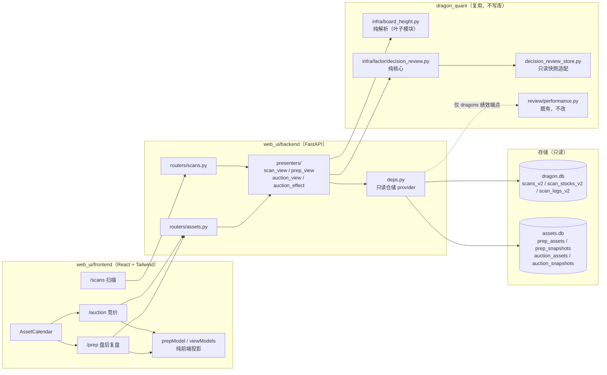
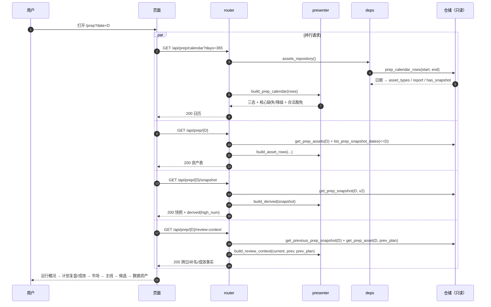
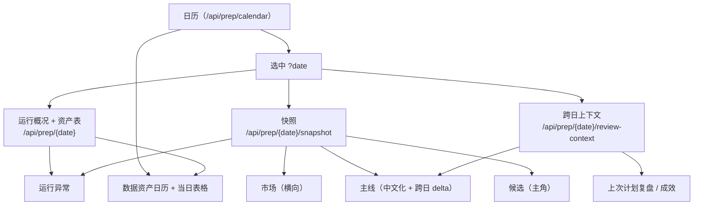
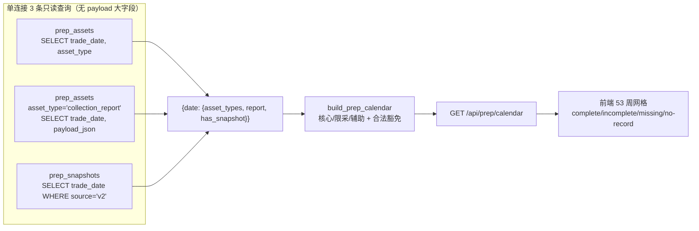
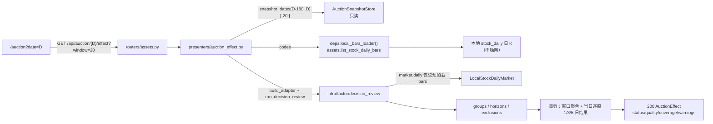
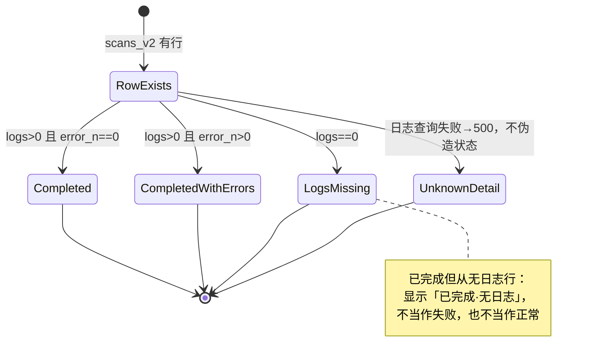
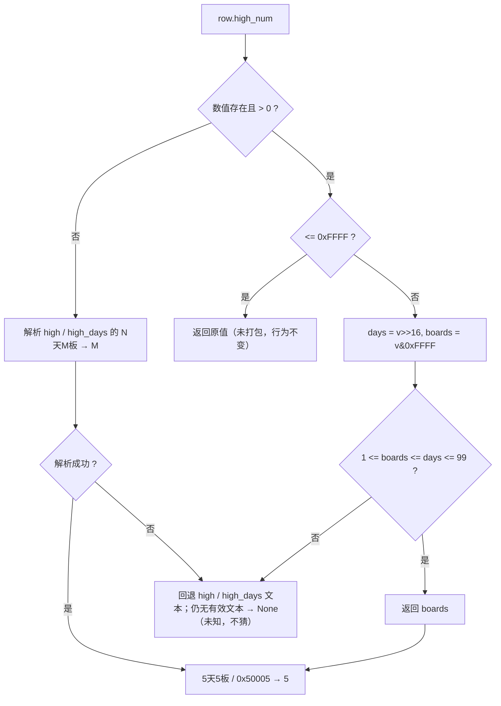

# dashboard 运维与复盘成效重构 · 技术方案（2026-11-01）

> 阶段 2 产物。范围：dashboard 全站排版与语义色、扫描运行态、`/prep` 盘后复盘重构、新 `/auction` 页、数据资产日历、复盘/竞价成效、`high_num` 解析修复。
>
> 上游输入（照收，不推翻）：
> - main 任务包：用户已确认的 10 条核心方向（排版、扫描、prep、成效、资产日历、竞价、high_num、架构、验收、文档）。
> - owner 文档：`archived_md/web_ui/2026-10-31-web-ui-dashboard-design.md`（web_ui API 契约）、`docs/agent/prep-auction.md`（prep/auction 口径）、`docs/agent/development.md`（Web UI 构建与测试）、`archived_md/factor_framework/2026-10-29-decision-outcome-review-technical-design.md`（decision-review 口径）。
>
> 本文只写方案：阶段 2 不改产品代码、不改 owner 文档、不跑测试、不执行任何 git 操作。阶段 3 按 §11 的 TDD 顺序实施；文档同步在阶段 3 同一 commit 完成（commit 由用户控制）。

---

## 0. 结论摘要

1. **全站排版统一到 14px 基准**：`html { font-size: 14px }`，新增 `caption/body/title/section/page/metric` 六个 rem 令牌；**所有可见文字最小 1rem**，机械清理现有 171 处 `text-[9–13px]` 与 11 处 CSS 小字号；表格密度靠间距、列隐藏与展开行解决，不再靠缩小字号。
2. **语义色四态令牌**：新增 `danger/warning/normal/positive` 及 `-soft/-line/-text`；`warn/critical/info` 全量迁移，旧 token 删除。A 股 `up/down`（红涨绿跌）保持独立，**状态色禁止用于价格/收益单元格**。
3. **扫描页只读 `scans_v2` + `scan_stocks_v2` + `scan_logs_v2`**：列表批量补 `真龙数/错误数/日志条数/状态`；新增日志分页端点与错误摘要；`已完成 / 已完成·有异常 / 已完成·无日志` 三态，不新增统一运行历史表，未落库崩溃不伪造。
4. **`/prep` 只保留盘后复盘**：标题「盘后复盘」；新增独立 `/auction` 与导航；prep 页按「运行概况 → 上次计划复盘/成效 → 市场 → 主线 → 候选 → 数据资产」排序；删除原始 JSON 块，次级信息拆成「成效」与「运行异常」。
5. **复盘成效复用既有 `plan_review` / `feedback`**：否决股 `outcome_pct`、正确回避/错过/数据不足、推荐对照、前日市场建议与次日实际并排；只陈述事实，不新增「空仓建议正确」阈值；缺数据一律「待评估 / 数据不足」。
6. **数据资产改为近一年 GitHub 风格日历 + 当日表格**：后端一次批量投影（3 条聚合查询），不做 365 次前端请求、不逐日 `get_prep_assets`；默认最近有记录日，**所有日期均可点击（含完全缺失日）**，空日期展示全部 expected 资产缺失与无快照明细，不产生 404；**所有 expected 资产参与 `expected_ok/expected_total` 完备判定**；三态 + 合法缺席豁免。
7. **`/auction` 五段式**：运行概况 → 竞价结果（名称/强度/方向/关键证据/风险/质量）→ 成效 → 资产日历 → 当日逐股明细；成效复用 `factor decision-review` 核心，行情**只读本地 `stock_daily`**，打开页面不触网，缺数据显示待评估。
8. **`high_num` 共享纯解析器**：识别 THS 打包值（如 `0x50005` = 327685）并按板数解码；普通未打包值行为逐字不变；旧快照展示兼容最高板并标「需重算」，不自动重算、不写库。
9. **架构 = Adapter + Presenter**：`web_ui` 零 SQL、零写库，所有读经 `deps.py` 白名单只读仓储；新增 `backend/presenters/` 纯投影层；竞价成效复用 `infra.factor.decision_review` + 本地 market adapter。
10. **无新依赖、无 DB schema、无 CLI 命令、无评分权重/交易决策变化**；前端改动后同批构建 `web_ui/dist`。

---

## 1. 范围、验收标准映射与非目标

### 1.1 验收标准映射（对应 main 任务包 1–10）

| # | 验收标准（任务包原文要点） | 本方案落点 | 阶段 3 验证 |
|---|---|---|---|
| 1 | 全站 html 根字号 14px；所有可见文字最小 1rem；清理 9–13px；Tailwind 增 danger/warning/normal/positive 及 soft/line；A 股红涨绿跌独立 | §6.1、§6.2 | 源码/dist 正则契约测试 + 390px/桌面/light/dark 截图 + 对比度抽查 |
| 2 | 扫描页展示完成态/有异常、完成时间、耗时、候选/真龙数、错误数；详情展示日志与错误摘要及当日榜单；只用 `scans_v2`/`scan_logs` | §4.1、§5.6、§6.5 | 后端单测（批量聚合、三态、无日志）+ E2E D9 |
| 3 | `/prep` 只保留盘后复盘，title「盘后复盘」；新增 `/auction` 与导航；固定顺序；市场横向；主线状态中文化 + 跨日分数/排名变化；候选仍主角；删除原始 JSON；次级拆成成效/运行异常 | §4.2、§5.2、§6.3、§6.4 | 前端契约测试 + 页面截图 + 路由深链 E2E |
| 4 | 复盘成效用已有 plan_review/feedback：否决股 outcome_pct、正确回避/错过/数据不足、推荐对照；前日建议与次日实际并排；不发明空仓正确阈值；缺数据待评估 | §5.3、§6.3 | presenter 单测（分组/空态/成交未知）+ 前端契约 |
| 5 | 资产改近一年日历 + 当日表格；默认最近有记录日；**所有日期可点击（含完全缺失日）**；三态基于 `expected_ok/expected_total`；合法缺席不误报；批量 API；竞价按代码核对原始资产/快照；veto/数据不足不算采集失败 | §4.2、§4.3、§5.1、§7 | 仓储批量读单测 + presenter 三态/豁免单测 + E2E D8 |
| 6 | 竞价页五段式；成效复用 decision_review 既有口径；打开页面不触网；只读本地快照与日 K；缺数据待评估 | §4.3、§5.4、§6.4 | 本地 market adapter 单测 + 无网络 E2E D10 + 页面截图 |
| 7 | high_num 打包值修复；共享纯解析器；未打包行为不变；旧快照展示兼容 + 标需重算；不自动重算/写库 | §5.5 | 解析器单测（含 327685）+ 5 个调用点回归 + derived 契约 |
| 8 | Adapter + Presenter；web_ui 零 SQL/零写库；无新依赖/DB schema/CLI/权重/交易决策；前端构建 dist | §2.8、§3、§7、§12 | 架构约束测试 + `npm run build` + dist 入库检查 |
| 9 | 390px/桌面、light/dark；深链/前进后退；日历三态/豁免/点击；扫描日志；成效空态；high_num 回归；单测/集成/E2E/Playwright 截图；E2E 不碰真实库/Cookie/网络 | §9、§10 | 门禁命令 + Playwright 清单 + sentinel 不变 |
| 10 | 同步 owner 文档、README、development/prep-auction、归档 dashboard 设计 | §12 | 文档 diff + `test_docs_consistency` |

### 1.2 非目标（明确不做）

- 不新增统一运行历史表、不记录未落库的扫描崩溃、不做扫描任务队列。
- 不改 `prep` / `auction` 算法、采集器、快照版本、`prep_snapshots` / `auction_snapshots` 字段。
- 不改 `dragons_v2` 物化、5 日去重、`review` 固定 5 日回测、`dragon_review_strict`。
- 不新增 CLI 命令/参数、不改评分权重、不改 `buy`/`sell`/`review-account` 交易决策。
- 不改 DB schema（只新增只读查询函数）、不新增 Python/npm 依赖。
- dashboard 不提供重算按钮、不写库、不自动回填；`high_num` 旧快照只标记不修复。
- 竞价页不触网补行情；不把未持久化的空盘口/失败候选伪造为已采集。
- 不在前端重算金融公式、不在前端复制 decision-review 分组/方向口径。
- 不恢复 prep 页的原始 JSON 调试块（API 仍可用于调试）。

---

## 2. 核心决策（候选对比与推荐）

### 2.1 排版：令牌化 + 机械替换（推荐）

| 候选 | 做法 | 评价 |
|---|---|---|
| **A（推荐）14px 根字号 + 6 个 rem 令牌 + 机械替换** | `html` 14px；`caption/body/title/section/page/metric` 全部 ≥1rem；171 处任意 px 全部替换为令牌 | 一次治理、可被契约测试守护；字号语义集中；后续新增页面不再引入小字 |
| B 逐组件 `clamp()`/媒体查询 | 窄屏缩字 | 直接违反「最小 1rem」；每个组件各自为政，无法统一验收 |
| C 只把 `body` 改 14px，保留小字工具类 | 改动最小 | 未解决 9–13px 现状，验收 1 不成立 |
| D（非常规）用 `zoom`/`transform: scale` 整体放大 | 视觉变大 | 会放大全部间距与图表，且不改变计算字号；可访问性与截图不稳定，否决 |

**推荐 A。** 关键取舍：**不通过缩小字号换密度**。表格/卡片密度改用内边距、列优先级（390px 隐藏次要列）、行展开与内部横向滚动解决；图表用减少刻度数量而不是缩小字号。

### 2.2 语义色：四态新令牌 + 迁移（推荐）

| 候选 | 做法 | 评价 |
|---|---|---|
| **A（推荐）`danger/warning/normal/positive` + `-soft/-line/-text`，删除 `warn/critical/info`** | 组件只用新令牌；A 股 `up/down` 保持独立 | 语义唯一、浅色覆盖集中；迁移量约 60 处，可机械完成 |
| B 新令牌与旧令牌并存（别名） | 少改代码 | 两套名字长期漂移；新人会继续用旧名；违反单一 owner |
| C 只加新令牌，不迁移旧用法 | 最小风险 | 页面仍混用两套语义，验收 1 的「必要 token」形同虚设 |

**推荐 A。** 语义边界写死：`normal` = 正常/已完成/可用；`positive` = 好于基准/健康；`warning` = 异常但可用；`danger` = 失败/不可用/硬风险。**价格、涨跌幅、收益、回撤、买卖方向只用 `up/down`**，状态色不得出现在这些单元格；反之亦然。

### 2.3 资产日历：单次元数据投影（推荐）

| 候选 | 做法 | 评价 |
|---|---|---|
| **A（推荐）`prep_calendar_rows` / `auction_calendar_rows` 单连接聚合** | 3 条查询拿全部日期的资产类型、`collection_report`、快照日期/代码集合；大 payload 一律不读 | 一次请求、无 N+1；payload 可控；规则在 presenter 可单测 |
| B 前端逐日调 `/api/prep/{date}` | 实现简单 | 365 次请求；每次解析整日资产（含 `stock_daily` 百根 K），必然卡顿，否决 |
| C（非常规）新增日历汇总表/物化视图 | 读得快 | 需要 DB schema、写入与回填；违反「无 schema」；且与 `collection_report` 语义双写，否决 |
| D 只返回有记录日期，前端补空白 | 响应最小 | 仍需逐日状态；本方案 A 已足够小，D 作为 A 的响应裁剪策略保留 |

**推荐 A。** 日历只投影「日期 → 资产类型集合 + report 状态 + 快照存在」；当日明细仍走既有 `get_prep_assets` 单日读取（1 次），不批量拉全量 payload。

### 2.4 扫描运行态：`scan_logs` 聚合（推荐）

| 候选 | 做法 | 评价 |
|---|---|---|
| **A（推荐）列表 2 条批量聚合 + 日志分页端点** | `scans.summarize_scan_stocks(ids)` + `logs.summarize_scan_logs(ids)` + `get_scan_logs_page` | 无 N+1；只读既有表；状态可由 `error_n/log_entries` 推导 |
| B 新增 `scan_runs` 运行历史表 | 状态字段化 | 需要 schema/写入/回填；且无法覆盖历史；违反非目标 |
| C 列表逐行调 `log_summary` | 复用现函数 | 50 行 = 50 次全量日志解析，明显 N+1，否决 |
| D（非常规）前端按 `scan_id` 逐行请求日志 | 分层清晰 | 更多请求；列表页不应加载日志正文，否决 |

**推荐 A。** `log_summary` 保留给详情摘要（单次扫描），列表用 SQL 聚合；两者不重复计数。

### 2.5 复盘成效：既有字段 + 服务端补名（推荐）

| 候选 | 做法 | 评价 |
|---|---|---|
| **A（推荐）读当前快照 `plan_review`/`feedback` + 读严格 T-1 快照补名称/跨日数据** | 不新增计算模型；不写快照；只做事实归并与展示 | 与 prep 既有口径一致；缺数据可显式待评估 |
| B 新建一套「复盘成效」计算器 | 输出更灵活 | 必然与 `plan_review` 分组/成交缺失语义漂移；违反「不发明阈值」 |
| C（非常规）前端从原始 JSON 自行聚合 | 后端零改动 | 把分组/成交缺失规则复制到 TS；原始 JSON 又要保留，与验收 3 冲突 |
| D 让 prep 写新的成效字段 | 数据最全 | 需要改快照/算法/回填；违反非目标 |

**推荐 A。** 服务端只补「名称映射、跨日排名/分数、前日市场快照」；分组与 judgement 全部来自既有字段。

### 2.6 竞价成效：本地 `stock_daily` + 复用 decision-review（推荐）

| 候选 | 做法 | 评价 |
|---|---|---|
| **A（推荐）预加载本地 `prep_assets.stock_daily`，注入 `run_decision_review`** | 复用 Adapter/Strategy/Template Method 与 1/3/5 日净收益口径；零网络；缺 K 线走既有剔除原因 | 口径与 `factor decision-review` 完全一致；覆盖不足会显式 `insufficient_data`，符合「待评估」 |
| B 复用 `MarketData` 拉雪球日 K | 覆盖高 | 打开页面触网，违反验收 6；Cookie/限流/离线不可用 |
| C 用 `dragons_v2` 日 OHLC 回退 | 本地行多 | 只覆盖真龙，且与 `stock_daily` 字段/来源不一致；会造成两套口径，本期不做 |
| D（非常规）前端用快照 + 手写前向收益 | 无后端工作量 | 复制可成交口径/成本/剔除规则，必然漂移，否决 |

**推荐 A。** 明确记录 `data_source="local_stock_daily"`、`calendar_basis="bars_union"`，并在 UI 显示「本地日 K 覆盖」计数；覆盖不足时只显示「待评估」，不宣称策略有效。

### 2.7 `high_num`：共享纯解析器（推荐）

| 候选 | 做法 | 评价 |
|---|---|---|
| **A（推荐）`board_height.py` 唯一解析器；5 个调用点接入** | 未打包值逐字不变；打包值解码；文本兜底 | 一处修复、全链路一致；可单测；不改快照 |
| B 只改 `mainline._row_height` | 改动最小 | `market` 最高板、`pool` 锚点、`orchestrator`/`compute` 仍错；主线 H 修了但市场 HGT 仍错 |
| C 完全忽略 `high_num`，只解析 `high` 文本 | 简单 | 文本可能缺失（池行只有 `high_days`，部分板块行无 `high`）；会丢失原本可用的普通数值，改变既有行为 |
| D 在 provider 层清洗 `high_num` | 源头修复 | 会改写已采集资产/影响其它消费方；旧资产仍错；无法覆盖历史；需采集层变更，超出范围 |

**推荐 A。** 解析器放 **`dragon_quant/infra/board_height.py`**（纯函数、零 I/O、零项目内依赖），由 `market.py`、`board_rank.py`、`pool.py`、`orchestrator.py`、`compute.py` 共用。
> 不放在 `review_account/prep/review/` 下：该包的 `__init__` 会 eager 加载 `prep.main` → provider 模块；`web_ui` 若为展示解码而 import 纯解析器，会间接把 `infra.provider.*` 拉进 Web 进程，破坏「web_ui 不 import provider」的白名单硬约束。`infra/board_height.py` 是无副作用的叶子模块，prep 与 web_ui 都可安全引用。

### 2.8 架构分层：Adapter + Presenter（推荐）

| 候选 | 做法 | 评价 |
|---|---|---|
| **A（推荐）`web_ui/backend/presenters/` 纯投影 + `deps.py` 只读仓储** | 路由只做参数/响应；规则可单测；web_ui 零 SQL | 与既有 `deps.py` / `review.performance` 模式一致；边界可 AST/文本校验 |
| B 路由内直接拼装 | 少一层 | 路由膨胀；复盘/竞价规则混在 HTTP 层，难测 |
| C（非常规）把展示规则下放到 `dragon_quant` 领域包 | 复用方便 | 展示状态（日历三态/「需重算」）不是领域事实；会污染领域 API；否决 |
| D 前端复制规则 | 前端自治 | 两套口径漂移；无 Python 单测；否决 |

**推荐 A。** 设计模式落点：

| 模式 | 落点 | 动机 |
|---|---|---|
| Adapter | `AuctionSnapshotAdapter`（复用）、`LocalStockDailyMarket`、`presenters/*` 把领域 payload 适配为视图 | 隔离快照/资产字段差异；行情来源可替换 |
| Presenter | `web_ui/backend/presenters/{scan,prep,auction}_view.py` | UI 只消费视图模型；展示规则集中、可测 |
| Strategy | 资产类别 → `expected/legal_absence` 判定策略；扫描状态由 `log_entries/error_n` 策略推导 | 规则表驱动，新增资产类型只加一行 |
| Template Method | `run_decision_review` 骨架复用；presenter 只填「本地行情 + 输出裁剪」 | 不复制七步流水线 |
| Facade | `deps.py` 仓储 provider | 唯一 I/O 适配点；测试可 override |
| Composition | `AssetCalendar` / `StatusBadge` / `MetricStrip` 小组件组合 | 不为假设的未来需求引入全局 store/组件库 |

刻意不引入：全局状态库、图表库、通用表格抽象、服务端分页框架、跨模块「运行历史」抽象。

### 2.9 前端路由与页面承载（main 已定，照收）

- `/prep` 只保留盘后复盘；`/auction` 独立页；`AppShell` 导航新增「竞价」。
- 两页均用 `?date=YYYY-MM-DD` 作为规范深链（与既有页面输出/API 回显一致）；API 参数解析层同时接受 `YYYYMMDD` 并归一为 ISO；`popstate` 驱动前进/后退；无 `?date=` 时默认最近有记录日。**所有日历日期均可点击**，空日期只展示资产缺失/无快照，不触发无意义的成效请求。
- 不新增路由依赖；沿用 `router.tsx` 的正则表。

---

## 3. 架构与数据流

### 3.1 组件与只读边界



**硬边界**：`web_ui` 不出现 `sqlite3`、不建连接、不写 SQL；新增读能力全部落在 `dragon_quant` 既有仓储模块（只读、`create=False`）。竞价页不经过 `kline_provider`。

**`deps.py` 白名单增量（阶段 3 同步归档设计 §5.2）**：

| 来源 | 允许对象 | 用途 |
|---|---|---|
| `dragon_quant.infra.board_height` | `parse_board_height` / `board_height_for_display` / `needs_recompute` | 旧快照展示解码（纯函数） |
| `dragon_quant.infra.factor.decision_review` | `build_adapter` / `run_decision_review` / `AuctionSnapshotAdapter` | 竞价成效复用（纯核心） |
| `dragon_quant.infra.factor.decision_review_store` | `build_store` | 只读快照枚举/装载 |
| `dragon_quant.scan.storage.logs` | `get_scan_logs` / `get_scan_logs_page` / `count_scan_logs_filtered` / `log_summary` / `summarize_scan_logs` | 扫描日志/摘要 |
| `dragon_quant.scan.storage.scans` | `list_scans` / `get_scan` / `get_scan_stocks` / `summarize_scan_stocks` | 扫描列表/详情/真龙计数 |
| `dragon_quant.infra.assets.db` | 新增 `prep_calendar_rows` / `auction_calendar_rows` / `list_auction_asset_names` / `list_stock_daily_bars` / `get_prep_asset` / `get_previous_prep_snapshot` | 日历/资产/成效只读 |
| `dragon_quant.infra.clock` | `now` | 日历 `end` 缺省值（既有白名单用途扩展） |

明确禁止：`web_ui` 直接 import `infra.provider.*`（既有 benchmark/performance 例外不变）、`review_account.prep.*`（会经包 `__init__` 拉入 provider）、任何写函数。

`deps.py` 另新增无 I/O 的 `review_assets_enabled()`：读取 `DQ_REVIEW_ASSETS_ENABLED`（默认 true），仅供日历 `expected` 判定，不改 prep 采集；测试可 override。

### 3.2 请求与数据流（单一装配点）



### 3.3 `/prep` 页面区块与数据源



顺序固定：运行概况（含运行异常）→ 上次计划复盘/成效 → 市场 → 主线 → 候选 → 数据资产。原始 JSON 不再渲染。

### 3.4 日历批量投影



竞价日历同理：只取 `auction_assets.trade_date/code` 与 `auction_snapshots.trade_date/code` 两个轻量投影，**不读 `items_json`**。

### 3.5 竞价成效本地评估



**不变量**：`LocalStockDailyMarket.daily()` 只返回预加载字典；无 provider、无时钟、无写入。缺 bars 时由 `build_tradable_labels` 产出稳定剔除原因，不写 0 收益。

### 3.6 扫描状态推导



未落库的崩溃没有 `scans_v2` 行，页面不展示、不推断、不补记录。

### 3.7 `high_num` 解析决策树



事实口径（main 阶段 2 验收）：高 16 位是**天数**、低 16 位是**板数**；校验 `1 <= boards <= days <= 99`。不满足校验时回退文本，仍无文本则 `None`；不猜测顺序。

---

## 4. 接口定义

> 约定：新端点为普通 `def`（anyio 线程池）；日期接受 `YYYYMMDD` / `YYYY-MM-DD`，响应回显 `YYYY-MM-DD`；新端点用 pydantic 响应模型；错误沿用 `{"error": code, "detail": msg}`；既有冻结端点不设 `response_model` 的规则不变。

### 4.1 扫描

#### `GET /api/scans?limit=50`

`ScanSummary` 增量字段（既有键不变）：

```python
ScanStatus = Literal["completed", "completed_with_errors", "logs_missing"]

class ScanSummary(BaseModel):
    id: str
    scan_date: str
    elapsed_s: float | None
    top_n: int | None
    candidates_n: int | None
    workers: int | None
    created_at: str
    source: str
    # 新增
    true_dragon_n: int | None      # scan_stocks_v2 WHERE is_true_dragon=1
    stock_n: int | None            # scan_stocks_v2 行数（当日榜单规模）
    log_entries: int               # scan_logs_v2 行数；0 = 无日志
    error_n: int | None            # level='error' 行数；无日志为 null
    status: ScanStatus
```

- 批量实现：`scans.summarize_scan_stocks(scan_ids, source="v2")`（1 条股票聚合）+ `logs.summarize_scan_logs(scan_ids, source="v2")`（1 条日志聚合），由 presenter 合并；**不逐行调用** `log_summary`。
- 状态：`log_entries == 0 → logs_missing`；`error_n > 0 → completed_with_errors`；否则 `completed`。
- `limit` 仍 `clamp_limit(..., maximum=200)`；排序保持 `id DESC`。

#### `GET /api/scans/{scan_id}`

`ScanDetail` 继承 `ScanSummary` 的新增字段，并保留 `has_raw_output` / `raw_output_bytes`。不存在 → 404。

#### `GET /api/scans/{scan_id}/logs?level=&offset=0&limit=200`

```python
class ScanLogEntry(BaseModel):
    ts: float | None
    time: str | None               # Asia/Shanghai HH:MM:SS，由后端格式化
    category: str
    level: str
    message: str
    code: str

class ScanLogSummary(BaseModel):
    total_entries: int
    phases: list[dict]             # [{key, label, message}]，A/B/C/D/F
    api_total: int
    api_ok: int
    api_error: int
    api_by_provider: dict[str, dict]
    scorer_count: int
    error_count: int
    truncated: bool                # 解析条目 < SQL 总数

class ScanLogsPage(BaseModel):
    scan_id: str
    available: bool
    total: int | None
    entries: list[ScanLogEntry]
    summary: ScanLogSummary | None
```

- 无日志：200 `{available: false, total: 0, entries: [], summary: null}`，**不是错误**。
- `level` 白名单 `info/warn/error`；非法 → 400；`limit` clamp 1..500；`offset >= 0`。
- 不返回 `data_json`（技术细节）；需要时通过既有 CLI `logs query` 查看。
- `log_summary` 返回 `{"error": "无日志"}` 时映射为 `available=false`；`phases` 的 key 保留 A/B/C/D/F，label 在前端映射。

### 4.2 prep

#### `GET /api/prep/calendar?days=365&end=YYYYMMDD`

```python
class ExemptAsset(BaseModel):
    asset_type: str
    reason: str        # same_day_only_history / first_day_no_plan / no_prev_plan /
                       # review_assets_disabled / not_attempted / legal_empty

class PrepCalendarDay(BaseModel):
    trade_date: str
    status: Literal["complete", "incomplete", "missing"]
    has_snapshot: bool
    has_assets: bool
    asset_count: int                # 非 collection_report 的资产类型数
    expected_ok: int                 # 完备判定基座
    expected_total: int
    expected_missing: list[str]      # 所有 expected 但缺失的资产
    expected_degraded: list[str]     # 所有 expected 但 error/empty_suspicious/unavailable/非法 empty
    core_ok: int                     # 运行概况辅助信息，不参与三态
    core_total: int
    exempt: list[ExemptAsset]

class PrepCalendar(BaseModel):
    available: bool
    start_date: str
    end_date: str
    latest_record_date: str | None
    days: list[PrepCalendarDay]
```

- `days` clamp 1..366；`end` 缺省由 `deps.clock_module()` 取 Asia/Shanghai 当天；非法 → 400。
- `assets.db` 不存在 → 200 `{available: false, days: [], latest_record_date: null, start_date, end_date}`，不建库。
- **路由注册顺序**：`/api/prep/calendar` 必须注册在 `/api/prep/{trade_date}` 之前（与既有 `/api/prep/dates` 同理），否则 `calendar` 会被当成日期参数；竞价日历同理。
- `latest_record_date` = 窗口内「有非 `collection_report` 资产或快照」的最大日期；页面无 `?date=` 时用它。
- **`days` 只返回有记录日期**；前端对 `start_date..end_date` 内未返回的日期渲染 `missing`（完全缺失）并允许点击。点击后调用 `/api/prep/{date}`：该端点对任意合法日期返回 200，并按 §5.1 计算 expected 资产（全部缺失 + `has_snapshot=false`），**不 404、不建库**。
- **单行 JSON 损坏隔离**：`collection_report` 用逐行 `_load_json`，损坏行标 `report_error` 并按「无 report 条目」处理，不中断整批；`prev_plan` 资产的 JSON 损坏由 presenter try/except 降级为 `plan_names` 回退 + `degraded`，不 500。
- 一次请求；不逐日请求。

#### `GET /api/prep/{trade_date}`（水位，增量）

`PrepAssetStatus` 增量：

```python
class PrepAssetStatus(BaseModel):
    asset_type: str
    present: bool
    status: str | None              # collection_report 状态（最佳已知），不是本次运行证明
    note: str | None
    error: str | None
    as_of: str | None
    usable_display: bool
    # 新增
    category: Literal["core", "same_day_only", "review_conditional",
                      "auxiliary", "report"]
    expected: bool
    legal_absence: str | None       # 合法缺席原因；非空时不算 missing/degraded
    asset_complete: bool            # expected 且 status 达标；非 expected 资产显示「不适用」
```

`PrepWatermark` 增 `has_prior_snapshot: bool`、`first_record_day: bool`、`expected_ok: int`、`expected_total: int`。既有键与 13+1 类固定清单不变。当日表格必须把 `status` 列标为「采集报告（最佳已知）」，把 `asset_complete`/`expected_ok` 标为「资产完备」，不得合并成一列。
- `expected` 判定需要「今天」：路由用 `deps.clock_module().now(Asia/Shanghai)` 解析 `today`（测试可 override），与 `trade_date` 比较决定 `same_day_only`/`review_conditional`/当日辅助资产是否 expected；无记录日同样返回 200 与 expected 缺失列表。

#### `GET /api/prep/{trade_date}/snapshot`（增量 derived）

既有响应键不变，新增：

```python
class MainlineDerived(BaseModel):
    source: Literal["review", "legacy"]   # 与前端 mainline 回退链一致
    index: int
    board_name: str | None
    stored_high_num: float | None
    board_height: int | None        # 展示用；打包值解码
    needs_recompute: bool
    evidence: list[str]             # 已把「最高 N 板」改写为展示板数

class MarketDerived(BaseModel):
    source: Literal["review", "sentiment"]
    stored_max_board_height: float | None
    max_board_height: int | None
    needs_recompute: bool
    evidence: list[str]             # 已改写「最高 N 板」片段

class PrepDerived(BaseModel):
    mainlines: list[MainlineDerived]   # 按 UI 实际使用的数组生成（review 优先，缺失回退 main_boards）
    market: MarketDerived
    needs_recompute: bool
```

`snapshot` 本体（`result_json`）一字不改；`derived` 是响应层只读投影。旧快照的 `high_num` 打包时 `needs_recompute=true`，展示用解码值；`evidence` 里的「最高 N 板」片段由 presenter 改写，避免 UI 同时渲染 327685。legacy 快照同样覆盖：`main_boards[].high_num` 与 `sentiment.max_board_height` 走同一解码；`source` 字段让前端知道 joined 的是哪一组。

#### `GET /api/prep/{trade_date}/review-context`

```python
class MarketSide(BaseModel):
    available: bool
    trade_date: str | None
    state: str | None
    score: float | None
    coeff: float | None
    position_advice: str | None
    position_pct: float | None      # sentiment 原值 0~1；前端统一 ×100 展示

class MarketComparison(BaseModel):
    prev: MarketSide
    current: MarketSide
    score_change: float | None      # 优先用当前快照 review.market.score_change

class MainlineDelta(BaseModel):
    index: int
    board_name: str | None
    rank: int | None
    prev_rank: int | None
    prev_score: float | None
    rank_delta: int | None          # prev_rank - rank；正数=上升
    score_delta: float | None       # current - prev
    state: str | None               # 快照原值，不重算
    unknown_reason: str | None

class PlanName(BaseModel):
    code: str
    name: str | None
    source: Literal["prev_plan_asset", "prev_snapshot_context",
                    "current_snapshot", "missing"]

class PlanEffectItem(BaseModel):
    code: str
    name: str | None
    planned_action: str | None
    planned_position: float | None
    feedback_state: str
    outcome_pct: float | None       # 当日开盘→收盘（既有 plan_review 字段）
    actual_position: float | None
    execution_known: bool
    unknown_reason: str | None

class NoTradeItem(BaseModel):
    code: str
    name: str | None
    judgement: Literal["correct_avoidance", "missed_opportunity", "data_gap"]
    outcome_pct: float | None

class PlanGroupOutcome(BaseModel):
    key: Literal["recommended", "not_recommended", "unknown"]
    count: int
    with_outcome: int
    mean_outcome_pct: float | None

class PlanEffect(BaseModel):
    available: bool
    reason: str | None              # plan_review_missing / feedback_missing / ...
    plan_date: str | None
    eval_date: str | None
    checkpoint: str | None
    items: list[PlanEffectItem]
    no_trade: list[NoTradeItem]
    groups: list[PlanGroupOutcome]
    market: MarketComparison
    degraded: list[str]

class ReviewContext(BaseModel):
    trade_date: str
    available: bool
    reason: str | None              # snapshot_missing / ...
    prev_trade_date: str | None
    prev_meta_error: str | None
    mainlines: list[MainlineDelta]
    plan_names: list[PlanName]
    plan_effect: PlanEffect
    degraded: list[str]
```

- 当前日期非法 → 400；当前快照缺失 → 200 `available=false, reason=snapshot_missing`（不 404，页面不级联失败）。
- 严格 `< trade_date` 读 T-1 快照；损坏 → `prev_meta_error` + `degraded=["prev_snapshot_corrupt"]`。
- 不新增/修改快照字段；不改 `plan_review`/`feedback` 计算。

### 4.3 auction

#### `GET /api/auction/calendar?days=365&end=YYYYMMDD`

与 prep 日历同构；字段为竞价语义：

```python
class AuctionCalendarDay(BaseModel):
    trade_date: str
    status: Literal["complete", "incomplete", "missing"]
    has_snapshot: bool
    has_assets: bool
    snapshot_count: int
    asset_count: int
    snapshot_only_codes: list[str]   # 有快照无原始资产
    asset_only_codes: list[str]      # 有原始资产无快照

class AuctionCalendar(BaseModel):
    available: bool
    start_date: str
    end_date: str
    latest_record_date: str | None
    days: list[AuctionCalendarDay]
```

- 只用 `auction_assets(trade_date, code)` 与 `auction_snapshots(trade_date, code)` 轻量投影；**不读 `items_json`**。
- `veto` / `data_quality=unavailable` 属于评估结果，不影响采集完备；日历只看代码覆盖。
- 历史缺失是合法的（竞价仅当日可采）；`missing` 仅表示「无记录」，不报警。
- **所有日期可点击**：`days` 只返回有记录日期，前端对窗口内其余日期渲染 `missing`；点击后调用 `/api/auction/{date}`（200 空态，不 404）展示「无原始资产 / 无快照」；**空日期不请求 `/effect`**。

#### `GET /api/auction/{trade_date}?source=v2&with_assets=false`（增量）

既有 `AuctionSnapshotRow` 增：

```python
class AuctionSnapshotRow(BaseModel):
    # 既有 11 键不变
    name: str | None = None
    collected: bool = False            # 原始 auction_assets 是否存在
    evaluated: bool = True             # 快照是否存在
    collection_status: Literal["ok", "asset_only", "snapshot_only", "missing"]
    key_evidence: dict | None = None   # evidence 投影（末时点/开盘/示性价/匹配/未匹配）
```

`AuctionDayView` 增：

```python
class AuctionRunView(BaseModel):
    snapshot_count: int
    asset_count: int
    snapshot_only_codes: list[str]
    asset_only_codes: list[str]
    quality_counts: dict[str, int]      # ok/degraded/unavailable/vetoed/unknown
    error_rows: int
    config_versions: list[str]
    validation_statuses: dict[str, int]
    created_at_min: str | None
    created_at_max: str | None
    evaluation_available: bool

class AuctionDayView(BaseModel):
    # 既有键不变
    run: AuctionRunView
    names: dict[str, str]
    asset_codes: list[str]
```

- `names` 来自 `auction_assets.name`（轻量 `list_auction_asset_names`），缺失不编造。
- `snapshot_count` 对损坏行也计数；`error_rows` 单独标出。
- `quality_counts` 的推导顺序与既有 `_auction_summary` 对齐，避免同一行在两个块里语义不同：`error`（损坏行）→ `vetoed`（`is_weak=true`）→ `unavailable`（`data_quality.status=unavailable` / `unverified=true` / `strength=null` / `level=null`）→ `degraded`（`data_quality.status=degraded`）→ `ok` → `unknown`。`vetoed` 是决策状态，不是采集失败。
- 不展示池来源（快照未持久化 pool），不猜。

#### `GET /api/auction/{trade_date}/effect?window=20&horizons=1,3,5`

```python
class HorizonGroup(BaseModel):
    group: str
    label: str
    expected_direction: str | None
    observations: int
    valid: int
    excluded: int
    coverage: float | None
    direction_evaluable: bool
    direction_hit_rate: float | None
    mean_net_return_pct: float | None
    median_net_return_pct: float | None
    quality: Literal["ok", "low_confidence", "not_evaluable"]
    above_reference: bool | None

class HorizonEffect(BaseModel):
    horizon: int
    groups: list[HorizonGroup]
    spread: float | None

class SelectedDayOutcome(BaseModel):
    code: str
    horizon: int
    entry_date: str | None
    exit_date: str | None
    net_return_pct: float | None
    outcome: Literal["up", "down", "flat"] | None
    exclusion_reason: str | None

class LocalCoverage(BaseModel):
    snapshot_dates: int
    window_codes: int               # 窗口并集去重后的 codes
    loaded_codes: int               # 实际加载（受 300 上限约束）
    selected_codes: int             # 选中日快照的 codes
    codes_with_bars: int
    bar_dates: int
    truncated: bool                 # 并集或 bars 超上限

class AuctionEffect(BaseModel):
    status: Literal["ok", "insufficient_data"]
    reason: str | None              # no_snapshot / local_bars_missing / calendar_unavailable
    date_from: str
    date_to: str
    data_source: Literal["local_stock_daily"] = "local_stock_daily"
    calendar_basis: str
    cost_bps: float
    horizons: list[HorizonEffect]
    selected_day: list[SelectedDayOutcome]
    local_coverage: LocalCoverage
    warnings: list[str]
    caveats: list[str]
```

- `window` clamp 1..60，默认 20；`horizons` 只接受 `{1,3,5}` 的非空子集，非法 → 400。
- **前端只在选中日 `has_snapshot=true` 时请求本端点**；完全缺失日/无快照日不触发无意义请求，只展示资产缺失与「无快照」。
- `cost_bps` 固定 13（`DEFAULT_COST_BPS`），不在 UI 暴露。
- 无快照 → 200 `status=insufficient_data, reason=no_snapshot`；无本地日 K → `reason=local_bars_missing`；均非 500。
- `status=insufficient_data` 但工具未给 `reason`（例如所有组都 `low_confidence`）→ presenter 标 `reason="insufficient_samples"`；这是有效结论，不是错误。
- `selected_day` 只回选中日期的逐股样本（从 `samples` 过滤），不回整窗样本，避免大 payload。
- `selected_day` 不含名称（decision-review 的 auction 观测 `name=None`）；前端用 `/api/auction/{date}.names` 按 code join，缺失只显示代码。
- 不返回 `samples` 全量；不回 `gross_return_pct`（审计字段留在 CLI）。

### 4.4 前端路由与类型

| 路径 | 页面 | 参数 |
|---|---|---|
| `/prep` | `PrepPage`（盘后复盘） | `?date=YYYY-MM-DD`（API 兼容 `YYYYMMDD`） |
| `/auction` | `AuctionPage`（竞价） | `?date=YYYY-MM-DD`（API 兼容 `YYYYMMDD`） |
| `/scans`、`/scans/:id` | 扫描列表/详情 | 既有 |

`api/assets.ts` 新增：`fetchPrepCalendar`、`fetchReviewContext`、`fetchAuctionCalendar`、`fetchAuctionEffect`；`api/scans.ts` 新增 `fetchScanLogs`，并扩展 `ScanSummary` 类型。页面不得手写 `fetch`。

### 4.5 错误形状与状态码

| 场景 | HTTP | 形状 |
|---|---|---|
| 日期非法 / `days>366` / `horizons` 非法 | 400 | `{"error":"invalid_request","detail":...}` |
| 扫描不存在 | 404 | `{"error":"not_found","detail":...}` |
| 无快照的 review-context | 200 | `available=false` + `reason` |
| 无日志 | 200 | `available=false` + 空 entries |
| assets.db 不存在 | 200 | 空日历/空资产，`available=false` |
| 本地日 K 缺失 | 200 | `status=insufficient_data` + `reason` |
| 未捕获异常 | 500 | `{"error":"internal_error","detail":...}`（无 traceback） |

---

## 5. 关键规则

### 5.1 日历三态与合法缺席

> main 阶段 2 验收裁决（必须修改 1）：**所有「当日应有」资产都计入完备判定**；类别只决定 `expected / legal_absence`，不再决定「异常是否可忽略」。`same_day_only` / `auxiliary` 只要当日应有，缺失或错误同样使当天不完备。

**资产分类与 `expected` 规则（唯一表）**

| 类别 | 资产 | `expected` 判定 | 合法缺席 / 合法 empty | 影响完备 |
|---|---|---|---|---|
| `core` | `dragons`、`ths_limit_up_pool`、`ths_block_top`、`macro_global` | 任何日期都期望 | 无（empty 也不是合法空态） | 是 |
| `same_day_only` | `market_breadth`、`fg_boards`、`fund_flow` | `D == end_date`（当日）**或** 该日 `collection_report` 有条目 / payload 存在 | `D < end_date` 且无 report/payload → `same_day_only_history` | 是（expected 时） |
| `review_conditional` | `stock_daily` | `collection_report` 有条目/payload，**或** `D == end_date` 且 review assets 启用且 `dragons` 存在 | 未启用且无 report → `review_assets_disabled`；历史无 report → `not_attempted` | 是（expected 时） |
| `auxiliary` | `holdings`、`cninfo_announcements`、`prev_plan`、`auction_feedback`、`t1_intraday` | `collection_report` 有条目/payload；`D == end_date` 且 review assets 启用时，`holdings` / `cninfo_announcements` 也期望；`prev_plan` 另需「存在更早快照」；`auction_feedback` / `t1_intraday` 另需 `prev_plan` 存在 | `prev_plan` 无更早快照 → `first_day_no_plan`；`auction_feedback` / `t1_intraday` 无 `prev_plan` → `no_prev_plan`；无 report 的历史辅助资产 → `not_attempted` | 是（expected 时） |
| `report` | `collection_report` | 否 | — | 否（元数据） |

- `review assets 启用` 由 `deps.review_assets_enabled()` 读取 `DQ_REVIEW_ASSETS_ENABLED`（默认 true）；只用于「当日」的 `stock_daily` / `holdings` / `cninfo` 期望判定，不改 prep 采集行为。
- `same_day_only` 的当日 = 日历 `end_date`（默认 Asia/Shanghai 今天）；显式传 `end` 的测试/回放以 `end` 为准，保证可重现。

**`expected_ok` / `expected_total`（完备的唯一判定基座）**

```text
expected_total = 该日 expected=true 的资产数
expected_ok    = expected=true 且同时满足以下条件的资产数：
                 present
                 && status ∉ {error, empty_suspicious, unavailable}
                 && (status != empty || asset_type ∈ LEGAL_EMPTY)
                 && (无 as_of 或 as_of == trade_date)

LEGAL_EMPTY = {holdings, cninfo_announcements}
# 真实业务空态：无持仓 / 无公告。
# 其它 expected 资产的 empty（dragons/涨停池/板块榜/market_breadth/fg_boards/
# fund_flow/stock_daily/prev_plan/auction_feedback/t1_intraday）都不是合法空态。
```

**三态**

```text
has_real_assets = 存在任一非 collection_report 的 prep_assets 行
has_snapshot    = prep_snapshots 有该日 source=v2 行

if not has_snapshot and not has_real_assets:
    status = "missing"          # 完全缺失：仍可点击，展示全部 expected 资产缺失
elif has_snapshot and expected_total > 0 and expected_ok == expected_total:
    status = "complete"
else:
    status = "incomplete"       # 快照缺，或任一 expected 资产缺失/降级/非法 empty
```

- `expected_missing` / `expected_degraded` 列出所有未达标的 expected 资产（不再只列 core）；`core_ok/core_total` 仅作为运行概况的辅助信息保留，**不参与三态**。
- `degraded` 也包括 expected 但 `status=error/empty_suspicious/unavailable` 的 `cninfo_announcements`、`market_breadth`、`fund_flow`、`stock_daily` 等；`cninfo error` 必须使当天 `incomplete`。
- `collection_report` 是「该日期资产当前最佳已知状态」，**不是本次运行成功证明**；日历/表格必须分开显示「资产完备（expected_ok/total）」与「采集报告（最佳已知）」，不得把 report 当成本次运行结果（main 建议 2）。
- 日历为控成本不读 `core`/`auxiliary` 的大 payload；以 `collection_report` + presence 为准；无 report 条目时按 `present` 保守处理，并在当日表格标「无 report 条目」，不静默当作已验证。

**合法缺席（`exempt`）规则**

| 条件 | 原因码 | 说明 |
|---|---|---|
| `same_day_only` 在历史日缺失且无 report/payload | `same_day_only_history` | 历史日不可补采，豁免；当日缺失不豁免 |
| `prev_plan` 缺失且没有更早快照 | `first_day_no_plan` | 升序首日合法缺席 |
| `auction_feedback` / `t1_intraday` 缺失且无 `prev_plan` | `no_prev_plan` | 无计划则无 T+1 反馈 |
| `stock_daily` 无 report 且 review assets 未启用 | `review_assets_disabled` | 复盘资产关闭，豁免 |
| 历史辅助资产缺失且无 report/payload | `not_attempted` | 采集器未注册/未运行，不是失败 |
| `holdings` / `cninfo_announcements` 有 report 且 `status=empty` | `legal_empty` | 真实业务空态，`expected_ok` 计为达标 |

**竞价日历**：

```text
missing    = asset_codes 与 snapshot_codes 都为空
complete   = 两者非空 且 snapshot_codes ⊆ asset_codes
incomplete = 其余（asset_only / snapshot_only）
```

`is_weak=true`、`data_quality=unavailable`、`unverified=true` 都是**评估结果**，不影响 `complete`；逐股表分别展示「采集状态」与「决策质量」。

### 5.2 主线跨日比较

**数据来源**：`get_previous_prep_snapshot(trade_date, source="v2")`（严格 `< trade_date`，`create=False`）。优先 `review.mainlines`，缺失回退 `main_boards`；仍缺失 → 前日无主线数据。**当前主线来源与前端回退链、`derived.mainlines.source` 必须一致**（`review.mainlines` 优先，缺失才用 `main_boards`），避免 delta 与展示行错位。

```text
prev_rank  = prev.rank if 1..watchlist_n else index+1
rank_delta = prev_rank - current_rank          # 正数 = 排名上升
score_delta = current.mainline_score - prev.mainline_score   # 任一 null → null
```

- `state` 直接使用当前快照的 `review.mainlines[].state`（`new/strengthening/stable/weakening/unknown`），**不在 dashboard 重算**。
- 中文映射：`new→新进主线`、`strengthening→走强`、`stable→稳定`、`weakening→走弱`、`unknown→数据不足`；legacy `state=null` → `未评估`。
- `unknown_reason` 中文映射：`prev_snapshot_missing→前日无快照`、`prev_snapshot_corrupt→前日快照损坏`、`prev_mainlines_missing→前日无主线`、`prev_mainline_score_missing→前日主线缺分`、`mainline_score_missing→当日主线缺分`、`mainline_prev_rank_missing→前日无该主线排名`、`mainline_change_below_threshold→变化未达阈值`、`board_members_missing→缺成分名单`。
- 前日快照损坏/缺失时：`rank_delta/score_delta=null`，UI 显示「—」并展示原因；不猜、不补。
- 排名/分数变化用中性箭头与文字，不使用 A 股红绿；避免把「排名上升」误读为「上涨」。

### 5.3 `plan_review` 补名与成效口径

**补名优先级**（只用于展示，不参与计算）：

1. 当日 `prev_plan` 资产 `positions[].name`（T-1 计划复制，已含 name）；
2. T-1 快照 `strategy_context.positions[].name`；
3. 当前快照 `review_candidates[].name`；
4. 当前快照 `candidates[].name`；
5. 仍无 → `name=null`，UI 只显示代码（不编造）。

**成效（只陈述事实，不新增阈值）**

| 展示项 | 来源 | 规则 |
|---|---|---|
| 否决股后续表现 | `plan_review.no_trade[]` + 同名 `plan_review.items[].outcome_pct` | `judgement ∈ correct_avoidance / missed_opportunity / data_gap`；按 code join `outcome_pct`，有则显示、无则「待评估」；不另算收益 |
| 推荐对照 | `plan_review.items[].planned_position` + `outcome_pct` | 分组 `recommended`（>0）/ `not_recommended`（==0）/ `unknown`（null）；只算均值与样本数，不叫「胜率」 |
| 计划执行 | `plan_review.items[]` | `planned_action`、`planned_position`、`feedback_state`、`actual_position`、`execution_known` |
| 执行未知 | `execution_known=false` | 显示「实际成交未知」；`actual_position` 保持 null，不填 0 |
| T+1 反馈 | `feedback.items[]` | `state`、`gap_pct`、`auction_ratio`、`close_pct`、`unknown_reason`、`allowed_actions` |
| 前日 vs 次日市场 | T-1 快照 `review.market` + `sentiment`；当前快照同键 | 并排展示 state/score/coeff/position_advice；只陈述，不判定「空仓正确」 |
| 归因 | `plan_review.attribution` | 保留在 API；主 UI 不展示「市场归因计数」，避免被读成新的正确性结论 |

- `outcome_pct` 的既有语义是**当日开盘→收盘**，UI 标签必须写「当日开→收」，不得写成「次日收益」或「推荐收益」。
- 缺 `plan_review`（首日/无 T-1 计划）→ `available=false, reason=plan_review_missing`，显示「首日无计划，不适用」。
- 缺 `feedback` → 计划表仍显示 `plan_review`，T+1 反馈列显示「未生成」。
- `degraded` 原因码在「运行异常」区展示，不在成效主表堆砌。

**市场并排**：

```
前日：state / score / coeff / sentiment.position_advice / sentiment.position_pct
今日：state / score / coeff / sentiment.position_advice / sentiment.position_pct
变化：优先 review.market.score_change；无则 null
```

T-1 快照缺失 → 前日列「无前日快照」；不拿 `plan_review.attribution_evidence` 的字符串反推数值。

### 5.4 竞价本地日 K 可评估边界

**数据源与加载**

- 唯一行情来源：`prep_assets.stock_daily`（`rows: {code: [bar]}`，每行最多 120 根，`date <= asset.trade_date`）。
- 新增只读仓储 `assets_db.list_stock_daily_bars(codes, date_from, date_to, max_bars=400_000)`：
  - 只读 `prep_assets WHERE asset_type='stock_daily' AND trade_date BETWEEN ? AND ?`；
  - 只保留请求 codes；按 `(code, date)` 去重（后日期资产覆盖同日期 bar）；
  - 返回 `{code: [bar]}` + `truncated`；超上限显式截断并告警，不静默。截断按「最近日期优先、按 code 整组保留」执行，避免留下半只票的 bar 集合。
- 加载窗口：`selected_date - 120 天` 到 `selected_date + 30 天`，且不超过最新 `stock_daily` 资产日期。
- **codes 上限**：`review_max_codes=60` 是**单日**上限；20 日窗口的并集可能远大于 60，不能按 60 假设。取窗口内 codes 并集去重后硬上限 **300**（模块常量），超限按「最近出现日期 + 出现次数」截断并标 `truncated`；`local_coverage` 分别给出 `window_codes` / `loaded_codes`。
- 打开 `/auction` 页面**不调用任何 provider**；`routers/assets.py` 不 import/reference `kline_provider`。

**可评估条件（沿用 `build_tradable_labels`）**

| 条件 | 结果 |
|---|---|
| 快照日 D 之后出现首根本地 bar（含 D 次日） | 入场日；开盘价入场 |
| 入场 bar 缺失 / 停牌 / 一字板不可成交 | 既有剔除原因（`missing_bar` / `suspended` / `unfillable_one_word`），不是采集失败 |
| 入场日成交额 < 2 亿 | `illiquid`（既有 `MIN_AMOUNT`），不是采集失败 |
| 第 N 个本地交易 bar 缺失 | `insufficient_horizon` / `missing_bar` |
| 本地 bar 完全为空 | `reason=local_bars_missing`，`status=insufficient_data` |
| 本地 bar 日历不足 | `calendar_basis="bars_union"`，warning `calendar_fallback` |

- `calendar` 用本地 bar 日期并集；`requested_days` 表示「本地可观察交易日」，不是交易所日历；UI 标注，不把周末/节假日缺口当异常。
- **一字板/涨停标记的本地差异（必须写进 caveats）**：`stock_daily` 的 TDX 日 K 通常不带 `limit_up` / `limit_up_price` 标记。`build_tradable_labels` 在「零成交」时靠这些标记识别 `unfillable_one_word`；本地 bar 若缺失标记，可能退化为 `suspended`/`missing_bar`，或在有少量成交时把一字板按开盘价当作可成交，从而高估收益。本期**不新增涨停价推导**（避免引入第二套价格口径），只在成效卡显式标注「本地日 K 缺涨停标记，一字板可能未被剔除」；若后续需要，再单独评估用 `pre_close` 推导涨停价（非本期）。
- 覆盖天然有限：某 code 只有在后续日期的 `stock_daily` 资产里仍被采集，才有前向 bar；否则待评估。`local_coverage` 明确给出 `selected_codes / codes_with_bars`。
- `min_days=20`、`min_group_samples=30`、`cost_bps=13` 沿用 decision-review 默认；不改阈值。`quality != ok` 时 UI 显示「样本不足，待评估」并保留 coverage/valid 计数，不把命中率当结论。
- `veto` / `unavailable` 是决策分组，不是采集失败；仍参与分组统计（有 bar 时），无 bar 时按剔除原因计入覆盖。

### 5.5 `high_num` 解析与「需重算」

**共享解析器**（新增 `dragon_quant/infra/board_height.py`，纯函数、零 I/O、零项目内依赖）：

```python
MAX_PACKED = 0xFFFF

def parse_board_text(value) -> int | None      # "N天M板" → M
def decode_packed_height(value) -> int | None:
    # 事实口径（main 阶段 2 验收）：hi = days, lo = boards
    # days = value >> 16; boards = value & 0xFFFF
    # 校验 1 <= boards <= days <= 99；不满足 → None，由文本兜底
def parse_board_height(row) -> int | None:
    # 1) numeric 0 < v <= 0xFFFF → int(v)           （未打包，行为不变）
    # 2) numeric v > 0xFFFF → decode_packed_height  （打包；不满足校验则文本兜底）
    # 3) 无有效 numeric / 打包校验失败 → parse high / high_days（文本兜底）
    # 4) 仍无有效文本 → None（未知，不猜）
def board_height_for_display(stored) -> int | None
def needs_recompute(stored) -> bool               # stored > 0xFFFF
```

**接入点（5 处，全部改为 import 共享函数）**

| 文件 | 现函数 | 影响 |
|---|---|---|
| `review/market.py` | `_row_height` / `_max_board_height` | 市场 `max_board_height`、HGT 子分 |
| `review/board_rank.py` | `_row_height` | 主线 H 子分、`high_num` 输出 |
| `review/pool.py` | `_row_height` | 正/负锚（最高板） |
| `review/orchestrator.py` | `_row_height` | 候选 facts / 锚点 |
| `prep/compute.py` | `_board_height` | 情绪 `max_board_height` |

**兼容与标记**

- 未打包 `high_num`（0 < v ≤ 65535）→ 原值，逐字不变；即使与 `high` 文本不一致也保持既有数值优先。
- 打包值按事实口径 `days = v >> 16`、`boards = v & 0xFFFF` 解码；校验 `1 <= boards <= days <= 99`。不满足（如 `0x20003` = days 2 / boards 3）→ **回退 `high` / `high_days` 文本**；仍无有效文本 → `None`。**不使用 min(hi, lo)，不猜测打包顺序**。文本回退按文本显式板数返回；若文本本身出现 `N < M`（如 "2天3板"），属数据异常，解析器不在此处二次改写，交由调用方/展示标记处理。
- 文本兜底：`high` 优先、`high_days` 次之；两者不一致时以 `high` 为准（与 `board_rank` 既有顺序一致）。**有意的口径统一**：`board_rank` 原先只查 `high`、`pool`/`orchestrator` 先查 `high_days`，共享解析器在「无有效 `high_num`」时同时接受两者；单测需固定现有 fixture 结果不变，并记录此扩展。
- **旧快照**：`mainlines[].high_num > 0xFFFF`、legacy `main_boards[].high_num > 0xFFFF`、`market.inputs.max_board_height > 0xFFFF` 或 legacy `sentiment.max_board_height > 0xFFFF` → `derived.needs_recompute=true`；展示用解码值（如 5 板），子分 H/HGT 标「需重算」，不把 327685 当板数。`derived.evidence` 同步改写「最高 N 板」片段，避免证据列表把 327685 渲染出来。
- **不自动重算、不写库、不改冻结快照**；UI 只显示一次性提示「该快照部分评分使用了异常最高板，需重算」和 CLI 提示文本（`prep --date <D> --recompute`），不提供按钮。
- 新跑出的快照不再出现打包值；旧快照与由旧快照派生的因子/回测保持原状，不宣称已修复。

**测试向量**

| 输入 `high_num` | `high` | 期望 |
|---|---|---|
| `4` | `4天2板` | `4`（未打包优先，行为不变） |
| `327685`（`0x50005`） | `5天5板` | `5`（days=5, boards=5） |
| `196610`（`0x30002`） | 无 | `2`（days=3, boards=2） |
| `131075`（`0x20003`） | 无 | `None`（days=2, boards=3 非法；不返回 2） |
| `0` / 负数 | `3天2板` | `2`（文本兜底） |
| `70000`（days=1, boards=4464，越界） | 无 | `None`（未知，不猜） |

### 5.6 扫描日志与状态

- 列表批量：`scans.summarize_scan_stocks` 1 条 SQL + `logs.summarize_scan_logs` 1 条 SQL：
  1. `scan_stocks_v2 WHERE scan_id IN (...) GROUP BY scan_id` → `stock_n`、`true_dragon_n`；
  2. `scan_logs_v2 WHERE scan_id IN (...) GROUP BY scan_id` → `log_entries`、`error_n`、`first_ts`、`last_ts`。
- 详情摘要：`log_summary(scan_id)` 给出 `phases/api_stats/scorer_count/error_count`；`total_entries` 用 SQL 计数，若解析条目少于总数标 `truncated=true`。
- 无日志：`log_summary` 返回 `{"error":"无日志"}` → API `available=false`，列表状态 `logs_missing`；不显示「失败」，也不显示「正常」。
- 日志正文分页：`get_scan_logs_page(scan_id, level, offset, limit)`（新只读函数，`ORDER BY ts DESC`）；不返回 `data_json`。
- 错误摘要只展示聚合与错误消息，不堆砌原始 `data`；技术字段通过 CLI `logs query` 查看。
- 不新增运行历史表；未落库崩溃没有行，页面不伪造。

---

## 6. 前端设计

### 6.1 排版令牌与迁移

**根字号与令牌**（`src/styles.css`）：

```css
html { font-size: 14px; }          /* 1rem = 14px */
body { font-size: 1rem; line-height: 1.5; }

@theme {
  --text-caption: 1rem;            /* 14px：表头/标签/辅助说明 */
  --text-caption--line-height: 1.25rem;
  --text-body: 1rem;               /* 14px：正文/表格/按钮/徽章 */
  --text-body--line-height: 1.5rem;
  --text-title: 1.0625rem;         /* 14.875px：卡片标题 */
  --text-title--line-height: 1.5rem;
  --text-section: 1.125rem;        /* 15.75px：区块标题 */
  --text-section--line-height: 1.625rem;
  --text-page: 1.5rem;             /* 21px：页面标题 */
  --text-page--line-height: 1.875rem;
  --text-metric: 1.75rem;          /* 24.5px：指标数值 */
  --text-metric--line-height: 2rem;
}
```

**迁移映射（机械替换，不新增小字号）**

| 现状 | 替换为 | 典型位置 |
|---|---|---|
| `text-[9px]` / `[10px]` / `[10.5px]` / `[11px]` | `text-caption` | 表头、eyebrow、脚注、工具类标签 |
| `text-[11.5px]` / `[12px]` / `[12.5px]` / `[13px]` | `text-body` 或 `text-caption`（按语义） | 表格、徽章、字段值、次要说明 |
| `text-[14px]` | `text-body` | 正文 |
| `text-[15px]` / `[16px]` | `text-title` | 卡片标题 |
| `text-[19px]` | `text-section` | 区块标题 |
| `text-[21px]` / `[23px]` / `[24px]` | `text-page` / `text-metric` | 页面标题、StatCard 数值 |
| CSS `font-size: 11/12/12.5/13px` | `1rem`（或对应令牌） | `.panel-title/.panel-desc/.btn/.btn-sm/.input/.field-label/.dt/.dt th/.num/.seg-item` |
| SVG `fontSize="10/10.5/11/11.5"` | `14`（或 CSS `font-size: 1rem`） | 图表刻度/tooltip |

**约束与验收**

- 不再新增 `text-xs` / `text-sm`（0.75/0.875rem < 1rem）；新代码只用令牌或 `text-base` 以上。
- 390px 不靠缩字：表格列优先级（隐藏次要列）、行展开、容器内 `overflow-x-auto`；图表减少刻度数量。
- 徽章/表头高度随 1rem 文本调整（`leading` 到 `1.25rem`），不裁剪文字。
- 契约测试：扫描源码所有 `text-[Npx]`、CSS `font-size`、SVG `fontSize`，断言 `N >= 14`；断言 `html { font-size: 14px }`；dist CSS 含六个令牌。

### 6.2 语义色令牌与迁移

**新增 `@theme` 令牌**（dark 默认；light 在 `[data-theme=light]` 覆盖）：

```css
--color-danger: #f97066;
--color-danger-soft: rgba(249, 112, 102, 0.14);
--color-danger-line: rgba(249, 112, 102, 0.35);
--color-danger-text: #ffb4ab;

--color-warning: #f0b429;
--color-warning-soft: rgba(240, 180, 41, 0.14);
--color-warning-line: rgba(240, 180, 41, 0.35);

--color-normal: #4a9eff;
--color-normal-soft: rgba(74, 158, 255, 0.14);
--color-normal-line: rgba(74, 158, 255, 0.35);

--color-positive: #2dd4bf;
--color-positive-soft: rgba(45, 212, 191, 0.14);
--color-positive-line: rgba(45, 212, 191, 0.35);
--color-positive-text: #99f6e4;
```

- 浅色覆盖：`danger #b42318`、`warning #8a5a00`、`normal #1d63c9`、`positive #0f766e`，`-soft/-line` 同步降明度；最终值需在阶段 3 用对比度脚本复核 WCAG AA。
- 迁移：`text-warn→text-warning`、`bg-warn→bg-warning-soft`、`bg-warn-soft→bg-warning-soft`、`border-warn→border-warning-line`、`border-warn-line→border-warning-line`、`badge-warn→badge-warning`、`text-critical→text-danger-text`、`bg-critical→bg-danger-soft`、`border-critical→border-danger-line`、`alert-critical→alert-danger`、`btn-danger` 改用 danger、`text-info→text-normal`、`bg-info/border-info→*-normal-soft/line`、`badge-info→badge-normal`；删除 `--color-warn/--color-critical/--color-info` 及其 soft/line。阶段 3 用 `rg 'text-(warn|critical|info)|bg-(warn|critical|info)|border-(warn|critical|info)|badge-(warn|critical|info)|alert-critical'` 清零。
- **内联 `var(--color-*)` 同步迁移**（删旧 token 前必须处理，否则运行期颜色失效）：`pages/prep/AuctionSection.tsx` 的 `var(--color-warn)` → `var(--color-warning)`；`pages/account/AccountTimeline.tsx` 的 `var(--color-info)` → `var(--color-normal)`；其余 `var(--color-critical-*)` / `var(--color-warn-*)` 引用一并替换。阶段 3 用 `rg 'var\\(--color-(warn|critical|info)'` 清零。
- `up/down` 与 `up-soft/down-soft` 保留；`lib/format.ts::pnlClass` 不改；价格/收益/回撤只用 `up/down`。
- `BadgeTone` / `StatTone` 扩展为 `neutral|brand|up|down|danger|warning|normal|positive|outline|muted`；状态徽章必须带中文文字，不能只靠颜色。
- 禁止斜杠透明度（`bg-white/5`、`border-danger/35`）；需要 alpha 用 `-soft/-line` 或 `color-mix()`。

### 6.3 `/prep` 盘后复盘

**页面结构（固定顺序）**

1. **运行概况**：交易日、快照版本/生成时间、`expected_ok/expected_total`、缺失/降级计数、详细池/主线/候选计数、T-1 计划日、`dragon_source.window_days`；下方「运行异常」折叠（danger/warning/info 分组，中文原因）。
2. **上次计划复盘 / 成效**：计划日 → 评估日、前日市场建议 vs 今日实际并排、计划执行表、正确回避/错过/数据不足、推荐对照、T+1 反馈明细（展开）。
3. **市场（横向）**：状态/评分/系数/仓位建议/分数变化 + 7 个子分横向条 + 证据；390px 内部横向滚动，不纵向堆卡片。
4. **主线**：排名、板块、状态（中文）、评分、涨停数、最高板（derived 解码）、连续在榜、集中度、排名/分数变化、未知原因；`needs_recompute` 行标「需重算」。
5. **候选（主角）**：全宽列表；代码/名称/评分/档位/主线/角色/仓位/资格/原因；行展开预期、drivers/drags；legacy 回退保持。
6. **数据资产**：近一年日历 + 图例 + 当日表格（类别/期望/资产完备/采集报告最佳已知/存在/as_of/合法缺席原因）；默认最近有记录日；**所有日期可点击**，空日期展示全部 expected 资产缺失 + 无快照明细（不 404）；点击写 `?date=YYYY-MM-DD`。

**删除**：`SnapshotRawDetails`、`JSON_BLOCKS`、原始 `JSON.stringify` 渲染、`CollapsibleSection` 的「次级信息」；原始数据只通过 API/CLI 查看。

**空态**：无快照 →「该日无复盘快照」；无 T-1 计划 →「首日无计划，不适用」；无候选 →「该日无候选」；无异常 →「无运行异常」；缺名称 → 只显示代码。

**请求与错误**：日历、当日资产表并行；**仅当该日 `has_snapshot=true` 时才请求 snapshot / review-context**；空日期只展示资产缺失与「无快照」，不请求快照/成效。任一失败只影响本区块；日期变化只重拉当日请求（日历按需刷新）；`popstate` 同步日期（ISO）。

### 6.4 `/auction` 集合竞价

**导航**：`AppShell` 在「复盘」后新增「竞价」，匹配 `/auction`；「复盘」链接仍 `/prep`。

**页面结构（固定顺序）**

1. **运行概况**：日期、快照数/原始资产数、质量分布（ok/degraded/unavailable/vetoed）、校验状态、配置版本数、快照创建时间范围、`snapshot_only/asset_only` 代码数、损坏行数。
2. **竞价结果**：代码/名称/强度/等级/方向/排名/关键证据/风险事件/质量/采集状态；按 `rank`（null 最后）→ strength 降序 → code 排序；行展开可看 1/3/5 日后续表现（来自成效端点）。
3. **成效**：窗口聚合（1/3/5 日 × 分组）显示 `quality/coverage/valid/hit_rate/mean_net`；`quality != ok` 或 `valid=0` 时标「样本不足，待评估」，命中率不作为结论；显示 `local_coverage` 与 caveats。
4. **资产日历**：近一年网格；三态 + 图例；默认最近有记录日；**所有日期可点击**（含完全缺失日）；空日期展示该日全部 expected 资产缺失与无快照明细，不请求成效；点击写 `?date=YYYY-MM-DD`。
5. **当日逐股明细**：代码/名称/原始资产/快照/items 是否存在（不展示 items 正文）/采集状态/决策质量/风险/未知原因；明确区分「采集失败」与「veto/数据不足」。

**不触网**：页面不调用 dragons 绩效端点，不触发任何 provider；成效只读本地快照与日 K。无数据一律显示「待评估」而不是错误。

### 6.5 扫描页

**列表**：scan_id、扫描日、完成时间、耗时、Top N、候选数、真龙数、日志条数、错误数、状态徽章；状态：`已完成`（normal）/`已完成·有异常`（warning）/`已完成·无日志`（warning outline）。页头汇总三态计数。

**详情**：
1. 运行概况条（状态、创建时间、耗时、并发、Top N、候选/真龙/日志/错误）；
2. 错误摘要（阶段 A/B/C/D/F、API 调用总数/成功/失败、评分记录数、错误数；无日志时显示「该次扫描没有保存日志」）；
3. 日志（时间/级别/类别/消息/代码；级别筛选 + 分页加载；不展示 data JSON）；
4. 当日榜单（既有全榜表，保持 rank/五维/真龙/否决原因；`true_only` 开关）。

**颜色**：异常数 >0 用 warning；无日志用 warning outline；扫描不存在用 danger；不用 positive 表示「完成」，避免与 A 股绿色下跌混淆。

### 6.6 共享组件、390px 与无障碍

- 新增 `AssetCalendar`（props: `days`, `selected`, `onSelect`, `legend`, `loading`）、`StatusBadge`、`MetricStrip`、`ReasonList`；均为组合小组件，不引入全局 store。
- 日历：CSS grid 53 列；容器 `overflow-x-auto`，页面本身不横向滚动；单元格可键盘聚焦（`button`），`aria-label` 含日期/状态/expected 缺失；**所有日期均可点击**，包括无记录日/周末；空日期进入相同的当日资产表（全部 expected 缺失 + 无快照），不显示 404。
- 表格：390px 通过列优先级隐藏次要列、行展开查看详情；不缩小字号；关键数字保持可见。
- 颜色对比：状态徽章文字与背景满足 AA；A 股红绿与状态色不在同一单元格混用；图例带文字。
- 键盘：日历/展开行/日志分页可 Tab 操作；tooltip 支持 focus/blur/Escape（沿用 `HintIcon`）。

---

## 7. 性能预算与 N+1 规避

| 页面 | 请求 | 读取量级 | 约束 |
|---|---|---|---|
| `/prep` | calendar + watermark；有快照时 + snapshot + review-context | 日历 3 条聚合；单日资产 1 次；当前快照 2 次（snapshot / review-context 各自独立）+ 前日快照 1 次 + prev_plan 1 次；空日期只 2 个请求 | 不读 365 天的 `payload_json`（除 `collection_report` 小对象）；不逐日请求；空日期不请求快照/成效 |
| `/auction` | calendar + day + effect | 日历 2 条轻量投影；单日快照 + 资产名称；成效窗口 ≤20 个快照日；本地日 K 窗口 codes 并集 ≤300 | 不读 `items_json`；成效按需加载；`list_stock_daily_bars` 有 `max_bars`/codes 上限与 `truncated` |
| `/scans` | list | 2 条批量聚合 + 1 条扫描列表 | 不逐行 `log_summary` |
| `/scans/:id` | detail + logs | 单扫描 + 单日志分页 | 日志默认 200 条，最大 500；不返回 `data_json` |

- 所有新读函数走既有连接（`create=False`、`migrate=False`），单连接内完成多查询；不建库、不写表。
- `review-context` 的前日快照是单行读取，成本固定；不做缓存，避免状态漂移。
- `auction effect` 默认窗口 20，最大 60；本地日 K 上限 200k bars，超限显式 `truncated`，不静默。
- `prep_calendar_rows`/`auction_calendar_rows` 响应 ≤ 366 天；前端一次请求，不做 365 次。

---

## 8. 错误处理与降级矩阵

| 场景 | 行为 | 返回/展示 |
|---|---|---|
| `assets.db` 不存在 | 空日历/空资产，不建库 | 200；页面空态「请先运行 prep/auction」 |
| 选中日无快照 | snapshot 404；review-context `available=false` | 页面显示「该日无复盘快照」，资产表仍可用 |
| 完全缺失日/周末点击 | `/api/prep/{date}` 200；`has_snapshot=false`；expected 资产全缺失 | 当日资产表显示全部 expected 缺失 + 无快照；不 404 |
| T-1 快照缺失 | `prev_available=false`，`prev_snapshot_missing` | 前日列「无前日快照」；主线 delta null |
| T-1 快照损坏 | `prev_meta_error`，`prev_snapshot_corrupt` | 同上，附原因 |
| `plan_review` 缺失 | `plan_effect.available=false` | 「首日无计划，不适用」 |
| `feedback` 缺失 | 计划表仍显示，反馈列「未生成」 | 不报错 |
| `execution_known=false` | `actual_position=null` | 「实际成交未知」，不填 0 |
| 旧快照 `high_num` 打包 | `derived.needs_recompute=true` | 展示解码板数 + 「需重算」；不写库 |
| 扫描无日志 | `logs_missing`；logs 端点 `available=false` | 「已完成·无日志」；不是失败 |
| 扫描不存在 | 404 | 详情页错误态 |
| 日志级别非法 | 400 | 前端筛选不会发送非法值 |
| 竞价无快照 | effect `insufficient_data, reason=no_snapshot`；前端空日期不请求 effect | 「待评估：无竞价快照」 |
| 竞价无本地日 K | effect `insufficient_data, reason=local_bars_missing` | 「待评估：本地日 K 不足」 |
| 竞价 veto/unavailable | 采集仍算成功 | 决策质量列显示 veto/数据不足；采集状态列显示 ok |
| 竞价快照损坏行 | `error_rows` 计数，行不参与评估 | 明细表显示「快照损坏」 |
| 日历区间非法 | 400 | 前端不会发送非法日期 |
| 未捕获异常 | 500 `internal_error` | 区块级错误，不白屏 |

---

## 9. 测试策略（TDD）

### 9.1 纯函数（先 RED）

**`dragon_quant/tests/test_board_height.py`（新增）**
- 未打包 `4` + `high="4天2板"` → `4`（行为不变）。
- `327685` + `high="5天5板"` → `5`；`0x30002` → `2`；`0x20003` 无文本 → `None`（非法 days=2/boards=3，不得返回 2）。
- `0`/负数/非数值 → 文本兜底；文本缺失 → `None`。
- 越界打包值（hi/lo 不在 1..99）→ `None`，不返回巨数。
- `needs_recompute(327685)=True`，`needs_recompute(4)=False`。
- 5 个调用点的既有单测（market/mainline/pool/orchestrator/prep）回归不变；新增打包 fixture 的端到端断言。

**`dragon_quant/tests/test_dashboard_presenters.py`（新增）**
- 日历三态：`complete` 需 `expected_ok == expected_total`；完整/缺任意 expected/缺快照/完全缺失；`collection_report` 只有一行不算资产。
- **main 必须修改 1 的回归用例**：当前日缺 `market_breadth` → `incomplete`；review assets 启用时缺 `stock_daily` → `incomplete`；`cninfo_announcements` 有 report 且 `status=error` → `incomplete`；历史 `same_day_only` 无 report/payload → 豁免且不误报。
- 合法豁免：首日 `prev_plan`、历史 `same_day_only`、`no_prev_plan`、`review_assets_disabled`、`holdings empty`、`cninfo empty`。
- `expected_ok/expected_total`：expected 资产缺失/降级/非法 empty 均不达标；`holdings empty`/`cninfo empty` 达标；core `empty` 不达标。
- 完全缺失日：`/api/prep/{date}` 返回 200，全部 expected 缺失，`has_snapshot=false`；不 404。
- 主线 delta：prev/current 排名/分数；prev 缺失/损坏 → null + reason。
- 补名优先级：prev_plan → prev context → current snapshot → missing。
- 成效分组：recommended/not_recommended/unknown；mean 只算非空；无 outcome → 待评估。
- 竞价采集状态：ok/asset_only/snapshot_only/missing；veto/unavailable 不影响 complete。
- derived：打包 `high_num` → `days>>16 / boards&0xFFFF` 解码 + 需重算；`0x20003` 无文本 → `None`；未打包 → 无标记。

**`dragon_quant/tests/test_dashboard_local_market.py`（新增）**
- `LocalStockDailyMarket.daily` 只返回预加载 bars；无网络调用。
- `list_stock_daily_bars` 合并多日资产、去重、codes 过滤、`max_bars` 截断。
- decision-review 在本地 bars 上产出 1/3/5 日标签；缺失 bar → 剔除原因，不写 0。
- 无快照/无 bars → `insufficient_data` + 正确 reason。

### 9.2 仓储读函数（先 RED）

**`dragon_quant/tests/test_assets_db_calendar.py`（新增）**
- `prep_calendar_rows` / `auction_calendar_rows` 各 3/2 条查询，返回正确日期集合；不读取大 payload（用 spy/SQL 断言）。
- `assets.db` 不存在 → 空 dict；不建库。
- `list_stock_daily_bars` 的 codes/date 过滤、去重、`truncated`。
- `list_auction_asset_names` 不返回 `items`。

**`dragon_quant/tests/test_scan_storage_summary.py`（新增/扩展）**
- `summarize_scan_stocks` / `summarize_scan_logs` 的 `stock_n/true_dragon_n/log_entries/error_n` 聚合；空日志 → 0/null。
- `get_scan_logs_page` 的 level/offset/limit 排序；`count_scan_logs_filtered`。
- 不新增表；`scans`/`scan_logs` 既有契约不变。

### 9.3 API（先 RED）

**`dragon_quant/tests/test_web_backend.py`（扩展）**
- `/api/scans`：三态、字段、批量 spy（不调用 `log_summary`）。
- `/api/scans/{id}`：新增字段；404。
- `/api/scans/{id}/logs`：分页/级别/无日志/摘要；不返回 `data_json`。
- `/api/prep/calendar`：三态/expected_ok/expected_total/latest_record_date/空库/400；`days` 只含有记录日期。
- `/api/prep/{date}`：category/expected/legal_absence/asset_complete；首日 prev_plan 豁免；**完全缺失日返回 200 + 全部 expected 缺失 + `has_snapshot=false`，不 404**。
- `/api/prep/{date}/snapshot`：`derived` 解码/需重算；既有键不变。
- `/api/prep/{date}/review-context`：前日/损坏/补名/成效/市场并排；不写库。
- `/api/auction/calendar`、`/api/auction/{date}`（names/asset_codes/run/collection_status；空日 200）、`/api/auction/{date}/effect`（无快照/无 bars/正常/参数非法）。
- 断言 `routers/assets.py` 不引用 `kline_provider`，无 provider import。

### 9.4 前端零依赖契约（扩展 `test_web_frontend_results.py` 或新增 `test_web_frontend_ops.py`）

- 排版：源码无 `text-[<14px]`；CSS `font-size` 无 <14px；`html{font-size:14px}`；SVG `fontSize>=14`；dist CSS 含六个文本令牌。
- 语义色：`styles.css` 含 danger/warning/normal/positive 及 soft/line；无 `--color-warn/critical/info` 残留；`pnlClass` 仍只用 up/down。
- `/prep`：标题含「盘后复盘」、不含「集合竞价」；区块顺序 token；无 `SnapshotRawDetails`/`JSON.stringify`；含「运行概况」「上次计划复盘」「成效」「运行异常」「数据资产」。
- `/auction`：路由/导航、五段顺序、`fetchAuctionEffect`、无 `fetchDragonPerformance`/provider 引用。
- 扫描页：状态/错误数/真龙数/日志；`fetchScanLogs`。
- `high_num`：前端使用 `derived`，不直接渲染 `high_num` 为板数。
- dist：新文案/键进入 JS；旧「次级信息」「原始 JSON」文案不回流；dist 资产引用存在。
- **既有契约测试必须同批改写**：`test_web_frontend_results.py` 中「`SnapshotSection` 必须包含 `SnapshotRawDetails`/`次级信息`」「prep 顺序 snapshot < watermark < auction」两条断言与新页面直接冲突，阶段 3 需删除/重写为「无原始 JSON」「新六段顺序」「`/auction` 独立」；这不是 golden 变更，是随产品行为变更同步的契约更新。

### 9.5 E2E（`dragon_quant/tests/e2e/test_dashboard.py`）

- 既有 D1–D7 不降级；D5 的 `/api/scans`/`/api/prep` 断言按新增键兼容性核对（不删旧断言）。
- **D8 prep 日历/跨日/成效**：seed 两日 `prep_snapshots`（T-1 含 `strategy_context.positions[].name`、T 含 `plan_review`/`feedback`）、`prev_plan` 资产；断言日历三态/`expected_ok`/`expected_total`/首日豁免、review-context 的 delta/补名/成效、`high_num` derived；断言“当前日缺 market_breadth”“review 启用缺 stock_daily”“cninfo error”均使当天 `incomplete`；**点击完全缺失日 → `/api/prep/{date}` 200 + 全部 expected 缺失，不 404**；无网络。
- **D9 扫描日志**：seed `scan_logs_v2`（有错误/无日志两种扫描）；断言列表三态、error_n、logs 分页/摘要；无真实库。
- **D10 竞价成效本地日 K**：seed 多日 `auction_snapshots` + `auction_assets` + `stock_daily`；断言 day 的 names/collection_status/run、calendar 三态、effect 的 `data_source=local_stock_daily`/quality/selected_day；断言 veto 不影响采集状态；**空日期 `/api/auction/{date}` 200 且前端不请求 effect**；全程 fake provider、无网络。
- `coverage-map.json`：`independent_entries.web.tests` 追加 D8–D10；**无 CLI/parser 变化**，`node_count=54`、`top_level_count=16` 不变。
- `seed_builders.py` 增加可选参数（默认行为不变）：`prep_assets_tables` 支持多日期、`scan_logs_seed`、`stock_daily_seed`。

### 9.6 Playwright 手动验收（隔离 fake dashboard）

用临时 `DQ_DATA_DIR` + E2E fixtures 启动 `dashboard --no-browser --port 0`，记录真实端口：

| # | 操作 | 期望 |
|---|---|---|
| 1 | `/prep` 390px / 桌面 | 无页面级横向滚动；表格/日历容器内部滚动；所有文字 ≥14px |
| 2 | light / dark | 语义色可读；A 股红绿不被状态色替代 |
| 3 | 日历点击记录日 | `?date=` 变化（ISO）；页面数据联动；浏览器后退恢复 |
| 4 | 日历空白日/周末 | 可点击；展示全部 expected 资产缺失 + 无快照明细；不 404；不触发成效请求 |
| 5 | `/auction` 390px / 桌面 | 五段顺序；成效「待评估」不报错；结果/明细采集状态与决策质量分列 |
| 6 | `/scans` 有异常/无日志 | 状态徽章正确；详情日志分页/错误摘要 |
| 7 | high_num 旧快照 | 最高板显示 5 板 + 「需重算」；无自动写库 |
| 8 | 网络 | 打开 `/auction` 无 provider 请求；E2E 网络拦截无外连 |

截图留档到阶段 3 交付报告（不写入仓库）。

### 9.7 门禁命令（阶段 3 自测）

```bash
.venv/bin/python -m pytest dragon_quant/tests/test_board_height.py \
  dragon_quant/tests/test_dashboard_presenters.py \
  dragon_quant/tests/test_dashboard_local_market.py \
  dragon_quant/tests/test_assets_db_calendar.py \
  dragon_quant/tests/test_scan_storage_summary.py \
  dragon_quant/tests/test_web_backend.py -q
.venv/bin/python -m pytest dragon_quant/tests -q \
  --ignore=dragon_quant/tests/e2e --ignore=dragon_quant/tests/smoke
.venv/bin/python -m pytest dragon_quant/tests/e2e -q
npm --prefix web_ui/frontend run build
.venv/bin/python -m pytest dragon_quant/tests/test_web_frontend_results.py \
  dragon_quant/tests/test_web_frontend_theme.py -q
```

---

## 10. 风险与缓解（含需求方未覆盖的影响点）

| 风险/影响点 | 影响 | 缓解 |
|---|---|---|
| 1rem 最小字号使密集表格变宽 | 390px 列放不下 | 列优先级/行展开/容器内滚动；不缩字；截图验收 |
| 状态色（positive 青绿）与 A 股绿跌混淆 | 误读涨跌 | 状态色只用于状态徽章/日历；价格/收益只用 up/down；徽章带文字 |
| 日历批量读 `collection_report` 365 行 | JSON 解析成本 | 只读小对象；单连接；`days≤366`；不读大 payload |
| `collection_report` 语义是「最佳已知状态」而非本次运行 | 可能把上次成功当成本次成功 | 表格/日历分开显示「资产完备（expected_ok/total）」与「采集报告（最佳已知）」；不据此宣称本次运行成功；运行异常与 snapshot `degraded` 交叉展示 |
| 历史 `same_day_only` 缺失 | 误报不完备 | 仅历史日且无 report/payload 时豁免 `same_day_only_history`；当日缺失仍使 `incomplete`；表格标「历史不可补」 |
| 首日 `prev_plan` 缺失 | 误报降级 | `first_day_no_plan` 豁免；需存在更早快照才期望 |
| 复盘成效 `outcome_pct` 是当日开→收 | 被误读为次日/推荐收益 | UI 明确「当日开→收」；不叫胜率；只做事实对照 |
| 实际成交未知 | 被填 0 或编造 | `execution_known=false` + null；文案「实际成交未知」 |
| 前日市场建议与次日实际 | 被读成「空仓正确」 | 只并排事实；不展示市场归因计数；不新增阈值 |
| 竞价本地日 K 覆盖不足 | 成效大量待评估 | `local_coverage` + `quality` 明示；不宣称策略有效；后续可评估本地 dragons 回退（非本期） |
| 本地日 K 缺 `limit_up` 标记 | 一字板可能被当作可成交，收益高估 | caveats 明示；本期不推导涨停价；不据此宣称策略有效 |
| 窗口 codes 并集超过单日 60 | 本地日 K 加载放大 | 并集硬上限 300 + 最近出现优先截断 + `truncated` 告警；`local_coverage` 区分 window/loaded |
| 本地日 K 的 `MIN_AMOUNT=2亿` 剔除 | 小盘股样本少 | 沿用 decision-review 既有口径；在 caveats 说明；不擅自放宽 |
| 本地日 K 日历用 bars union | `requested_days/missing` 非交易所口径 | 显式 `calendar_basis=bars_union` + warning；UI 标注 |
| 旧快照评分仍错 | 用户把旧分数当正确 | `needs_recompute` 标记 + 提示；不自动修复；旧因子/回测保持原状 |
| 打包值校验失败 | 解码错板数 | 事实口径 `days=v>>16 / boards=v&0xFFFF`；校验 `1<=boards<=days<=99`；不满足回退文本，仍无则 None；测试钉住 `0x20003` 不得返回 2 |
| 日志被 `storage clear --logs` 清理 | 历史扫描显示无日志 | `logs_missing` 明确说明；不是失败；不伪造 |
| 扫描未落库崩溃 | 无记录 | 不展示、不推断；非目标 |
| 删除原始 JSON 块 | 调试入口减少 | API/CLI 仍可查；文档说明调试路径 |
| 前日快照读取 | 页面多一次单行读 | 单行、固定成本；不做全局缓存 |
| 竞价 effect 窗口 20 日可能仍 `low_confidence` | 命中率不可结论 | UI 显示样本不足/待评估；保留 valid/coverage；不隐藏事实 |
| 旧快照缺 `review`（0.7） | 市场/主线字段少 | 前端回退 `sentiment`/`main_boards`；缺值「—」；不补算 |
| `dist` 与源码不同步 | 线上旧 UI | 同批 `npm run build`；契约测试守护 |
| E2E 真实目录 sentinel | 误碰真实库 | 沿用沙箱/哨兵；失败不重跑淡化 |

---

## 11. TDD 实施顺序（阶段 3，不含 commit）

1. **`board_height` 解析器**：先写 `test_board_height.py`（RED）→ 实现 `board_height.py`（GREEN）→ 接入 5 个调用点 → 跑既有 prep/review 单测回归。
2. **只读仓储**：先写 `test_assets_db_calendar.py` / `test_scan_storage_summary.py`（RED）→ 实现 `prep_calendar_rows`、`auction_calendar_rows`、`list_auction_asset_names`、`list_stock_daily_bars`、`summarize_scan_stocks`、`summarize_scan_logs`、`get_scan_logs_page`、`count_scan_logs_filtered`（GREEN）。
3. **presenters**：先写 `test_dashboard_presenters.py` / `test_dashboard_local_market.py`（RED）→ 实现 `presenters/{scan_view,prep_view,auction_view,auction_effect}.py` + `deps.py` 新 provider（GREEN）。
4. **routers**：扩展 `routers/scans.py` / `routers/assets.py` + 响应模型；扩展 `test_web_backend.py`（RED→GREEN）；断言 web_ui 零 SQL、竞价不触网。
5. **前端令牌与排版**：`styles.css` 根字号/文本令牌/语义色；`Badge/StatCard` 迁移；机械替换 171 处 px；先加契约测试（RED），替换后 GREEN；`npm run build` 更新 dist。
6. **`/prep` 重构**：`prepModel.ts` 扩展 + 新组件（RunOverview/MarketStrip/MainlineTable/CandidateList/PlanReviewSection/AnomalyList/AssetCalendar/AssetDayTable）；删除 raw JSON；前端契约测试（并改写 `test_web_frontend_results.py` 中与新页面冲突的旧断言）。
7. **`/auction` 新页**：`api/assets.ts` 新类型/请求；页面五段；`router.tsx`/`AppShell` 导航；契约测试。
8. **扫描页**：`api/scans.ts` 新字段/日志请求；列表状态/详情日志/错误摘要；契约测试。
9. **E2E 与截图**：D8/D9/D10 + `seed_builders` + `coverage-map`；Playwright 390/桌面/light/dark 截图；sentinel 校验。
10. **文档同步与门禁收口**：按 §12 更新 owner 文档/README/CHANGELOG/归档 dashboard 设计；跑 §9.7 全量命令；加载 `code-self-review` 回报 main。

每步先 RED 后 GREEN；偏离本方案必须在阶段 3 交付报告 `deviations` 说明，并同步 owner 文档。

---

## 12. 文档同步清单（阶段 3 同一 commit）

| 文件 | 改动 |
|---|---|
| `docs/agent/prep-auction.md` | 新增「dashboard 复盘/竞价投影」段：`/prep` 只读、`/auction` 本地日 K、日历三态/合法豁免、成效口径、竞价不触网；不改快照字段/算法/CLI |
| `docs/agent/development.md` | Web UI 段补：新端点、`presenters/` 目录、`deps` 白名单增量、扫描日志端点、前端契约测试、`dist` 同批构建、排版/语义色令牌约束 |
| `docs/agent/scan.md` | 扫描运行态/日志：`scan_logs_v2` 聚合读取、三态、无日志语义；不新增表 |
| `docs/agent/review.md` | 如涉及绩效端点/总览，补一句「本次不改固定 5 日回测；新增只读扫描/复盘投影」；保留既有 token |
| `docs/agent/factor.md` | 交叉引用：dashboard 竞价成效复用 `decision_review` 核与本地行情注入；不改 CLI/口径 |
| `docs/agent/architecture.md` | 目录树补 `web_ui/backend/presenters/`、`infra/board_height.py`；公共入口/只读边界一句 |
| `archived_md/web_ui/2026-10-31-web-ui-dashboard-design.md` | 已归档 web_ui owner：补新路由 `/auction`、新端点、排版/语义色契约、扫描/复盘/竞价页面；历史正文不重写，增量追加 |
| `README.md` | dashboard 说明：盘后复盘/竞价分页、资产日历、扫描日志、排版升级；不写实现细节 |
| `CHANGELOG.md` | `[Unreleased]` Added/Changed/Fixed：`/auction`、日历、扫描日志、high_num 修复、排版/令牌 |
| `docs/solutions/2026-11-01-dashboard-operations-results-design.md` | 本文；功能合入前按全局约定询问是否归档 |
| `web_ui/dist/**` | `npm --prefix web_ui/frontend run build` 后同批入库 |
| `dragon_quant/tests/e2e/coverage-map.json` | 仅 `independent_entries.web.tests` 追加 D8–D10；parser/顶层命令计数不变 |
| `AGENTS.md` | **不改**：无新增跨模块硬约束；根 20KB/240 行门禁不动 |

---

## 13. 验收标准 → 实现 → 验证（阶段 3 填写证据的模板）

| 验收项 | 实现位置（计划） | 验证方式 |
|---|---|---|
| 14px / 最小 1rem | `web_ui/frontend/src/styles.css`、全站 TSX | 契约测试正则 + Playwright 计算样式 + 截图 |
| danger/warning/normal/positive | `styles.css` `@theme` / light 覆盖；`Badge/StatCard` | 契约测试 + 对比度抽查 |
| 扫描三态/字段 | `scan/storage/{scans,logs}.py`、`presenters/scan_view.py`、`api/scans.py`、`ScansPage/ScanDetailPage` | 单测 + D9 |
| `/prep` 顺序/标题/删 JSON | `pages/prep/*`、`prepModel.ts` | 契约测试 + 截图 |
| 主线中文/跨日 | `presenters/prep_view.py`、`MainlineTable.tsx`、`lib/labels.ts` | presenter 单测 + D8 |
| 成效事实 | `presenters/prep_view.py`、`PlanReviewSection.tsx` | presenter 单测 + D8 + 空态截图 |
| 日历三态/豁免/批量 | `infra/assets/db.py`、`presenters/prep_view.py`、`AssetCalendar.tsx` | 仓储/presenter 单测 + D8 + 点击深链 |
| `/auction` 五段/不触网 | `pages/auction/*`、`routers/assets.py`、`presenters/auction_view.py` | 契约测试 + D10 + 网络拦截 |
| 竞价成效复用 | `presenters/auction_effect.py`、`LocalStockDailyMarket` | 本地 market 单测 + D10 |
| high_num 修复 | `board_height.py` + 5 调用点 + `derived` | 解析器单测 + 回归 + D8 |
| 架构/零 SQL | `deps.py`、`presenters/` | AST/文本断言 + 代码审查 |
| 文档/dist | §12 | 文档 diff + `npm run build` + dist 契约 |

---

## 14. 假设与待 main 确认项（不阻塞阶段 3）

1. **资产分类**：`core=dragons/ths_limit_up_pool/ths_block_top/macro_global`；`same_day_only=market_breadth/fg_boards/fund_flow`；`review_conditional=stock_daily`；`auxiliary=holdings/cninfo_announcements/prev_plan/auction_feedback/t1_intraday`。**所有 expected 资产都参与完备判定**；类别只决定 expected/合法缺席。`stock_daily` 在 review assets 启用且当日应有时计入，禁用时豁免。若 main 要调整分类，只需改 presenter 的类别表并补单测。
2. **竞价成效窗口**：默认最近 20 个快照日（上限 60），沿用 `min_days=20/min_group_samples=30/cost_bps=13`；不调整阈值。若希望默认更长，改 `window` 默认值即可。
3. **`high_num` 打包口径**：已按 main 验收确认为 `days = v >> 16`、`boards = v & 0xFFFF`，校验 `1 <= boards <= days <= 99`；不满足回退 `high`/`high_days` 文本，仍无则 `None`。不再使用 min 猜测。
4. **市场并排的「前日建议」**：取 T-1 快照 `sentiment.position_advice`（旧情绪口径）与 `review.market.state/score`；不把 `review.portfolio` 当市场建议。若 main 希望只展示 `review.market`，去掉 sentiment 列即可。
5. **竞价快照池来源**：`auction_snapshots.analysis_json` 未持久化 `pool`，本方案不展示池来源，不猜；若需要，需另立快照字段方案（本期不做）。

---

## 15. main 阶段 2 单次验收处置（main_acceptance）

| 意见 | 级别 | 处置 | 落点 |
|---|---|---|---|
| 必须修改 1：资产完备语义 | 必须修改 | **已落实**。所有 expected 资产参与 `expected_ok/expected_total`；`same_day_only`/`auxiliary` 当日应有失败同样使当天 `incomplete`；历史 `same_day_only` 无 report/payload 才豁免；`stock_daily` 在 review assets 启用且当日应有时计入、禁用时豁免；合法 empty 仅 `holdings`/`cninfo_announcements`；补当前日缺 market_breadth、启用缺 stock_daily、cninfo error、历史 same_day_only 豁免测试 | §5.1、§4.2、§9.1、§9.3、§9.5 |
| 必须修改 2：板数解码不得猜测 | 必须修改 | **已落实**。改为事实口径 `days = v>>16`、`boards = v&0xFFFF`；校验 `1 <= boards <= days <= 99`；不满足回退文本，仍无则 `None`；`0x20003` 无文本 → `None`；未打包普通值行为不变 | §3.7、§5.5、§9.1、§10、§14 |
| 必须修改 3：缺失日可点击 | 必须修改 | **已落实**。所有日历日期可点击；完全缺失日 `/api/prep/{date}` 返回 200、全部 expected 缺失、`has_snapshot=false`，不 404；空日期展示资产明细且不请求 effect；默认仍最近有记录日 | §4.2、§4.3、§6.3、§6.4、§6.6、§8、§9.5、§9.6 |
| 建议 1：深链兼容 | 建议 | **已采纳**。规范 URL 为 `?date=YYYY-MM-DD`（与既有输出/API 回显一致）；`YYYYMMDD` 仅在 API 参数解析层归一 | §4.4、§6.3、§6.4 |
| 建议 2：区分资产完备与 collection_report | 建议 | **已采纳**。日历三态基于 `expected_ok/expected_total`；表格分列「资产完备」与「采集报告（最佳已知）」；不把 report 当本次运行成功证明 | §5.1、§4.2、§6.3、§10 |

main 明确：落实后自动视为阶段 2 收口，不再复审。
