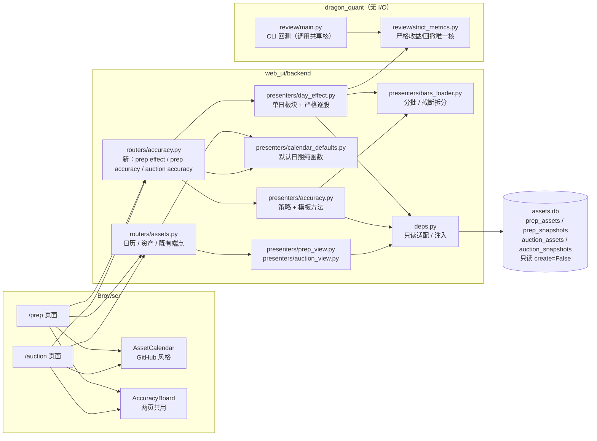
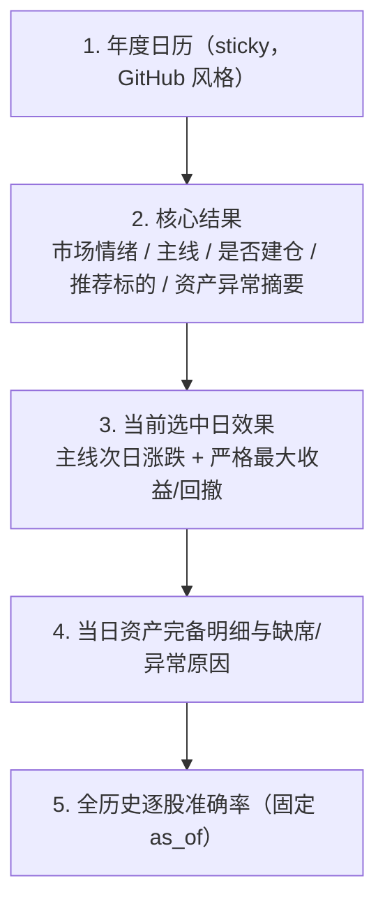
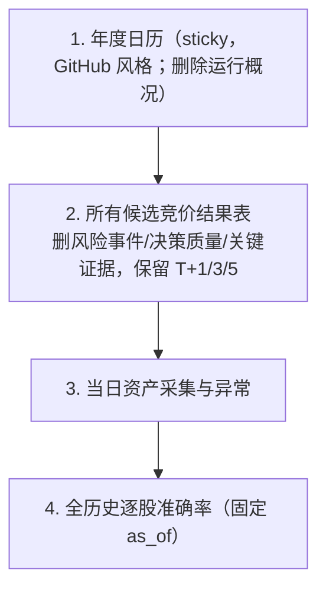

# dashboard 复盘 / 竞价页改版技术方案（2026-11-02）

> 阶段：2 技术方案 · 状态：待自审
> 上游：[调研报告](../research/2026-11-02-dashboard-prep-auction-research.md)（research-self-review = APPROVE）
> 范围：`/prep`、`/auction` 两页的只读投影、年度日历、单日效果、全历史逐股准确率、前端重组与构建产物。
> 非目标：不改 prep / auction 决策算法、CLI、快照字段、表结构与既有数据资产写入；不联网补历史；不新增持久派生表；不改其他页面与既有 API 的兼容语义。

---

## 1. 结论与边界

采用调研路径 A「纯本地只读投影」，在 main 已定框架内落地：

1. **共享严格指标核**：把 `dragon_quant/review/main.py` 的严格窗口纯计算抽到无 I/O 的 `dragon_quant/review/strict_metrics.py`，review CLI 与 Web 共用；用 parity 测试锁定原结果。
2. **独立准确率纯核**：新增 `web_ui/backend/presenters/accuracy.py`，用「策略（信号选择）+ 模板方法（通用开盘→收盘收益/有效性/聚合）」实现 prep / auction 两套口径；不复用 `decision_review` 的 open→open + 13bp 口径。
3. **只读 API 增量**：新增 prep 单日效果、prep / auction 全历史准确率；日历响应增加后端计算的默认日期与降级来源；既有 `plan-followup` 与 `auction/{date}/effect` 保留不动。
4. **前端共用组件**：`AssetCalendar` 重做 GitHub Contributions 外观，两页共用；新增 `AccuracyBoard` 两页共用；两页按验收顺序重组，不新增依赖。
5. **分批与截断**：全历史日 K 按日期/代码递归分批；任何 `truncated` 必须通过拆分解决，无法解决则整体 `insufficient_data`，不静默少样本。

约束继承：

- 行情只读本地 `prep_assets.stock_daily`；不 import provider、不触网。
- `web_ui` 内零 `sqlite3`、零自建连接、零建表写表；所有 DB 访问经 `deps.py` + 既有只读仓储。
- 快照 / 资产 / CLI / 决策算法 / 表结构不变；`dist` 与源码同批构建。
- 缺数据一律显式 `待评估` + 稳定 reason code，不补算、不写 0。

---

## 2. 方案级候选设计对比

main 已比较并确定路径 A；下列候选是**在路径 A 内部的实现形态对比**，用于说明取舍，不改变产品方向。

| 候选 | 做法 | 优点 | 缺点 / 判定 |
|---|---|---|---|
| **D1 后端纯投影 + 共享核（采用）** | 后端输出结构化日历/效果/准确率；严格公式共享；准确率独立纯核；路由只做参数与响应 | 口径唯一、可单测、前端无重算、历史可追溯 | 后端多一次读；当前规模可接受 |
| D2 后端只出原始快照 + 前端计算（非常规） | `/api/prep/{date}` 直接给 `review_candidates` 与日 K，前端算严格收益/准确率 | 后端改动最小 | 全历史日 K 无法整体下发；公式会在前端复制第二套；分页/截断/边界不可控；直接违反「唯一严格公式」 |
| D3 预计算派生表 / 物化视图 | prep/auction 运行时写效果与准确率表 | 查询快 | 需新表/写入/回填/版本治理，违反非目标；早期历史仍缺数据；main 已拒绝路径 C |

推荐 D1，理由：把「口径」放在可测试的 Python 纯函数里，Web 只做投影；不引入新持久层；与现有 `presenters/` + `deps.py` 模式一致。

另外两个**接口粒度**取舍：

- **单端点聚合全部**（`/api/prep/{date}/everything`）vs **按区块拆分**：采用拆分（日历 / 单日效果 / 准确率独立）。原因：准确率固定全历史、不随选中日变化，应与日期解耦；单日效果失败不应拖垮日历与资产明细；前端可并行请求、局部降级。
- **把默认日期交给前端推断** vs **后端返回 `default_date`**：采用后端。原因：交易日序列来自本地日 K，属于数据事实；前端各写一套必然漂移；深链与测试需要确定性。

---

## 3. 架构总览



**依赖方向**：`routers → presenters → deps → infra/assets（lazy import）`；`presenters` 不写 SQL、不触网；`review.strict_metrics` 无任何 `infra` / provider / storage import，可被 CLI 与 Web 同时依赖。

---

## 4. 共享严格指标核

### 4.1 新模块

新增 `dragon_quant/review/strict_metrics.py`（无 I/O）：

- 常量：`WINDOW_SKIP = 1`、`WINDOW_SIZE = 4`、`CANNOT_EVALUATE_REASON`、`PARTIAL_WINDOW_REASON`。
- `is_valid_bar(bar) -> bool`：逐字保留 `review.main._is_valid_bar` 语义（缺 OHLC / 非正价 / `high < low` / OHLC 越界 / 零成交平盘占位 → False）。
- `window_metrics(klines, calendar, buy_date, buy_price) -> dict | None`：逐字保留 `review.main._window_metrics`（买入后第 2～5 个交易日收益窗口；回撤为买入日 → 峰值日最低价）。
- `evaluate_strict(klines, calendar, trade_date) -> dict`：逐字保留 `review.main._strict_review` 的输出形状（`completed` / `cannot_evaluate`、`reason`、`buy_date`、`buy_price`、`max_return_5d`、`max_drawdown_5d`、`max_return_hold_days`）。

### 4.2 review CLI 改造

`dragon_quant/review/main.py`：

- 删除本地 `_window_metrics` / `_strict_review` 实现，改为 import 并调用共享核。
- 保留 `_is_valid_bar = strict_metrics.is_valid_bar` 兼容别名（`test_review_performance.py` 直接 import 该名字）。
- `_loose_review` 改用 `window_metrics`，输出字段与数值不变。
- 不改变 `review_dragon` / `run_review` 的任何返回结构、状态与写库行为。

### 4.3 parity 证据

- 既有 `dragon_quant/tests/test_review.py`、`test_review_strict.py`、`test_review_performance.py` **不修改**并全部通过。
- 新增 `dragon_quant/tests/test_review_strict_metrics.py`：
  - `is_valid_bar` 与 `review.main._is_valid_bar` 在多组合法/非法 bar 上等价；
  - `window_metrics` 覆盖正常、部分窗口、空窗口；
  - `evaluate_strict` 覆盖：次日缺 bar、无效 bar、正常 completed、partial_window；
  - 断言 `review.main._strict_review` 与共享核输出逐字段一致（重构后仍成立）。

### 4.4 Web 使用方式

`presenters/day_effect.py` 只调用 `evaluate_strict`；不 import `review.main`，避免把 provider / storage 依赖拉进 Web 进程。

Web 额外区分「未到期」与「无法评估」：

- 若全局交易日序列中不存在 `> T` 的日期 → `pending`（`next_trading_day_not_available`），不调用共享核。
- 若存在买入日但买入 bar 缺失/无效 → `cannot_evaluate`（`missing_bar` / `invalid_bar`）。
- 若买入 bar 有效但共享核返回 `cannot_evaluate`（窗口内没有任何可用 bar）→ Web 标 `pending`（`window_not_started`）。
- 其余按共享核 `completed`；`partial_window` 原样透出。

> 该映射只改变 Web 展示状态，不改变共享核与 review CLI 的 `cannot_evaluate` 语义。

---

## 5. 全历史逐股准确率

### 5.1 纯核职责

> **样本单位**：本方案把「股票 × 快照日」视为一个样本，再按 code 聚合为逐股行。这样「全历史」不会因某只股票重复出现而丢失日期信息，同时逐股表回答「这只股票历史上判断对了几次」。若产品所说的「每股票一样本」是指每只股票只取一条决策（例如最新一条），分母会显著变化，需 main 另行确认；本方案不擅自按去重口径实现。

`web_ui/backend/presenters/accuracy.py`：

- `AccuracyWindow(entry_offset, exit_offset, entry_price="open", exit_price="close", cost_bps=0.0)`。
- **策略接口**（轻量 Strategy，不引入插件注册表）：
  - `PrepSignalStrategy.select(payload) -> list[SignalSample]`
  - `AuctionSignalStrategy.select(rows, names) -> list[SignalSample]`
  - `SignalSample`：`code`、`name`、`snapshot_date`、`expected_direction`（`up|down`）、`group`、`exclusion_reason`（若样本级不可用）。
- **模板方法**：`evaluate_accuracy(samples, bars, calendar, window, cutoff)` 统一完成：
  1. 若 `snapshot_date > cutoff` → `immature`；
  2. 定位 `T` 在全局交易日序列中的索引；不在序列且 `T <= cutoff` → `calendar_unavailable`；
  3. 按 `entry_offset` / `exit_offset` 取入场/出场日；
  4. 取 bar，缺 bar → `missing_bar`，bar 无效 → `invalid_bar`；
  5. 原始价格方向：`close > entry_open` 为 up，`<` 为 down，`==` 为 flat；
  6. `expected_direction` 与方向一致 → correct；flat 计入 valid 但不计 correct；
  7. 按 code 聚合逐股 `correct / valid / excluded / hit_rate`；
  8. 汇总 `summary`、`excluded_by_reason`、`excluded_snapshot_dates`。

**有效分母**：`valid = correct + wrong + flat`；`excluded` 全部原因计数；`hit_rate = correct / valid`（`valid == 0` → `null`）。

### 5.2 prep 口径

数据源：`prep_snapshots`（v0.7 / v0.8），逐日 `sentiment` + `review_candidates`。

**日级「是否建仓」**（唯一实现）：

1. `sentiment.position_pct`（0～1）> 0 → 建仓日；`== 0` → 不建仓日。
2. `position_pct` 缺失时回退 `sentiment.position_advice`：`空仓` → 不建仓日；`重仓 / 正常 / 轻仓` → 建仓日。
3. 两者都缺失 → 当日 `market_signal_missing`，该日所有候选样本按 `excluded` 计数。

**组选择**：

| 日级状态 | 计入样本 | 排除（样本级） | 忽略 |
|---|---|---|---|
| 建仓日 | `eligibility == "eligible"` 且 `position_pct > 0` | `eligibility` 缺失/`unknown` 或 `position_pct == null` → `candidate_data_insufficient` | 其余（明确不推荐） |
| 不建仓日 | `position_pct == 0`（**不要求** `eligibility=="not_qualified"`；eligible 但 0 仓位同样属于明确不推荐） | `position_pct == null` 或信号缺失 → `candidate_data_insufficient` | `position_pct > 0`（与日级建议冲突的推荐股，记 `inconsistent_group` 告警但不计入分母） |
| 信号缺失 | 无 | 全部候选 → `market_signal_missing` | 无 |

- 一个「股票 × 快照日」为一样本；同一股票跨日分别计数，再按 code 聚合。
- 明确不从 `candidates[]` 兼容投影取信号；只读 `review_candidates`。
- 快照版本不在 `("0.7", "0.8")` → 该日 `snapshot_unsupported`；无 `review_candidates` → `review_candidates_missing`；损坏 → `snapshot_corrupt`。这些计入 `excluded_snapshot_dates`，不伪造样本。

**窗口**：T+1 开盘买入，T+3 收盘卖出（`entry_offset=1`，`exit_offset=3`）。原始价格，不扣费。

### 5.3 auction 口径

数据源：`auction_snapshots`（`version == "2"`），逐日行。

| 条件 | 预期方向 |
|---|---|
| `level == "弱"`（含 `is_weak` 否决导致 level=弱） | down |
| `level in ("强", "中")` 且 `direction == "bear"` | down |
| `level in ("强", "中")` 且 `direction in ("bull", "neutral")` | up |
| `level == null` / `data_quality.status == "unavailable"` / `unverified == true` | 排除 `signal_missing` |
| 非弱但 `direction` 缺失 | 排除 `signal_missing` |
| 行 `error` | 排除 `snapshot_corrupt` |
| `version != "2"` | 排除 `snapshot_unsupported` |

- 「非弱偏多/中性预期上涨」严格按用户口径；`neutral` 不算 down。
- 窗口：T 日开盘买入，T+2 收盘卖出（`entry_offset=0`，`exit_offset=2`）。原始价格，不扣费。
- 名称从 `list_auction_asset_names(day)` 读取；缺失时 name 为 null，不阻塞。

### 5.4 截至日与未成熟

- 全局交易日序列 = 本地 `stock_daily` 所有 bar 的日期并集（只读、非交易所日历）。
- `latest_bar_date = max(calendar <= 今日)`。
- 可验证截止日：
  - prep：`calendar[-4]`（其后还有 3 个交易日：T+1、T+2、T+3）；
  - auction：`calendar[-3]`（其后还有 2 个交易日：T+1、T+2）。
- 交易日不足 4 / 3 天 → `as_of = null`，全部样本 `immature`。
- 快照日 `T > as_of` 的样本按 `immature` 排除，**不进入有效分母**；页面显示 `as_of`、正确数、有效数、排除数。
- 准确率固定全历史，不接收日期参数，不随日历选中日变化。

### 5.5 样本级 reason 优先级

1. `snapshot_unsupported` / `snapshot_corrupt` / `review_candidates_missing`（日级，计入 `excluded_snapshot_dates`）
2. `market_signal_missing` / `candidate_data_insufficient` / `signal_missing`
3. `immature`
4. `calendar_unavailable`
5. `missing_bar`
6. `invalid_bar`

同一优先级内按 code 排序，保证输出确定性。

---

## 6. 默认日期算法

### 6.1 共享纯函数

`web_ui/backend/presenters/calendar_defaults.py`：

```python
resolve_default_date(
    *,
    page: Literal["prep", "auction"],
    bar_dates: Sequence[str],
    reference_date: str,          # 显式 end 或上海今天
    latest_record_date: str | None,
) -> dict
```

返回：

```json
{
  "default_date": "2026-10-30",
  "default_date_source": "local_bar_previous",
  "calendar_basis": "local_stock_daily_bars_union",
  "calendar_latest_date": "2026-10-30",
  "degraded": false,
  "degraded_reason": null
}
```

### 6.2 状态机

```mermaid
flowchart TD
    A["reference_date = 显式 end 或上海今天"] --> B["confirmed = bar_dates <= reference 升序去重"]
    B --> C{confirmed 非空?}
    C -- 否 --> D{latest_record_date?}
    D -- 是 --> E["default = latest_record_date<br/>source=record_date_fallback<br/>degraded=true, reason=local_bars_missing"]
    D -- 否 --> F["default = reference_date<br/>source=today_fallback<br/>degraded=true, reason=local_bars_missing"]
    C -- 是 --> G{page}
    G -- auction --> H["default = confirmed[-1]<br/>source=local_bar_latest"]
    G -- prep --> I{confirmed[-1] == reference_date?}
    I -- 否 --> J["default = confirmed[-1]<br/>source=local_bar_latest"]
    I -- 是 --> K{存在 confirmed[-2]?}
    K -- 是 --> L["default = confirmed[-2]<br/>source=local_bar_previous"]
    K -- 否 --> M["default = confirmed[-1]<br/>source=local_bar_latest<br/>degraded=true, reason=no_previous_trading_day"]
```

语义对照：

- **prep 交易日**：本地写入当天 bar 后 `confirmed[-1] == reference_date` → 选前一确认交易日（T-1）；当天 bar 未写入（盘中/收盘前）→ `confirmed[-1]` 是前一交易日（仍为 T-1）。
- **prep 休息日**：`confirmed[-1] < reference_date` → 选最近确认交易日（周五/节前）。
- **auction**：永远选 `confirmed[-1]`（最近确认交易日），不因当天是否有记录改变。
- 默认日期**不要求当天有资产/快照记录**；页面如实展示缺失。
- 显式 `?date=` 深链优先级最高，前端不再用默认值覆盖。

### 6.3 局限与可见性

本地日 K 不是交易所日历。若最近多个交易日完全无本地行情，系统无法凭空知道真实开市序列；此时 `default_date_source` 与 `calendar_latest_date` 会暴露依据，前端显示「按本地日 K 最近交易日」提示。需要绝对交易所日历时另立需求，不在本期引入在线日历。

---

## 7. API 契约

### 7.1 日历响应增量（向后兼容）

`GET /api/prep/calendar?days=365&end=` 与 `GET /api/auction/calendar?days=365&end=` 在既有字段后追加：

```json
{
  "default_date": "2026-10-30",
  "default_date_source": "local_bar_previous",
  "calendar_basis": "local_stock_daily_bars_union",
  "calendar_latest_date": "2026-10-30",
  "degraded": false,
  "degraded_reason": null
}
```

- `default_date_source` ∈ `local_bar_previous | local_bar_latest | record_date_fallback | today_fallback`。
- `calendar_basis` ∈ `local_stock_daily_bars_union | record_dates`。
- `days` 仍只返回有记录日期；前端对窗口内其余日期渲染「无记录」且可点击。
- 既有 `latest_record_date` / `end_date` 保留不变。

### 7.2 `GET /api/prep/{trade_date}/effect`（新）

只读本地；路由只做参数与响应；I/O 经 `assets_repository` / `local_bars_loader` / `bar_calendar_loader` 注入。

```json
{
  "status": "ok",
  "reason": null,
  "trade_date": "2026-10-30",
  "next_trade_date": "2026-11-02",
  "snapshot_version": "0.8",
  "data_source": "local_prep_assets+local_stock_daily",
  "calendar_basis": "local_stock_daily_bars_union",
  "boards": {
    "available": true,
    "reason": null,
    "source": "review_mainlines",
    "rows": [
      {
        "rank": 1,
        "board_name": "机器人概念",
        "category": "概念",
        "is_mainline": true,
        "board_code": "885517",
        "t_change_pct": 2.31,
        "next_change_pct": 3.14,
        "match": "code",
        "exclusion_reason": null,
        "warnings": []
      }
    ],
    "summary": { "evaluated": 3, "missing": 0, "mean_change_pct": 2.87 }
  },
  "stocks": {
    "available": true,
    "reason": null,
    "rows": [
      {
        "code": "600001",
        "name": "龙头A",
        "group": "recommended",
        "role": "leader",
        "review_score": 82.0,
        "eligibility": "eligible",
        "position_pct": 20.0,
        "status": "completed",
        "buy_date": "2026-11-02",
        "buy_price": 10.0,
        "max_return_5d": 6.2,
        "max_drawdown_5d": -2.1,
        "max_return_hold_days": 3,
        "partial_window": false,
        "reason": null
      }
    ],
    "summary": [
      {
        "group": "recommended",
        "label": "推荐",
        "valid": 2,
        "cannot_evaluate": 0,
        "pending": 1,
        "mean_max_return_5d": 4.1,
        "median_max_return_5d": 4.1,
        "mean_max_drawdown_5d": -1.5,
        "median_max_drawdown_5d": -1.5
      }
    ]
  },
  "coverage": {
    "boards_total": 3,
    "stocks_total": 5,
    "bar_dates": 9
  },
  "warnings": [],
  "caveats": ["行情只读本地日 K；打开页面不联网，缺数据一律「待评估」"]
}
```

规则：

- 板块来源：T 快照 `review.mainlines`（`source="review_mainlines"`）**仅取 `is_mainline == true` 的真主线**；`mainline_watchlist` 中的观察位不进入单日板块效果。旧快照无 `review.mainlines` 时回退 `main_boards`（`source="main_boards"`，该列表本身就是主线回退来源，全部按主线展示，附 `legacy_main_boards` 警告；不能因 `is_mainline` 全 false 而过滤为空）。
- T+1 交易日：全局交易日序列中第一个 `> T` 的日期；不存在 → 全部 `next_trading_day_unavailable`，**不**用下一条记录日冒充。
- T 板块代码：从 T 的 `prep_assets.ths_block_top.rows` 按 `board_name` 找 `code`；T+1 优先按 `code` 匹配，找不到再按唯一 `name` 匹配（`match="name"` + `board_name_fallback` 警告）；同名多条 → `ambiguous_board_name`；无匹配 → `next_board_missing`。
- `change` 字段缺失/非数值 → `change_missing`；T 或 T+1 的 `ths_block_top` 资产缺失 → `board_asset_missing` / `next_board_asset_missing`。
- 股票分组：`recommended` = `eligibility=="eligible" && position_pct>0`；`not_recommended` = `position_pct == 0`（**不再要求** `eligibility=="not_qualified"`，eligible 但 0 仓位同样归入明确不推荐）；`position_pct == null` 或信号缺失 → `data_insufficient`；`position_pct > 0` 但不在推荐集（与日级/资格冲突）→ `data_insufficient` 并记 `inconsistent_group` 警告。逐股严格入场/窗口/回撤完全调用 `strict_metrics.evaluate_strict`。
- `status`：至少一个板块或股票 `completed` → `ok`；否则 `insufficient_data`，reason 优先 `snapshot_missing` > `local_bars_missing` > `next_trading_day_unavailable` > `no_signal`。
- 不返回宽松口径字段；不展示宽松。

### 7.3 `GET /api/prep/accuracy`（新）

无日期参数、固定 v2、全历史。

```json
{
  "status": "ok",
  "reason": null,
  "as_of": "2026-10-28",
  "latest_bar_date": "2026-11-02",
  "snapshot_count": 8,
  "data_source": "local_stock_daily",
  "calendar_basis": "local_stock_daily_bars_union",
  "sample_unit": "stock_day",
  "window": {
    "entry_offset": 1,
    "exit_offset": 3,
    "entry_price": "open",
    "exit_price": "close",
    "cost_bps": 0.0
  },
  "summary": {
    "correct": 3,
    "valid": 5,
    "excluded": 7,
    "hit_rate": 0.6,
    "excluded_by_reason": {
      "candidate_data_insufficient": 2,
      "missing_bar": 3,
      "immature": 2
    }
  },
  "day_kind_counts": { "build": 4, "no_build": 3, "signal_missing": 1 },
  "stocks": [
    { "code": "600001", "name": "龙头A", "correct": 2, "valid": 2, "excluded": 0, "hit_rate": 1.0 }
  ],
  "excluded_snapshot_dates": { "snapshot_unsupported": 0, "snapshot_corrupt": 0, "review_candidates_missing": 1 },
  "warnings": [],
  "caveats": ["方向命中仅描述历史样本，不构成策略有效性结论"]
}
```

`excluded_snapshot_dates` 是日级排除；`summary.excluded` 是样本级排除，二者分开展示。

### 7.4 `GET /api/auction/accuracy`（新）

同形状，`window` 为 `entry_offset=0` / `exit_offset=2`；`day_kind_counts` 不适用（返回 `{}`）；无 `review_candidates_missing`。

### 7.5 路由顺序硬要求

`GET /api/prep/accuracy` 与既有 `GET /api/prep/{trade_date}` 冲突。实现：

- 新增 `web_ui/backend/routers/accuracy.py`，在 `routers/__init__.py` 中**先于** `assets.router` 注册。
- 增加测试：`GET /api/prep/accuracy` 返回 200 且含 `summary`，不得被 watermark 解析成 400；`GET /api/auction/accuracy` 同理。

---

## 8. 数据读取、分批与截断

### 8.1 新增只读 helper

`dragon_quant/infra/assets/db.py`：

```python
def list_stock_daily_bar_dates(date_from=None, date_to=None, *, db_path=None) -> list[str]
```

- `create=False`，不建库；
- 扫描区间内 `asset_type='stock_daily'` 的 payload，收集 `rows[*][*]["date"]` 并集；
- 作为「本地已确认交易日」序列，不声称是交易所日历；
- 供日历默认日期、单日效果、准确率共用。

### 8.2 分批策略

新增 `web_ui/backend/presenters/bars_loader.py`：

```python
def load_bars_resilient(load_bars, codes, date_from, date_to) -> dict
```

- 先按 `[date_from, date_to]` 调 `load_bars`；
- `truncated` 时先按日期中点二分；日期已到单日仍截断，再按 codes 二分；
- 单 code + 单日仍截断 → 抛 `BarsTruncated`；
- 调用方捕获后返回 `status="insufficient_data"`、`reason="local_bars_truncated"`，**不输出部分统计**；
- 合并结果按 `(code, date)` 去重、date 升序，返回 `rows` / `bar_dates` / `codes` / `truncated=False`。

调用点：

- prep 单日效果：`codes` = T 的 `review_candidates` codes；范围 `[T-10, T+30]`（自然日）。
- 准确率：`codes` = 全部成熟样本 codes；范围 `[min(T), 今日]`。先取全局日历，再分批加载。

### 8.3 规模与内存

- 快照逐日 load 是 O(快照日数)；当前本机 prep 8 日、auction 7 日，量级可接受。
- 日 K 加载按区间/代码递归拆分，最终只保留 `(code, date)` 去重后的 bar；不保留重复 payload。
- 不引入持久缓存/派生表；若未来历史显著增长，再评估缓存层（另立需求）。
- 全历史不设样本上限；不因 `200_000` 默认上限静默丢样本。

---

## 9. 前端组件与页面重组

### 9.1 共用组件

**`web_ui/frontend/src/components/AssetCalendar.tsx`（重写，保留文件名/Props）**

- GitHub Contributions 布局：列=周、行=周一…周日；顶部月份标签；左侧星期标签（一/三/五）。
- 色阶（语义，不新增依赖）：
  - 无记录：`bg-panel-3`；
  - 资产缺失：`bg-danger-soft + border-danger-line`；
  - 不完备：`bg-warning-soft + border-warning-line`；
  - 完备：`bg-positive-soft + border-positive-line`。
- 选中态：`ring-2 ring-brand`，`aria-current="date"`。
- sticky：外层 Section 使用 `className="sticky top-0 z-20"`；面板背景必须为实色 token（`bg-panel`），避免内容透出。
- 移动端：日历网格容器 `overflow-x-auto`，页面本身不横向滚动。
- 键盘：每格为原生 `<button>`，Tab 可聚焦，Enter/Space 选中；`aria-label` 含日期/状态/选中态。
- 主题：只用语义 token；禁止 Tailwind 斜杠透明度；浅色/深色由 `[data-theme]` 自动切换。

**`web_ui/frontend/src/components/AccuracyBoard.tsx`（新）**

- 顶部：截止日 `as_of`、「最新可验证日」说明、正确数 / 有效数 / 排除数、命中率。
- **文案必须明确**：准确率是历史样本的描述性统计，不构成策略有效性结论；不得使用「胜率」「验证有效」等措辞。
- 排除原因：`excluded_by_reason` + `excluded_snapshot_dates` 中文映射。
- 逐股表：`DataTable`（代码 / 名称 / 正确 / 有效 / 排除 / 命中率），按 valid desc、code 排序。
- 空态：`status="insufficient_data"` 时显示稳定 reason，不显示 0% 或虚假稳定性。
- caveats 折叠展示。
- Props 由两页传入同一 `AccuracyResponse`，仅标题/口径文案不同。

### 9.2 `/prep` 五区块顺序



- **删除当前「结论」区块**（`PrepSummaryBand`）与「运行概况」「上次计划复盘 / 成效」独立区块。
- 第 2 区块由 `PrepCoreResult` 组合：
  - `MarketStrip`（市场情绪原始指标）；
  - `MainlineTable`（主线）；
  - 是否建仓：`buildMarketView(snapshot).positionAdvice` / `positionPct`；
  - 推荐建仓标的：`review_candidates` 中 `eligible && position_pct>0` 的紧凑列表（新 `RecommendedList` 或 `PrepCoreResult` 内表格）；
  - 资产完备与异常摘要：`watermark.expected_ok/expected_total` + `buildAnomalies(...)` 前 3 条 + 计数。
- 第 3 区块 `PrepDayEffectSection`：
  - 主线板块表（仅真主线）：板块 / 排名 / 来源 / T 日涨跌 / 次日涨跌 / 匹配方式 / 待评估原因；若为 `main_boards` 回退则在表头标注来源与 `legacy_main_boards` 警告，不展示 watchlist 观察位；
  - 推荐与不推荐两张逐股表：代码 / 名称 / 组 / 状态 / 买入日 / 买价 / 最大收益 / 最大回撤 / 持有天数 / 待评估原因；
  - 组内汇总：有效 / 无法评估 / 待评估 / 最大收益均值+中位数 / 最大回撤均值+中位数；
  - 数据不足组折叠为「待评估 N 只」明细。
- 第 4 区块复用 `AssetDayTable` + `watermark`；不再单独展示「数据资产」大区块的旧标题。
- 第 5 区块 `AccuracyBoard`，单独请求 `/api/prep/accuracy`，不随选中日变化。
- 页面不再请求 `plan-followup` 与 `review-context`；API 保留供其他消费者。
- `PrepPage` 默认日期：`calendar.default_date ?? calendar.latest_record_date ?? calendar.end_date`；URL `?date=` 优先。

### 9.3 `/auction` 四区块顺序



- 删除 `RunSection`（运行概况）与 `EffectSection`（窗口成效聚合）的页面展示；`/api/auction/{date}/effect` 保留。
- 第 2 区块 `ResultsSection`：删除 `evidence` / `risk` / `quality` 三列；保留代码/名称/强度/等级/方向/排名/采集状态/T+1/T+3/T+5；T+1/3/5 仍取 `effect.selected_day`（既有口径，不混称准确率）。
- 第 3 区块 `AssetCollectionSection`：资产代码 / 原始资产 / 快照 / 采集状态 / 未知原因 / 运行异常计数（`run.error_rows`、仅快照/仅资产代码）；不展示决策质量。
- 第 4 区块 `AccuracyBoard`，请求 `/api/auction/accuracy`，不随选中日变化。
- 默认日期：`calendar.default_date`（始终最近确认交易日）。
- 保留 `?date=` 深链和前进/后退。

### 9.4 文案与标签

`web_ui/frontend/src/lib/labels.ts` 新增：

- `DEFAULT_DATE_SOURCE_LABELS`：本地前一交易日 / 本地最近交易日 / 记录日回退 / 今日回退。
- `ACCURACY_REASON_LABELS`：`market_signal_missing`、`candidate_data_insufficient`、`signal_missing`、`immature`、`calendar_unavailable`、`missing_bar`、`invalid_bar`、`snapshot_unsupported`、`snapshot_corrupt`、`review_candidates_missing`、`no_snapshots`、`local_bars_missing`、`local_bars_truncated`。
- `EFFECT_REASON_LABELS`：板块与股票 reason。
- `ACCURACY_GROUP_LABELS`：推荐 / 不推荐 / 数据不足。

---

## 10. 文件级改动清单

### 10.1 后端 / 领域

| 文件 | 动作 | 内容 |
|---|---|---|
| `dragon_quant/review/strict_metrics.py` | 新增 | 严格收益/回撤唯一核 |
| `dragon_quant/review/main.py` | 修改 | 改为调用共享核；保留 `_is_valid_bar` 兼容别名 |
| `dragon_quant/infra/assets/db.py` | 修改 | 新增 `list_stock_daily_bar_dates`（只读、无 schema） |
| `dragon_quant/infra/provider/ths.py` | 修改 | `get_block_top` docstring 声明真实上游 `code/change` |
| `dragon_quant/review_account/prep/collectors.py` | 修改 | `_collect_ths_block_top` docstring/注释声明 `code/change` |
| `web_ui/backend/presenters/calendar_defaults.py` | 新增 | 默认日期纯函数 |
| `web_ui/backend/presenters/bars_loader.py` | 新增 | 递归分批/截断拆分 |
| `web_ui/backend/presenters/accuracy.py` | 新增 | 策略 + 模板方法 + 两类口径 + 聚合 |
| `web_ui/backend/presenters/day_effect.py` | 新增 | prep 板块次日涨跌 + 严格逐股/组汇总 |
| `web_ui/backend/presenters/snapshot_io.py` | 新增 | `split_load` / 快照日枚举小工具（prep / auction 共用） |
| `web_ui/backend/routers/accuracy.py` | 新增 | 3 个只读端点 + Pydantic 响应模型 |
| `web_ui/backend/routers/assets.py` | 修改 | 日历响应追加默认日期字段；注入 `bar_calendar_loader` |
| `web_ui/backend/routers/__init__.py` | 修改 | `accuracy.router` 先于 `assets.router` |
| `web_ui/backend/deps.py` | 修改 | 新增 `bar_calendar_loader`；不新增 SQL |

> `snapshot_io.py` 可选：若阶段 3 认为 `prep_effect._split_load` 复用成本低于新文件，可把 `split_load` 保留在 `prep_effect.py` 并从 `accuracy.py` import；但禁止复制第二份实现。

### 10.2 前端

| 文件 | 动作 | 内容 |
|---|---|---|
| `web_ui/frontend/src/api/assets.ts` | 修改 | 新类型 + `fetchPrepEffect` / `fetchPrepAccuracy` / `fetchAuctionAccuracy`；日历类型加默认日期字段 |
| `web_ui/frontend/src/components/AssetCalendar.tsx` | 重写 | GitHub 风格、sticky、横滚、键盘、主题 |
| `web_ui/frontend/src/components/AccuracyBoard.tsx` | 新增 | 两页共用准确率展示 |
| `web_ui/frontend/src/pages/prep/PrepPage.tsx` | 重写 | 五区块顺序、默认日期、新请求 |
| `web_ui/frontend/src/pages/prep/PrepCoreResult.tsx` | 新增 | 市场 / 主线 / 是否建仓 / 推荐标的 / 资产异常摘要 |
| `web_ui/frontend/src/pages/prep/PrepDayEffectSection.tsx` | 新增 | 板块次日 + 严格逐股/组汇总 |
| `web_ui/frontend/src/pages/prep/prepModel.ts` | 修改 | 新增推荐标的/异常摘要投影；删除仅旧结论带/计划区块使用的 helper |
| `web_ui/frontend/src/pages/prep/PrepSummaryBand.tsx` | 删除 | 旧「结论」区块 |
| `web_ui/frontend/src/pages/prep/RunOverview.tsx` | 删除 | 旧运行概况 |
| `web_ui/frontend/src/pages/prep/PlanReviewSection.tsx` | 删除 | 旧上次计划复盘区块（API 保留） |
| `web_ui/frontend/src/pages/prep/CandidateList.tsx` | 删除或改造 | 新核心结果只展示推荐标的；若无复用则删除 |
| `web_ui/frontend/src/pages/auction/AuctionPage.tsx` | 重写 | 四区块顺序、删旧运行概况/成效、结果表删三列、新准确率 |
| `web_ui/frontend/src/lib/labels.ts` | 修改 | 默认日期来源 / 准确率/效果 reason / 分组标签 |
| `web_ui/dist/**` | 重新构建 | `npm --prefix web_ui/frontend run build` 同批更新 |

### 10.3 文档

| 文件 | 动作 | 内容 |
|---|---|---|
| `docs/solutions/2026-11-02-dashboard-prep-auction-revamp.md` | 新增 | 本方案 |
| `docs/agent/development.md` | 修改 | 新 presenters / 端点 / deps / 共享核 / 测试与构建要求 |
| `docs/agent/prep-auction.md` | 修改 | 默认日期、`/effect`、`/accuracy`、`ths_block_top` 的 `code/change` 契约、页面区块 |
| `docs/agent/review.md` | 修改 | 严格指标核共享（`review/strict_metrics.py`）及 parity 约束 |
| `README.md` / 根 `AGENTS.md` | 不改 | 无新增跨模块硬约束 / 无新命令 |

### 10.4 测试

| 文件 | 动作 | 内容 |
|---|---|---|
| `dragon_quant/tests/test_review_strict_metrics.py` | 新增 | 共享严格核 + parity |
| `dragon_quant/tests/test_dashboard_calendar_defaults.py` | 新增 | 默认日期状态机 |
| `dragon_quant/tests/test_dashboard_prep_effect.py` | 新增 | 板块匹配、严格逐股、pending/cannot |
| `dragon_quant/tests/test_dashboard_accuracy.py` | 新增 | 两套口径、分母、flat、切截断、全历史 |
| `dragon_quant/tests/test_assets_db_calendar.py` | 修改 | `list_stock_daily_bar_dates` |
| `dragon_quant/tests/test_web_backend.py` | 修改 | `FakeAssets` 新方法；新端点；日历字段；路由顺序 |
| `dragon_quant/tests/test_web_frontend_ops.py` | 修改 | 新五/四区块顺序、GitHub 日历契约、删旧区块/列、准确率共用 |
| `dragon_quant/tests/test_web_frontend_results.py` | 修改 | 同步旧顺序断言 |
| `dragon_quant/tests/e2e/test_dashboard.py` | 修改 | 新端点 200/空态、默认日期、只读哨兵 |
| `dragon_quant/tests/e2e/coverage-map.json` | 不改 | 无新 CLI 命令，parser 54 / 命令 16 不变 |

---

## 11. 实施顺序（阶段 3 两个工作包）

### 工作包 3A：后端与共享核

顺序：

1. `strict_metrics.py` + `review/main.py` 改造 + parity 测试。
2. `list_stock_daily_bar_dates` + 仓储测试。
3. `calendar_defaults.py` + 日历响应字段 + 测试。
4. `bars_loader.py` + `snapshot_io.py`。
5. `accuracy.py` + `routers/accuracy.py` 的两个 accuracy 端点 + 测试。
6. `day_effect.py` + `/api/prep/{date}/effect` + 测试。
7. `test_web_backend.py` / E2E 增补；全量后端测试。

**3A 验收接口**（3B 可依赖）：

- `GET /api/prep/calendar`、`/api/auction/calendar` 含 6 个默认日期字段；
- `GET /api/prep/{date}/effect` 响应形状如 §7.2；
- `GET /api/prep/accuracy`、`/api/auction/accuracy` 响应形状如 §7.3/§7.4；
- 既有 `plan-followup`、`auction/{date}/effect`、`/api/prep/{date}` 响应不变（仅日历追加字段）。

### 工作包 3B：前端与构建

顺序：

1. `api/assets.ts` 类型与请求。
2. `AssetCalendar` GitHub 重写。
3. `AccuracyBoard`。
4. `PrepPage` + `PrepCoreResult` + `PrepDayEffectSection`；删除旧区块。
5. `AuctionPage` 重组。
6. `labels.ts`。
7. 更新前端契约测试、`npm run build`、dist 同批、全量前端测试。

**3B 验收**：

- 两页区块顺序与验收标准一致；
- 深链 `?date=`、主题切换、移动端横滚、键盘可选；
- 竞拍结果表仅删三列；
- `web_ui/dist` 与源码同批。

---

## 12. 错误、空态与降级

| 场景 | 行为 |
|---|---|
| `assets.db` 不存在 | 日历 200 空态；准确率 200 `insufficient_data` + `no_snapshots`；不建库 |
| 某日无资产 / 无快照 | 日历渲染 `missing`；详情页显示缺失；不 404 |
| prep 快照损坏 / 版本不支持 | 该日 `excluded_snapshot_dates` 计数；不 500 |
| `sentiment` 缺失 | 该日候选 `market_signal_missing` 排除；不猜涨跌 |
| 候选 `eligibility/position` 缺失 | 样本级 `candidate_data_insufficient` 排除 |
| 本地日 K 缺失 | `missing_bar`；准确率可整体 `local_bars_missing` |
| 日 K 截断无法拆分 | `insufficient_data` + `local_bars_truncated`；不输出部分统计 |
| 无 T+1 交易日 | 单日效果 `next_trading_day_unavailable`；严格逐股 `pending` |
| T+1 板块资产缺失 | `next_board_asset_missing`；不用后续记录日替代 |
| 准确率窗口未成熟 | `immature` 排除；`as_of` 显示截止日 |
| 名称匹配多条 | `ambiguous_board_name`；不猜 |
| 竞价 `level` / `direction` 缺失 | `signal_missing` 排除 |

统一原则：**缺失是数据事实，不是 0 收益，也不是看空**。

---

## 13. 测试矩阵

### 13.1 单元 / presenter

| 模块 | 用例 |
|---|---|
| `review.strict_metrics` | 合法/非法 bar；正常/部分/空窗口；严格 completed/cannot；与 `review.main` 旧私有函数逐字段 parity |
| `calendar_defaults` | prep 交易日（latest==today）→ 前一；latest<today → latest；周末；仅一天；无 bar → 记录日回退；无记录 → 今日回退；auction 永远 latest |
| `day_effect` | 板块 code 命中；name 唯一回退；同名多条；缺 T/T+1 资产；无 T+1 交易日；change 缺失；仅 `is_mainline=true` 进入板块效果；legacy `main_boards` 全量作为主线回退且标 source/警告；严格 recommended（eligible ∧ >0）/not_recommended（`position_pct==0`，含 eligible 但 0 仓）/data_insufficient（position null 或冲突）；pending vs cannot；组均值/中位数 |
| `accuracy` | prep 建仓日只取推荐；不建仓日取 `position_pct==0`（不要求 not_qualified）；position null/信号缺失 → data_insufficient；flat 计入 valid 不计 correct；T+1 open → T+3 close；auction T open → T+2 close；弱→down；非弱 bear→down；非弱 bull/neutral→up；unavailable 排除；immature 截止日；逐股聚合；全历史多日 |
| `bars_loader` | 直接成功；宽区间 truncated → 日期二分；单日 truncated → code 二分；单 code+单日仍 truncated → 抛错；合并去重排序 |

### 13.2 仓储

- `list_stock_daily_bar_dates`：库不存在返回 `[]` 不建库；多日 payload 日期并集；日期区间过滤；损坏 payload 跳过不中断。

### 13.3 API

- 日历默认字段：prep/auction 各 4 种来源；`degraded` 语义。
- 路由顺序：`/api/prep/accuracy`、`/api/auction/accuracy` 不被动态路由吞掉。
- 新端点空库 200、`insufficient_data`；非法日期 400；既有端点响应不变。
- `FakeAssets` 增加 `list_stock_daily_bar_dates` / `get_prep_asset` 返回测试数据。

### 13.4 前端契约

- `/prep` 五区块顺序；不出现「结论」「运行概况」「上次计划复盘」旧区块。
- `/auction` 四区块顺序；不出现「运行概况」「成效」旧区块。
- 结果表列集合：不含风险事件/决策质量/关键证据；含 T+1/T+3/T+5。
- `AssetCalendar` 含月份、周列、色阶 class、sticky、`overflow-x-auto`、`button`、`aria-label`、`aria-current`。
- 两页都 import `AccuracyBoard`；准确率区块不接收选中日参数。
- dist 与源码同批（`test_web_frontend_theme.py` / `test_web_frontend_ops.py`）。

### 13.5 E2E

- `/api/prep/calendar?end=...` 默认日期为前一确认交易日；`/api/auction/calendar` 为最近确认交易日。
- `/api/prep/{date}/effect`：板块 code 匹配、严格字段、空态 reason。
- `/api/prep/accuracy`、`/api/auction/accuracy`：200、`as_of`、counts、排除原因；真实数据目录哨兵不变。
- 不新增命令 → `coverage-map.json` 不变。

### 13.6 门禁命令

```bash
.venv/bin/python -m pytest dragon_quant/tests -q --ignore=dragon_quant/tests/e2e --ignore=dragon_quant/tests/smoke
.venv/bin/python -m pytest dragon_quant/tests/e2e -q
npm --prefix web_ui/frontend run build
```

---

## 14. 兼容与迁移

- **无 schema 迁移**：不新增表/列；`list_stock_daily_bar_dates` 只读。
- **快照兼容**：prep 接受 0.7/0.8；缺失 `review.mainlines` 回退 `main_boards`；auction 只接受 v2，旧行按 `snapshot_unsupported` 排除并计数。
- **API 兼容**：日历只追加字段；`plan-followup` 与 `auction/{date}/effect` 原样保留；旧前端/旧深链不受影响。
- **前端兼容**：`?date=` 深链、浏览器前进/后退、system/light/dark 三态、其他页面不触碰。
- **dist**：`web_ui/dist` 与源码同批构建，随 wheel 分发。
- **归档**：本方案属开发期产物；功能合入/提 PR 前由 main 询问是否归档，本期不自动移动。

---

## 15. 风险与缓解

### 15.1 main 未覆盖的边界与处理

| 边界 / 隐含假设 | 处理 |
|---|---|
| 「每股票一样本」可能指每只股票只取一条决策 | 方案明确按「股票 × 快照日」采样并逐股聚合；若需去重口径，必须由 main 决策，避免两套分母 |
| prep「是否建仓」没有单一现成字段 | 固定 `sentiment.position_pct > 0` 为主口径，`position_advice` 为回退；两者都缺失则整日 `market_signal_missing` |
| auction `level=弱` 与 `is_weak` 否决的关系 | 当前评分中否决会把 level 置为「弱」；统一按「等级弱优先看跌」处理，不再区分来源 |
| 非弱 `neutral` 的预期方向 | 按用户确认口径预期上涨；在 caveat 明示，不按直觉改成看跌 |
| 快照日不在本地 bar 日历中 | prep / auction 准确率要求 T 在确认交易日序列中；不在序列且早于最新 bar → `calendar_unavailable`，不用相邻 bar 冒充 T |
| 未成熟窗口 | `as_of` 固定为第 4 / 第 3 个最近交易日；T 晚于 `as_of` 的样本计 `immature` 排除，不进入分母 |
| 单日效果「明年才到期」 | 严格逐股区分 `pending`（无下一交易日 / 窗口尚未开始）与 `cannot_evaluate`（bar 缺失/无效），避免把未到期显示成失败 |
| 板块名称改名 / 同名 | code 优先；唯一 name 回退并告警；多条同名 → `ambiguous_board_name` 排除 |
| T+1 板块资产缺失但存在更晚记录日 | 不使用「下一条记录日」冒充 T+1；直接 `next_board_asset_missing` 待评估 |
| `review_candidates` 为空列表 | 视为合法无候选，不产生样本、不计日级排除；只有键缺失/类型错误才 `review_candidates_missing` |
| 旧快照 / 旧竞价版本 | prep 仅接受 0.7/0.8；auction 仅接受 v2；不支持版本计 `snapshot_unsupported` 日级/行级排除 |
| 本地日 K 截断 | 日期二分 → 代码二分；单 code + 单日仍截断才整体 `local_bars_truncated`，绝不输出部分统计 |
| `/api/prep/accuracy` 被动态路由抢先 | `accuracy.router` 先于 `assets.router` 注册，并加路由顺序测试 |
| 默认日只有一天本地 bar 且等于参照日 | 无前一交易日 → 该日 + `no_previous_trading_day`，显式降级，不静默改选记录日 |
| 前端旧契约测试仍断言旧区块 | 同批更新 `test_web_frontend_ops.py` / `test_web_frontend_results.py`，不保留两套页面结构 |

### 15.2 风险表

| 风险 | 级别 | 缓解 |
|---|---|---|
| 本地日 K 不是交易所日历，最近行情缺失时默认日/T±1 可能不准确 | MAJOR | 返回 `default_date_source` / `calendar_latest_date` / `degraded`，前端显式提示；绝不把下一记录日当下一交易日；需要绝对日历时另立需求 |
| `ths_block_top` 的 `code/change` 未在旧契约声明 | MAJOR | 实现同批补 provider/collector 文档与单测夹具；旧资产缺字段 → `board_code_missing` / `change_missing`，不猜 |
| 全历史逐日 load 快照与日 K，数据增长后变慢 | MAJOR | 快照 O(日数) 可解释；日 K 递归分批 + 去重；当前不引入持久缓存；未来另立需求 |
| 严格核抽取导致 review 数值漂移 | CRITICAL（若发生） | 共享核逐字迁移；旧测试不改；新增 parity 测试；review CLI 输出不变 |
| 准确率日级「是否建仓」口径歧义 | MAJOR | 在 §5.2 固定 position_pct > 0 主口径 + advice 回退；单测覆盖；页面显示 `day_kind_counts` |
| auction `neutral` 预期上涨与直觉不同 | MINOR | 按用户确认口径实现并在 caveat 说明；不自行改口径 |
| 板块同名/改名 | MINOR | code 优先、唯一 name 回退、歧义排除并给 reason |
| 一字板/停牌/跌停无法成交 | MINOR | 复用 `is_valid_bar` 剔除零成交平盘；页面 caveat 明示；不推导涨停价 |
| 准确率样本同日相关，Wilson 区间偏窄 | MINOR | 只展示描述性命中率与 caveat；不宣称策略有效 |
| 新路由被 `/api/prep/{date}` 抢先匹配 | MAJOR | `accuracy.router` 先注册 + 路由顺序测试 |
| 前端契约测试仍按旧区块断言 | MINOR | 同批更新 `test_web_frontend_ops.py` / `test_web_frontend_results.py` |

---

## 16. 设计模式与动机

| 模式 | 位置 | 动机 |
|---|---|---|
| **Strategy** | `PrepSignalStrategy` / `AuctionSignalStrategy` | 两套信号选择与预期方向是唯一变化点；通用收益/有效性/聚合不变；避免 if/else 膨胀 |
| **Template Method** | `evaluate_accuracy` | 固定「截止日 → 定位交易日 → 取 bar → 方向 → 聚合」骨架，子类只提供样本 |
| **Adapter** | `deps.local_bars_loader` / `bar_calendar_loader` / `LocalStockDailyMarket` | 把只读仓储适配成 presenter 可注入的端口；Web 不写 SQL、不触网 |
| **Facade** | `presenters/day_effect.py` / `presenters/accuracy.py` | 对路由隐藏多源读取与聚合细节；路由只做参数与响应 |
| **Pure Function Core** | `review/strict_metrics.py` | 唯一严格公式，无 I/O，可被 CLI 与 Web 共同复用 |

刻意不做的抽象：

- 不引入插件注册表 / 动态发现；只有两个来源，显式函数足够。
- 不为假设的规模引入缓存层、物化表或后台任务。
- 不把板块匹配做成通用模糊匹配；code 优先 + 唯一名称回退已覆盖真实契约。

---

## 17. 验收标准映射

| # | 验收标准 | 实现位置 | 验证 |
|---|---|---|---|
| P1 | 最近一年 GitHub 风格日历，sticky，移动端横滚，代表详情日期；交易日默认 T-1、休息日最近交易日，不能仅依赖当天记录；删除“结论”区块 | `AssetCalendar.tsx`、`calendar_defaults.py`、`routers/assets.py`、`PrepPage.tsx` | `test_dashboard_calendar_defaults.py`、前端契约测试、E2E 日历默认日 |
| P2 | 核心结果整合市场情绪、主线、是否建仓、推荐标的、资产完备与异常摘要 | `PrepCoreResult.tsx`、`prepModel.ts`、既有 `MarketStrip` / `MainlineTable` | 前端契约测试 + E2E 快照数据 |
| P3 | 当前选中日效果：主线次日涨跌；推荐/不推荐逐股及组内严格最大收益/回撤；只保留严格 | `routers/accuracy.py`、`presenters/day_effect.py`、`strict_metrics.py`、`PrepDayEffectSection.tsx` | `test_dashboard_prep_effect.py`、`test_review_strict_metrics.py`、E2E effect |
| P4 | 当日资产完备明细与每项缺席/异常原因 | 既有 `/api/prep/{date}` + `AssetDayTable.tsx` | 既有 `test_web_backend.py` + 前端契约 |
| P5 | 全历史判断准确率：固定截至最新可验证日；每股票一样本；建仓日只统计推荐、不建仓日只统计不推荐；T+1 开盘→T+3 收盘；涨对/跌对；0 计未命中但有效分母；缺数据/未成熟/信号缺失排除；显示截止日/正确/有效/排除 | `routers/accuracy.py`、`presenters/accuracy.py`、`AccuracyBoard.tsx` | `test_dashboard_accuracy.py`、API 测试、E2E |
| A1 | 竞价页同款 sticky 年历，默认永远最近交易日；删除运行概况 | `AssetCalendar.tsx`、`calendar_defaults.py`、`AuctionPage.tsx` | `test_dashboard_calendar_defaults.py`、前端契约 |
| A2 | 所有候选竞价结果表只删风险事件/决策质量/关键证据三列，其余含 T+1/3/5 保持 | `AuctionPage.tsx` `ResultsSection` | 前端契约列集合 + E2E |
| A3 | 当日资产采集与异常 | `AuctionPage.tsx` `AssetCollectionSection` + 既有 `/api/auction/{date}` | API 测试 + 前端契约 |
| A4 | 全历史逐股准确率：弱→跌；非弱偏空→跌；非弱偏多/中性→涨；T 开盘→T+2 收盘；其余同 prep | `presenters/accuracy.py`、`routers/accuracy.py`、`AccuracyBoard.tsx` | `test_dashboard_accuracy.py`、E2E |
| C1 | 只读本地资产，不联网补历史，不写库 | `deps.py`、`infra/assets/db.py`、`presenters/*` | E2E 数据目录哨兵 + 架构测试 |
| C2 | 缺数据显式待评估 | reason codes + 空态组件 | presenter/API 测试 |
| C3 | 不改 prep/auction 决策算法、CLI、快照/表结构 | 仅新增读路径与共享核抽取 | 旧测试全过 + 无 schema diff |
| C4 | 保留深浅主题、日期深链、其他页面行为 | `AssetCalendar` 语义 token、`?date=` 逻辑、仅改两页 | 前端主题测试 + 深链测试 |
| C5 | 构建 dist 同批更新 | `web_ui/dist/**` | `npm run build` + `test_web_frontend_theme.py` |

---

## 18. 自审留痕

```yaml
review_type: solution
round: 1
verdict: APPROVE
summary: "方案在既定纯本地只读框架内闭环；无 CRITICAL；样本单位、离线日历、严格核抽取与全历史性能四个 MAJOR 已显式定义并给出缓解。"
findings:
  - severity: MAJOR
    dimension: "需求覆盖 / 可维护性"
    location: "§5.1 / §15.1"
    finding: "「每股票一样本」可能被理解为每只股票只取一条决策，而方案按「股票 × 快照日」采样；两种分母结论不同。"
    evidence: "用户验收原文只写「每股票一样本」，未说明是否按日去重。"
    recommendation: "在响应中显式返回 sample_unit=stock_day；逐股聚合；若 main 要求去重口径，只改聚合层，不改窗口与信号规则。"
    change_my_mind: "main 明确「每股仅取最新/首条决策」时，需改为去重口径并重算分母。"
    disposition: "已处置：main 单次验收确认 sample_unit=stock_day（同一股票不同快照日各一条，再按 code 聚合），无需修改。"
  - severity: MAJOR
    dimension: "一致性 / 可维护性"
    location: "§4 / §15.1"
    finding: "严格核从 review.main 抽取后若逐字迁移不完整，会改变 CLI 历史数值。"
    evidence: "review.main 同时服务宽松/严格与写库；_window_metrics 被两条口径复用。"
    recommendation: "共享核逐字迁移；保留 _is_valid_bar 兼容别名；旧测试不改；新增 parity 测试逐字段比对。"
    change_my_mind: "若旧测试无法覆盖 partial_window / 无效 bar 边界，则 parity 证据不足，应补 fixture。"
  - severity: MAJOR
    dimension: "正确性 / 边界"
    location: "§5.4 / §6.3"
    finding: "本地日 K 并集不是交易所日历，快照日不在序列或最近行情缺失时，T+1/T+3 与默认日可能无法确认。"
    evidence: "调研 §2.4 与 LocalStockDailyMarket 已声明 bars_union。"
    recommendation: "准确率要求 T 在确认序列中，否则 calendar_unavailable；默认日返回来源/degraded；绝不把下一记录日当下一交易日。"
    change_my_mind: "引入交易所日历或可靠 provider 日历时，可放宽该限制。"
  - severity: MAJOR
    dimension: "可扩展性 / 性能"
    location: "§8"
    finding: "全历史逐日 load 快照 + 日 K 递归分批，数据增长后页面请求可能变慢。"
    evidence: "本机当前仅 8 个 prep 快照；历史增长后 O(日数) 读取。"
    recommendation: "日 K 递归二分并在单日/code 仍截断时整体降级；不提前引入持久缓存；在方案记录未来另立缓存需求。"
    change_my_mind: "若实测全历史请求超过可接受交互延迟，应在本期增加内存缓存或投影表。"
  - severity: MINOR
    dimension: "需求覆盖"
    location: "§7.2"
    finding: "板块效果列出 review.mainlines 全 watchlist，而产品说「主线板块」，可能只需要 top3。"
    evidence: "review.mainlines 含 is_mainline 标记，watchlist 也在其中。"
    recommendation: "保留全部 watchlist 但用 is_mainline 标记；前端突出主线、其余作观察位。"
    change_my_mind: "若 main 明确只要 top3，可过滤 rows 并保持 summary 一致。"
    disposition: "已处置：main 单次验收要求只展示 `is_mainline=true` 的真主线；已修改 §7.2/§9.2/§13；legacy `main_boards` 全量作为主线回退来源，不因 is_mainline=false 过滤为空。"
  - severity: MINOR
    dimension: "一致性"
    location: "§9.2 / §9.3"
    finding: "新五/四区块会移除旧「上次计划复盘」「成效窗口聚合」的页面展示，虽 API 保留，仍属可见行为变化。"
    evidence: "验收标准明确要求按新顺序重组并删除旧结论/运行概况；未列旧计划区块。"
    recommendation: "API 保留兼容；页面按验收顺序；在交付报告 deviations 记录该 UI 移除。"
    change_my_mind: "若 main 要求旧计划区块继续可见，可在不破坏五区块顺序的前提下折叠进核心结果。"
  - severity: MINOR
    dimension: "一致性"
    location: "§7.5"
    finding: "/api/prep/accuracy 与 /api/prep/{trade_date} 存在路由顺序冲突。"
    evidence: "assets.py 先注册 /api/prep/{trade_date}。"
    recommendation: "accuracy.router 先于 assets.router 注册，并加路由顺序测试。"
    change_my_mind: "若改用非静态前缀（如 /api/accuracy/prep）则无冲突，但会偏离既有路由风格。"
scorecard:
  critical: 0
  major: 4
  minor: 3
  dimensions_passed: "7/7"
```

修复动作：已补 `sample_unit`、`boards.source`、空 `review_candidates` 语义、`pending`/`cannot_evaluate` 区分、main 未覆盖边界表与路由顺序测试要求。

## 19. main 单次验收留痕（阶段 2）

```yaml
main_acceptance:
  round: 1
  must_change:
    - item: 1
      requirement: "『不推荐建仓』统一为 position_pct == 0，不得再要求 eligibility == not_qualified；eligible 但 position=0 也是明确不推荐；position=null/信号缺失才进 data_insufficient。"
      disposition: "已修改 §5.2 不建仓日样本选择、§7.2 单日效果股票分组、§13 测试矩阵；并保留 position_pct>0 与日级建议冲突时的 inconsistent_group 告警。"
    - item: 2
      requirement: "单日板块效果只展示真正主线（is_mainline=true）；legacy main_boards 全量作为主线回退，不因 is_mainline=false 过滤为空。"
      disposition: "已修改 §7.2 数据来源与匹配规则、§9.2 前端板块表说明、§13 day_effect 测试矩阵、§18 自审 finding 处置。"
  suggestion:
    - item: "页面文案明确准确率是描述性统计"
      disposition: "已在 §9.1 AccuracyBoard 增加强制文案：历史样本描述性统计，不构成策略有效性结论，不得使用『胜率』『验证有效』。"
  decisions:
    - "样本单位确认 stock_day：同一股票不同快照日各一条，再按 code 聚合；无需改口径。"
    - "全历史无持久缓存、严格核 parity、本地日历降级等 MAJOR 风险按方案登记。"
  result: "必须修改已全部落实；建议项已采纳；等待 main 自动通过。"
```
