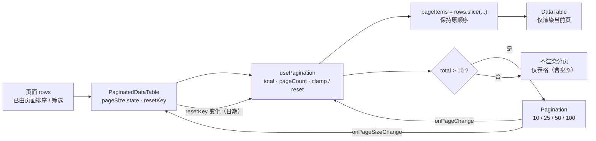

# dashboard 复盘 / 竞价表格分页技术方案（2026-11-02）

> 阶段：2 技术方案 · 状态：自审 APPROVE（round 1，CRITICAL 0）· main 单次验收通过（无“必须修改”）
> 范围：`/prep`、`/auction` 两页内所有数据表格的前端分页；含两页共用的 `AccuracyBoard` 逐股表。
> 非目标：不改后端 API、数据库、CLI、决策算法、表结构；不改其他页面的表格行为；不新增运行时依赖；不引入状态管理库。

---

## 1. 结论与边界

采用 **共享分页 hook + `PaginatedDataTable` 组合式装饰组件**，只替换 prep / auction 两页的表格调用点：

1. **唯一分页计算入口**：扩展既有 `lib/pagination.ts` 的 `usePagination`，所有页码、页大小、越界与重置逻辑只在这里实现；各表格不得复制页码计算。
2. **唯一表格分页壳**：新增 `components/PaginatedDataTable.tsx`，组合 `DataTable` + `Pagination`，内部调用共享 hook。`DataTable` 只增加类型导出，运行时行为不变。
3. **opt-in 启用**：默认 `pageSize=10`、可选 `10/25/50/100`；仅当 `total > 10` 时渲染 `Pagination`。其他页面继续直接使用 `DataTable` / `usePagination`，默认行为不变。
4. **状态语义**：日期切换（`resetKey` 变化）回到第 1 页；数据缩短导致越界时钳制到最后一个有效页；换页只切换切片，不触碰外层排序。
5. **无后端参与**：数据已在前端完整返回，纯客户端分页；不新增接口、不改 `web_ui/backend/*`。

设计模式与动机：

- **组合 / 装饰（Decorator）**：`PaginatedDataTable` 包住 `DataTable`，在不改变表格渲染契约的前提下附加分页关注点；避免把分页状态塞进共享的展示组件。
- **策略（Strategy）**：`defaultPageSize`、`pageSizeOptions`、`minTotalToShow` 作为可配置参数；prep / auction 使用同一策略，其他页面可继续沿用旧行为。
- **单一职责**：页码计算在 hook；表格渲染在 `DataTable`；分页控件在 `Pagination`；三处不互相复制逻辑。

约束继承：

- 不新增 npm 依赖；只用 React 内置 hooks。
- 不改变 `DataTable` / `Pagination` 对现有页面的默认语义（`Pagination` 仅补充可访问性属性与窄屏换行）。
- 改前端后必须 `npm --prefix web_ui/frontend run build`，让 `web_ui/dist` 与源码同批更新。
- `docs/agent/development.md` 是 Web UI 前端事实的 owner 文档；实现时在同一 commit 追加本增量说明。

项目检查清单（实现与自审时逐条核对）：

- 不用 `text-xs` / `text-sm` / `<14px` 文本类；所有可见文字保持既有 `text-*` 语义令牌。
- 主题色禁止 Tailwind 斜杠透明度（如 `bg-white/5`）；需要 alpha 用 `-soft` / `-line` / `-focus` token。
- 不改根 `AGENTS.md`（无新增跨模块硬约束）；不改 `web_ui/backend/**`、`coverage-map.json`。
- 新组件只从 `../lib/pagination`、`./DataTable`、`./Pagination` 取依赖，不引入反向依赖。

---

## 2. 方案级候选设计对比

main 已定「共享分页逻辑 + DataTable 可选增强（组合/装饰式复用）」。以下是在该方向内的实现形态对比：

| 候选 | 做法 | 优点 | 缺点 / 判定 |
|---|---|---|---|
| **D1 hook-only（现有账户页模式）** | 每个表格自行 `usePagination` + `<Pagination>` | 无新组件，模式已被账户页使用 | 10 个调用点重复接线、重复 `total > 10` 判断；易漏、易漂移；不满足「禁止每表复制页码计算」的精神 |
| **D2 组合式 `PaginatedDataTable`（采用）** | 新组件内部用共享 hook，组合 `DataTable` + `Pagination`；调用点只换组件名 | 分页逻辑单点；`DataTable` 保持纯展示；原生 table 仍可直接复用同一 hook；opt-in 不影响其他页 | 新增一个组件文件；需导出 `DataTableProps<T>` 类型 |
| D3 URL / 服务端分页（非常规） | `?page=`、`?size=` 或后端分页 | 可深链、可大数据量 | 一页多张表，URL key 需命名空间；污染历史与既有 `?date=`；需求明确前端分页且数据已全量返回；服务端分页违反非目标。否决 |

推荐 **D2**：改动面最小且行为集中，新增能力只对显式使用 `PaginatedDataTable` 的表格生效。`DataTable` 本身不感知分页，避免影响扫描、账户、因子等页面。

---

## 3. 必须覆盖的表格盘点

仓库内 `prep` / `auction` 两页没有裸 `<table>`，全部走 `DataTable`；因此只需替换下表中的调用点，并让共享 hook 同时可服务未来的原生 `<table>`。

| # | 页面 | 位置 | 表格内容 | 数据源 | `rowKey` | `resetKey` | 可能 >10 行 |
|---|---|---|---|---|---|---|---|
| 1 | `/prep` | `pages/prep/PrepCoreResult.tsx` → `MainlineTable` | 主线 | `buildMainlineRows(snapshot)` | `name + index` | `snapshot.trade_date` | 是 |
| 2 | `/prep` | `pages/prep/PrepCoreResult.tsx` | 推荐建仓标的 | `buildRecommendedCandidates(snapshot)` | `code` | `snapshot.trade_date` | 是 |
| 3 | `/prep` | `pages/prep/PrepDayEffectSection.tsx` | 主线板块次日涨跌 | `effect.boards.rows` | `board_code / board_name / rank` | `effect.trade_date` | 是 |
| 4 | `/prep` | `pages/prep/PrepDayEffectSection.tsx` | 组内汇总 | `effect.stocks.summary` | `group` | `effect.trade_date` | 否（通常 3 行，自动隐藏） |
| 5 | `/prep` | `pages/prep/PrepDayEffectSection.tsx` → `StockGroup` | 推荐逐股 | `group === "recommended"` | `code` | `effect.trade_date` | 是 |
| 6 | `/prep` | `pages/prep/PrepDayEffectSection.tsx` → `StockGroup` | 不推荐逐股 | `group === "not_recommended"` | `code` | `effect.trade_date` | 是 |
| 7 | `/prep` | `pages/prep/AssetDayTable.tsx` | 当日资产明细 | `watermark.assets` | `asset_type` | `watermark.trade_date` | 是（通常 >10） |
| 8 | `/prep` + `/auction` | `components/AccuracyBoard.tsx` | 全历史逐股准确率 | `data.stocks` | `code` | 不传（固定全历史，不随日期变化） | 是 |
| 9 | `/auction` | `pages/auction/AuctionPage.tsx` → `ResultsSection` | 竞价结果 | `day.snapshots` | `code` | `day.trade_date` | 是 |
| 10 | `/auction` | `pages/auction/AuctionPage.tsx` → `AssetCollectionSection` | 当日资产采集 | 资产码 ∪ 快照码 | `code` | `day.trade_date` | 是 |

明确不纳入：

- `PrepDayEffectSection` 的「待评估 N 只」是 `CollapsibleSection` + `<ul>`，不是表格，不分页。
- `AssetCalendar`、`MarketStrip` 是卡片 / 指标条，不是表格，不分页。
- 其他页面（扫描、账户、因子等）的表格即使日后需要分页，也不在本期改动范围内；它们可复用同一 hook，但本期不迁移。

两点事实说明：

- **无裸 table**：已用源码检索确认两页内没有 `<table>`，所有表格都由 `DataTable` 渲染；因此「原生 table 复用同一 hook/helper」体现为共享 `usePagination` + `Pagination` 可被未来任何裸 table 直接使用，无需另起一套页码计算。
- **当前无可排序列**：prep / auction 的表格目前都没有 `sortable` 列，`DataTable` 的 `sort / onSort` 在这两页未被使用。因此「换页保持排序」在本期是结构性保证：`PaginatedDataTable` 原样透传 `sort / onSort`，hook 只对已排序数组切片、不持有排序状态；未来给这些表加排序列时无需再改分页。现有可排序页（如龙头页）不在迁移范围，行为不变。


---

## 4. 接口定义

### 4.1 共享 hook：`lib/pagination.ts`

在现有 `usePagination(items, pageSize)` 上增加**可选**第三参数与返回值字段，保持现有 4 个调用点（账户页 / 龙头页）零改动。分页常量与 hook 放在同一文件，保证 `DataTable` 包装组件与未来裸 table 共用同一套定义：

```ts
/** 表格分页默认值：与「超过 10 行才显示分页」的验收一致。 */
export const TABLE_DEFAULT_PAGE_SIZE = 10;
export const TABLE_PAGE_SIZE_OPTIONS = [10, 25, 50, 100];
export const TABLE_MIN_TOTAL_TO_SHOW = 10;

export interface PaginationOptions {
  /** 数据身份变化（日期 / 筛选）时回到第 1 页；undefined 表示不重置。 */
  resetKey?: string | number | null;
  /** 仅当 total > minTotalToShow 时建议显示分页；默认 0（保持旧行为）。 */
  minTotalToShow?: number;
}

export interface PaginationResult<T> {
  page: number;                 // 始终是 [1, pageCount] 内的有效页
  setPage: (page: number) => void;
  pageCount: number;            // 最小为 1，空数据也安全
  pageItems: T[];               // 当前页切片
  total: number;
  showPagination: boolean;      // total > minTotalToShow
}

export function usePagination<T>(
  items: T[],
  pageSize: number,
  options?: PaginationOptions
): PaginationResult<T>;
```

实现要点（状态重置 / 越界 / 空态）：

- `size = max(1, floor(pageSize))`；`pageCount = max(1, ceil(total / size))`，杜绝除零。
- 内部状态带 `resetKey`：`state.key !== resetKey` 时**渲染期直接取第 1 页**，并在 effect 中同步状态，避免先渲染旧页再纠正的一帧空表。
- `page` 在返回前统一 `clamp(1..pageCount)`；数据缩短时立即返回最后一个有效页，effect 只负责把内部状态收敛，不依赖它纠正 UI。
- `setPage` 同样 `clamp`，防御调用方传入越界值。
- `pageItems = items.slice((page-1)*size, page*size)`；空数据返回 `[]`，`showPagination=false`。
- 排序：hook **不排序、不改写 items**；入参顺序即展示顺序，分页只做切片。换页不会触碰外部 `SortState`。
- 日期重置策略：`resetKey` 变化时回第 1 页，比「仅越界时钳制」更强，目的是换交易日后从新数据集顶部开始；若产品只要求越界纠正，可去掉 `resetKey` 传参，hook 仍会把越界页钳制到有效页。
- 页大小状态：`pageSize` 由每个 `PaginatedDataTable` 局部持有。当前页面在日期切换时会先清空数据，表格通常随之卸载重建，因此会回到默认 10；`resetKey` 主要用于「表格保持挂载但数据身份变化」的场景（例如未来缓存/保留旧数据），保证页码不漂移。需求未要求跨日期保留页大小；若需要，应把页大小提升到页面级或持久化，不在本期范围。


### 4.2 表格分页壳：`components/PaginatedDataTable.tsx`

```tsx
import {
  TABLE_DEFAULT_PAGE_SIZE,
  TABLE_MIN_TOTAL_TO_SHOW,
  TABLE_PAGE_SIZE_OPTIONS,
  usePagination,
} from "../lib/pagination";

export interface PaginatedDataTableProps<T> extends DataTableProps<T> {
  defaultPageSize?: number;       // 默认 10，且必须包含在 pageSizeOptions 内
  pageSizeOptions?: number[];     // 默认 10/25/50/100
  resetKey?: string | number | null;
  minTotalToShow?: number;        // 默认 10：超过 10 行才显示分页
}

export function PaginatedDataTable<T>({
  defaultPageSize = TABLE_DEFAULT_PAGE_SIZE,
  pageSizeOptions = TABLE_PAGE_SIZE_OPTIONS,
  resetKey,
  minTotalToShow = TABLE_MIN_TOTAL_TO_SHOW,
  ...tableProps
}: PaginatedDataTableProps<T>) {
  const [pageSize, setPageSize] = useState(defaultPageSize);
  const pager = usePagination(tableProps.rows, pageSize, {
    resetKey,
    minTotalToShow,
  });

  return (
    <>
      <DataTable<T> {...tableProps} rows={pager.pageItems} />
      {pager.showPagination ? (
        <Pagination
          page={pager.page}
          pageCount={pager.pageCount}
          total={pager.total}
          pageSize={pageSize}
          pageSizeOptions={pageSizeOptions}
          onPageChange={pager.setPage}
          onPageSizeChange={(next) => {
            setPageSize(next);
            pager.setPage(1); // 页大小变化回第 1 页
          }}
        />
      ) : null}
    </>
  );
}
```

- `defaultPageSize` 必须出现在 `pageSizeOptions` 中（默认值已满足）；否则 `select` 没有匹配项。
- `DataTable.tsx` 仅把现有内联 props 类型抽成并导出 `export interface DataTableProps<T>`，**无运行时改动**。
- 调用点保留现有外层 `<div className="overflow-hidden rounded-lg border border-hairline">`；`PaginatedDataTable` 返回 fragment，`Pagination` 自然落在同一边框内、表格下方。
- 所有原有属性（`columns / rowKey / sort / onSort / onRowClick / rowClassName / empty / minWidth / maxHeight`）原样透传，因此排序、行点击、空态文案不丢。

### 4.3 `Pagination.tsx` 的最小增强

只做向后兼容的可访问性 / 移动端增强，不改分页算法：

- 外层改为 `<nav aria-label="表格分页">`（原 `div` 的布局 class 保持不变）。
- 页大小 `select` 增加 `aria-label="每页条数"`。
- 摘要区域增加 `aria-live="polite"`，换页时可被读屏播报。
- 控件组增加 `flex-wrap`，窄屏下与摘要分行而不是撑破容器；宽屏布局不变。
- 现有 `aria-label="上一页" / "下一页"`、`aria-current="page"`、禁用态保持不变。

---

## 5. 状态流



关键状态规则：

1. **日期切换**：`resetKey` 变化 → 立即取第 1 页；适合「换了交易日就是新数据集」的语义。
2. **数据缩短/过滤**：`resetKey` 未变但 `page > pageCount` → 钳制到最后一个有效页，在渲染前完成，不出现空表闪烁。
3. **页大小切换**：`setPageSize(next)` 后显式 `setPage(1)`；默认 10，选项 10/25/50/100。
4. **分页可见性**：以「总行数 > 10」为准，而不是「当前页数 > 1」。这样用户把页大小切到 25/50/100 后，即使只剩一页，分页与页大小选择器仍然可见，可以切回 10；否则会出现「选择器随分页一起消失」的死角。
5. **空态**：`total=0` → `showPagination=false`，`DataTable` 继续渲染 `empty` 文案；不存在「分页显示 0 条」的中间态。
6. **排序与索引**：排序由页面/上游完成，hook 只切片；换页不重置排序。`DataTable` 的 `render(row, index)` / `rowKey(row, index)` 收到的是**当前页局部 index**，本期所有 prep/auction 表格的 key 与渲染均不依赖全局序号（主线表使用数据字段 `row.index`），无需改造；后续若做全局排名列，应在分页前写入数据字段。

补充：两页当前除日期外没有筛选控件（`/prep`、`/auction` 的日期即唯一数据身份）。若后续新增筛选，把「日期 + 筛选条件」拼成稳定字符串作为 `resetKey` 即可复用同一重置语义，不需要改 hook。

---

## 6. 测试策略

项目前端没有 JS 单测运行器，继续沿用现有的**零依赖源码契约测试**模式（test_web_frontend_*.py），并配合真实构建与人工场景矩阵。

新增 `dragon_quant/tests/test_web_frontend_table_pagination.py`：

1. `usePagination` 源契约：包含 `resetKey`、`minTotalToShow`、`showPagination`、`Math.min/Math.max`、`slice`；不包含 `sort(`（分页不排序）；导出 `TABLE_DEFAULT_PAGE_SIZE=10`、`TABLE_PAGE_SIZE_OPTIONS`、`TABLE_MIN_TOTAL_TO_SHOW=10`。
2. `PaginatedDataTable` 源契约：导入 `DataTable`、`Pagination`、`usePagination` 与共享常量；`...tableProps` 透传（含 `sort / onSort`）；`onPageSizeChange` 中调用 `setPage(1)`；`showPagination` 条件渲染。
3. 覆盖清单：上表 6 个源文件均使用 `PaginatedDataTable`，且不再直接声明 `<DataTable`；`AccuracyBoard` 的共用表被覆盖。
4. 隔离性：账户 / 龙头 / 扫描 / 因子页面仍直接使用 `DataTable` 或旧 `usePagination` 接线，未迁移；`DataTable.tsx` 不含分页逻辑；`Pagination.tsx` 不含硬编码的 `total > 10`。
5. 可访问性：`Pagination` 含 `nav`、`aria-label="表格分页"`、`aria-label="每页条数"`、`aria-current`、`aria-live`。
6. 构建产物：`npm --prefix web_ui/frontend run build` 后，`web_ui/dist/assets/*.js` 含新增的可访问性文案（如「每页条数」「表格分页」）。
7. 范围隔离：`AccuracyBoard` 目前只被 prep / auction 引用（契约测试断言两页引用且其他页不引用）；若未来被第三页复用，需显式决定是否保留分页。

回归命令：

```bash
npm --prefix web_ui/frontend run build
.venv/bin/python -m pytest \
  dragon_quant/tests/test_web_frontend_table_pagination.py \
  dragon_quant/tests/test_web_frontend_ops.py \
  dragon_quant/tests/test_web_frontend_results.py \
  dragon_quant/tests/test_web_frontend_theme.py -q
```

人工场景矩阵：

- `/prep`、`/auction` 各选一个表格行数 >10 的交易日；逐表确认分页出现、默认 10 条、页码/摘要正确。
- 切换 10→25→50→100→10；确认回到第 1 页、分页在选择器仍可见时可切回。
- 跳到末页后切换到行数更少的日期：确认无空表闪烁；日期变化回到第 1 页。
- 选择无数据日期：表格空态 + 无分页。
- 390px / 360px 宽度：分页换行、无页面级横向滚动；表体仍在 `.dt-wrap` 内横向滚动。
- 键盘 Tab / Enter 操作页码与页大小；确认 `aria-current` 与焦点顺序。
- 抽查 `/dragons`、`/account`、`/scans` 原有分页/排序未回归。

---

## 7. 文件级最小改动清单

| 文件 | 改动 |
|---|---|
| `web_ui/frontend/src/lib/pagination.ts` | 扩展 `usePagination`：可选 `resetKey` / `minTotalToShow`，返回 `showPagination`，渲染期钳制与重置；新增共享分页常量 |
| `web_ui/frontend/src/components/DataTable.tsx` | 仅导出 `DataTableProps<T>` 类型（运行时代码不变） |
| `web_ui/frontend/src/components/PaginatedDataTable.tsx` | **新增**：组合 `DataTable` + `Pagination`，默认 10 / 10-25-50-100 / 阈值 10 |
| `web_ui/frontend/src/components/Pagination.tsx` | 可访问性与窄屏换行增强；不改分页算法与默认渲染条件 |
| `web_ui/frontend/src/components/AccuracyBoard.tsx` | `DataTable` → `PaginatedDataTable`（prep / auction 共用表一次覆盖） |
| `web_ui/frontend/src/pages/prep/MainlineTable.tsx` | 改用 `PaginatedDataTable`；新增可选 `resetKey` 并透传 |
| `web_ui/frontend/src/pages/prep/PrepCoreResult.tsx` | 推荐标的表改用 `PaginatedDataTable`；向 `MainlineTable` 传 `snapshot.trade_date` |
| `web_ui/frontend/src/pages/prep/PrepDayEffectSection.tsx` | 板块 / 汇总 / 推荐 / 不推荐 4 张表改用 `PaginatedDataTable`；`StockGroup` 接收 `resetKey` |
| `web_ui/frontend/src/pages/prep/AssetDayTable.tsx` | 改用 `PaginatedDataTable`，`resetKey=watermark.trade_date` |
| `web_ui/frontend/src/pages/auction/AuctionPage.tsx` | 竞价结果 / 资产采集 2 张表改用 `PaginatedDataTable`，`resetKey=day.trade_date` |
| `dragon_quant/tests/test_web_frontend_table_pagination.py` | **新增**：源码契约与覆盖清单测试 |
| `docs/agent/development.md` | 追加本增量事实（仅前端、无后端、构建要求） |
| `web_ui/dist/**` | 由 `npm --prefix web_ui/frontend run build` 生成，不手改 |

不改：`web_ui/backend/**`、任何 Python 业务代码、DB schema、`coverage-map.json`（没有新增 CLI 命令）、其他页面源码。

文档同步说明：本期无 CLI / 命令 / 数据源 / 表结构变化，`README.md` 的人类手册内容无需更新；前端行为事实写入 owner `docs/agent/development.md`，与源码、`dist` 同批提交。根 `AGENTS.md` 不新增硬约束，因此不修改。

---

## 8. 风险与缓解

| 风险 | 缓解 |
|---|---|
| 共享 hook 改动波及账户 / 龙头页 | 新参数全部可选，默认 `minTotalToShow=0`、`resetKey=undefined`；返回 `page` 从「可能短暂越界」变为「始终有效」，只改善不改变最终结果；实现后抽查原有页面 |
| 无 JS 运行时单测 | 逻辑集中在单个 hook，源码契约锁定关键分支；用人工矩阵覆盖空态 / 越界 / 页大小 / 移动端；未来引入测试运行器再补行为测试 |
| 多张表各自持有页码，日期切换需一致重置 | 所有日期驱动的表统一传 `resetKey=数据日期`；`AccuracyBoard` 固定全历史，不随日期变化，保持独立 |
| 页大小切大后分页消失导致无法切回 | 可见性阈值固定为 `total > 10`，与当前 `pageSize` 解耦（见 §5.4） |
| 页内局部 index 被误用为全局排名 | 本期现有表格不依赖；在方案与实现说明中明确，未来排名列在分页前由数据层提供 |
| `Pagination` 改为 `nav` / 增加 `flex-wrap` 影响其他页 | 仅语义标签、aria 与窄屏换行；宽屏视觉与分页逻辑不变；跑现有前端契约测试并抽查账户页 |
| `AccuracyBoard` 被第三页复用时自动带分页 | 当前仅 prep / auction 引用，契约测试锁定；未来复用前显式决定是否保留分页 |
| 日期切换后页码/页大小行为不一致 | 当前页面切换日期会清空并重建表格，页码与页大小都回到默认；`resetKey` 保证表格不重建时页码也回第 1 页。需求只要求越界回有效页，未要求跨日期保留页大小；若要保留需另做页面级状态 |

---

## 9. 验收标准映射

| 验收标准 | 方案落点 | 实现后验证 |
|---|---|---|
| 复盘与竞价页内所有表格覆盖 | §3 清单 + §7 文件清单 | 契约测试枚举 6 个源文件均使用 `PaginatedDataTable` |
| 超过 10 行才显示分页 | `showPagination = total > 10` | 源码契约 + 人工 >10 / ≤10 场景 |
| 默认 `pageSize=10` | `TABLE_DEFAULT_PAGE_SIZE = 10` | 源码契约 + 首屏人工确认 |
| 复用现有 `Pagination`，支持 10/25/50/100 | `PaginatedDataTable` 直接渲染 `Pagination`，`TABLE_PAGE_SIZE_OPTIONS` | 源码契约 + 切换页大小人工验证 |
| 日期 / 筛选 / 数据变化越界回有效页 | `resetKey` 回第 1 页；无 resetKey 时 clamp 到末页 | 人工切换日期 / 末页缩短数据；契约测试检查 reset/clamp |
| 换页保持排序 | hook 只对已排序 `items` 切片，不持有排序状态 | 源码契约（hook 无 `sort`）+ 现有龙头页排序抽查 |
| 不影响其他页面 | opt-in 包装；`DataTable` 运行时不变；hook 新参数可选 | 现有前端契约测试 + 账户/龙头/扫描页抽查 |
| 不改后端 API | §7 明确无 `web_ui/backend` / Python 业务改动 | diff 检查 |
| 原生 table 复用同一 hook/helper（如未来出现） | `usePagination` 导出；页内无裸 `<table>` 需迁移 | 契约测试确认 hook 为唯一页码计算入口 |
| 禁止每表复制页码计算 | 所有调用点只传 props，不出现本地 `pageCount` / `slice` | 源码扫描 |
| 无新增依赖 | 仅 React `useState/useEffect/useMemo/useCallback` | `package.json` diff 为空 |

---

## 10. main_acceptance（阶段 2 单次验收）

- **验收结论**：通过；无「必须修改」项。
- **已确认方向**：
  - 前端无 JS 运行器时，以源码契约 + 阶段 3 真实浏览器行为矩阵补足。
  - 日期 / 筛选通过 `resetKey` 回第 1 页；`total > 10` 才显示分页，均符合已确认需求。
  - `PaginatedDataTable` 组合包装保持其他页面 opt-out，符合「隔离变化」方向。
- **建议项处置**：
  - `pageSize` 跨日期不保留：接受，不扩大本期范围；当前表格重建即回默认 10。
  - 共享 `Pagination` 的可访问性 / 窄屏换行：纳入阶段 3，抽查 `/dragons`、`/account`、`/scans` 等既有页面。
  - 阶段 3 必须实际验证：`>10` / `≤10` 行、页大小 10/25/50/100 切换、末页越界、日期重置，并执行 `npm --prefix web_ui/frontend run build` 更新 `web_ui/dist`。
- **实现约束**：阶段 3 仅按本方案实施，不扩展后端、不改其他页面分页语义；如出现会改变产品行为的歧义，以 `NEED_DECISION` 上报 main。
