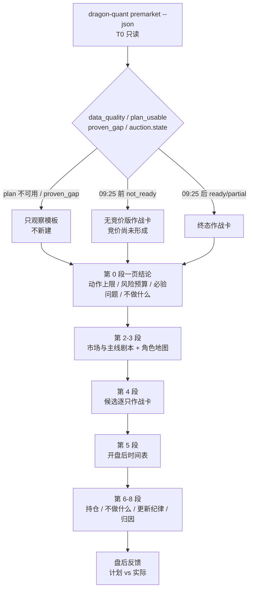
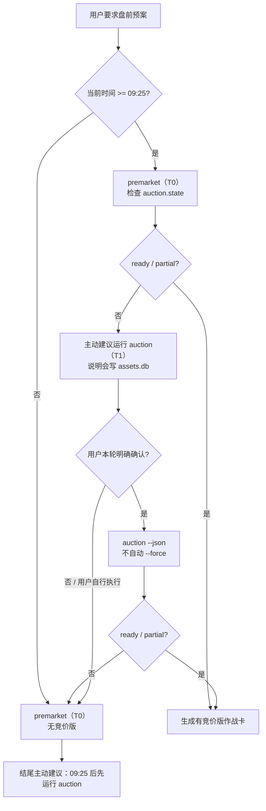

# 技术方案：盘前预案 v2（Agent 作战卡模板）

- 日期：2026-11-02
- 阶段：阶段 2（技术方案；本文只定义模板与实现范围，不改生产代码）
- 上游依据：`docs/research/2026-11-02-premarket-playbook-research.md`
- 分支基线：`feat/skills-op`（当前工作区）
- 目标文件：`skills/dragon-quant/references/premarket.md`（owner）、`skills/dragon-quant/SKILL.md`、`dragon_quant/tests/test_skill_content.py`、`docs/agent/premarket.md`

---

## 1. 问题与目标

现有八段模板按数据域组织，审计性强但盘中可用性弱：候选是 12 列宽表，四态条件没有落到 09:25/09:30/09:35 的逐时点检查，缺少“一页结论 / 不做什么 / 盘中更新纪律”。用户反馈“对盘中操作帮助不大”。

目标：在**不新增后端字段、不新增阈值、不放开交易指令**的前提下，把模板重排为“盘前作战卡”：

- 第一屏回答：今天最多能做什么、风险预算多少、必须验证什么、什么情况下不做。
- 每只候选一张卡：角色、冻结预期、trigger、invalidation、position_pct、时间窗、验证后 `allowed_actions`。
- 逐时点检查表：09:15–09:20 / 09:20–09:25 / 09:25 / 09:25–09:30 / 09:30–09:35 / 09:35–10:00 / 午后 / 尾盘。
- 把“不做什么”和“更新纪律”提升为一等章节。

非目标：不改 `premarket` CLI / JSON / DB / 评分 / 策略参数；不新增自动交易；不把自媒体阈值写成项目规则；不改变“动作只取 `allowed_actions` 交集”的硬约束。

---

## 2. 设计模式与动机

| 模式 | 落点 | 动机 |
|---|---|---|
| **Template Method** | 固定 8 段 + 每张作战卡固定字段顺序 | 防止每次报告结构漂移，便于测试与审计 |
| **Strategy** | 三向剧本（超预期/符合/不及预期/无法判断）与四态（confirmed/weakened/invalidated/unknown） | 同一卡片按不同可观察条件选择不同动作集，不写死单一路径 |
| **Facade** | 第 0 段“一页结论” | 把闸门、仓位、动作上限压缩为可读摘要，不新增数据 |
| **Null Object** | `missing / unknown / null / expectations_unavailable` | 缺失显式占位，避免被误读为 0、中性或看空 |

### 2.1 备选方案对比

| 方案 | 做法 | 优点 | 缺点 | 结论 |
|---|---|---|---|---|
| A. 增量补丁 | 保留现有八段，只在开头加“一页结论”，时间表补几行 | 改动最小、测试改动少 | 候选宽表仍难读；盘中仍要翻数据域章节 | 不采用 |
| B. 按交易时间线重排（推荐） | 一页结论 → 剧本 → 角色 → 作战卡 → 时间表 → 持仓 → 不做什么/更新纪律 → 归因 | 直接服务盘中；保留三栏与动作交集 | 需要改测试与文档；模板更长 | 采用 |
| C. 拆成两份 reference | `premarket.md`（盘前）+ `intraday.md`（盘中） | 单文件更短；可分别加载 | 多一个 owner、路由与测试；上下文切换 | 暂不采用；若 B 超出 300 行再拆 |

选择 B 的理由：用户的核心痛点是“盘中找不到现在该做什么”，而不是“盘前信息不足”；B 在不新增数据的前提下改变阅读路径，收益最大、风险最低。

### 2.2 三向剧本 ↔ 四态映射

市场层与个股层使用不同标签，必须显式映射，避免语义漂移：

| 市场层标签（描述性） | 个股层四态（动作依据） | 说明 |
|---|---|---|
| 超预期 | `confirmed`（仅在 09:25/开盘验证后） | 竞价/开盘强于冻结预期；09:25 前只能写 `wait` |
| 符合预期 | `confirmed` 或 `wait` | 达到冻结 `gap_low/ratio_low` 且在 `seal_by` 前封板 → confirmed；仅达标未封板 → wait |
| 不及预期 | `weakened` / `invalidated` | 缺口/量比未达 → weakened；深度低开/跌破前收/炸板/主线跌出 → invalidated |
| 无法判断 | `unknown` | 数据缺失/预期缺失；动作只有 `observe_only` |

**重要**：市场层三向标签只用于组织叙述，**不产生动作**；动作只来自个股 `allowed_actions` 与 `action_ceiling`。若无法从现有字段机械判断市场层标签，写“无法判断”，不得新造评分或阈值。

---

## 3. 数据流与模板结构



### 3.1 09:25 竞价编排（Skill 层）

`premarket` 是 T0 只读，`auction` 是 T1 写 `assets.db`；Skill 不自动执行 `auction`，但必须主动建议：



规则：

- 09:25 前不运行 `auction`；只出无竞价版，结尾主动建议。
- 09:25 后先跑 `premarket` 检查状态；缺失/不可用时主动建议运行 `auction`，给出确认话术；只有用户本轮明确确认后才执行。
- `auction` 成功后重跑 `premarket`，确认状态可用，再生成最终预案；不能拿旧的无竞价版硬套。
- 用户拒绝或自行执行 → 无竞价版 + 「竞价缺失」。
- 失败/空池/部分数据 → 回退无竞价版，不伪造、不自动 `--force`。
- Agent 不能自行等到 09:25；需要全自动时由外部定时任务或用户自行运行 `auction`。

---

## 4. Agent 模板（完整版）

> 实现时写入 `skills/dragon-quant/references/premarket.md`；目标 ≤300 行。以下为模板正文草案。

```markdown
# premarket — 盘前作战卡（workflow + 八段模板）

**何时读我**：生成 T 日盘前预案、解释 `premarket_sc_v1` 字段、叠加外部证据时。
字段事实只来自 `dragon-quant premarket --json`（T0）；本文不复制评分权重、策略参数或表结构。

## 工作流

1. `dragon-quant premarket [--date D] --json`。T0：不写库、不触网、不重算、不新增表。
2. 先读闸门：`data_quality.status / plan_usable / auction_usable / degraded`；`prep.strictness` 与 `prep.proven_gap`；`auction.state`。
3. **信息截止** `info_cutoff` = 本次运行；三个时点分开：`prep.frozen_at`（T-1 决策）、`prep.created_at`（快照写入）、`auction.as_of`（09:25 语义时点）；`auction.positions[].created_at` 是快照写入时间，`evidence.last_time` 才是盘口末笔。
4. 09:25 前 `auction.state=not_ready`：只出无竞价版，写「竞价尚未形成」；09:25 后重跑读取终态，**不得倒填**。
5. 外部证据按 `references/evidence.md` 采集；缺失只降低情景覆盖。
6. 按下方八段模板输出，事实 / 工作假设 / 行动分栏，每段末尾写「待验证/证伪」。
7. 用户问「盘中怎么做」时，只按第 5 段时间表解释当前时点该看什么；不新造行情、不新造阈值、不宣布未验证的 confirmed。

## 硬约束

- 事实栏只写 CLI 字段 / 数值 / 来源 / 时点；推断必须进「工作假设」并可被证伪。
- 缺失写「缺失 / 不可用 / 不在本次数据范围」，不补 0、不写「弱 / 看空 / 中性」。
- `cache=unknown` 与 `trading_day_verified=false` 是已知限制，不当作降级。
- `position_pct=0` 写「不建议新建仓，**不是清仓**」；`null` 写「无法给出，只观察」。
- `auction.state` ∈ `missing / not_ready / corrupt / read_error / partial / ready`；只有 `ready / partial` 可作竞价事实，其余只观察，**不等于看空**。
- 四态 `confirmed / weakened / invalidated / unknown` 只做条件预告；完整判定属于 T+1 收盘反馈。
- `gap_high` 之上只写追价警戒 / 等待复核，不发明买点。
- 持仓退出只归现有 sell 规则；`premarket` 不自动交易、不输出买卖指令。
- 不新增评分、不重排候选、不按分数排买入优先序。
- 作战卡字段填不满（trigger / invalidation / position_pct / 时间窗）→ 标「观察卡」，不得写成可执行卡。

---

# 盘前作战卡｜{trade_date}

- 信息截止：{info_cutoff}（run_at={run_at}）
- 本报告只读、不自动交易、不构成投资建议、不承诺收益。
- 数据质量：{data_quality.status}；plan_usable={plan_usable}；auction_usable={auction_usable}
- 降级：{degraded}；已知限制：cache_status_unknown / trading_day_unverified

## 0. 一页结论

| 项目 | 结论 | 依据 |
|---|---|---|
| 今日动作上限 | {逐只 action_ceiling；全部 no_new_position → 「今日不新建，只观察」} | `candidates[].action_ceiling` |
| 风险预算 | {逐只 position_pct；账户闸门 unknown 写「账户风险未知，不声称可执行仓位」} | `candidates[].position_pct` / `gates.account` |
| 必须验证的 3 个问题 | ① 主线龙头竞价是否达冻结预期 ② 负锚/veto 是否触发 ③ 数据/账户闸门是否允许 | `prep` / `auction` / `gates` |
| 今天不做什么 | {从第 7 段原样复制 3–5 条} | 第 7 段 |
| 组合提示 | sum_pct={portfolio.sum_pct}；warning={portfolio.warning}；同主线={portfolio.same_mainline_counts} | `portfolio` |

**一句话**：{今日以「等待开盘验证 / 只观察 / 不新建」为主；不把全部候选写成待命买入。}

**待验证/证伪**：…

## 1. 信息截止与覆盖

| 事实 | 工作假设 | 行动 |
|---|---|---|
| T={trade_date}；T-1 prep={prep.trade_date}；frozen_at={prep.frozen_at}；created_at={prep.created_at}；version={prep.schema_version}；config={prep.review_config}；strictness={prep.strictness}；proven_gap={prep.proven_gap} | 假设 T-1 计划仍是当前有效计划；`proven_gap=true` 时该假设不成立 | prep 不可用或 proven_gap=true → 只观察，不新建 |
| auction.state={auction.state}；as_of={auction.as_of}；rows={auction.row_count}；created_at={auction.created_at}；cache={auction.cache.status} | 只有 09:25 终态可作竞价事实；缓存状态未知 | 09:25 前写「尚未形成」；09:25 后重跑 |
| 外部覆盖：政策={…}；交易所={…}；公司公告={…}；官方行情={…}；媒体={…}；社交={…} | 未覆盖的来源不能当作无风险 | 缺失只降情景覆盖，不填中性 |

**待验证/证伪**：…

## 2. 市场与主线剧本

| 事实 | 工作假设 | 行动 |
|---|---|---|
| T-1 市场：{market.state}/{market.score}/{market.coeff}；证据={market.evidence} | 市场状态只描述 T-1，不是 T 日实时 | 只作情景基准；不据此加分 |
| 正/负/风险锚：{anchors.positive} / {anchors.negative} / {anchors.risk} | 锚共振才提高情景置信；单锚不改变动作 | 只观察；锚失效写失效，不换锚 |
| 隔夜外部增量：{Agent 证据摘要} | 外围只调整情景与风险预算，不给个股加分 | 硬风险 → 取消/不新建；其余降档或只观察 |

### 三向剧本（市场层）

| 剧本 | 可观察表现（优先引用冻结预期/竞价终态） | 行动上限 |
|---|---|---|
| 超预期 | 主线龙头竞价/开盘强于最优剧本；正锚共振；无 veto | 只写「等待开盘验证」或 `wait`；`gap_high` 之上只写追价警戒 |
| 符合预期 | 龙头竞价落在冻结 `gap_low/gap_high` 区间、量比达 `ratio_low`；板块无明显负反馈 | 按 `allowed_actions` 条件观察 / 验证；不提前宣布 confirmed |
| 不及预期 | 深度低开、跌破前收、炸板/负锚下杀、auction veto | 降档 / 取消新建；持仓退出走现有 sell 规则 |
| 无法判断 | 关键数据缺失、auction unknown、外部未覆盖 | 只观察，不新建；写明缺什么 |

> 市场层三向标签只用于组织叙述，不产生动作；动作只来自个股 `allowed_actions` 与 `action_ceiling`。无法从现有字段机械判断时写「无法判断」，不新造评分或阈值。

**待验证/证伪**：…

## 3. 主线与角色地图

| 主线 | 状态/分数 | 角色（代码） | 确认条件 | 证伪条件 | 关注顺序 |
|---|---|---|---|---|---|
| {mainline} | {state}/{mainline_score} | leader={…}；vanguard={…}；mainstay={…}；capacity={…}；follower={…} | 龙头/先锋共振、板块扩散 | 龙头断板/跌出前列/负锚下杀 | 龙头 → 先锋/中军 → 跟风 |

- **关注顺序 ≠ 买入优先级**：只决定先看谁，不产生交易顺序。
- 候选池不代表板块竞价广度；缺失写未知，不从候选池反推全市场。
- `role=null` 只写「未识别角色/诊断标的」，不指派跟风。

**待验证/证伪**：…

## 4. 候选逐只作战卡

先出总表（按 `review_candidates` 原顺序，不重排）：

| 代码/名称 | 角色 | action_ceiling | position_pct | eligibility | 冻结预期 | 当前竞价缺口/状态 | 下一检查点 |
|---|---|---|---|---|---|---|---|
| {code/name} | {role} | {wait/observe_only/no_new_position} | {X% / 0 / null} | {eligible/not_qualified/unknown} | {gap_low/gap_high/ratio_low/seal_by 或 缺失} | {gap/ratio/veto/data_quality 或 缺失} | {09:25 / 09:30–09:35 / 09:35–10:00} |

每只可执行卡（`action_ceiling=wait`）按下面字段写；其余写「观察卡」：

### {code} {name}｜{role}｜{action_ceiling}

- **事实**：血缘={prep.source_trade_date/facts}；eligibility={…}；position_pct={…}；position_basis={position_basis}；expectations={gap_low/gap_high/ratio_low/seal_by 或 缺失}；公告证据={official_original/media_unverified/none}；竞价={gap/ratio/turnover/conversion}；auction status={…}；veto={…}；data_quality={…}；warnings={…}
- **触发**：{达到 gap_low / ratio_low / seal_by 前封板 / 其他冻结条件}；**失效**：{深度低开 / 跌破前收 / 炸板 / 主线跌出 / auction veto / 数据缺失}
- **三向剧本**：
  - 超预期（{可观察条件}）→ {验证后 allowed_actions；gap_high 之上只写追价警戒}
  - 符合预期（{可观察条件}）→ {验证后 allowed_actions}
  - 不及预期（{可观察条件}）→ {cancel_entry / exit_via_sell_rules / observe_only}
  - 无法判断（{缺失项}）→ `observe_only`
- **仓位**：{>0 → 单票建议仓位 X%（上限来源）；0 → 不建议新建，不是清仓；null → 无法给出，只观察}
- **时间窗**：09:25 读终态；09:30–09:35 首根 5 分钟 K / 开盘区间；09:35–10:00 二封/承接；{seal_by} 前未封板按冻结条件处理
- **禁止**：不新增买点、不改阈值、不把候选池当板块广度、不按分数排买入顺序

**待验证/证伪**：…

## 5. 开盘后时间表与确认清单

| 时点 | 只看什么 | 确认 / 证伪 | 动作上限 |
|---|---|---|---|
| 09:15–09:20 | 虚拟匹配价、虚拟匹配量、封单变化 | 可撤单，可能是虚假挂单；**不据此行动** | 只记录 |
| 09:20–09:25 | 真实委托、封单强弱、竞价量能 | 不可撤单；只记录，不宣布结果 | 只记录 / 准备 |
| 09:25 | 正式开盘价、竞价末点、gap/ratio/换手、veto、data_quality | 终态才可作竞价事实；缺失 → unknown | 按 `allowed_actions` 交集 |
| 09:25–09:30 | 券商暂存；不处理成交/撤单 | 不把挂单当成交；不倒填 | 只记录 |
| 09:30–09:35 | 首根 5 分钟 K、开盘区间、均价线、回踩、量能 | 突破回踩 / 开盘区间突破 / 均价线收复或拒绝 / 量能确认 | 未达 confirmed → wait / observe_only |
| 09:35–10:00 | 二封/炸板、承接、板块共振 | 未达 confirmed 不提前宣布；炸板/跌破 → weakened/invalidated | 降档 / 取消 / 只观察 |
| 10:00–11:30 | 主线扩散/退潮、负锚 | 主线跌出、跌停/炸板扩散 → 只观察 | 不追高 |
| 13:00–14:30 | 午后承接、量能、板块联动 | 未确认不新建；持仓按 sell 规则 | 只观察 / 持仓 |
| 14:30–15:00 | 尾盘封板/炸板/破昨收 | 持仓退出走现有 sell 规则；T+1 不新开仓 | 不新建 |

- 确认方式只列可观察事件，不写“感觉强/弱”。
- 任何时点缺数据 → `unknown` / `observe_only`，不补 0、不写看空。

**待验证/证伪**：…

## 6. 持仓与退出

| 事实 | 工作假设 | 行动 |
|---|---|---|
| 账户/持仓：{status=unknown 或用户提供} | 账户未知时不得声称可执行仓位 | 未知写未知；不推断 |
| 持仓逐只：{code/hold_days/可卖日/成本/峰值 或 缺失} | 盘前预案不改变卖出规则 | 只引用现有 sell 规则；T+1 可卖日单独标 |
| 跌停封死/不可成交：{状态} | 不可成交不能补造成交价 | 记录 pending；不发明价格 |

**待验证/证伪**：…

## 7. 不做什么 + 盘中更新纪律

### 今天不做什么（逐条勾选）

- [ ] `plan_usable=false` 或 `proven_gap=true` → 不新建，只观察。
- [ ] `data_quality=unavailable` / `auction.state` 非 `ready|partial` → `observe_only`，不等于看空。
- [ ] 硬风险 / veto / `is_weak` → 不新建；持仓退出走现有 sell 规则。
- [ ] 只有 `media_unverified` / `social_lead` → 待核实，不作硬否决。
- [ ] `gap_high` 之上无 confirmed → 追价警戒，不追。
- [ ] 账户闸门 unknown → 不声称“可执行仓位”。
- [ ] 无 trigger / 无 `allowed_actions` / 无数据 → 不交易。
- [ ] 用户明确无法盯盘 → 默认只观察，不列待命买入。

### 盘中更新纪律

- **允许改变剧本**：新官方原文、09:25 终态、09:30 后确认事件。
- **禁止改变**：阈值、候选池、冻结预期、盘前事实；不得用浮盈亏、未核媒体、盘中情绪改计划。
- **更新日志**：`time | source | what_changed | scenario | action_change | reason`。
- 更新只写在当前报告内，不覆盖旧事实；盘后保留版本链。

**待验证/证伪**：…

## 8. 盘后归因与明日输入

| 事实 | 工作假设 | 行动 |
|---|---|---|
| 哪套剧本发生：{超预期/符合/不及预期/无法判断} | 单日结果不能倒改盘前事实 | 记录归因，不改写盘前结论 |
| 四态反馈：{confirmed/weakened/invalidated/unknown} | 未知不等于看空 | 明日 prep 输入 |
| 归因：市场 / 模型 / 执行 / 数据 | 区分可复盘与不可复盘 | 留待盘后复核 |
| 不交易 / 正确回避 | 「不交易」是有效结果 | 不强行找标的 |

**待验证/证伪**：…

## 附录：外部证据清单

| claim | source_name | source_level | url | event_time | publish_time | effective_time | first_seen | verification_status | 用于段落 |
|---|---|---|---|---|---|---|---|---|---|

## 声明

原文引用 `disclaimer`；阈值为待验证基线，不构成投资建议，不承诺收益。
```

---

## 5. 与现有模板的差异

| 现有 | v2 | 理由 |
|---|---|---|
| 第 0 段无 | 一页结论 | 盘中先看结论 |
| 候选 12 列宽表 | 总表 + 逐只作战卡 | 降低盘中阅读成本 |
| 四态表 | 三向剧本 + 四态映射 | 与 A 股“三向预期”实践对齐 |
| 验证时间表 4 行 | 9 行逐时点检查 + 确认方式 | 可执行 |
| “无法交易”放最后 | “不做什么”第 7 段 + 第 0 段摘要 | 防止临场找标的 |
| 无更新纪律 | 允许/禁止/日志 | 防止盘中改计划 |
| 无持仓章节 | 第 6 段 | 持仓退出与新建分开 |

保留：事实/假设/行动三栏、时点分离、动作交集、四态、`gap_high` 追价警戒、现有 sell 规则归属、免责声明。

---

## 6. 实现范围

| 文件 | 改动 |
|---|---|
| `skills/dragon-quant/references/premarket.md` | 替换为 v2 模板；≤300 行；保留所有安全 token |
| `skills/dragon-quant/SKILL.md` | 更新“盘前预案”路由描述（八段 → 作战卡八段；工作流增加时间表） |
| `dragon_quant/tests/test_skill_content.py` | 更新 `TestPremarketSkill` 标题/关键词；保留 300 行与总 1200 行上限；新增“一页结论/作战卡/不做什么/更新纪律/时间表”断言 |
| `dragon_quant/tests/test_skill_routes.py` | 若路由描述引用八段，同步；T0/只读断言不变 |
| `docs/agent/premarket.md` | Skill 侧模板 owner 说明同步；命令/字段/只读语义不变 |
| `README.md` | 若提到八段模板，同步一句；否则不动 |
| `CHANGELOG.md` | Skill 版本条目（建议 skill-version 1.3.0 → 1.4.0；Python 不变） |

不改：`dragon_quant/review_account/premarket/*`、`commands/premarket.py`、JSON schema、DB、评分、策略参数、依赖。

---

## 7. 测试策略

- `pytest dragon_quant/tests/test_skill_content.py -q`：模板标题顺序、关键词、体量。
- `pytest dragon_quant/tests/test_skill_routes.py -q`：八类白名单、premarket T0、只读。
- `pytest dragon_quant/tests/test_premarket_*.py -q`：后端契约不变（应全绿）。
- `pytest dragon_quant/tests -q --ignore=e2e --ignore=smoke`：全量回归。
- `pytest dragon_quant/tests/e2e -q`：E2E 不受影响（无 CLI 变更）。
- `npm test`：安装器不受影响。

新增断言建议：
- 模板含 `# 盘前作战卡`、`## 0. 一页结论`、`### 今天不做什么`、`### 盘中更新纪律`、`09:15–09:20`、`09:20–09:25`、`09:30–09:35`。
- 保留 `allowed_actions`、`action_ceiling`、`observe_only`、`wait`、`no_new_position`、`position_pct`、`不是清仓`、`expectations_unavailable`、`gap_high`、`追价警戒`、`现有 sell 规则`、`09:25`、`09:30`、`不得倒填`、`不自动交易`、`不构成投资建议`。
- 禁止出现“优先买入顺序”“先买 A 再买 B”“必涨”“胜率”。
- 新增 `test_premarket_report_body_uses_chinese_terms`：报告正文不得出现 `observe_only` / `position_pct` / `action_ceiling` / `allowed_actions` / `gap_high` / `T-1` / `T+1` / `sell 规则` 等字段名或英文枚举。

实现前先测量模板行数：`wc -l` 必须 ≤300；若超出，按方案 C 拆出 `intraday.md`，并同步 `SKILL.md` 索引与 `test_skill_content.py` 的 `REFS` 列表。

---

## 8. 风险与取舍

1. **模板变长**：可能接近 300 行上限；取舍是压缩重复占位符，不删除安全约束。若超限，拆出 `references/intraday.md`（总 refs 预算 1200 行仍有余量），但会增加一份 owner 文档和路由。
2. **三向剧本与四态语义混淆**：明确“市场层三向、个股层四态”，用冻结预期连接；不新增第五态。
3. **自媒体阈值诱惑**：模板不搬用 ±1%/150% 等经验阈值；只用 `gap_low/gap_high/ratio_low/seal_by`。若用户要求，可作为“外部经验参考”标注，但不进入动作判定。
4. **“更可执行”与“不输出买卖指令”的张力**：模板只写条件剧本与动作上限，验证通过后原样引用 `allowed_actions`；不写“买入/卖出”新指令。若用户希望更直接，需要单独做产品决策（不在本方案内）。
5. **Agent 不能实时盯盘**：模板是“检查清单”，用户需在对应时点叫 Agent 重跑 `premarket` / 询问；Agent 不轮询、不伪造行情。

---

## 9. 验收标准

1. 新模板第一屏给出动作上限、风险预算、必验问题、不做什么。
2. 每只候选有作战卡字段；字段缺失标“观察卡”，不写成可执行。
3. 时间表覆盖 09:15–09:20 / 09:20–09:25 / 09:25 / 09:25–09:30 / 09:30–09:35 / 09:35–10:00 / 午后 / 尾盘。
4. 所有动作仍只来自 `allowed_actions` 交集；无新增阈值/评分/买卖指令。
5. 测试更新后全绿；`premarket` 后端契约零变化。
6. 文档 owner 同步（`docs/agent/premarket.md`、`SKILL.md`、`CHANGELOG.md`）。
7. 报告正文只出现汉语用语；字段名仅存在于操作说明与映射表，且测试锁定。

---

## 10. 待用户确认

1. 是否接受“市场层三向 + 个股层四态”的双层语义？
2. 是否接受“作战卡字段填不满即观察卡”的规则（宁可不做，不硬凑）？
3. 是否需要把自媒体经验阈值（±1%、150% 等）作为“外部参考”单列？建议**不**进入动作判定。
4. 是否同意本次只改 Skill 文档与测试，不改后端/CLI/JSON？
