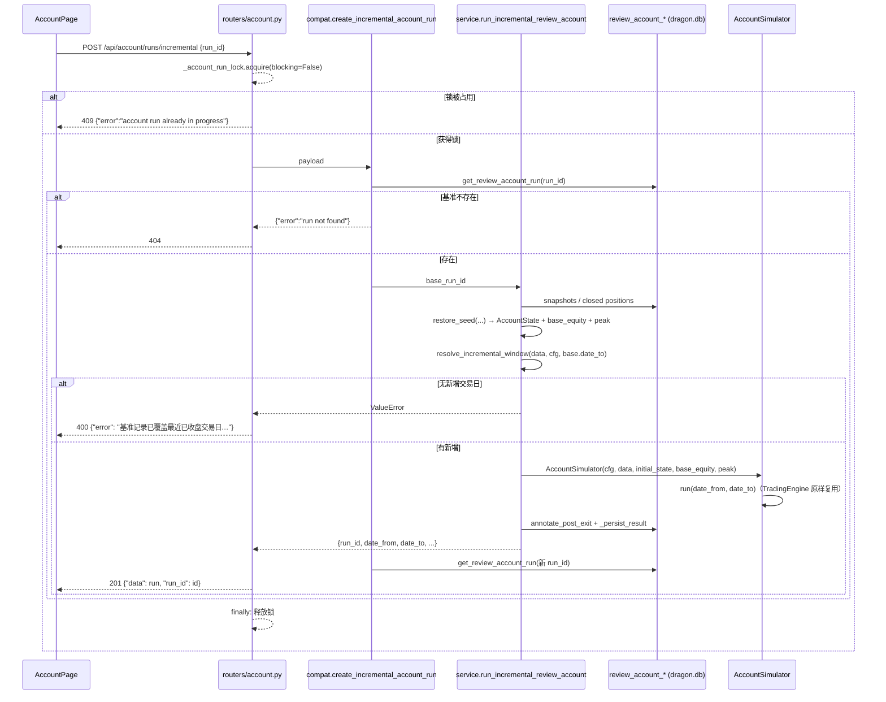

# 账户页「增量回测」技术方案（2026-11-03）

> 阶段：2 技术方案 · 状态：自审 APPROVE（round 1，CRITICAL 0 / MAJOR 3 / MINOR 4）· 待 main 单次验收
> 范围：`/account` 页新增「增量回测」按钮 + `POST /api/account/runs/incremental` + `review_account` 真增量续算能力。
> 非目标：不改买卖/成交规则、不改 `review-account` CLI 命令与参数、不改表结构、不改全量回测行为、不引入前端状态库或新依赖、不做增量记录的「多次合并成一个 run」。

---

## 1. 结论与设计模式

采用 **「快照即备忘录（Memento）+ 模拟器注入初始状态 + 服务层编排」**：

1. `review_account_snapshots.positions_json` 已经是完整 `Position` 的序列化快照，天然可作续算起点；不再另建状态表。
2. `AccountSimulator` 只增加 **三个可选构造参数**（`initial_state` / `base_equity` / `peak_equity`），不复制任何买卖、成交、风控规则；`TradingEngine` 原样复用。
3. 新增 `service.run_incremental_review_account(base_run_id, ...)` 负责「读基准 → 恢复状态 → 解析增量区间 → 跑模拟 → 落库」，web 层只做参数解析与错误映射。
4. 前端在「生成回测记录」后追加按钮，问号复用 `HintIcon`，成功自动选中新记录。

设计模式与动机：

- **Memento（备忘录）**：`Snapshot.positions_json` 冻结了当天收盘后的账户持仓，增量回测只读取、不修改基准记录；恢复逻辑集中在 `service` 的纯函数里，避免模拟器知道数据库。
- **Strategy（策略）**：`StrategyConfig` 全量快照冻结在 run 行，增量回测继承快照而非「当前默认配置」；买卖规则链本身不变。
- **Template Method（模板方法，轻量）**：把「补算清仓后窗口指标 → 写 run → 写子表」抽成 `service._persist_result(...)`，全量与增量共用同一落库管线，消除重复、避免两条持久化路径漂移。
- **Adapter（适配器）**：`deps.run_incremental_account_backtest()` 是既有的惰性注入 seam，测试用 `dependency_overrides` 替换，web 进程仍零 `sqlite3`、零自建连接、零写库。

---

## 2. 候选设计与取舍

| 方案 | 做法 | 优点 | 缺点 | 结论 |
|------|------|------|------|------|
| **A（推荐）** | 从基准最后快照恢复 `AccountState`，注入模拟器从下一交易日续算 | 只算增量、复用已落库状态、与「以当前记录为基准」语义完全一致 | 需要精确恢复口径（峰值/连亏/半仓腿） | 采用（main 已定方向） |
| B（非常规） | 从基准 `date_from` 重放整段到最近已收盘日，仅把尾部写成新 run | 不需要状态恢复代码，结果与全量逐位一致 | 每次点击都重算历史；候选池依赖当前 `assets.db` 镜像，重放可能偏离已存基准；成本随区间线性增长，违背「增量」语义 | 否决 |
| C | 不新建 run，直接把增量快照/交割单追加到基准 `run_id` | 记录唯一、无继承问题 | 篡改历史记录、失去审计与对比能力；与「新建一条记录并自动选中」需求冲突 | 否决 |

方案 A 的关键正确性护栏：**链式增量与一次性全量回测在重叠日期上必须逐值一致**（见 §10 的 E2E 断言），这是「绝不复制规则」的可验证形式。

---

## 3. 架构与数据流

### 3.1 请求时序



### 3.2 续算状态恢复

```mermaid
flowchart TD
    A[基准 run + snapshots + closed positions] --> B{完整性与一致性校验}
    B -- 失败 --> E[ValueError → 400<br/>旧数据/不完整/缺策略快照]
    B -- 通过 --> C[last = snapshots[-1]]
    C --> D1[cash = last.cash]
    C --> D2[positions = json.loads(last.positions_json)<br/>逐字段还原 Position]
    C --> D3[base_equity = last.total_equity]
    C --> D4[peak = max 快照权益, drawdown 反推峰值]
    C --> D5[consecutive_losses = 已平仓尾部连续亏损]
    D1 --> F[AccountState<br/>pending/evaluated/marks/sold_today/<br/>buys_today/realized_today/last_event 置零]
    D2 --> F
    D3 --> G[_base_equity（收益率分母）]
    D4 --> H[_peak + state.peak_equity（回撤/风控分母）]
    D5 --> I[state.consecutive_losses]
    F --> J[AccountSimulator.run(date_from, date_to)]
    G --> J
    H --> J
    I --> J
```

---

## 4. 状态恢复字段清单与口径

恢复入口：`service.restore_incremental_seed(base_run, snapshots, closed_rows)`，返回 `{"state", "base_equity", "peak_equity"}`；纯函数，不读写数据库（数据由调用方传入），便于单测。

| 状态字段 | 来源 | 口径 |
|----------|------|------|
| `cash` | 基准最后一条快照 `cash` | 原值 |
| `positions` | 基准最后一条快照 `positions_json` | `asdict(Position)` 全字段还原：`code/name/qty/entry_date/entry_price/cost/entry_reason_code/entry_reason_text/entry_signal/highest_return/highest_price/entry_day_low/initial_qty/initial_cost/realized_pnl/took_profit_half`；解析失败或字段不匹配 → 400 |
| `peak_equity` | 快照权益与回撤反推 | 见 §5.2 |
| `consecutive_losses` | `review_account_positions` 已平仓记录 | 见 §5.3 |
| `pending` | — | 置零。事件流最后一个事件（盘中 `close`，日K兜底 `fill`）都不产生新决策；日级换日时 `TradingEngine.step` 也只保留 SELL 单，而最后事件不可能留下 SELL 单。因此置零与全量 run 的换日清理**等价**，不存在被丢弃的跨日挂单 |
| `evaluated` | — | 置零。键含基准日的 bar 时间戳，保留只会膨胀状态 |
| `marks` | — | 置零。增量首日第一个事件会用当日行情重写 marks；停牌标的由 `event.last_closes` 覆盖 |
| `sold_today` / `buys_today` / `realized_today` | — | 置零；`TradingEngine.step` 在首日 `trade_date` 变化时本来也会重置 |
| `trade_date` / `last_event` / `sentiment_pct` | — | 置零；首日由 engine 重新赋值 |
| `base_equity`（模拟器内部新字段） | 基准最后快照 `total_equity` | 增量 `daily_return`/`cumulative_return`/`total_return` 的收益率分母 |
| `_previous`（模拟器内部） | 同上 | 首日 `daily_return` 相对基准收盘 |
| `_peak`（模拟器内部） | 同 `peak_equity` | 快照 `drawdown` 分母 |

**不使用未来数据**：恢复只读基准 run 已落库的收盘快照；增量区间终点由 `infra.clock` + `MarketData.calendar` 决定（当日 15:05 前不含当日），与 BS 回放同口径。

### 基准完整性校验（任一失败 → 400）

1. `snapshots` 非空；最后一条 `trade_date == base_run["date_to"]`。
2. 最后一条快照 `cash` / `total_equity` 非 `NULL`，且 `total_equity > 0`。
3. `base_run["initial_cash"]` 非 `NULL` 且 `> 0`（旧行可能为空；直接塞进 `StrategyConfig` 会在校验时变成 500，必须先转成 400）。
4. `positions_json` 为空但 `market_value > 0` → 判定为**旧数据缺少持仓明细**，拒绝续算（防止静默丢持仓）。`market_value == 0` 且持仓为空视为合法空仓。
5. `base_run["strategy_params"]` 非空且可被 `StrategyConfig.from_dict` 接受。
6. `base_run["source"] ∈ {v1, v2}`、`strategy_name` 非空（由 `StrategyConfig` 校验）。

---

## 5. 续算语义

### 5.1 增量区间

- `today = clock.now(SHANGHAI).strftime("%Y-%m-%d")`（`infra.clock`，测试可 `FixedClock`）。
- `days = MarketData.calendar(calendar_start(base.date_to, cfg.candidate_lookback_days), today)`；该函数已实现「`d == today` 且 `now >= 15:05`」的收盘判定。
- `future = [d for d in days if d > base.date_to]`；为空 → `ValueError("基准记录已覆盖最近已收盘交易日（<base.date_to>），无新增数据")`。
- `date_from = future[0]`、`date_to = future[-1]`。
- `sim.run(date_from, date_to)` 内部会重新构建自己的日历（`calendar_start` 预留 ≥40 天，候选池回看 5 个交易日不受起点影响）。

### 5.2 峰值（`peak_equity`）与回撤分母

main 已定口径：`peak_equity = 基准快照 total_equity 最大值（含首日）`。**本方案在完全保留该口径的前提下补一项等价兜底**：

```text
peak_from_equity = max(s.total_equity for s in snapshots)
peak_from_drawdown = max(s.total_equity / (1 + s.drawdown / 100)
                         for s in snapshots if s.drawdown is not None)
peak = max(peak_from_equity, peak_from_drawdown)
```

- 对**首代基准**（普通全量 run），`drawdown = equity / running_peak - 1`，二者逐值相同，main 口径未变。
- 对**链式增量**（从一条增量记录再增量），基准 run 的 `peak` 已继承过更早的峰值，但 `peak` 本身没有落库列；仅取快照权益最大值会把历史峰值「洗掉」，导致回撤/`drawdown_delevel` 与一次性全量回测偏离。用 `drawdown` 反推可精确还原继承峰值，且不新增列。
- 若 main 坚持只看权益最大值，删除 `peak_from_drawdown` 一行即可（行为差异只出现在链式增量）。

新增 run 的 `max_drawdown = min(s.drawdown for s in 新快照)`，因此它是「相对继承峰值」的全周期回撤，首日就可能为负——这是保留风控语义的必然结果，需在文档中明示。

### 5.3 连续亏损（`consecutive_losses`）与半仓腿

- 数据源：新仓储函数 `storage.query_review_account_closed_positions(run_id)`，`SELECT id, exit_date, realized_return, status ... ORDER BY exit_date ASC, id ASC`。`id` 自增序即成交完成序，与运行时记账一致。
- 从尾部向前计数，直到遇到 `realized_return >= 0`；`realized_return < 0` 记 1 笔；`realized_return` 为 NULL 时**停止计数**（保守处理，不臆造亏损）。
- **半仓腿不单独计数**：`review_account_positions` 只在**整清仓**时写入一行；`apply_sell_fill` 的半仓腿只更新内存 `Position` 并在整清仓时把该腿盈亏并入 `realized_pnl`。运行时 `TradingEngine._fill` 也只在 `not fill["partial"]` 时更新 `consecutive_losses`。因此「按已平仓行末尾连续亏损」与运行时口径**逐笔一致**，不会把半仓腿算成独立亏损，也不会因半仓腿重置连亏。
- 已知限制：链式增量只看到本 run 的已平仓行，跨 run 边界的连亏不会延续（无 `base_run_id` 列可回溯）。`streak_delevel_enabled` 默认关，影响面小；见 §12 风险。

### 5.4 收益率与 run 行字段

| 字段 | 增量 run 取值 | 说明 |
|------|---------------|------|
| `source` | 基准 `source` | 原样继承 |
| `strategy_name` | 基准 `strategy_name` | 原样继承 |
| `strategy_params_json` | 基准冻结快照重建的 `cfg.to_json_dict()` | **不使用当前默认配置**；与基准逐键一致 |
| `initial_cash` | 基准 `initial_cash` | 仅作追溯，**不是**增量收益率分母 |
| `date_from` / `date_to` | 增量首日 / 最近已收盘日 | UI 据此展示区间 |
| `final_equity` | 增量最后快照权益 | 绝对值 |
| `total_return` | `(final_equity / base_equity - 1) * 100` | **增量收益率**（分母为基准最后权益） |
| `max_drawdown` | `min(新快照 drawdown)` | 相对继承峰值（含基准期峰值） |
| `trade_count` / `win_rate` | 仅增量期内成交/整清仓 | 与全量 run 同口径，但只统计本次增量 |
| `display_name` | `<基准 display_name> · 增量 <date_from>` | 缺省基准名时用 `<base.date_from> ~ <base.date_to>`；用**起始日**保证同名可复现（终点每天变化） |

> 语义提示：增量 run 的 `initial_cash` 与 `total_return` 分母不同源，UI 上「初始资金 × 累计收益」不能直接相乘。`display_name` 固定带「增量」后缀，且 `date_from` 即续算起点，足以让用户识别；是否在统计卡加副标题留待后续（非目标）。
>
> **基准线错位（main 未覆盖项）**：`/api/account/benchmark` 当前用 `run.initial_cash` 作为指数等效权益曲线的起点（`compat.build_benchmark_series`），而增量 run 的首个账户快照从 `base_equity` 起算。若基准 run 已有累计盈亏，图上指数线会与账户线整体错开「基准累计收益」的幅度（例如基准 +5% 时指数线起点低 5%）。本方案默认**不改**该端点（保持 D5 零回归），把错位登记为已知限制；推荐后续用可空列 `base_equity` 解决（见 §14.5）。

### 5.5 首个快照

- `daily_return` 相对 `base_equity`（基准最后收盘权益）。
- `cumulative_return` 相对 `base_equity`：若首日无成交且价格不变则为 0；若首日发生交易/价格变动，则为**首日真实盈亏**（分母固定为基准最后权益，不是首宗成交后的权益）。「以续算起点为 0 基线」指分母口径，不是强制值为 0。
- 快照/权益曲线只包含增量区间日期，不回溯复制基准快照（避免同一日期出现两条记录）。

---

## 6. API 契约

### `POST /api/account/runs/incremental`

请求：

```json
{ "run_id": 12 }
```

成功 `201`（与既有 create 同形状）：

```json
{ "data": { "id": 13, "source": "v2", "display_name": "2026-09-04 ~ 2026-09-08 · 增量 2026-09-09", "...": "..." },
  "run_id": 13 }
```

错误矩阵：

| 场景 | 状态码 | body |
|------|--------|------|
| body 非法 JSON / 非对象 | 400 | 与 `/api/account/runs` 同旧形状：`{"error":"invalid json body"}` / `{"error":"json body must be an object"}`（在 `errors.py` 的 legacy 路径集合中加入本端点） |
| 缺 `run_id` / 非整数 | 400 | `{"error":"missing run_id"}` / `{"error":"invalid run_id"}`（复用 `compat.parse_run_id`，dict 同样可用） |
| 基准 run 不存在 | 404 | `{"error":"run not found"}`（与 DELETE/benchmark 一致） |
| 基准已覆盖最近已收盘日 / 无新增交易日 | 400 | `{"error":"基准记录已覆盖最近已收盘交易日（YYYY-MM-DD），无新增数据"}` |
| 基准快照缺失/不一致/旧数据无持仓明细/缺策略快照 | 400 | 各场景独立中文原因（见 §4、§9） |
| 当前已有回测在跑 | 409 | `{"error":"account run already in progress"}`（复用 `_account_run_lock`） |
| 其它异常 | 500 | `{"error": str(exc)}`（`mutation_errors` 既有行为） |

实现位置：

- `web_ui/backend/routers/account.py`：新路由 + 复用 `_account_run_lock` + `@mutation_errors`；compat 返回 `{"error": "run not found"}` 时转 404（与 delete 同写法）。
- `web_ui/backend/compat.py`：`create_incremental_account_run(payload, *, account, run_incremental)` —— 只解析 `run_id`、查基准、调用注入服务、回读新 run；**不写库、不 import 仓储实现**。
- `web_ui/backend/deps.py`：新增 `run_incremental_account_backtest()`，lazy import `dragon_quant.review_account.main.run_incremental_review_account`。
- `review_account/main.py`：公共入口新增 `run_incremental_review_account`（`service` 实现 + `__all__`）。
- `review_account/service.py`：编排 + 纯函数 `restore_incremental_seed` / `resolve_incremental_window` / `_persist_result`。
- `review_account/storage.py`：新增只读 `query_review_account_closed_positions(run_id)`（按 `exit_date, id` 排序）。
- `review_account/simulator.py`：构造参数 `initial_state` / `base_equity` / `peak_equity`；`_snapshot` / `_result` 使用 `_base_equity`。
- `docs/agent/trading.md`：`/account` API 与增量口径。
- 前端：`api/account.ts`、`pages/account/AccountPage.tsx`（+ dist 重建）。

---

## 7. 模拟器改造点（不复制规则）

`AccountSimulator.__init__(cfg, provider=None, data=None, *, initial_state=None, base_equity=None, peak_equity=None)`：

```text
self.state        = initial_state or AccountState(cfg.initial_cash)
self._base_equity = cfg.initial_cash if base_equity is None else base_equity
self._peak        = cfg.initial_cash if peak_equity is None else peak_equity
self._previous    = self._base_equity
```

- `self._previous` 初始值改为 `base_equity`（默认 `cfg.initial_cash`，与现状一致），首日 `daily_return` 才有意义。
- `self.state.peak_equity` 由调用方在 `initial_state` 中设好；模拟器不重复推导。
- `_snapshot`：`cumulative_return = (equity / self._base_equity - 1) * 100`（原 `cfg.initial_cash`）；`drawdown = equity / self._peak - 1`（不变）。
- `_result`：`total_return = (final / self._base_equity - 1) * 100`；新增 `base_equity` 键供测试/打印；`initial_cash` 仍为 `cfg.initial_cash`。
- **默认路径逐位不变**：不传新参数时 `base_equity == peak_equity == cfg.initial_cash`，与现有全量回测完全一致。
- `run()` 的每日循环、候选池、`TradingEngine.step`、`annotate_post_exit` 均不改。

---

## 8. 前端交互

`AccountPage.tsx` 的 `PageHeader.actions`，紧跟「生成回测记录」：

```text
[RunPicker] [生成回测记录] [增量回测 ⓘ]
```

- 按钮：`IconRefresh` + 文本「增量回测」；`incrementing` 时文本「增量回测中…」并禁用。
- 问号：`HintIcon`，`label="增量回测说明"`（可访问名），children 逐字为
  **「在当前回测记录与操盘策略的基础上对增量数据执行回测」**。
- DOM 结构：按钮与 `HintIcon` 是**兄弟节点**（包在 `inline-flex items-center gap-1.5` 的 `span` 里），避免 `<button>` 嵌套 `<button>`（`HintIcon` 自身渲染 button）。
- 禁用条件：`!runId || incrementing`（无记录/未选中/运行中）。
- 点击：直接 `createIncrementalAccountRun(runId)`，无弹窗；成功 `await loadRuns(resp.data.id)` 自动选中；`loadRuns` 失败时沿用 `CreateRunModal.onCreated` 的兜底（`setRuns([run]); setRunId(run.id)`），避免新记录已生成却不可见；失败写入独立 `actionError`。
- 错误展示：复用既有 `alert-danger` 条样式，但使用**独立状态** `actionError`，文案不加「加载失败：」前缀（那是数据加载失败的语义）；切换 run 或重新发起时清空。
- `api/account.ts`：新增 `createIncrementalAccountRun(runId)`，POST `/api/account/runs/incremental`，错误解析 `body.error`（与 `createAccountRun` 一致）。
- 不引入新依赖、不引入状态库；文本仍用既有 `text-body` 等语义令牌（禁 `text-xs` / `text-sm`）。
- 实现后必须 `npm --prefix web_ui/frontend run build`，让 `web_ui/dist` 与源码同批入库（契约测试扫 dist）。

---

## 9. 错误矩阵（服务层）

| 检测点 | 触发条件 | 消息（400） |
|--------|----------|-------------|
| 基准行 | `get_review_account_run` 返回 None | compat 转 404 `run not found`；service 内再次读取仍为 None 时抛 `ValueError("基准记录不存在，无法增量续算")`（防并发删除竞态，避免 500） |
| 策略快照 | `strategy_params` 为空或非法 | `基准记录缺少可用的策略参数快照，无法增量续算` |
| 初始资金 | `base_run.initial_cash` 为 NULL / `<= 0` | `基准记录初始资金无效，无法增量续算` |
| 快照存在性 | `snapshots` 为空 | `基准记录缺少每日快照，无法增量续算` |
| 快照一致性 | `snapshots[-1].trade_date != base.date_to` | `基准记录快照与结束日期不一致，数据不完整` |
| 权益有效性 | `cash`/`total_equity` 为 NULL 或 `<= 0` | `基准记录最终权益无效，无法增量续算` |
| 持仓明细 | `positions_json` 解析失败 / 字段不匹配 | `基准记录持仓明细无法解析，请重新生成基准记录` |
| 旧数据降级 | 持仓为空但 `market_value > 0` | `基准记录快照缺少持仓明细（旧数据），请重新生成基准记录` |
| 无新增日 | 增量区间为空 | `基准记录已覆盖最近已收盘交易日（YYYY-MM-DD），无新增数据` |
| 行情覆盖 | `MarketData.calendar` 抛 `DataCoverageError` | 原样消息（`DataCoverageError` 继承 `ValueError` → 400） |

---

## 10. 测试策略

### 10.1 单元 / 集成（`dragon_quant/tests/test_review_account_incremental.py` 新增）

1. `restore_incremental_seed` 往返：含半仓腿字段（`took_profit_half=True`、`initial_qty/initial_cost/realized_pnl`）的 `Position` 还原后逐字段相等。
2. 连亏口径：`realized_return` 序列 `[+1, -1, -1, +0.5, -1]` → 尾部 1；`[-1, -1]` → 2；空 → 0；**半仓腿不作为独立行参与**（用一组只在整清仓出现的行验证）。
3. 链式峰值：基准快照含 `drawdown` 时，`peak` 反推回原峰值；无 `drawdown` 列时退化为权益最大值。
4. 模拟器注入：给定 `initial_state(cash, positions, peak)`、`base_equity`，首个快照 `daily_return`/`cumulative_return` 以 `base_equity` 为分母、`drawdown` 以 `peak` 为分母；不传新参数时与旧行为逐位一致。
5. 基准完整性：空快照 / 日期不一致 / `market_value>0` 但持仓空 / 策略快照空 / `initial_cash` 为 NULL → 各自 400 文案（不得变成 500）。
6. 区间解析：基准 `date_to` = 最近已收盘日 → ValueError；`FixedClock` 15:05 前不含当日。
7. 服务落库：用 `FakeData` + patch `MarketData`，断言新 run 行继承 `source/strategy_name/strategy_params/initial_cash`、`date_from/date_to` 为增量区间、`display_name` 后缀、快照从增量首日开始。
8. **链式 = 全量（核心 oracle）**：同一 `FakeData` 下，`full(09-04→09-11)` 与 `full(09-04→09-08)` + `incremental(→09-11)` 在重叠日期上的 `(cash, market_value, total_equity)` 与交割单逐值一致。

### 10.2 Web 后端（`dragon_quant/tests/test_web_backend.py` 追加）

- `FakeAccount`（`get_review_account_run` / `query_*`）+ `FakeIncremental`，断言 201 形状 `{data, run_id}`。
- 404：基准不存在；400：缺/非法 `run_id`、服务 `ValueError` 透传；409：测试直接 `with _account_run_lock:` 后发请求，断言 409 并在 finally 释放。
- 验证请求期间不会调用真实 `run_account_backtest`（注入 fake）。
- `test_account_invalid_json_body_keeps_legacy_shape` 增加新端点的 malformed body 断言（若扩展 `errors.py`）。

### 10.3 E2E（`dragon_quant/tests/e2e/test_web_api.py`，复用 W5 场景）

在 `ACCOUNT_SCENARIO`（`now=2026-09-11T15:30`，5 分钟 K 覆盖 09-09~09-11）下：

1. 创建基准 `09-04~09-08`（run A）。
2. 创建对照全量 `09-04~09-11`（run B）。
3. `POST /runs/incremental {run_id: A}` → run C：`date_from=09-09`、`date_to=09-11`、3 条快照、`initial_cash=100000`、`display_name` 含「增量 2026-09-09」。
4. **C 与 B 在 09-09~09-11 的快照 `(cash, market_value, total_equity)`、交割单、已平仓记录逐值一致**（D2 的强证据）。
5. 再次对 C 增量 → 400 且消息含「无新增数据」（D3）。
6. `run_id=999999` → 404；缺 `run_id` → 400。
7. 清理：删除 C/B/A 后 `runs.count == 0`；真实目录哨兵比对不变化。

`coverage-map.json` 不需要改（无 CLI parser 变更）；新用例归入既有 W5 组说明即可。

### 10.4 前端契约（`dragon_quant/tests/test_web_frontend_account.py` 新增）

- `api/account.ts` 含 `/api/account/runs/incremental`、`createIncrementalAccountRun`。
- `account` 页面源码含 `HintIcon`、逐字 tooltip、`增量回测中…`、`createIncrementalAccountRun`、`loadRuns(...)` 自动选中、`actionError`。
- 按钮与 `HintIcon` 为兄弟节点（避免嵌套 `<button>`）作为实现评审项，契约测试只钉文案、端点与文件级 token；dist 的 JS 含 tooltip 文案（构建产物同批）。

### 10.5 回归

```bash
.venv/bin/python -m pytest dragon_quant/tests -q --ignore=dragon_quant/tests/e2e --ignore=dragon_quant/tests/smoke
.venv/bin/python -m pytest dragon_quant/tests/e2e -q
npm --prefix web_ui/frontend test   # 如有 node 测试随构建
```

重点确认：全量 `POST /api/account/runs`、`review-account` CLI、`/account` 其余端点、`/account` 页面其他区块零回归。

---

## 11. 文档同步（同一 commit）

| 文档 | 更新内容 |
|------|----------|
| `docs/agent/trading.md` | `/account` 新增增量端点、请求/响应/400/404/409、继承与状态恢复口径、`total_return` 分母与 `initial_cash` 关系、峰值/连亏/半仓腿口径、前端按钮 |
| `docs/agent/architecture.md` | 只更新 `review_account.main` 公共入口导出列表（追加 `run_incremental_review_account`）；无新表、无新模块、无导航链变化 |
| `README.md` | **不改**：README 未逐项列举 `/account` 按钮，按钮契约归 trading.md |
| `docs/solutions/2026-11-03-account-incremental-run.md` | 本文件；实现后按项目归档约定处理 |

`review_account/strategy/STRATEGY.md` 不改：买卖规则与数值零变化；若实现后发现状态恢复影响某条规则语义，再在同一 commit 补 §5。

---

## 12. 风险与缓解

| 风险 | 影响 | 缓解 |
|------|------|------|
| 旧 run 无 `positions_json` 却仍有持仓 | 静默丢持仓 | §4 一致性校验 `positions_empty ∧ market_value>0 → 400` |
| 链式增量峰值被「洗掉」 | 回撤/降仓偏离全量 | §5.2 `drawdown` 反推峰值（首代逐值等价） |
| 基准期盘中峰值未落库 | 恢复的峰值只到「每日收盘权益最大值」，全量 run 的 `state.peak_equity` 可能含盘中更高点 | 快照本就不存盘中峰值；`drawdown_delevel_pct` 默认关，影响面小；文档明示 |
| 链式增量跨边界连亏丢失 | `streak_delevel` 偏离全量 | 文档明示；`streak_delevel_enabled` 默认关；后续可选加 `base_run_id` 列（本方案不引入） |
| 增量 run 的 `initial_cash` 与 `total_return` 分母不同源 | 用户误读收益 | `display_name` 带「增量」+ 文档口径；UI 后续可加副标题（非目标） |
| 增量期间行情缺失/停牌 | 与全量同样的数据分级，不会伪造 | 复用 `historical_events` / 数据分级，错误按既有 `DataCoverageError` 400 |
| 长耗时请求占锁 | 阻塞并发生成 | 单飞锁是既有设计；409 明确提示，前端按钮加载态防重复点击 |
| 旧数据 `strategy_params` 缺失 | 无法保证「冻结参数」 | 明确 400 要求重新生成基准，绝不回落到当前默认配置 |

---

## 13. 验收标准映射

| 验收 | 实现位置 | 验证 |
|------|----------|------|
| **D1** 按钮 + tooltip 按文案落地 | `AccountPage.tsx`（`actions` 区、`HintIcon`）、`api/account.ts` | 前端契约测试扫描源码与 dist；E2E 页面可达 |
| **D2** 增量续算正确（持仓/现金/连亏/峰值；新增日撮合同规则） | `service.restore_incremental_seed`、`simulator` 注入参数、`TradingEngine` 复用 | 单测往返/连亏/峰值；E2E「链式 = 全量」逐值对比 |
| **D3** 无新增交易日清晰报错 | `resolve_incremental_window` | 单测 + E2E 二次增量 400 |
| **D4** 并发 409、基准缺失 404 | `routers/account.py` 锁 + compat | 后端单测 409/404 |
| **D5** 原全量回测零回归 | simulator 默认路径不变、`_persist_result` 行为保持 | 现有单测/集成/E2E 全绿 |
| **D6** 测试与文档同步 | §10 测试 + §11 文档 | 提交内同批更新；`trading.md` 审阅 |

---

## 14. 开放点 / 需 main 裁决

1. **峰值兜底**（§5.2）：在 main 口径上叠加 `drawdown` 反推峰值。首代基准逐值等价，只修正链式增量。若 main 要求严格只取「快照权益最大值」，实现删掉一行即可。
2. **链式连亏**（§5.3）：无 `base_run_id` 列时无法跨 run 延续；建议接受并文档化，若不可接受需新增列（超出本方案范围）。
3. **错误文案语言**：新增域错误用中文（UI 直接展示），body/参数错误沿用既有英文（`missing run_id` 等）。如需统一，另行约定。
4. **v1 基准**：框架要求 `source` 原样继承，因此直接 POST 一个 v1 run_id 会生成新的 v1 记录，与「v1 只读历史、不再新增写入」的项目约束存在张力。前端只暴露 v2，实际 UI 路径不受影响；建议实现时在 service 层拒绝 `source != "v2"`（400「仅支持对 v2 回测记录做增量」）。若 main 坚持严格继承，则保持现状并在文档注明。
5. **基准线锚点**（§5.4）：增量 run 的指数曲线仍从 `initial_cash` 起算，与账户首个快照的 `base_equity` 不一致。默认按 D5 不改端点、登记为已知限制；推荐后续在 `review_account_runs` 增加可空 `base_equity REAL` 列（迁移模式同 `display_name` / `positions_json`），`account_benchmark` 改为 `base_equity or initial_cash`——旧 run 为 NULL 时逐位不变，增量 run 的曲线正确对齐。需 main 决定是否纳入本次范围。
