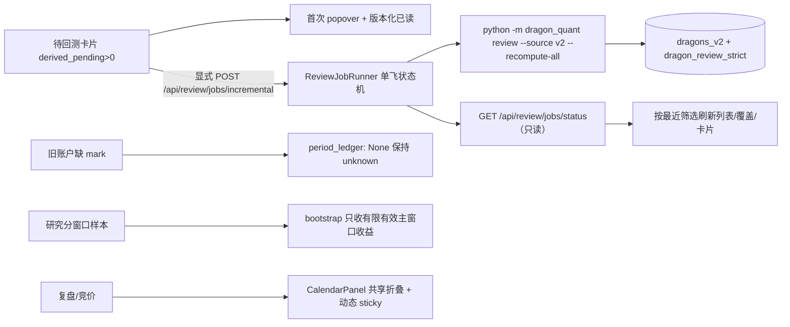

# Dashboard 用户故障修复（2026-11-05）

> 状态：阶段 3.5 终审通过；main 的独立验证、收尾及限制见 §9。尚未提交或推送。
> 范围：龙头总览增量回测入口、旧账户兼容、研究页窗口统计、导航与研究页、复盘/竞价日历、准确率单位。
> 非目标：不改买卖策略/资金参数、五维评分/因子定义、存储 schema、生产推荐池；不新增第三方依赖。

## 1. 问题与根因（先复现后修复）

| KR | 真实故障 | 根因 | 修复 |
|----|----------|------|------|
| KR1 | 待回测卡片没有启动回测的入口；说明与已读无持久化 | 仅展示卡片，无作业 UI | 卡片内「回测」按钮 + 首次 popover + 版本化 localStorage |
| KR2 | 无 HTTP 增量回测能力 | Web 无 review 作业适配层 | `review_runner.py`（组合 `BsRunner` 状态机）+ 显式 POST |
| KR3 | `GET /api/account/positions|summary?run_id=8` 500 `NoneType - float` | 旧 `positions_json` 无 `mark`，`period_ledger` 仍做 `end_value - basis` | 期末价值未知 → `unrealized/period_pnl=None`、`quality=unknown`；前端逐项降级 |
| KR4 | `GET /api/research/scan-quality` 500 `float + NoneType` | 主 horizon 未成熟时 `net_return_pct=None` 被送进 bootstrap；基础读取失败被吞成空数据 | 重采样前剔除 None/非有限值；其他 horizon 样本保留；读取失败显式 `scan_read_error` |
| KR5 | 导航「研究/诊断」是灰 span，不是路由 | 误导性伪入口 | 删除伪入口；`/research` 改名「扫描研究」并写清反馈用途 |
| KR6 | 复盘日历不是首块、`top-14` 在窄屏遮挡、默认日期按本地 K 线前一日推断 | 视觉 `order-*` 后置；固定 top；prep 沿用 auction 的日历推导 | 首块 + 动态 `--dq-header-h` sticky；prep 默认选最近复盘快照 |
| KR7 | 日历不可折叠、无收起入口 | 只渲染 AssetCalendar | 共享 `CalendarPanel`（默认展开、上/下沿居中切换控件） |
| KR8 | 准确率把百分点再 ×100（-8.5% 显示成 -851.4%） | `pctRate` 同时用于 ratio 与 percentage points | `pctRate`（ratio×100）与 `pctPoints`（已是百分点）分离 |

## 2. 架构与设计模式



- **命令模式 + 状态机组合**：`ReviewJobRunner` 只提供命令工厂与公开方法，单飞锁、
  `idle → running → succeeded|failed`、输出截断、`terminate` 全部复用在 `BsRunner`；
  Web 层零 SQL、零 `dragon_quant.review` import，写入只发生在子进程。
- **组合复用**：`CalendarPanel` 封装「展开/收起 + 日期摘要 + aria + 切换控件位置」，
  `PrepPage` / `AuctionPage` 只组合，不复制日历状态；选题日期/URL/数据仍由页面持有，
  折叠不触发任何请求。
- **Ports & Adapters**：新端点仍走 `deps` 白名单；未新增 Web→业务编排依赖。
  `http_guards.origin_allowed` 抽出与 BS 共用的本机 Origin 校验。
- **防御式纯函数**：`period_ledger` / `build_scan_quality` / `_bootstrap_interval` /
  `_group_stats` 对 `None` / 非有限值显式建模为 unknown/excluded，不填 0。

## 3. 关键实现位置

| 功能 | 文件 / 函数 |
|------|-------------|
| 增量回测作业（命令 + 状态） | `web_ui/backend/review_runner.py::ReviewJobRunner/default_command` |
| 作业 HTTP 契约 | `web_ui/backend/routers/review.py`；`app.py` / `deps.py` / `serve.py` shutdown |
| 本机 Origin 守卫 | `web_ui/backend/http_guards.py::origin_allowed`（BS + review 共用） |
| 前端入口 / popover / 轮询 | `pages/dragons/ReviewJobControl.tsx`；`SummaryCards.tsx`（footer）；`DragonsPage.tsx`（appliedFilters、刷新） |
| 前端作业 API | `api/review.ts` |
| 旧账户未知归因 | `dragon_quant/review_account/evaluation.py::period_ledger`（end_value 守卫）；`AccountStats/EntryReasonStats` 中文 unknown |
| 账户逐项降级 | `pages/account/AccountPage.tsx`（`Promise.allSettled` + `partialError`） |
| 研究分窗口统计 | `presenters/scan_quality.py`（finite 过滤、`pairs()`、`scan_read_error`）、`presenters/accuracy.py`（`_finite_values`、net 守卫）、`routers/research.py` |
| 研究页 | `pages/research/ResearchPage.tsx`（请求序号、区间显示、read_errors、中文错误）、`api/research.ts` |
| 复盘默认日 | `presenters/calendar_defaults.py::resolve_default_date`（prep 快照优先）、`presenters/prep_view.py::build_calendar`（快照/资产分开统计） |
| 日历面板 | `components/CalendarPanel.tsx`；`AppShell.tsx`（`--dq-header-h` + ResizeObserver）；`PrepPage/AuctionPage` |
| 准确率单位 | `components/AccuracyBoard.tsx::pctPoints` |
| 导航与研究命名 | `AppShell.tsx`（删除伪入口、`扫描研究`） |

## 4. 行为契约摘要

- 待回测入口仅当 `derived_pending > 0`；加载中/失败不显示。首次出现自动弹说明，
  **只有点击「我知道了」**才写 `dq.dragons.review-intro.v1`；storage 异常不崩溃；
  Escape / 点击外部关闭不记已读。按钮运行期间禁用，2s 间隔轮询 status 并在终态停止。
- 作业固定 `review --recompute-all`（无 `--force`）：成熟 pending、partial、严格缺失补算，
  已完成严格结果跳过，未成熟保留；成功后按最近提交的筛选刷新，并提示剩余未成熟条数。
- 复盘默认日 = 最近复盘快照 →（缺快照）最近真实复盘资产日 →（无记录）最近真实交易日；
  `collection_report` 失败壳不参与。竞价默认日语义不变。
- 日历是复盘首块；sticky `top` 用实测顶栏高度，390px 换行也不遮挡；折叠保留日期摘要、
  URL 与已加载数据，不重新请求。
- 收益 / 中位 / 日期等权 / spread / bootstrap 区间使用百分点格式（1.25 → 1.3%）；
  命中率 / 避损率 / 错失率仍按比率 ×100（0.125 → 12.5%）。

## 4.1 Main 阶段 3.5 验收返工（R1–R5，已落实）

- **R1 结果不推断**：`routers/review.py` 的 status 载荷新增 `summary`，从既有
  `📊 重算完成` 输出解析 processed / completed / cannot_evaluate / failed / skipped；
  前端 `composeSummaryText` 按业务结果显示「完成/部分失败/无可补算标的」，`failed>0`
  明确部分失败，无汇总只给中性「任务执行结束，仍有 N 条待处理」。**作业状态 ≠ 业务
  成功**：provider 单条失败（exit 0）与子进程非零退出分别有回归与浏览器证据。
- **R2 刷新恢复**：`ReviewJobControl` 挂载只读 GET status——running 立即挂接、禁用按钮、
  不重复 POST；最近 10 分钟完成结果恢复；父级加载时只读探测 running，pending=0 也保持
  状态区挂载。轮询改串行 `setTimeout`，`started_at` 作业身份守卫防止过期 running 覆盖
  终态；状态请求失败只提示重试、不暗示取消。
- **R3 刷新失败不伪报**：`DragonsPage.load` 返回 `ok | stale | error` 结构化结果；错误
  分支保留最近有效数据、不再清空 rows/summary；`onReviewFinished` 把失败向上传递，
  前端显示「任务已结束，但列表刷新失败…已保留上次有效数据」。浏览器注入 `/api/dragons`
  500 验证。
- **R4 pending→0**：新增 `mature` fixture（全部成熟），真实点击→完成→按钮消失、成功
  文案仍在；初始 0 场景不显示按钮也不弹说明。
- **R5 键语义分离**：`prep_view.build_calendar` 的 `latest_record_date` 恢复为
  `max(最新快照日, 最新真实资产日)`；默认日仍由 `resolve_default_date` 优先
  `latest_snapshot_date`。新增字段/默认日分离契约测试。
- 建议 S1（popover 文案去实现语言）与 S2（收起摘要改「选中日期」）已采纳。

## 5. 测试与门禁

```bash
PYTHONDONTWRITEBYTECODE=1 DQ_TEST_ALLOW_REAL_DATA=0 .venv/bin/python -m pytest \
  dragon_quant/tests -q --ignore=dragon_quant/tests/e2e --ignore=dragon_quant/tests/smoke -p no:cacheprovider
PYTHONDONTWRITEBYTECODE=1 DQ_TEST_ALLOW_REAL_DATA=0 .venv/bin/python -m pytest \
  dragon_quant/tests/e2e -q -p no:cacheprovider
npm --prefix web_ui/frontend run build
```

新增回归：
- `dragon_quant/tests/test_dashboard_followup_20261105.py`：旧 run 缺 mark 不崩溃且 unknown、
  research 主 horizon 缺失 + 多日通过/否决的 bootstrap、基础读取失败/截断显式、空区间、
  回测作业命令/单飞/403/409/状态只读 + 业务汇总解析 + provider 单条失败（exit 0）
  `run_review` 输出里 failed=1、`run_review(recompute_all=True)` 补算 partial 与严格缺失
  且跳过 completed。
- `dragon_quant/tests/test_web_frontend_dashboard_followup.py`：入口条件、持久已读键、
  挂载恢复/串行轮询/作业身份守卫、部分失败与刷新失败文案、刷新失败保留数据、
  共享日历组件、百分点/比率分离、账户逐项降级、研究请求序号、dist 同批契约。
- `test_dashboard_calendar_defaults.py` 新增：`latest_record_date=max(snapshot, asset)`
  与 `default_date` 快照优先相互独立的契约。

## 6. 隔离 fixture 与浏览器验收（main 可独立复跑）

证据目录：`/private/tmp/dq-dashboard-followup-20261105/evidence/`
（`repro_pre_fix.txt` 保存真实 500 原文、根因算术与修复后 HTTP 200；`browser-results.json` 为 72 项浏览器断言）

```bash
cd /Users/bing/Repo/dragon-quant
EV=/private/tmp/dq-dashboard-followup-20261105/evidence

# 1) >0 待回测（8790）；2) 0 待回测（8791）；3) 全成熟 pending→0（8793）
.venv/bin/python $EV/run_fixture_server.py --root /private/tmp/dq-dashboard-followup-20261105/data --port 8790
.venv/bin/python $EV/run_fixture_server.py --root /private/tmp/dq-dashboard-followup-20261105/data-zero --variant zero --port 8791
.venv/bin/python $EV/run_fixture_server.py --root /private/tmp/dq-dashboard-followup-20261105/data-mature --variant mature --port 8793

# 4) provider 单条失败（8794）/ 5) 子进程非零退出（8795）：先 seed，写 review-mode，再 --no-seed 启动
.venv/bin/python $EV/seed_fixture.py --root /private/tmp/dq-dashboard-followup-20261105/data-fail
echo provider-fail > /private/tmp/dq-dashboard-followup-20261105/data-fail/review-mode.txt
.venv/bin/python $EV/run_fixture_server.py --root /private/tmp/dq-dashboard-followup-20261105/data-fail --port 8794 --no-seed
.venv/bin/python $EV/seed_fixture.py --root /private/tmp/dq-dashboard-followup-20261105/data-exit
echo exit-fail > /private/tmp/dq-dashboard-followup-20261105/data-exit/review-mode.txt
.venv/bin/python $EV/run_fixture_server.py --root /private/tmp/dq-dashboard-followup-20261105/data-exit --port 8795 --no-seed

# 浏览器交互（72 项断言，含 R1–R4；脚本会临时把 8790 的 review-mode 切到 slow 再还原）
.venv/bin/python $EV/browser_check.py \
  --zero-base http://127.0.0.1:8791 --mature-base http://127.0.0.1:8793 \
  --fail-base http://127.0.0.1:8794 --exit-base http://127.0.0.1:8795
```

- fixture 内容：4 条龙头（3 条成熟 pending + 1 条未成熟；`mature` 变体无未成熟行，
  回测后 pending=0）；两个扫描日、通过/否决各 9 只，部分 code 缺 3 日退出 bar；复盘快照日
  `2026-11-03` 与本地日 K 最新 `2026-11-04` 不同，且 `2026-11-05` 只有 `collection_report`
  失败壳；账户新/旧 run（旧 run 期末 `positions_json` 缺 `mark`，默认选中）；准确率 fixture：
  推荐组命中 1/8（12.5%），不推荐组均值 +1.25 百分点。
- 回测按钮的命令被 fixture 服务替换为 `fixture_review_command.py`：**真实** `run_review` +
  注入离线 provider/日历，选择/成熟度/写库仍走生产代码；`review-mode.txt` 支持
  `ok | slow | provider-fail | exit-fail`，生产默认命令不变。
- 服务只绑定 `127.0.0.1`，pidfile `<root>/fixture-server.pid`；基准/绩效 provider 注入空 K 线，
  全程不触网、不读真实库。

## 7. 完成状态

- KR1–KR8 全部实现；`test_dashboard_followup_20261105.py` 14 passed、
  `test_web_frontend_dashboard_followup.py` 10 passed。
- 全量非 smoke 单元：`3046 passed, 2 skipped`；离线 E2E：`353 passed`（含 harness 安全与
  架构门禁）；`npm test`（安装器）：`166 passed`；`npm --prefix web_ui/frontend run build`
  通过并更新 `web_ui/dist`。
- 浏览器交互：`72/72 checks passed`（含 R1 部分失败/非零退出、R2 刷新挂接与慢状态、
  R3 刷新失败、R4 pending→0、0 pending、390/1440、明暗主题、请求乱序、失败重试、旧账户）。

## 8. 已知限制 / 未验证项

- Review 作业的 fixture 子进程替换了 K 线 provider 与交易日历（离线约束），生产默认命令
  与参数由单元测试锁定；真实雪球链路未在 fixture 中联网验证。
- `AccuracyBoard` 的 popover/HintIcon 等既有交互未在本任务重测，仅回归其单位格式。
- 多 dashboard 实例并发不在本任务范围（单进程内单飞，与 BS 作业一致）。
- executor 未操作真实 8765；main 先独立启动 8792 只读验收，终审通过后重新加载原 8765，见 §9。

## 9. Main 最终验收

main 已独立核对 KR1–KR8 和 R1–R5 的实现及验证证据；无未解决阻断项。

| 验收项 | main 亲自验证 |
|--------|--------------|
| 首次提示与按钮 | 独立离线 `main-data-mature` / 8796：首次显示说明，点击「我知道了」后刷新不再弹；点击回测后按钮禁用；待回测 3→0，按钮消失，结果提示保留 |
| 业务失败反馈 | 8794 离线 provider 失败：实际点击后显示「任务部分失败：失败 1 条」，未伪报未成熟或全部成功 |
| 归零后刷新 | main 补齐父级最近终态探针后，在浏览器刷新 8796，待回测 0、无按钮、结果提示仍在 |
| 账户真实旧批次 | 8792 只读 GET run 8 的 positions/summary 均 200；36 条已平仓记录，缺失归因保持 unknown/null；浏览器曲线、持仓、交割单正常 |
| 研究真实数据 | 原失败区间 `2026-09-06..2026-11-05` 返回 200 / ok / 104 个主窗口有效样本；浏览器实际显示分组统计 |
| 复盘日历 | 真实页面默认最近快照日 2026-11-05；首个区块；实际点击收起/展开并滚动截图确认吸顶在顶栏下 |
| 竞价日历 | main 实际点击收起、Space 键展开；日期与页面结果保留；窄屏/主题补核 executor 的 390px 截图与 72 项交互记录 |
| 导航与单位 | 浏览器已移除伪入口并显示「扫描研究」；收益百分点与命中率比率分离，定向回归通过 |

main 在终审中直接完成两处局部、可逆收尾，并按 `code-self-review` 单独自审通过：

- CLI 没有候选或只有未成熟候选时提前返回，不打印数字汇总；`parse_review_summary`
  识别既有明确空结果文案，输出 `processed=0`，对未知输出仍保持 `None`，不推断业务成功。
- 父级只读探针同时保留最近十分钟终态，修正 pending 归零后刷新不挂载结果区的问题。

最终变更后的 main 验证：

- 后端 / review / 日历 / Web 集成定向：**136 passed**。
- 前端契约 / 主题 / 结果 / 交互接线：**64 passed**。
- dashboard 与 Web API 离线 E2E：**27 passed**（首跑被沙箱 `socket.bind` 权限拒绝，获准监听本机临时测试端口后通过；无真实数据哨兵变化）。
- `npm --prefix web_ui/frontend run build` 通过，最终 JS 为 `index-ZRMnDSBR.js`；`git diff --check` 通过。
- executor 全量证据：3046 passed / 2 skipped、353 E2E passed、72/72 浏览器交互；main
  收尾后运行上述受影响检查，不把旧全量结果冒充最终版本重新全跑。

交付记录异常：返工复制会话为 `a3d0e94f-5136-46ec-bab4-bff6f6c81ec3`，实际最终报告
已读并另存 `/private/tmp/dq-dashboard-followup-20261105/evidence/resumed-final-report.txt`。
原 Bridge 未继承复制会话 hooks，仍显示旧报告及 RUNNING；核实两个会话均 `done` 后，按工作流
对协调记录执行 cancel 补记，**不是取消已完成的修复**，所有运行目录与证据均保留。

终审后 main 已将原入口 `http://127.0.0.1:8765/` 重新加载为最终代码（显式
`--no-bs-autogen`，不自动补算）。真实 run 8 的 positions/summary、原失败研究区间、
prep calendar、review job status 再次全部返回 200；作业为 idle，未执行真实联网 review 写入。
端口重载证据为 `evidence/main-original-port-final.json`；回测按钮写流程仅在隔离数据亲验。
