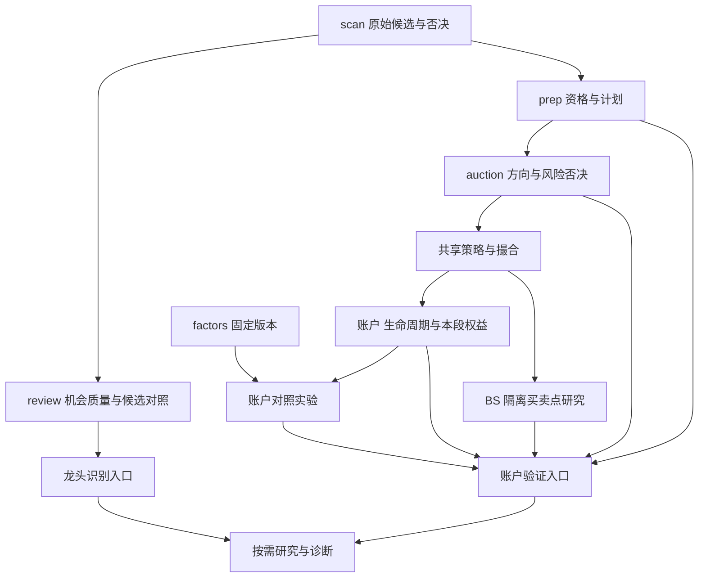

# 两核心评估、dashboard 与 Skill 全量修复方案

状态：2026-11-05 阶段 3.5 终审通过，27 项修复及本机 Codex / Claude Code Skill 1.4.0 同步完成；验收与限制见 §12。用户明确授权“根据列出的所有问题制定修复方案，然后找 Claude 去修”，包括下列 27 项的落地。未授权提交、推送、合并、发布、真实数据回填或改变实盘交易策略默认参数。

基线：`d8776b7f5fbc8e34a61cf9745383d0991fc3b138`，派工前工作区干净（本方案为本任务新增）。审查依据：`/private/tmp/dragon-quant-audit-2026-11-05.md`；其中116项相关测试通过，6项合成复现。审查未读取真实业务库，也未实屏验收。

## 1. 产品目标、范围与非目标

两个核心：scan 识别当天龙头；review-account 用真实模拟权益、风险和整笔交易结果检验识别与操盘策略。review 为scan提供反馈；prep、auction、buy/sell和factors为账户验证服务。

本次覆盖审查A1–A12、D1–D8、S1–S7，不能把P2/P3仅登记成后续建议。按依赖顺序实现，并对每项给出实际产物与证据。数据不足可以是正确运行结果，缺少实现入口不能冒充数据不足。

非目标：不调五维权重、买卖阈值或默认风控；不新增v1写路径；不复制撮合/买卖规则；不全站换技术栈；不引入付费服务；不声称已证明策略有效；不读取、重算、清理用户真实库；不改全局工作流配置与项目根AGENTS。保留现有主题、分页、独立派生评估与共享撮合基础。

## 2. 路径比较与设计模式

1. 仅修改标签：成本低，无法解决成熟度、错误窗口、异常终态与跨段归因，不选。
2. 在现有模块内修复指标合同、补运行追溯与研究入口，再重组现有页面：采用。改动可分片验证；已有消费者优先增量兼容。
3. 全量重写评估与前端：缺乏必要性证据，迁移成本大，不选。

模式：复用 **Adapter + Strategy** 统一prep/auction信号适配，保留不同评估用途的独立策略；用 **Template Method** 固定样本选择→有效性→窗口→聚合步骤，窗口用小型显式规格而非复用错误的整套review函数；用 **Facade** 保留一个Skill入口；用 **Strangler Fig** 渐进替换展示与聚合，保留旧URL和历史字段。运行质量用普通冻结结构与仓储JSON扩展，不造通用事件总线或评估框架。

## 3. 模块落点与依赖（L2增量，非整仓重构）

- CLI入口沿用 `dragon_quant/commands/*`；本轮优先新增HTTP研究入口，不新增顶层CLI命令。
- review机会窗口与成熟度归 `dragon_quant/review/`；状态/汇总归 `scan/storage/dragons.py`、`review_strict.py` 与现有schema owner；不在Web重写规则。
- BS买卖窗口与故障状态归 `dragon_quant/bs_eval/`；卖后有效bar规则复用/提取现有纯核，禁止让基础层反向依赖账户业务。
- 信号共同适配归现有 `infra/factor/decision_review.py` 或同目录纯职责文件，公开稳定的小型适配接口；Web presenter调用该接口。因子层不得import账户/评分/provider，既有显式例外不扩大。
- 账户生命周期、跨段盈亏与实验编排归 `review_account/`；仓储写入仍由现有storage独占。
- scan全候选研究归 `review/` 的独立只读用例，消费已有scan仓储和调用方注入的本地行情；不得因研究改变dragons去重或生产候选池。
- Web：现有deps装配→routers薄壳→presenters纯展示。增加 `routers/research.py` 与对应API客户端/研究视图可行；不在Web自建DB连接或导入provider。
- Skill：`skills/dragon-quant/` 及 `lib/doctor.mjs`、安装器必要注册路径与测试。保持Facade；不修改已安装的全局Skill文件。
- 文档：更新现有owner文档、README和受影响的已归档方案；本方案记录本次合同，不另增重复方案链。



## 4. 指标合同与关键行为

### 4.1 通用评估元数据

新评估结果包含 `metric_id/evaluation_version`、`sample_unit`、`universe`、`as_of`、窗口/成交假设/成本、分子分母/排除、独立日期与股票数、策略/评分/快照配置版本、数据质量、来源/回填标签。与已有API冲突时放在增量 `evaluation`/`meta` 对象，保留原键；不要求每条历史记录都能恢复所有字段，缺失明确为unknown。

只有成熟且有效的样本进入正式成效分母；partial/pending/cannot_evaluate独立计数。不得填0冒充未知。名称区分“机会质量”“方向命中”“整笔交易盈利率”“本段权益贡献”。bootstrap/区间均是描述性，不宣称独立样本显著性。

### 4.2 review成熟度与历史兼容（A1/A6）

- 保留现有机会窗口数值定义：买入后第2～5个交易日的4个交易日作为历史机会合同；明确它并非账户5日净收益。
- 默认成熟度从实际入场与完整窗口派生，不再硬编码入选满5日。显式日期查询可返回partial，但不入正式汇总。
- 现有strict侧表的 `reason=partial_window`、无成熟度证据的严格行可区分，补算选择应覆盖partial；`recompute-all`不得因已有partial行直接跳过。
- 不自动重算或覆盖用户数据；修复后的默认命令将来可以合法补算partial，输出数量与口径。旧完整数值不静默重定义，legacy端点需兼容；新主视图采用有效成熟分母并返回元数据。
- “平均收益”改为“平均最大潜在涨幅”；“回撤”明确为相对入场的峰值前不利波动；“严格”显示“假设次日开盘”，一字板假设明确揭示。
- 增加独立的 `tradable_open_v1` 研究对照：严格T+1入场，已有盘口/限价信息无法确认成交或日K一字板时排除并说明；不因事后最低价构造实际成交，不顺延偷偷选更好日期。固定1/3/5持有期净收益与机会指标并列，日K约束仅称可成交估算，不宣称真实成交。

### 4.3 BS窗口、异常、卖出评价（A2/A3/A12）

- 卖后窗口：卖出日之后5根有效日K，不含卖出当日，不跳过次日；相对卖价的最高涨幅与全窗最低跌幅（最低跌幅上限0）。复用账户 `post_exit_stats` 的纯规则或提取到零I/O共享叶子，避免跨层深引。
- BS买后机会窗口保持已有合同但显式标签；日K无法辨认盘中买入前低点时标近似，不冒充真实持仓MAE。
- DataCoverageError为可重试cannot_evaluate；真实停牌仅用unavailable语义。部分日期故障不得宣称整个买入窗口“无信号”；买入后故障也不能冻结为成熟全清结果。
- 升BS evaluator version并使旧行stale；避免启动/查看dashboard时隐式大批历史重算。
- 增加独立 `missed_upside`、`avoided_downside` 两轴，可同时成立；旧互斥verdict仅兼容/辅助。半仓腿与全清腿独立样本且不混入整笔交易盈利分母；展示对应窗口覆盖及数量。

### 4.4 prep/auction分组、覆盖与版本（A4/A5/A11）

- prep完整 `review_candidates` 母集固定；推荐=eligible且position>0，不推荐=position==0，数据不足单列，不随市场建仓日型丢弃不推荐组。不推荐不是看跌：主指标为两组同窗口净收益/中位/胜负分布/差值、避损与错失机会；市场空仓风险效果按日期等权另列。
- auction方向为bull/bear/neutral/unknown；neutral不强塞up/down，只有bull/bear进入方向命中分母。level强中弱、真实veto、数据可用性各自保留。缺unverified或关键信号字段fail-closed。
- 复用既有适配器；允许显式“方向”与“等级效果”两种评估策略，不要求把本来不同的研究问题强改成同一数字。
- 主研究比较复用decision-review可成交开盘→第N交易日开盘、扣成本的显式合同；原raw开盘到收盘方向统计若保留须标legacy。CLI/Web同口径对相同输入结果一致。
- 展示候选/有效/排除、独立日期/股票、stock-day与date-equal两种权重；同股票重叠窗口不当独立证据。按配置hash/快照版本/市场状态/时期分层，unknown单列；原始与重算无法恢复时注明不可判定。
- 至少提供同母集等权基准与日期分块bootstrap差值区间（固定seed，可复现，样本不足不出区间）；不提供虚假的独立样本显著性。

### 4.5 账户指标、跨段贡献与运行追溯（A7/A8/D2）

- 保留整笔生命周期realized_return>0的胜率、半仓并入整笔的既有语义；显示盈利数/已平仓数，交割笔数另列，未平仓数单列。
- 新运行保存 `base_run_id`、起点权益、期初持仓与估值、期初累计已实现盈亏、运行质量/候选池来源/降级天数与原因、策略参数及版本。使用既有schema owner幂等加可空列或单一元数据JSON；迁移仅schema，不写推断的历史业务值。
- 新运行同时保存精确净盈亏金额/初始成本（或等价可验证字段），不再通过entry_price×qty估算新结果贡献。
- “本段已实现贡献”以期初盯市价值为成本基准：继承持仓本段卖出只归本段从期初价值到卖出的盈亏；本段新仓归含费用本段现金流；半仓只按本段成交数量归属。按买点聚合，分母=本段起点权益。另示期末未实现贡献及现金费用/舍入调整，使总贡献与本段权益变化可对账。
- 生命周期胜率不变成期间胜率；跨段关闭的交易按生命周期展示，旁注明其收益覆盖更早区间。老批次无法精确归因时返回unavailable，仍可展示明确标注的legacy近似，不能假精确。
- 链式增量沿base_run_id保留追溯与期初状态，恢复风险状态时消费冻结状态；不只换分母。
- 增加平均盈利/亏损、净盈亏比（金额口径）、期望整笔收益、费用、最大单笔亏损、已实现/未实现、Sharpe和基准差；样本为0/全赢/全亏按不可计算规则显示，不能除0或冒充无风险。

### 4.6 有用的研究入口（A9/A10）

必须交付可调用入口与dashboard入口，不仅是helper或文档。

1. `GET /api/research/scan-quality?date_from=&date_to=`：只读原始扫描全候选和本地行情，按扫描配置/分数区间/rank/通过与否决/首次或重复入榜分组，展示成熟覆盖、固定持有期净收益、错失机会、基准差、日期等权统计。每天同code多次扫描按明确canonical规则去重，仍保留原始贡献数。不改dragons gate。没有历史否决候选时明确覆盖缺口，不虚造召回率；信号事后机会只能称错失机会描述。
2. `POST /api/account/experiments`：用户在账户研究区显式点击并确认后运行；基于指定run冻结的期间/资金/策略/版本，固定upstream候选母集、本地行情快照和成本，复用AccountSimulator。支持baseline、去掉prep过滤、去掉auction排序/否决、单条买/卖规则消融、固定factor模型开关。按项目已有实验能力扩展，不复制买卖算法。比较不同节点允许下游eligible集合变化，但上游母集必须一致。缺模型/因子/PIT或本地行情覆盖不足的variant返回insufficient_data，不隐式触网或回退另一份数据。
3. 实验采用固定时间切分、训练/验证选型与隔离测试区间、双倍滑点压力测试、最少交易数与trial_count；无数据返回证据不足，不自动推广参数。展示每variant收益/回撤/交易数/盈利率/质量与基线差，确定哪些比较可比。
4. 实验为用户触发的本地派生操作，返回可审计报告（沿既有存储扩展保存或既有报告路径），禁止dashboard启动隐式跑实验。GET查看现有结果不重算。请求耗时/互斥按既有account job路径或单飞模式处理，失败不可遗留半成品为成功。

## 5. dashboard行为（D1–D8）

- 主导航分“龙头识别”“账户验证”，保留 `/`、`/scans`、`/prep`、`/auction`、`/account`、`/bs`、`/factors` 旧深链。研究视图为 `/research`，入口统一命名“扫描研究”（早期“研究 / 诊断”灰字伪入口已按用户反馈删除；不得恢复非路由伪入口）。
- 龙头首屏：当前榜/观测日期与质量、全量成熟覆盖、当前筛选机会指标、候选对照入口。全量覆盖与筛选成效分两个有明确标题的数据源。默认不因completed过滤把待回测隐藏成0。
- 账户首屏：本段起点/当前权益、收益/风险、盈利数÷已平仓数、未平仓、数据质量/退化；参数摘要和批次比较入口。整笔生命周期与本段贡献明确分区。
- AccountPage详情结果绑定runId+请求序号；切换立即进入对应加载态，旧响应不可覆盖新run；基准/时间线等辅助失败局部降级，核心数据失败有独立状态。
- BS每块summary与对应筛选后的同基集一致；全局统计与固定分母研究若保留要在标题明示；卖出数、上涨机会数、避损数不得跨作用域混用。买点规则过滤后的结果应给自己的分母。
- auction主表增加参与限制/风险否决原因、评价完整性、未验证状态；避免用“可买”承诺实际成交。采集质量与策略验证分开。
- 首屏结果/风险优先；完整规则说明、日历长历史、hash/DB版本/PIT原字段/build审计/原始报告/子进程输出默认折叠，但保留诊断入口。不要隐藏影响结论的降级原因。
- 操作改名“重新计算买卖点评估”，明确范围、版本、耗时与副作用；纯查看路径关闭BS隐式生成，CLI保留显式opt-in兼容开关并更新说明。旧环境变量是否显式启用以明确优先级处理；缺省只读，新行为需对应测试与文档。
- 表格详情使用键盘可达的明确控件，排序aria-sort、焦点、loading/empty/error/disabled完整。窄屏保留关键列，次要列可展开；不以裁掉数据掩盖缺失。验证至少390px和1440px、浅/深色、键盘主流程；使用隔离fixture服务并关闭自动生成。

## 6. Skill与安装可诊断性（S1–S7）

- 保留单Facade，加入“识别质量”“账户策略质量”两个目标workflow；能力表可扩展受限的研究/实验流程，分开只读查看与显式实验写入。默认不扫全套、不自动推广策略。
- scan完成后的结构化核验读取对应原始scan记录（选对date/top/scan_id），另报新增dragons池；如果现有CLI表达不足，可增量暴露最小只读字段/flag，不新增顶层命令，兼容旧参数。
- 每个胜率报告先给指标类型/窗口/成熟样本/排除/成本/版本/质量与比较条件。默认简报一屏，详细模板按用户请求加载；明确完整报告模式，不同时强制6段与8段。
- 明确授权按日期、动作、参数和副作用范围持续有效，用户更改/撤销或越界才补确认；不按“上一轮不算”人为反复确认。交易时点和action上限不取消。
- 异常分流区分能力不支持、可只读解释、暂缺数据、真实故障；不把所有体验问题回复固定issue话术。允许解释公开已支持输出，不无边界开放命令。
- 发布包在消费项目可独立使用：运行时help/能力探测/包内输出解释为契约；仓库AGENTS/源码策略规范仅仓库维护模式按需读取。不把父级开发流程注入普通消费项目。不能简单把所有开发文档打进npm。
- doctor显示实际发现的project/global/兼容路径、manifest版本及无manifest时frontmatter版本、来源/遮蔽/CLI能力差异；不把候选路径推断成宿主一定活动的Skill。更新包版本并测试内容/安装/能力最低版本对齐。
- 当前 `/Users/bing/.agents/skills/dragon-quant` 的1.0.0升级：executor准备本地安装器可review的dry-run与备份策略/命令，main在阶段3.5完成必要的宿主授权后用支持的安装入口同步。禁止executor直接写全局目录或篡改manifest假装升级。本项最终验收包含实际安装结果；权限缺口如实单列。
- 行为场景测试必须覆盖：只看不生成、授权范围延续、重复入榜核验、数据故障不是空仓、中性不是看涨、不同版本不可比、迟到竞价不伪造、包外无repo docs可用。

## 7. 工作包、27项覆盖与KR

同一Claude execute-agent会话顺序闭环阶段3；不再派生agent。共享schema/依赖装配/公共类型由该会话唯一写入。各里程碑验证后继续，不将正常里程碑作为交还用户的结束条件。

| 工作包 | 审查项 | 完成结果与验证 |
|---|---|---|
| M1 正确性核 | A1/A2/A3/A6/A12 | 实际成熟度、partial重试、独立卖后窗口、异常可重试、两轴/半仓、版本标签；六类反例回归与现有review/BS测试 |
| M2 信号合同 | A4/A5/A11 | 完整母集、中性/不推荐语义、同源适配、分层/覆盖/日期权重/基准/区间；CLI-Web同输入parity和缺数据场景 |
| M3 账户追溯 | A7/A8/D2 | 幂等加列、旧数据unknown、跨段精确贡献/对账/链式增量、正确胜率分母与风险指标；全量/增量/半仓/期末未平仓/老库测试 |
| M4 研究闭环 | A9/A10 | 上述可用scan-quality与account experiments入口、同母集冻结输入、OOS/压力/不推广、真实UI报告；不足覆盖与版本不一致拒绝比较 |
| M5 人类界面 | D1/D3/D4/D5/D6/D7/D8 | 双核心导航/旧URL兼容、新旧响应隔离/局部降级、同域分母、风险披露/折叠/准确文案/只读启动、实屏/键盘/小屏证据 |
| M6 Skill与交付 | S1/S2/S3/S4/S5/S6/S7 | 原始scan核验、目标路由、简报与持续授权、分流/能力/独立安装内容、doctor可查与受支持升级方案、行为验收 |

KR1：所有正式统计均只包含合同约定的成熟有效样本；复现中的partial=100%错误不再成立。
KR2：次日+10%样本的BS卖后上涨机会不被漏掉；数据异常绝不写不可重试no_signal。
KR3：prep不建仓与auction中性不被当成相反/正向预测；相同研究合同同输入各入口一致。
KR4：新账户全量/任意两段及链式增量贡献可与本段权益变化对账；生命周期统计不混段；旧run明示缺口。
KR5：真实可用的scan候选对照、账户消融入口有可比性检查与不足证据结果，参数不自动推广。
KR6：用户能从两核心入口找到结果/风险/证据；筛选不混分母、切run不混详情、辅助失败不清整页；实屏与键盘验证。
KR7：Skill在消费项目无仓库文档仍可解释/路由，原始scan核验正确、授权持续、异常有区分，doctor与升级证据齐全。
KR8：项目硬约束、B1、依赖方向、跨平台、v2、真实数据隔离继续通过；owner文档/README/dist/受影响归档方案同批同步。

## 8. 迁移、历史与回退

- 只加可空元数据/归因字段或新研究派生表，不DROP旧表、不批量回写旧业务值；schema init重复调用可用，旧schema升级测试必须真实运行。
- 旧API字段保留原含义；正式新合同通过版本元数据和新聚合键/研究端点暴露，不能在相同旧字段下悄悄换公式。对于“排除partial”等明确缺陷修复，同步契约和有意行为变更测试。
- 旧BS行因新evaluator stale，UI提供显式重算入口而非启动时隐式覆盖。真实历史修复仅交付预检/重算路径与受影响统计方式，本次不得操作真实库。
- 归档文档若仍是owner引用的对应设计，受影响合同同步更新，保留历史/新版本区别。新方案待整项完成、用户要PR/合入时再询问归档。
- 无git提交授权，以未提交diff交付；可按M1–M6列出未来建议提交边界，不能替用户commit。schema增量旧列保留，可回退代码；新含义由版本区分。

## 9. 验证命令与交付证据

实现先跑相关针对性用例，再完整离线门禁；Python使用既有.venv，不安装系统包。所有运行均隔离真实数据、Cookie、网络、云端和自动生成。测试失败不能靠改golden掩盖；只有本方案批准的行为变更可更新对应golden，报告逐条解释。

```bash
PYTHONDONTWRITEBYTECODE=1 DQ_TEST_ALLOW_REAL_DATA=0 .venv/bin/python -m pytest dragon_quant/tests/test_review_strict_metrics.py dragon_quant/tests/test_dashboard_accuracy.py dragon_quant/tests/test_bs_eval_aggregate.py dragon_quant/tests/test_bs_eval_evaluator.py dragon_quant/tests/test_skill_content.py dragon_quant/tests/test_skill_routes.py -q -p no:cacheprovider
PYTHONDONTWRITEBYTECODE=1 DQ_TEST_ALLOW_REAL_DATA=0 .venv/bin/python dragon_quant/tests/e2e/harness/runner.py --self-check
PYTHONDONTWRITEBYTECODE=1 DQ_TEST_ALLOW_REAL_DATA=0 .venv/bin/python -m pytest dragon_quant/tests/e2e/test_harness_safety.py dragon_quant/tests/e2e/test_architecture_rules.py -q -p no:cacheprovider
PYTHONDONTWRITEBYTECODE=1 DQ_TEST_ALLOW_REAL_DATA=0 .venv/bin/python -m pytest dragon_quant/tests -q --ignore=dragon_quant/tests/e2e --ignore=dragon_quant/tests/smoke -p no:cacheprovider
PYTHONDONTWRITEBYTECODE=1 DQ_TEST_ALLOW_REAL_DATA=0 .venv/bin/python -m pytest dragon_quant/tests/e2e -q -p no:cacheprovider
npm test
npm --prefix web_ui/frontend run build
```

补充有意义的针对性测试：partial成熟补算/无效bar、BS次日涨幅与卖日盘中低点、买前买后故障、非推荐/中性/缺键、跨段半仓与未平仓净值对账、schema迁移重复、研究可比性/OOS/缺模型、请求乱序/局部失败、筛选分母、Skill消费项目与授权场景、旧URL与B1。测试入口按实际文件补充，不能只跑静态文案断言。

前端必须使用临时fixture数据源做390/1440、明暗、切run乱序、主流程键盘、空/失败/运行态的浏览器检查与截图，不启动真实默认数据dashboard；无浏览器工具时明确NEED_DECISION/验证缺口，不伪造。

完成报告逐项列27项与KR1–KR8：实现文件/符号、真实命令与结果、截图路径、迁移/兼容、known_issues、deviations（含用户attach干预）、main_acceptance。高级别问题清零才可请求终审。执行者按其宿主已有审查协议完成同会话自审，main收到最终回调后独立验证关键反例、迁移和集成。

## 10. main可执行性检查

已核对入口、现有纯核、仓储、schema与测试、包内容和Bridge能力。关键方向/数据语义/升级边界均由main裁定。未知：真实历史影响量、本机其余harness活动Skill、完整实屏效果；分别通过只读预检能力、doctor发现、隔离浏览器验收处理，不以未知阻塞可实现工作。实现若需改变上述核心语义/生产默认策略、超出允许文件或触碰真实数据，须NEED_DECISION；普通内部实现选型自行处理。

## 11. main单次验收与返工记录（2026-11-05）

首轮实现未通过终审。main独立62项相关测试通过，但真实隔离调用复现实验类型崩溃、0.8 prep消融无效、期间汇总/持仓数错误与未成熟研究指标；独立只读会话另交付7个BLOCKER并确认核心缺口。现有全量门禁通过不能代替成功路径与产品合同验收。

唯一全面验收意见：`/private/tmp/dq-two-core-fix-20261105/main-acceptance.md`。必须修改R1实验成功路径、R2实际冻结/消融/OOS、R3期间归因对账、R4共享评估合同/日期分块、R5成熟/截断研究覆盖、R6新指标与人类界面贯通、R7 Skill真源一致、R8旧partial/历史字段/迁移与文档证据。已正确的BS卖后窗口、引擎全清period_pnl公式和主账户请求隔离应保留。

返工沿原阶段3实现会话，核验受影响测试与delta自审；报告main_acceptance逐项记录R1–R8。全局Skill升级待实现通过后由main处理。无提交、推送、发布或真实历史回填授权。

## 12. 阶段 3.5 最终验收（2026-11-05）

结论：通过。首轮全面验收的 R1–R8 与后续聚焦核验的 D1–D6 已落实；无未解决 BLOCKER / CRITICAL。最终报告为原 Bridge run `cb-20261105T092437Z-787403af` 的 `report.md`，末次 Claude session 为 `782565ad-69e2-483f-9a11-e13ad936b1a1`。独立只读审查 run `cb-20261105T100813Z-5886bee5` 的七个阻塞问题已纳入 R1–R8，未以实现者自审代替 main 验收。

| 验收范围 | 实现位置 | 验证证据 |
|---|---|---|
| M1：A1/A2/A3/A6/A12；KR1/KR2 | `review/strict_metrics.py`、`review/main.py`、`bs_eval/evaluator.py` / `aggregate.py`、对应仓储 | 成熟窗口、partial 补算、异常重试、卖后有效 bar、两轴与半仓回归；最终完整离线 E2E 与相关单元检查 |
| M2：A4/A5/A11；KR3 | `infra/factor/signal_adapter.py`、`decision_review.py`、`web_ui/backend/presenters/accuracy.py`、`AccuracyBoard.tsx` | CLI/Web 共用方向语义；not_recommended 无方向，neutral 不当看涨；同源 open→open 净收益、日期分块与版本分层测试 |
| M3：A7/A8/D2；KR4 | `review_account/evaluation.py::period_ledger/entry_reason_stats`、期初字段 schema 与 simulator、账户 presenter 与页面 | main 隔离反例：一笔已平仓盈利+一笔浮亏，生命周期胜率仍为 100% / 1 笔，open_count=1，本段权益对账差为 0；链式、FIFO 批次、旧库迁移回归 |
| M4：A9/A10；KR5 | `web_ui/backend/presenters/scan_quality.py`、`routers/research.py`、`review_account/experiments.py`、`ResearchPage.tsx` / `ExperimentPanel.tsx` | HTTP 实验成功路径与缺数据分类；冻结期初、市场、母集、因子值/模型；main 真实 evaluate_buy 验证 prep 消融生效，生产仍拒绝；scan 成熟/截断/canonical 回归 |
| M5：D1/D3/D4/D5/D6/D7/D8；KR6 | 主导航、`DragonsPage.tsx`、`AccountPage.tsx`、`BsPage.tsx`、prep/auction 页面及 presenter | 双核心导航、全量覆盖/筛选分母分开、请求乱序/局部降级回归；隔离 fixture 390/1440 明暗及键盘证据在 `/private/tmp/dq-ui-evidence-2/`，main 复核窄屏与账户截图 |
| M6：S1–S7；KR7/KR8 | `skills/dragon-quant/`、`lib/doctor.mjs`、安装器、对应 owner/README/归档方案 | 目标路由、原始 scan 核验、消费项目与授权场景；main 校正 outputs 两条残留窗口说明；52 项 Skill 内容/包检查与 166 项安装器检查通过；双宿主 1.4.0 实际安装及 doctor 通过 |

验证来源分开记录：

- Claude 最终自测报告：非 E2E `3020 passed, 2 skipped, 1522 subtests passed`；E2E `353 passed`；harness 自检成功，安全/架构 `71 passed`；npm `166 passed`；前端 tsc + vite 构建成功。
- main 独立重跑：`test_two_core_remediation.py`、`test_review_account_incremental.py`、`test_dashboard_accuracy.py` 共 `95 passed`；另 `test_skill_content.py`、`test_skill_package.py` 共 `52 passed`。直接隔离反例覆盖生命周期/期间分离、冻结期初、真实 prep 买点旁路和 CLI 无方向语义。
- main `npm test` 首次因沙箱禁止写默认 npm 缓存而有三项 packaging 失败；获准使用 `/private/tmp/dq-main-accept-npm-cache-20261105` 后重跑 `166 passed, 0 failed`。未修权限、删除或修改用户 npm 缓存。`git diff --check` 通过。
- main 两行 Skill 文案修订按小范围文档快速通道完成 delta 自审：与运行时合同一致，未改业务行为；上述 52+166 检查通过，无阻塞 finding。

接受的偏离与限制：

1. train/validation/test 从本批期初独立重启，明确返回 `split_seed_policy=independent_restart_from_period_start` 与 `split_historical_continuity=false`；属于控制变量实验，不宣称重现连续历史持仓。冻结状态不含期末快照，消除了前视。
2. 旧增量批次缺少冻结期初时返回不可复现（400 / unknown），不填造旧状态；真实历史结果本次未重算。日期相关区间仍是描述性统计，不能据此宣称策略胜率已提高。
3. 因子值一次冻结到内存；长区间多变体尚未做性能压测，现有单飞锁与 409 保持。最后一轮统计列变更使用针对性测试；浏览器证据来自前一轮 fixture，不宣称重新完成整套浏览器检查。
4. Bridge 四条 interventions 均为 fixture 服务退出通知，无用户产品方向变更。最终报告 `rejected_findings` 实际列的是已修正的 delta 自审事项，不作为未解决或拒绝落实的意见。

全局安装使用项目受支持安装器，两个目标均先 dry-run、再备份替换：

- Codex：`/Users/bing/.agents/skills/dragon-quant` → 1.4.0；旧目录 `/Users/bing/.agents/skills/.dragon-quant-backup-1793882885855-9d3e9dfa`。
- Claude Code：doctor 发现另一份 1.0.0 后同步修正为 1.4.0；旧目录 `/Users/bing/.claude/skills/.dragon-quant-backup-1793883260046-d23a147e`。这是同名产品 Skill 同步，不修改全局工作流规则。
- `doctor --agent codex,claude-code --global --python /Users/bing/Repo/dragon-quant/.venv/bin/python --json` 返回 `ok=true`，两者均 `up-to-date`，文件完整性、CLI 0.8.0、叶子能力检查通过；只剩外部 `.skill-lock.json` 提示，不假定其管理器状态。Codex 新会话加载；Claude Code 用 `/reload-skills` 或新会话加载，不宣称当前会话已热更新。

代码、产物、文档保留为未提交工作区改动；未推送、合并、发布或操作真实业务库。本方案尚未归档，等待将来明确的 PR / 合入意图再按约定询问。
