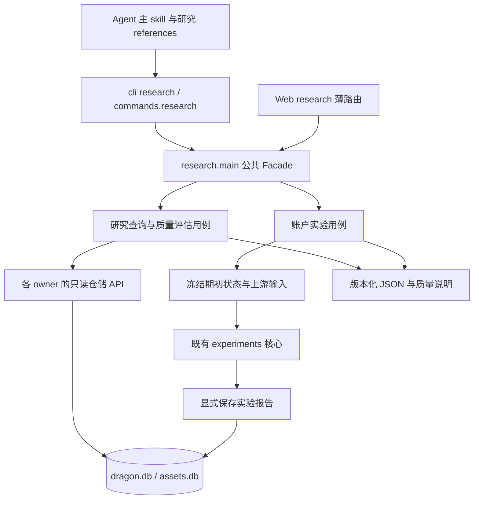
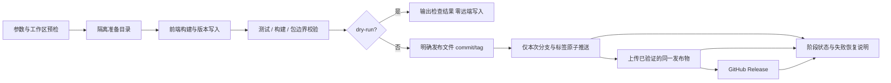

# Agent 研究能力与发布流程完善方案

日期：2026-11-06；owner：main；状态：阶段 3.5 终审通过，代码未提交、未发布。
基线：`8329cbc159d062c4cfa451e5284eea4cc784f51d`，工作区干净。

## 1. 目标、范围与非目标

用户希望 Agent 既能调用扫描、行情、复盘、盘前预案，也能读取历史证据帮助优化 scan 与 buy/sell。本次覆盖前一轮审查的全部问题，包含原标 P0/P1 的研究入口、两个发布脚本、文档漂移与行为验证。

保留日常助手已有行为、v2 口径、缺失不填零、成熟度与版本可比性约束。不修改生产评分算法、买卖规则、默认策略参数；不自动推广实验结论。不新增 v1 能力、任意 SQL、远程数据服务、付费依赖、自动安装依赖、调度、真实发布、提交、推送或 PR。不采集用户真实数据，不读取发布凭据内容，不执行真实库迁移。

版本决策：新增公共能力后 Python 目标版本 `0.9.0`；按用户指定，npm/skill 同步 `1.0.1`，skill 的 min-cli-version 为 `0.9.0`。只修改源码版本和 CHANGELOG，不创建发布物的远端版本。旧命令输出默认兼容；新命令独立采用版本化 JSON。

## 2. 已确认现状与选择

- `cli.py → commands.dispatch → feature` 是既有入口；`app.py` 只装配，provider 按动作惰性创建。research 全部使用本地存量，注册 needs_providers=False。
- `scan/storage/scans.py` 已有扫描日期、评分明细读取；账户 `storage.py` 已有批次、交易、持仓、事件和实验读写；assets 已有快照、因子及本地日K。
- `web_ui/backend/routers/research.py` 包含 scan-quality 编排及账户实验冻结/运行/保存；核心实验在 `review_account/experiments.py`。不能让新 CLI import Web/FastAPI。
- 默认 dragon.db 查询经 `_connect()` 会初始化 schema；assets 有 `_connect_readonly`。不能直接把既有写连接查询包装为严格只读。
- skill 已有九类能力和报告模板，但 factor 查询白名单只开放点查、研究依赖 UI。内容测试甚至禁止出现策略字段名，需改为禁止手写参数事实而非禁止消费运行时参数契约。
- `publish.sh:29` 把版本插入 Python 源码；已在临时目录复现代码执行。脚本先 git add/commit/tag/push 后 build/check，已用 fake commands 复现构建失败前 push。`publish-skill.sh` 临时 npmrc 基本正确，但无发布前门禁。
- 审查基线：skill Python 71 项通过；Node 首次 163 通过、3 项默认 cache EPERM，临时 cache 重跑 3 项通过；两个发布脚本语法通过。它们不是本次实现的通过证据。

取舍：候选 A 为 Agent 直接 SQL/HTTP 操作面板，开发量少但契约、权限与框架依赖散落；候选 B 为本地统一 research Facade 与共享研究用例。采用 B，代价是明确的数据集注册与只读适配，但 CLI/Web 可复用并能独立离线验证。保留一个 skill 加研究 references，避免为同一工具引入第二套安装生命周期。

## 3. 架构、放置与依赖

采用 Facade 收口跨模块研究能力，CLI/Web 两个消费者共享用例；Adapter 隔离已有仓储的返回形状与测试替身。数据集用小型显式注册表，简单分支直接实现，不引入插件框架或 DI 容器。



新增 `dragon_quant/research/`，公共入口 `main.py`，按用例分 `catalog.py`、`query.py`、`scan_quality.py`、`account.py`、`experiments.py`；实际职责可合并，禁止把所有逻辑堆在一个文件。扫描质量纯计算应从 Web presenter 移至领域研究模块，Web 留兼容转发或调用共享实现。账户实验从路由提取用例，核心算法仍归 `review_account`。纯展示函数可继续留在 Web。

SQL 与数据库字段映射留在存储 owner：允许在 `scan/storage/`、`review_account/`、`infra/assets/`、`infra/factor/` 新增窄只读函数/职责文件；research 不新建影子业务表，不绕过因子依赖边界。通用只读连接归 `infra/storage/`，不 import 研究或业务模块。既有写路径和公开连接行为不变。公共入口明确导出 catalog/schema/query/scan_quality/account/signals/snapshots/strategy/experiments 用例，避免导出内部 SQL。

根目录不增加新工具配置。`AGENTS.md` 不复制工作流或命令手册；仅在确需维护现有固定命令数量事实时最小纠正，以测试动态枚举为准。详细研究契约归 `docs/agent/development.md`，账户/因子/扫描差异各归其 owner 文档，不创建第二份路由索引。

## 4. Research CLI 契约

全部命令提供叶子 `-h` 与 `--json`；默认人读摘要，JSON stdout 只有一个完整对象，诊断走 stderr。research 默认离线，固定 source=v2，不接受 v1 参数。

共同 JSON envelope：`schema_version="research_v1"`、`ok`、`command`、`request`、`data`、`meta`、`warnings`、`error`。meta 包含 `source`、`data_quality`、可得的评分/策略/快照版本、`returned`、`truncated`、`next_cursor`；不可得的版本为 null 并说明原因。成功空集 exit 0 且有 empty_reason；缺库/缺表/不足样本是可解释降级 exit 0；非法参数 exit 2；损坏、I/O、无效 cursor 等真实故障用结构化错误且 exit 1/2，不混成空集。unknown dataset/field/filter 必须拒绝。

| CLI | 行为与关键参数 |
|---|---|
| `research datasets` | 数据集描述、字段契约版本、支持过滤器、日期范围、可用性；只有元信息，不返回敏感配置 |
| `research schema --dataset NAME` | 字段名、类型、单位/语义、可空性、关联键、可过滤/排序字段、来源与兼容说明；不输出任意 SQL/DDL |
| `research query --dataset NAME` | `--from --to --code --scan-id --run-id --fields --limit --cursor`；仅支持所选数据集声明的过滤器；limit 默认100、上限1000；稳定唯一排序，limit+1 探测，cursor 与过滤器/版本绑定；活动库并发变更的分页不冒充冻结快照 |
| `research scan-quality --from D --to D` | 全部已存评分候选、否决分组、成熟结果、排除原因、参考池与版本；复用现有质量算法，含样本账本分页，不伪称覆盖全市场 |
| `research account --run-id N` | `--view summary/snapshots/trades/positions/events`；默认summary，其他明细分页；费用、收益口径、期初状态、降级与版本可见；不触发回测 |
| `research signals` | `--from --to --code --status open/closed/all` 与分页；完整平仓/半仓腿、原因码、已存策略/血缘；不是实际券商成交；数据库没存过的诊断标 unavailable |
| `research snapshots --kind prep/auction` | 指定 `--date D` 或区间、`--code`、分页；读取已存快照与冻结时点，缺失不采集、不重算；大原始 payload 需明确字段选择 |
| `research strategy --kind scan/account` | 输出当前运行时评分器/参数/规则元信息及版本；可用 `--run-id` 读账户冻结配置；current 与 historical/unknown 分清，不用当前规则补历史 |
| `research experiments list/show/run` | list 指定 `--run-id`，show 指定 `--experiment-id`；run 必须 `--run-id N --confirm`，可重复 `--sell-rule NAME`，只接受已有消融规则；读取不重算 |

本期数据集至少覆盖：scan_runs、scan_candidates、dragons、review_strict、account_runs、account_snapshots、account_trades、account_positions、account_events、signals、prep_snapshots、auction_snapshots、factor_values、factor_registry、factor_build_runs、factor_models、experiments。复用逻辑避免 account/snapshots 与 query 重复 SQL。`datasets` 列出受支持数据及不可用原因；Cookie、token、云端凭据与任意系统表永不开放。

查询对动态字段/排序使用注册白名单，对值绑定参数。SQL 注入样例必须拒绝。日期支持项目既有归一规则并验证真实日期、区间前后序。run-id/code 等过滤器不能被静默忽略。

只读要求：缺目录/缺库时零 mkdir/DB/schema；现存库不执行 DDL、WAL 配置、checkpoint、业务写入或生成缓存/报告。mode=ro 不是忽略 WAL 的理由：复用/完善 owner 的只读 helper，URI 正确编码；有非空 WAL 不得用 immutable 丢弃已提交事务。无法在源文件无副作用条件下安全读取时返回明确 `readonly_unavailable`，不得降级成旧写连接。测试覆盖 checkpointed 库、活动 WAL、缺 sidecar、锁与旧 schema。跨库结果显式标注非原子读取；实验才声称输入冻结。

## 5. 研究算法与实验

scan-quality 与现有 Web 对相同 fixture 的候选选择、分母、成熟度、版本分组、指标数值一致。能解释“被否决的样本后续怎样”和“入选质量怎样”；机会质量不等于账户盈利率。权重/门槛重评分若没有原始字段支持，只能标不能精确重放，不在本期伪造新评分器回测。

账户 summary 复用既有 evaluation，输出真实交易/权益口径。信号查询读取历史记录，不运行 buy/sell 生成新记录。当前 sell 没有对称 JSON、review-account 缺机器结果的问题由 research 读回解决，不破坏其默认终端格式；skill 必须先取得真实 run_id 再读回，禁止猜测“最新记录必为本次”。若现有账户运行接口不返回 run_id，则增加兼容的 `review-account --json`（只增参数，人读默认不变）作为执行回执，返回本次 run_id/summary。

共享账户实验用例保持既有冻结期初状态、上游母集、因子/PIT、行情内容指纹；缺证据 fail-closed。train/validation/test 与双倍滑点压力复用既有逻辑，no_change 不能冒充消融改进。未知 sell-rule 报参数错误，不能静默跳过。Web 与 CLI 使用同一单飞入口；CLI 可与 Web 并发，须使用项目数据目录中的进程级互斥（仅实验 run 是写动作，list/show/query 不建锁文件），锁失败返回 busy；异常/进程退出能释放，不能只靠 Web threading.Lock 声称跨进程互斥。报告沿用既有 experiment 表，必要元信息进既有 JSON，不为本次增加业务表迁移。

## 6. Skill 与契约修复

保留主 skill，新增 `references/research.md`（研究问题→覆盖→样本→基线→实验→解释）与必要 `references/datasets.md` 导航，不把 SQL schema/参数值复制进 skill。description 增加策略优化、扫描诊断、归因、消融触发词；commands 唯一白名单与 safety 同步，不使用一条模糊 research 全权限路由。

开放已有 factor list/status/query 区间+code+version/export/eval/decision-review。list/status/query 为本地只读；export 写明确路径；eval/decision-review 可能触网且有数据缓存行为，要如实登记，不宣称纯离线。保留三组 build 限制，不自动扩大采集或默认策略变更。

T0/T1 按动作+参数+有效环境变量分级：普通 dashboard 查看 T0，显式/环境启用 bs-autogen 为 T1；纯查看默认传 --no-bs-autogen 避免继承环境造成写入，禁止自动安装 web。已有授权持续有效，用户明确要求扫描/保存文件本身即对应动作授权，信息足够不重复询问；只读 dashboard 不额外造批准门禁。复合请求不隐式增加写操作。

scan 时点统一为 skill 的产品规则：当日实时扫描只在15:00后执行；这是比当前CLI 09:00–15:00更严格的助手规则，明确区分，历史查询不受限，不修改扫描底层行为。`--force`/`--recompute` 的已有例外要按动作解释；只读历史快照不套采集时点。输出校验按 JSON/JSONL/human/url 四类分流，不能对人读日志强制 JSON.parse。

测试从“禁止一切研究名词/字段名”改为“禁止无依据维护参数数值/生成 SQL/凭据暴露”；保留字段来自运行时契约的约束。补可执行的路由/离线 fixture 任务验收，明确静态路由测试不能等同真实 LLM 行为评测。修 development 版本、授权持续性、能力边界等漂移，README 只简要说明新研究能力，帮助仍是完整命令真源。

## 7. 发布脚本



两个脚本可保留 shell 入口并以标准库 Python/Node helper 承担复杂编排；测试可注入 fake commands，生产路径不提供绕过验证的后门。无新增运行时依赖。

### PyPI

- 版本作为 argv/环境数据传入，不拼进 Python/sed/shell 源码；严格 x.y.z，缺值/重复/未知参数清晰错误。
- 统一解释器：显式 DQ_RELEASE_PYTHON 优先，其次仓库 .venv/bin/python；都不可用时给手动指引，绝不装系统依赖。`-m build`、`-m twine` 同解释器。
- 正常发布前检查干净工作区（含暂存）、分支/upstream/远端、目标本地/远端标签、CHANGELOG 非空段、工具与前端依赖、远端版本已存在；网络失败不能当“版本不存在”。默认发布当前有 upstream 的命名分支，不暗改 main 或绕过 CODEOWNERS。
- dry-run 无凭据、不连注册表、不提交/标签/推送/上传；在临时发布工作区准备目标版本、frontend dist、构建与校验，不改调用仓库版本或 dist。目录/依赖缺失明确失败，不能假通过。
- 真发布也先准备/验证，之后只把 pyproject.toml、_version.py、生成的 web_ui/dist 变更纳入发布提交，不 git add .，不带入其他 staged/untracked。固定已验证工件，禁止检查一份后重新构建上传另一份。构建失败前零 git mutation 和远端写入。
- 仅 `HEAD:当前分支` 与目标 vVERSION 标签推送，优先 git push --atomic；服务器不支持时失败并说明，不自动退化为全标签推送。
- 密码优先环境 DQ_PUBLISH_PASSWORD/隐藏输入，openssl 通过 env 或 fd 接收；token 优先 TWINE_PASSWORD/隐藏输入/已有加密文件解密，传 twine 使用子进程环境，不用 -p。旧 --passwd 参数明确拒绝并给替代指令（有意的安全兼容变更）。日志和错误不回显凭据；不改 encrypt_token.sh 与已存加密文件除非发现阻塞，届时 NEED_DECISION。
- 去除 BSD sed 依赖，版本编辑用解析后受限替换并验证只改期望位置；macOS/Linux shell 可用。
- 在发布状态目录保留不含凭据的阶段状态、目标commit/tag、工件SHA256、成功远端阶段。失败非零，清楚说明已经完成什么。提供明确 resume 入口验证状态、commit、工件哈希和远端事实，只继续未完成步骤；不重打标签、不自动 reset/删远端、不用 skip-existing 掩盖不同工件。若无法核验远端工件身份，停止要求人工处理，不猜测成功。临时凭据清理，失败恢复需要的非秘密工件不误删。

### npm skill

- 任意调用目录仍定位包根；只允许明确 npm publish 参数（dry-run/tag/access/otp 等按需），拒绝额外包路径、覆盖 registry/userconfig 和忽略门禁的参数。
- 发布前：Node/Python前置、package/skill/min-cli版本契约、skill Python内容/路由测试、Node测试、npm pack白名单与本地安装冒烟。测试与本地cache隔离；不能通过publish script递归调用自身造成测试死循环。
- dry-run 不要求token，不触网、不改长期npm配置；真正发布检查命名分支/干净工作区/版本存在，再隐藏读取token。认证遵循当前npm token/2FA机制，不承诺旧Automation token一定可用。
- 临时npmrc保持0600、umask保护、所有成功/失败/HUP/INT/TERM清理；TTY状态保存后精确恢复，仅真实TTY才stty，非TTY无token时给明确错误。
- 打包检查的同一tarball用于publish，避免TOCTOU；输出失败阶段与可重复执行说明，发布已存在不盲重试。

## 8. 切片、文件范围与回滚

一个阶段3执行会话，串行完成三个切片，避免共享cli.py/docs/测试注册表并发写入。切片A发布脚本+测试；B research/共享Web用例+存储适配+测试；C skill与文档/版本/覆盖映射+集成。每片验证通过再继续，不提交。最终报告列出可独立提交的文件分组，提醒用户发布修复与研究功能可分开提交。

允许范围：scripts/（不读写凭据/加密token内容）；test/；skills/dragon-quant/；lib/与bin/仅版本契约/安装校验必要变化；package.json；pyproject.toml；dragon_quant/_version.py；dragon_quant/cli.py、commands/、research/、infra/storage/、各相关仓储与review_account/实验用例；web_ui/backend/研究路由/依赖/presenters；dragon_quant/tests/；README.md、CHANGELOG.md、docs/agent/相关owner与本方案。前端UI不改；如Web契约必须改动前端类型则先证明兼容不可实现并NEED_DECISION。不进行全仓架构整理。

回滚按切片撤回源码变更；无新业务表/生产迁移。已有JSON/CLI默认输出保持兼容，Web endpoint名称/响应外形保持兼容。离线E2E旧golden原则不变，新命令只添加覆盖；只有已批准的新顶层help/版本变化可精确更新相关golden，不能批量重录。

## 9. KR 与验收映射

| KR | 可观察结果与失败条件 | 必需证据 |
|---|---|---|
| KR1 发布安全 | 版本注入拒绝；build/test失败前无git变更/远端写；不夹带文件/标签；凭据不进argv/log；dry-run零远端副作用 | fake command集成测试、成功/失败/信号矩阵、argv与临时文件检查、恢复测试 |
| KR2 数据发现与查询 | 上述全部数据集可发现/解释/分页过滤；非法参数拒绝；缺失/损坏区分 | CLI子进程fixtures、完整schema/过滤矩阵、注入与cursor测试 |
| KR3 严格只读 | help/import/研究读取不建目录/DB/schema/cache/报告；不触网；WAL不丢事务 | 文件哨兵、sqlite trace/只读失败测试、socket/provider禁用、WAL fixtures |
| KR4 研究结果一致 | 同fixture CLI/Web scan-quality与账户指标一致；真实分母/成熟度/版本可见；快照与信号不重算 | parity/integration测试与代表JSON |
| KR5 实验可复现 | list/show无写；run需confirm；冻结输入与期初状态；CLI/Web互斥；错误不持久化伪报告 | 冻结/污染/不足数据/两进程并发/锁释放/基线no_change测试 |
| KR6 skill可用 | 日常九类保持可用，研究意图路由可执行；有效授权不重复问；dashboard有效写动作正确分级；输出分类型校验 | 内容/路由/行为fixtures、human与JSON差异、BS环境矩阵 |
| KR7 分发兼容 | 版本声明一致，npm/wheel/sdist包含运行必须文件且不含测试/docs/凭据；旧命令默认兼容 | pack/install与Python包检查、覆盖映射/harness检查、owner文档同步 |

必须运行并记录真实结果：

```bash
.venv/bin/python dragon_quant/tests/e2e/harness/runner.py --self-check
.venv/bin/python -m pytest dragon_quant/tests/e2e/test_harness_safety.py dragon_quant/tests/e2e/test_architecture_rules.py -q
.venv/bin/python -m pytest dragon_quant/tests/e2e -q
.venv/bin/python -m pytest dragon_quant/tests -q --ignore=dragon_quant/tests/e2e --ignore=dragon_quant/tests/smoke
npm test
bash -n scripts/publish.sh
sh -n scripts/publish-skill.sh
```

npm使用临时cache；所有新业务命令只在隔离DQ_DATA_DIR/HOME/临时时钟/provider下运行，不能触及真实库。额外跑research与release目标测试、Python构建产物检查；build依赖缺失则记录缺口，不安装/伪造。新命令必须同步coverage-map与parser计数相关断言。大型结构调整后刷新codebase-memory（工具可用才执行，不能伪称刷新）。本任务不做真实LLM跨宿主评估，报告区分fixture验收与真实Agent评测。

## 10. 交接与主会话验收

Claude Code按该方案实现并独立完成自测/自审；核心方向变化、兼容破坏、无法安全读取WAL、需要真实凭据/网络业务写入等先NEED_DECISION，不自行缩减范围。报告包含每条KR→文件/函数→测试证据、known_issues、deviations、main_acceptance；未实现项不能藏在“后续建议”。用户attach指令优先并登记偏离。main收到回调后做一次验收与独立关键验证；复杂公共数据/发布边界另安排干净会话只读审查。

方案自查：目标/前轮问题覆盖PASS；CLI/Web依赖与owner SQL边界PASS；无迁移与外部写入PASS；异常/WAL/并发验收PASS；真实token机制与跨平台实机为UNKNOWN，须保留验证限制。

官方契约核查（2026-11-06）：Python sqlite3 URI与参数绑定 https://docs.python.org/3/library/sqlite3.html ；npm publish/dry-run https://docs.npmjs.com/cli/v11/commands/npm-publish/ ；Twine构建后上传与认证配置 https://twine.readthedocs.io/en/stable/ 。实现须兼容项目Python>=3.10，不能使用新版本独有API。

## 11. Main 单次验收（2026-11-06）与实现回写

Main 对首轮实现给出 NEEDS_CHANGES（A1–A11 / S1–S2），并保留首轮实现选择：shell 薄壳 + 标准库 Python 发布 helper、research Facade、owner 窄 SQL、Web 兼容转发、独立只读连接点、coverage 70/19、版本 0.9.0 / 1.0.1。以下为本次返工后的实现事实（不把未满足项写成已满足）：

- **A1 单位**：`research/catalog.py` 的 9 个收益/回撤/胜率字段统一为「百分比点（1.0 = 1%）」，与 simulator / engine 的 `*100` 生产计算一致；新增单位集合断言与代表值 fixture，不改数据值与生产算法。
- **A2 严格只读**：`open_readonly` 在连接前判断 sidecar：非空 WAL 且无 `-shm` 直接 `readonly_unavailable`（不创建 SHM）；有 `-shm` 才 `mode=ro`；无 WAL/SHM 才 `immutable=1`。测试覆盖零 sidecar、非空 WAL 无 SHM、现有 SHM、checkpointed、损坏/旧结构分支，断言文件集合 / db+WAL 字节不变。
- **A3 精确过滤与 v2**：prep `--code` 只认 `candidates[].code` / `review_candidates[].code` / `strategy_context.positions[].code`；未知旧结构返回 `code_filter_unsupported`，不做金额/文本/指数命中。prep/auction/账户/信号/experiments 固定 v2（账户子表经父 run、实验经 base run）；`factor_values.source` 保留业务来源，不按 v2 过滤。17 数据集参数化行级 fixture 覆盖过滤、分页不漏不重与混合 v1/v2。
- **A4 发布恢复**：状态绑定 repo 真实路径、base/release commit、branch、upstream（必须为 `origin/<current branch>`）、origin push URL 的 SHA-256 指纹、tag、工件 SHA256、模式与阶段；旧状态缺 upstream/指纹即 fail-closed，不补写当前值。`--resume` 在任何 state save / mutation 前校验记录 upstream、push 目标指纹、HEAD/branch、本地 tag、远端 branch 与 tag（含 annotated peeled target）以及工件哈希；upstream 或 push 目标变化明确非零且不覆盖原记录；push 使用记录的 release commit。非 `--resume` 遇既有状态拒绝；dry-run 使用独立状态目录。上传恢复按注册表文件名+sha256 核验，只上传明确缺失且同身份的文件；不完整/不一致即停止；gh 缺失保持 pending 可恢复。
- **A5 发布门禁与文件替换**：staging 内先跑必要测试（架构规则 / Skill 包 / research facade），失败前零 git 变更；构建使用 `--no-isolation`（缺后端给指引，不联网安装）。npm 预检/测试/pack/本地安装链在 dry-run 全部 `npm_config_offline=true`，真实 registry 查询与发布显式关闭。`commit_release` 先准备完整 dist 再带备份切换，失败回滚版本文件与 dist，并在 mutation 前复核工作区/暂存区。
- **A6 npm 参数**：`--tag` 仅允许 `[A-Za-z0-9._-]`，`--access` 仅 public/restricted；发布 argv 逐项位置参数传入，不做字符串分词/通配符展开；dry-run 与真发布同参数。移除 `--otp` 参数（改用 `NPM_OTP` 环境变量并如实说明调用者环境可见性）；允许有 upstream 的 main 分支；SIGTERM/失败路径清理临时 npmrc 并保留 0600 断言。
- **A7 错误分流**：query 与 account/experiments/strategy 专用入口共用 `read_with_status`，统一 `database_missing` / `table_missing` / `schema_mismatch` / `run_not_found` 等；损坏 JSON 行标 `_corrupt`，输出 `data_quality=degraded` 与 `corrupt_json_fields`，不把损坏当空对象或可用冻结策略。
- **A8 人读与截断**：account 人读使用真实 `run.run_id`；experiments 按子动作分派人读；list 使用 limit+1 / `truncated` / `next_cursor` 且默认省略大 `report`，show 返回完整报告；account 账本达到上限标 `ledger_truncated` 且不宣称完整指标。
- **A9 集成证据**：17 数据集真实行级矩阵；HTTP `/api/research/scan-quality` 与真实 CLI 在同一 fixture 比对完全一致；实验冻结失败/行情截断/保存异常均释放锁且不落成功报告；Web 在 CLI 持有进程锁时返回 409。
- **A10 Skill 契约**：测试从「禁止一切策略字段名」改为「允许引用运行时字段名、禁止手写参数数值」；datasets/research reference 更新精确过滤、v2、单位、空态、大字段与授权；architecture/development 索引同步。
- **A11 分发与静态检查**：真实 `python -m build --no-isolation` 测试正向断言 wheel/sdist 含 research 与 web_ui/dist 且不含 tests/docs/凭据；本次新增代码 ruff E/F 清零；旧 CLI 默认格式与 Web 响应形状保持。

**保留限制（未实测）**：twine 未安装，真实 `twine check` 未执行（release helper 的 twine 调用由 fake-command 测试覆盖，wheel/sdist 真实构建验证）；未做真实 PyPI/npm/gh 发布或读取凭据；未做真实 LLM 跨宿主行为评测；Windows/非 POSIX 进程锁与 shell 未实测；真实 registry 上传部分成功的远端核验仅以 fake 注册表元数据验证。

## 12. Main 阶段 3.5 终审记录（2026-11-06）

结论：A1–A11 必改项已核对实现、delta 自审和验证证据，S1/S2 已采纳；无未解决阻断项。独立只读审查发现的问题由原执行会话修复，main 独立复验原始失败场景，而非只采信作者报告。执行期间的 interventions 均为后台测试完成通知，无用户需求改向。

- main 独立运行研究/发布/Skill 目标测试：168 passed；npm 发布测试：10 passed。真实 HTTP 与 CLI 子进程扫描质量结果一致；WAL 无 SHM 的读取拒绝且源文件不变；快照精确股票过滤排除金额假阳性与 v1。
- A4 定点修复后，main 再运行发布目标测试：26 passed；相关 ruff E/F 通过。原始临时仓库复现现在 upstream 改变即 exit 1，原身份记录保留；同一身份的正常恢复由目标测试覆盖。此轮只涉及发布身份元数据，未重复业务全量测试。
- 执行者集成证据：3217 单元测试通过、2 skipped、1570 subtests；359 离线 E2E 通过；174 Node 测试通过；harness 自检与架构门禁通过；wheel/sdist 真实构建及内容检查通过。上述集成结果对应发布身份定点修复之前，其后变化由 26 项发布测试覆盖。
- 接受已披露的非阻断限制：staging 发布门禁为必要测试子集；OS 级 copy/rename 故障未注入；真实 twine/注册表/Windows/LLM 验证边界如上，不宣称已测。
- 代码导航索引刷新尝试返回 `Transport closed`，本次索引未刷新；功能验证不依赖索引。未修改全局工具配置。
- 未进行真实凭据读取、生产库操作、commit/push/tag/发布。方案继续保留在开发期目录；未收到合入/PR/归档指令。
