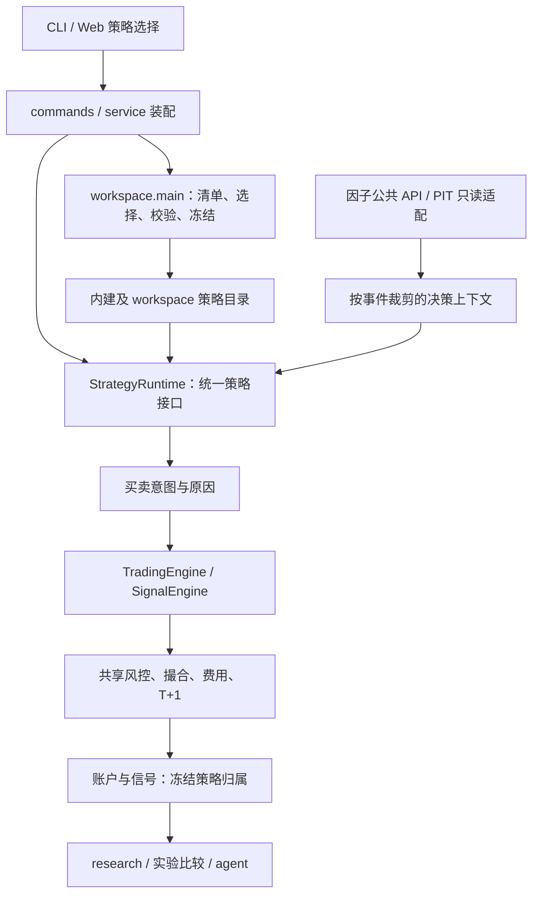

# dragon-quant：Workspace 与可选 BS 策略方案

日期：2026-11-11。状态：M1–M4 已实现；两轮集中返工后的关键结果已由 main 独立验证（验收记录见文末）。基线：feat/custom-factor @ 835e809b395590f690832180f279741b4a9aaee9。

## 1. 需求依据与交付目标

主要依据是本次用户描述，https://github.com/gitBingxu/dragon-quant/issues/41 仅作次要参考。目标：用户仅安装 PyPI 包即可在自己的 workspace 中编写 Python 策略，复用内建或自定义因子，通过 dragon-quant 的界面选择内建/用户策略，并在 buy、sell、review-account 生效；agent 能根据配套 skill 自主完成有证据的策略探索。

用户确认（2026-11-11）：“有问题按照你推荐的来”，并强调“在 web_ui 上和 cli 上都给用户留切换策略的口子”。因此首版固定为本地编辑 Python、Web 选择/配置/回测；Web 代码编辑器不在首版范围。普通技术决策由 main 处理，无需重复询问。

首版不包含策略市场、云端分发、自动券商交易、通用事件总线、表达式 DSL、自动安装策略依赖、自动把实验赢家设为活动策略。保持当前候选池来源和五维扫描基线；新策略首先针对既有候选池开展 BS 决策，不顺带开放全市场选股/扫描评分覆盖。

## 2. 已核对的事实

- `infra/factor/types.py` 已有 FactorSpec、FactorContext、FactorFrame；`registry.py` 当前从 builtin 构建模块级 FACTOR_SPECS/_BY_NAME，并提供重名/依赖/枚举验证。
- `infra/factor/decision.py::FactorModel` 是候选池打分协议，EqualWeightRankModel 为已有实现。其边界明确不加过滤、不加否决。因此，开放它只能扩展排序，不能直接等同于完整 BS 策略替换。
- `review_account/engine.py::TradingEngine` 和 `live_trade/signal_engine.py::SignalEngine` 使用共享 strategy 规则及 execution 成交设施；目前调用点绑定内建规则。
- `review_account/models.py::StrategyConfig` 有 strategy_name 和固定买卖规则名，但名字本身不负责动态加载策略实现。
- `review_account/service.py` 已冻结参数并支持增量回测；`storage.py` 已存 run_meta 与入场信号 JSON。`live_trade/storage.py` 当前按 code/source 查询未平仓记录，没有独立策略归属字段。
- 现有 `research`、`factor eval` 和账户 experiments 能复用。实验已有冻结输入、时间切分、双倍滑点、试验次数账本与证据不足语义。
- `pyproject.toml` 要求 Python>=3.10；wheel 当前只声明 web_ui/dist 资源。仓库 `skills/dragon-quant` 通过另一路安装机制分发，不能假定只装 PyPI 就能读取仓库 docs 或 skills。

以上结论来自当前 feat/custom-factor 分支的只读检查，工作树检查时干净。issue 的“已完成 90%”及行数估算不作为排期或完成度依据。

## 3. 核心取舍

候选 A：仅开放 FactorModel 与参数预设。实现成本较小，但无法表达新的入场/退出规则，不满足用户完整 BS 模型诉求。

候选 B（推荐）：workspace + 稳定策略 SDK + 统一策略装配 + 原有执行引擎。策略可返回买入/退出意图、解释、排序建议和可选目标仓位，成交/费用/时序/账户约束仍由系统处理。

候选 C：任意 hook/事件总线，允许策略替换整个引擎。扩展面过大，容易令回测与实盘辅助分叉，首版不采用。

采用 Strategy 模式隔离不同 BS 算法；Adapter 模式把现有内建规则包装成相同接口；Registry/Factory 负责通过策略 ID 和冻结版本装配实现。保留内建卖出规则现有责任链，不为了插件化重写每条规则。这里确有内建/用户两类实现，不另建泛化插件总线。

## 4. 用户体验与 workspace

拟新增命令（均为待实现设计，并非当前可用命令）：

```bash
dragon-quant workspace init /path/to/my-workspace
dragon-quant workspace check --workspace /path/to/my-workspace
dragon-quant strategy list --workspace /path/to/my-workspace --json
dragon-quant strategy validate user:strategy_1 --workspace /path/to/my-workspace
dragon-quant buy --workspace /path/to/my-workspace --strategy user:strategy_1
dragon-quant sell --workspace /path/to/my-workspace
dragon-quant review-account --workspace /path/to/my-workspace --strategy user:strategy_1 --from YYYYMMDD --to YYYYMMDD
```

workspace 独立于 site-packages，显式初始化才创建。目录包含 workspace.json（元信息/策略目录/当前选择）、strategies/、可选 factors/、共享 helpers/、snapshots/、experiments/、面向 agent 的入口说明与示例。为兼容 Python 3.10，首选现有标准库 JSON，避免单为 TOML 配置引入依赖。

路径解析：显式 --workspace > DQ_WORKSPACE 路径 > 已由本机显式配置的活动 workspace；不扫描任意当前目录并导入其中代码。init 默认不覆盖已有文件。升级 PyPI 包保留所有用户源码；SDK 不兼容给出迁移诊断。

策略有稳定 ID（如 builtin:dragon_pullback_daily、user:strategy_1）、显示名称、说明、SDK 版本、参数 schema、所需因子及适用数据级别。内建策略目录只显示实际存在的实现，不虚构多个“系统策略”。用户可基于内建策略创建不同参数预设，也可编写新的 Python BS 实现。

Web 增加「策略」入口：区分内建/用户；显示校验状态、当前选择、参数、源码指纹、因子覆盖、最近回测摘要。提供「用于新开仓」「按此策略新建回测」，回测表单也有策略选择。页面默认只读；选择并保存是显式操作。

当前选择须持久化到 CLI 与 Web 共读配置，不只存浏览器 localStorage。每次任务启动时解析并冻结一次选择，运行中的任务不被后续界面切换影响。参数优先级：内建默认 < 策略预设 < workspace 保存值 < 本次显式参数；历史重放/增量始终使用冻结值，不叠加当前默认。

## 5. 结构、导航与公开契约



新增 `dragon_quant/workspace/` 承担独立生命周期（发现、配置、加载、快照），`workspace/main.py` 为公共门面；新增轻量 `dragon_quant/strategy_sdk/` 作为用户唯一导入入口。SDK 放协议与纯数据类型，不 import Web、commands 或 workspace 装载器。

`review_account/strategy/runtime.py` 负责业务策略适配/装配；现有 buy/sell 模块继续作为内建实现。CLI 路径为 cli → commands → workspace.main/账户 service → runtime → 内建或用户实现；Web 路由复用相同用例，不复制加载/参数合并规则。

SDK 最小协议拟包含：descriptor、evaluate_entry(context)、evaluate_exit(context)、explain(context)；池级可选排名仍经现有 priority.rank_key 单注入点消费。入场/退出返回结构化 Intent（动作、原因码、原因文本、目标比例/退出比例、使用因子及值、诊断），不直接写库、不提交订单、不返回自行“成交”的价格。API 细节在执行前的方案完善节点定稿。

Context 为只读快照：事件时间/phase、候选、截至该时点可见行情、持仓与账户状态、声明过的因子读取结果。引擎对返回值做有限数值、合法动作、数量/比例范围等校验。对任意 Python 的只读约定不宣称是安全沙箱。

因子数据经公共 API 注入，不让策略直连 SQLite 或调用 provider；`infra/factor` 不反向 import workspace/SDK/review_account。workspace 装配得到完整且不可变的因子注册表，显式传入因子用例，避免运行时改全局常量导致不同 workspace 相互污染。内建 registry 保留原有默认行为。

## 6. 因子与时点语义

首版支持复用全部已注册且可用的内建因子，以及沿用 FactorSpec/FactorContext/FactorFrame 的用户因子；用户因子复用 assets.db 已有带版本长表，不另造影子数据库。不同 workspace 的用户因子使用稳定命名空间，禁止静默覆盖内建/其他用户定义。全表校验后一次接受，不部分注册；增加依赖环检测。

因子读取强制 available_at <= 当前决策时点，候选类因子继续按候选自身入选日期取值；持仓类/当日已完成行情须另声明 as-of 读取规则，不能一律用候选日期替代。缺失与未来不可用都不能补零；返回明确 missing/unavailable 原因。策略声明必要因子及缺失策略，默认该候选不产生新开仓信号。盘后因子不能用于当日上午回测。

不改变现有 factor_ranking_enabled 关闭/降级时的兼容行为；自定义完整 BS 策略无效或抛错时不能偷偷换成内建策略继续写信号。策略异常须在写入前失败并保留现有账本，具体错误带策略 ID/版本；返回 no_signal 与执行失败必须区分。

## 7. 持仓归属、版本与复现

推荐行为：活动策略改变只影响新开仓；旧持仓绑定开仓时的策略快照，sell 按持仓归属装配退出逻辑。多版本持仓共存时逐组评估；仍共享一个账户，按现有 code/source 防重复开仓，不把同一只股票变成多份虚拟持仓。明确指定策略不能隐式接管其他策略持仓。

旧记录按 legacy builtin 身份兼容解释，不伪造不可知的历史源码版本；缺少足够证据时标不可复现，禁止增量续算冒用当前实现。若将来要接管持仓，单独设计显式迁移，首版不提供自动迁移。

run 和 entry_signal 增加版本化 strategy_ref：策略 ID、SDK 版本、源码包哈希、参数哈希、依赖因子版本、运行环境、快照位置。通过既有 JSON 字段增量存储，避免不必要的列迁移；持仓归属和增量路径必须贯通，不能只在结果页增加名字。

快照应覆盖策略及其 workspace helpers/自定义因子等本地代码，而不只是某个方法 inspect.getsource。记录 Python、dragon-quant 与声明依赖的版本，以及实际使用的因子版本/数据输入引用；未知外部依赖明确降低复现等级。读取历史结果不执行历史源码；再次运行快照属于显式本地执行，校验内容哈希/SDK/环境后使用。

新回测冻结本次策略；增量回测沿用原 run 冻结策略/参数/因子版本。源码/依赖不兼容、快照缺失时明确拒绝续算，允许查看已有结果，不能换用当前源码。单有源码哈希不承诺完全复现：还需要数据、环境及训练状态可得。

## 8. 本地代码加载与 Web 边界

策略 Python 是用户明确配置的可信本地代码。策略清单由声明元数据读取，不在 GET/list/-h/普通 import 时导入用户模块；validate、回测、buy/sell 才在执行路径加载。目录限制、真实路径校验、禁止任意请求路径加载、哈希比对防止选中版本与执行版本不同。

Web 复用现有显式作业/Origin/锁机制；自定义策略由独立本地工作进程执行，含超时、取消、日志和并发隔离，不能把“子进程”或“本机”称为安全沙箱。workspace 执行能力只对明确启用的本地控制端开放；远程可达 dashboard 不自动获得执行本地 Python 的权限。新增远程授权体系不在首版范围。

若用户要求首版 Web 编辑器，需要补充代码保存/版本冲突/路径校验/编辑权限与执行授权的完整范围；不能把它当成一个 textarea 小改动。

## 9. Agent 的探索闭环与分发

扩展现有 `skills/dragon-quant` 入口，增加 workspace/策略开发 reference，并给 workspace 初始化生成可导航说明。skill 与最小示例须可由发布物获得；新增 wheel 内 SDK 示例/说明资源，通过 importlib.resources 读取，不依赖开发仓库 docs。现有 npm/skills 安装入口同步更新，保持 CLI 兼容版本契约。

agent 工作流：发现 CLI/SDK 能力 → 检查数据与因子覆盖 → 冻结内建/用户基线 → 写可证伪假设 → 创建独立策略候选 → validate → 同输入回测 → 时间切分与成本压力 → 因子/规则消融及交易归因 → 保存代码、参数、数据引用、trial_count、报告 → 给出推荐或证据不足。用户已授权的实验范围内可自主迭代，不能每次小实验都重新问许可。

agent 不复制评分规则常数、不直接 SQL、不改 site-packages、不将缺失填零、不用同一测试集无限调参；采用可配置的试验预算/停止条件。线性模型可输出因子贡献，非线性策略输出可追溯决策证据/消融，不强迫虚构可加和贡献。

研究自主探索与启用交易策略分离：实验成功不会自动改活动策略，也不会写入买卖记账；用户明确选择后才应用。报告至少包括收益/回撤/交易数/费用与滑点/覆盖与降级/样本外结果/相对基线/失败原因，不能只追求单一胜率。

## 10. 工作包与验收 KR

先完善单一技术方案并完成接口/自审，再通过本机 Bridge 分包实施；main 保留产品方向和终审。共享 SDK/持仓归属契约先完成，后续包顺序依赖，避免多处各自定义策略结构。

| 包 | 范围 | 可观察验收 |
|---|---|---|
| M1 基础工作区 | workspace、strategy_sdk、CLI、wheel 示例/资源 | KR1：干净 venv 只安装 wheel，不 clone，init 后能编写并验证两份用户策略；升级包不覆盖文件。KR2：内建+两份用户策略可列出，重名/环/不兼容/非法输出有明确失败。 |
| M2 执行接入 | engine、signal_engine、service、simulator、priority、信号/回测 JSON | KR3：同事件流两引擎产出一致决策，保留既有成交差异声明。KR4：策略能实际改变入场/退出，T+1/下一可成交事件/费用/涨跌停/仓位约束不能绕开。KR5：换策略不接管旧仓，混合归属 sell 正确，重复运行不重复记账。 |
| M3 冻结与研究 | snapshots、增量、research、experiments | KR6：修改策略/helper/因子后，新运行版本变化，旧 run 展示不变；增量使用旧快照，缺快照/环境不兼容明确拒绝。KR7：未来因子不可读，缺失不补零，不同 workspace 不串注册表。 |
| M4 UI 与 agent | Web API、frontend、dist、skill 及 owner docs | KR8：界面选择/保存后新 CLI buy 与新回测使用同一策略；显式参数覆盖，旧持仓/运行中作业不受影响。KR9：agent 从发布物说明完成创建→验证→比较→报告，证据不足如实返回，未获启用指令不切换默认策略。 |

最终集成包含隔离 fixture 的 Web 真交互，以及纯 wheel 消费环境冒烟，不能用源码 editable 安装替代 PyPI 场景。实际 PyPI 发布不在本轮授权范围。

## 11. 验证与文档同步

实施时新增必要契约/集成/E2E 用例覆盖上述 KR，更新 parser coverage-map 与计数。测试一律使用独立 DQ_DATA_DIR/HOME、fake provider、网络阻断，不打开真实账户库、不跑真实 buy/sell。计划命令：

```bash
.venv/bin/python dragon_quant/tests/e2e/harness/runner.py --self-check
.venv/bin/python -m pytest dragon_quant/tests/e2e/test_harness_safety.py dragon_quant/tests/e2e/test_architecture_rules.py -q
.venv/bin/python -m pytest dragon_quant/tests -q --ignore=dragon_quant/tests/e2e --ignore=dragon_quant/tests/smoke
.venv/bin/python -m pytest dragon_quant/tests/e2e -q
npm test
npm --prefix web_ui/frontend run build
```

纯 wheel 冒烟在临时 venv 安装本地构建 wheel，隔离数据源，验证资源/CLI/SDK/两份策略可用；具体构建命令沿用项目发布设施。以上均为待执行检查，不是通过证据。

同批更新 README、trading.md、factor.md、development.md，以及内建规则边界需要同步的 STRATEGY.md；新增 workspace owner 文档时仅在根唯一索引登记，是否新增跨模块硬约束再决定根约束 delta。保留已有归档策略文档与实现的一致性。开发方案是否归档在完成并准备合入/PR 时再询问。

## 12. 方案完善前待确定

用户已授权推荐方案及两端切换；以下执行契约固定接口和行为，覆盖上文的拟议项。实现者可调整局部文件拆分，但改变产品语义须先交 main 决策。

## 13. 已定执行契约（优先于上文拟议项）

### 13.1 选择、配置与命令

- CLI 新增 `workspace init PATH`、`workspace check`；新增 `strategy list`、`strategy current`、`strategy use ID`、`strategy validate ID`，均支持 `--workspace PATH`，查询/验证支持 `--json`。`strategy use ID` 是持久切换口，不能只提供单次 `--strategy`。
- `workspace init PATH` 初始化并登记为本机活动 workspace；已有目录内容不覆盖。登记文件是 `DQ_DATA_DIR/workspace-selection.json`，只在显式 init/use 创建；原子写入加跨进程互斥、失败保留原文件。`workspace.json` 包含 schema_version=1、稳定 workspace_id、策略清单、selected_strategy_id 和参数覆盖。修改选择使用内容 revision 校验，Web 冲突返回 409，CLI 冲突返回可操作错误。
- 明确路径选择顺序：`--workspace` > `DQ_WORKSPACE`（路径）> 本机登记；都未配置时使用内建策略且不创建 workspace。临时 `--workspace` 不改本机登记；`strategy use ... --workspace PATH` 切换该 workspace 的选择且登记为本机活动，保证随后的无参数 CLI 与 Web 一致。Web 服务启动时可固定 workspace，以固定路径为准并在页面显示，不能悄悄忽略用户 CLI 的路径选择。
- `buy / sell / review-account` 增加 `--workspace`、`--strategy`。buy/新 review-account：显式 strategy > 已保存选择 > 内建默认。sell：按持仓冻结版本路由；`--strategy ID` 仅筛选该归属的持仓，不能用来替换退出规则。默认 sell 评估全部已有归属，活动策略改变不漏掉旧仓。
- 每次 buy/new review-account 的人读输出与 JSON 都展示实际 strategy_id、版本/快照 ID、workspace_id；sell 逐持仓展示所属策略并说明筛选结果。现有 JSON 字段保持兼容，新增元信息；sell 可补 `--json` 便于验证与 agent 消费。
- ID 与显示名分离；内建 canonical ID=`builtin:dragon_pullback_daily`。用户策略在 workspace 中 `user:<slug>`，跨 workspace 的持久身份同时包含 workspace_id。参数预设可以引用内建实现，不能覆盖内建 ID。

### 13.2 用户代码与 SDK

- 每份策略放 `strategies/<slug>/strategy.json` 与 `strategy.py`；JSON 声明 id、label、description、sdk_version=1、entrypoint（相对 strategy.py 的工厂符号，默认 create_strategy）、parameters、required_factors、data_requirements。workspace 清单显式列相对 descriptor 路径，不递归扫描/导入任意 Python；helpers 放 workspace/helpers。模板至少有两个展示不同决策逻辑的示例，并说明只是 API 演示，无有效性宣称。
- SDK 公共出口：`StrategyContext`、`StrategyIntent`、`FactorValue`、`Strategy` 协议，以及用户因子所需 FactorSpec/FactorContext/FactorFrame 的兼容导出。工厂 `create_strategy(params: Mapping[str, object]) -> Strategy`；协议 `evaluate_entry(ctx) -> StrategyIntent | None`、`evaluate_exit(ctx) -> StrategyIntent | None`，可选 `explain(ctx) -> sequence[Mapping]`。核心必需接口固定，不追加任意生命周期 hook。
- Context 是深度只读、每次事件重新构造的数据：timestamp（既有毫秒时戳）、trade_date、phase、candidate、row、position（无仓为 None）、account、parameters、factors。所有当前事件之后的日K/分时和当日最终 OHLC 不得进入用户 Context；不能只用 MappingProxyType 包最外层。可选 explain 同样只能接收相同数据。
- Intent 字段：action（buy/sell）、reason_code（用户策略稳定命名空间）、reason_text、priority（有限数值）、position_pct（买入可选 0<值<=100）、exit_fraction（卖出仅 0.5 或 1，匹配当前半仓模型）、evidence（JSON 可序列化）。None=no_signal；方向错误、NaN/Infinity、越界、未知输出字段不能作为正常无信号吞掉。第一版不承诺任意比例的多次分批退出。
- FactorValue 含 value（缺失为 None）、version、available_at、status/reason；必要因子缺失默认跳过开仓，解释缺失项。退出的缺失处理须显式声明，默认不产生自定义退出信号并告警；不能自动切内建退出。用户策略不得写库/调用 provider 是公开开发约定，不宣称任意 Python 被技术沙箱限制。
- 内建适配器保持现有诊断 checks/原因码、优先级、所有默认参数与 golden 行为；自定义策略不先经过四个内建形态规则才能买入。系统候选资格、共享风控、行情可执行性、T+1/手数/现金/费用/下一事件成交检查仍保留。
- 用户 priority 只通过现有 priority 模块规范化并供 rank_key 消费，不另起排序器。position_pct 是建议上限，仍受共享仓位上限/现金/风险预算限制；不让返回值直接修改 state。调用用户代码不得污染 pending/峰值/持仓对象。

### 13.3 因子注册与存储

- workspace.json 的 factors 为显式相对模块路径，模块 `SPECS` 提供用户 FactorSpec；只在显式执行用例导入。workspace 层构造不可变 registry，infra.factor 新增可选 registry/specs 参数，默认内建路径完全兼容。factor list/status/build/query/eval 的相关 CLI 增加 --workspace 接入，使用户因子有完整 build→query→eval 路径，不能只有 SDK 能声明却无法计算入库。
- 注册名使用 `ws_<workspace_id短标识>.<local_name>`（完整 workspace_id 同时进入快照；检测截断碰撞）。用户因子依赖可以指向内建或同 workspace 因子；重复、悬空、循环整体拒绝。计算次序拓扑排序，保持已有同级稳定顺序。
- 用户因子的版本至少纳入规范化 spec、所在模块和 workspace helper 内容哈希；不只对 compute 方法取源码，helpers 修改必须产生新版本。用户代码取不到源码不可静默退化 impl_key；提供清楚错误，不改内建历史版本算法。
- 沿用 assets.db 的因子存储和缺失语义；只读因子视图复用 factor 仓储 API，日期/available_at 用统一时区解析。所需因子和版本在 run 开始固定，禁止任务中取 latest。

### 13.4 冻结与兼容

- 新策略运行在首次执行前冻结 descriptor、有效参数、策略源码与其 workspace helpers/用户因子源码到 `snapshots/<sha256>/`，写完校验后原子发布；禁止快照路径遍历/逃逸/不受控软链。查阅历史仅验证 JSON，不导入代码。保存运行环境版本，不自动 pip 安装。
- `strategy_ref` schema_version=1，包括 strategy_id、workspace_id、snapshot_id、params、params_hash、factor_versions、sdk_version、toolkit_version、python_version、dependency_versions、reproducibility 状态。完整引用冻结到 run_meta 和每笔入场 entry_signal，在恢复 Position、影子状态、半仓腿、出场输出路径保留。
- 新的内建运行也冻结身份和参数；内建实现版本可以用明确工具版本/实现指纹识别。内建代码版本不一致时增量拒绝，并提示用匹配版本环境；不要求把整个 dragon-quant 源码复制进 workspace。无 workspace 的内建运行不创建 workspace。
- 旧持仓无 strategy_ref 时继续走 legacy 内建兼容路径，明确版本不可知，避免让升级后 sell 无法处理旧仓。旧回测可查看；旧 run 缺少可证明的实现版本不能伪造同版本复现。对既有增量兼容：原来已冻结足够版本证据的内建 run 可沿用，证据不足明确拒绝并给中文原因。
- 同一命令内先完成全部策略解析/运行/结果校验，再写信号；异常整体不新增/平仓信号、不持久化峰值副作用，不留下半条 run。多个持仓归属共享账户和已卖出/仓位闸门，不对每个策略复制账户资金。临时策略选择不会绕开同 code/source 未平仓幂等。

### 13.5 Web 与 worker

- 增加 `/strategies` 页面并在导航中可达；账户新回测表单必须有策略下拉。`GET /api/strategies` 返回清单、有效当前选择、workspace、revision 和静态校验状态，`GET /api/strategies/current` 返回当前选择；`POST /api/strategies/selection` 接收 strategy_id、parameters、expected_revision，原子保存，冲突409/错误400。不能从请求接受任意宿主绝对路径或 Python 源码。
- 写接口沿用应用已有请求来源与错误设施，并增加本地 workspace 启用约束；页面可以只读展示远程可见信息，自定义 Python 执行与选择变更必须显式本机启用，不以反代后 client=127.0.0.1 推断授权。默认 dashboard 不执行策略，列表与账户历史 GET 不加载代码。
- 用户策略执行放独立本地进程，父子用带版本 JSON 通信（stdin/stdout 或受限文件），输出日志与协议分离；超时/取消/非零退出/坏JSON返回明确错误，不静默退内建。通过现有 runner/单飞机制管理生命周期，进程退出由 finally 清理。CLI 和 Web 必须共享装配及 worker 协议，不维护两种策略语义。
- 新账户回测 API 接受显式 strategy_id/parameters；省略时消费同一保存选择，提交后冻结并回传实际选择。增量端点忽略活动选择，只用基准引用；尝试覆盖策略返回400，不能悄悄换版本。

### 13.6 研究、skill 与实际文件范围

- research strategy/account/signals 展示冻结策略身份、参数、因子版本和证据；experiments 在已有冻结输入与60/20/20框架上接入 workspace 策略/声明参数 variant，沿用 trial_count 与压力验证，不能自建一套撮合模拟器。
- skill 增加策略探索 reference 和模板说明，给出真实 CLI 命令、授权范围内迭代预算、验证/停止条件及报告字段。新 workspace 生成可读 agent 入口说明；wheel 声明 SDK 资源和说明，用 importlib.resources 读取。npm skill 分发同时覆盖新 reference；不假设用户电脑上有仓库 AGENTS/docs。
- 新建范围：`dragon_quant/workspace/{main,config,catalog,loader,snapshots,worker}.py`、`dragon_quant/strategy_sdk/`（类型/资源）、`commands/workspace.py`、`commands/strategy.py`、`review_account/strategy/runtime.py`、`web_ui/backend/routers/strategies.py`、前端策略页/API与对应测试。允许在职责内再拆分，禁止制造一个包揽所有职责的巨型文件。
- 修改范围：cli/commands注册、factor registry/engine/service/只读接口、review_account engine/simulator/service/models/live_trade/priority/experiments/research适配、Web app/deps/settings/账户生成/导航/表单、pyproject资源、skill安装器内容/必要版本契约、tests/e2e覆盖映射、README与owner文档、dist。不得改五维评分规则、候选池产品语义、云同步协议、真实用户配置或数据。

## 14. 实施顺序与关键检查（main 执行计划）

本计划沿用第10节 M1→M2→M3→M4。每个节点先用隔离 fixture 固定可观察契约，再实现，再跑受影响检查；最后完整自测、自审与 main 验收。所有 to-do 的完成状态只记 work_state，不在本文重复维护勾选。

1. M1：先实现 SDK 数据/校验与 workspace 发现/选择/快照；测试 `test_workspace_catalog.py`、`test_workspace_selection.py`、`test_strategy_sdk.py`。重点断言 GET/list/help 不导入用户模块、不创建存储；use在两进程竞争下要么完整成功要么revision冲突，文件始终可读；跨workspace同slug不能串配置/模块缓存。
2. M2：内建 Adapter、runtime 和两引擎接入；测试 `test_workspace_strategy_engines.py`、`test_workspace_strategy_ownership.py`。同输入自定义入口/退出都能改变结果；默认内建逐笔等价；T+1和下一执行事件保留；切换后旧仓按旧参数/版本卖出，--strategy只过滤；策略异常/非法输出不产生部分记账。
3. M3：用户因子与版本/as-of、incremental、research/experiments；测试 `test_workspace_factors.py`、`test_workspace_snapshots.py`、`test_workspace_incremental.py`。未来因子不可读，helpers修改使版本变化，冻结run不受当前选择/源码更改影响；坏快照与环境不符明确拒绝，旧持仓仍可处理；样本不足不当成0收益或改进。
4. M4：Web 两端选择接线、agent入口与wheel资源；测试 `test_web_backend_strategies.py`、前端交互fixture、`test_workspace_wheel.py`。Web保存后无参数CLI使用同ID/参数，CLI use后Web重读可见；CLI临时--strategy不改保存选择；账户表单真正发送选择且后端采用，不仅渲染一个无效下拉。浏览器重启仍保留选择，未知/删除策略有可操作错误。
5. 集成：执行第11节命令，wheel在临时venv消费冒烟，真实浏览器使用隔离fixture验证列表→选择→回测参数→刷新；同步dist。新增命令覆盖映射及parser计数随实际结果更新，结构重构不改旧golden。
6. 自审/终审：报告逐项提供 KR1–KR9→实现位置→真实验证证据，记录 known_issues/deviations/main_acceptance。独立只读审查不代替 main 核验；未跑或失败的检查明确保留缺口，不能标全绿。

main 方案可执行性自查（2026-11-11）：两端持久切换与单次覆盖、sell筛选与归属、同账户多策略、旧仓兼容、因子build消费、PIT/深度只读、helper版本、包内资源均已明确；未引入新第三方运行时依赖或数据源。具体函数内部拆分由executor决定；若真实代码证据导致此契约不可行，先NEED_DECISION，不自行删减KR。

## 15. 最终验收与偏离登记（2026-11-11）

M1–M4 已实现，main 独立只读审查和两轮集中返工发现的冻结归属、因子读回、PIT 派生指标、worker、参数变体问题已闭环。main 最终重跑43项相关回归通过；真实Playwright验证Web保存与CLI切换互通、刷新持久、回测表单参数传递；另以离线合成行情和临时SQLite跑通真实HTTP→账户service→模拟引擎→worker→因子读回→交易落库，返回201且保存的用户策略真实生效。没有使用真实用户库或市场网络。

接受的实现边界：策略使用的用户因子须按模板以字面量 `SPECS` 声明元数据，动态构造会明确拒绝；参数实验每次一组变体；CLI与Web用户策略均走独立worker，内建不走worker。main完整HTTP验收脚本为外部验收产物，仓库内HTTP测试另覆盖装配/worker，不将其冒称无mock端到端。

全量验证仍有4项分支既存版本漂移失败（1单测+3E2E），未改无关版本/golden凑绿；因此验收通过指本功能KR，不表示整仓测试全绿。未提交、推送或发布；合入/提PR时再决定方案归档。
