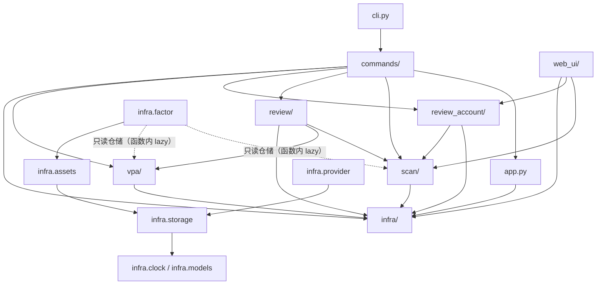
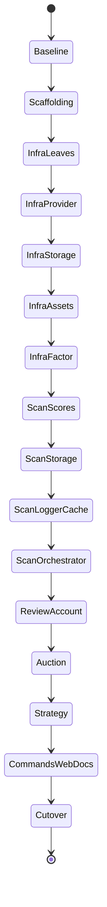

# dragon-quant 人类友好架构（第二轮 repository-wide 重构）· 批准版设计

> 状态：**已批准**（2026-10-25）。本文件是可独立阅读的最终规格，实施细节见
> `docs/superpowers/plans/2026-10-25-human-friendly-architecture.md`。
> 来源：已验收阶段 2 方案（`/tmp/dragon-quant-human-arch-solution/`）与用户最终决定。

## 1. 目标与非目标

**目标**：让新人在 `dragon_quant/` 一处读懂「入口 → 装配 → 用例 → 实现」。
主树固定为 `scan / review / review_account / commands / vpa / infra`，每个 feature
的 `main.py` 是公共导入入口与用例编排落点，不是新进程入口。

**非目标**：不改评分算法、策略规则、阈值、权重、执行顺序；不改 CLI 15 命令 /
51 parser 节点 / 参数 / 输出 / JSON / 退出码；不改 DB schema、表名、`scan_id`、
存储路径、数据语义；不新增第三方依赖；不新增进程入口；不实现虚拟写入 API 或无调用方
的通用 transaction；不重构 `web_ui`（只改 import）；不改写 `archived_md` 历史正文；
不改 E2E golden；不自动 git commit/revert/push。

## 2. 最终目标树

```text
dragon_quant/
├── __init__.py / __main__.py / _version.py / cli.py / app.py
├── commands/                  # 15 个薄 handler + COMMANDS + dispatch
├── scan/
│   ├── __init__.py            # 可调用包：scan(...) → scan.orchestrator.main.scan
│   ├── sectors.py
│   ├── scores/{__init__,main,aggregator,base,registry}.py + 5 维 scorer
│   ├── orchestrator/{__init__,main}.py
│   ├── storage/{__init__,main,scans,dragons,logs,blacklist,results}.py
│   ├── cache/{__init__,main}.py
│   └── logger/{__init__,main,events,report,query}.py
├── review/{__init__,main}.py           # 模块 → 包
├── review_account/
│   ├── __init__.py / main.py / service.py simulator.py engine.py data.py
│   ├── market.py indicators.py evaluation.py models.py advice.py verdicts.py
│   ├── storage.py
│   ├── prep/{__init__,main,service,collectors,compute,rebuild}.py
│   ├── auction/{__init__,main,collect,recompute,scoring,dates,registry,
│   │            strength,serialize,report,types}.py      # service.py 退役
│   ├── strategy/{__init__,main,common,buy,checks,sell,execution,priority,risk}.py
│   │   └── STRATEGY.md
│   └── live_trade/{__init__,main,service,trader,signal_engine,shadow,storage}.py
├── vpa/{__init__,main,engine,types,report,storage}.py + factors/
├── infra/
│   ├── __init__.py clock.py models.py market_calendar.py module_proxy.py
│   ├── provider/{__init__,main,base,bundle,data,rate_limit,tdx,ths,xueqiu,
│   │             tencent,macro,cookie,cookie_cli}.py
│   ├── storage/{__init__,main,paths,identifiers,connection,schema,_base,
│   │            dragons_rows,cache,manager}.py
│   ├── factor/{__init__,main,types,registry,engine,storage,decision,evaluation,
│   │           matrix,stats,service,finance,sql,finance_store}.py + builtin/
│   └── assets/{__init__,main,db,schema,dragons_mirror}.py
│       ├── ASSETS_ARCHITECTURE.md
│       └── sync/{__init__,cli_service,service,sources,tables,manifest,state,
│                 codec,models,credentials,doctor,errors}.py + backends/
└── providers/{__init__.py, cookie.py}   # 唯一旧路径例外：既有 -m 独立入口
```

**禁止残留**：`orchestrator.py`、`data.py`、`rate_limit.py`、`sectors.py`、
`cache/`、`logging/`、`scorers/`、`storage/`、`auction/`、`factors/`、`assets_sync/`、
`live_trade/`、`models/`、`runtime/`、`utils/`、`review.py`、`review_account/strategy.py`、
`review_account/{execution,priority,risk}.py`、`infra/compat.py`。

## 3. 关键边界与决策

| 决策 | 内容 | 理由 |
|---|---|---|
| `dragon_quant.scan` | **可调用包**：模块类 `__call__` 转发到 `scan.orchestrator.main.scan`；`__getattr__("scan")` 返回真实函数 | 避免包与惰性函数同名导致导入顺序破坏；`from dragon_quant import scan` 仍可调用；接受函数身份变化 |
| 单一 DB 连接 | `sqlite3.connect` 只允许出现在 `infra/storage/connection.py`（dragon.db）与 `infra/assets/db.py`（assets.db） | 消除双实现；AST 测试锁定 |
| dragon.db DDL | 集中在 `infra/storage/schema.py`，`connection.py` 首连调用；`identifiers.py` 管 source/表名 | 保持首连建 schema 语义，避免反向依赖 |
| assets.db DDL | 15 张表（含 `factor_*` / `fin_*`）集中在 `infra/assets/schema.py`；`infra/factor` 只拥有 SQL 仓储 | `assets_db._connect` 首连建全表现状不变；避免 `infra.assets → infra.factor` |
| 事务 | 不新增通用 `transaction()`；各仓储继续在 `_lock` 内自持事务边界 | 无真实多语句原子写需求，保持失败语义 |
| cache | 通用 `DataCache` 在 `infra/storage/cache.py`；`scan/cache/main.ScanCache` 只加 scan 键 | `review_account` 不再依赖 scan |
| provider | 唯一 `StockProvider` ABC + `ProviderBundle`；不为单实现拆 Protocol | 避免过度设计 |
| cookie 入口 | `python -m dragon_quant.providers.cookie` 是唯一独立 cookie 入口，委托 `infra.provider.cookie_cli.main`；canonical `infra/provider/cookie.py` 无 `__main__` | 不增殖进程入口；旧文件不是公共 import 兼容层 |
| factor | 整个因子层入 `infra/factor`；`main.py` 保留 13 个批准出口 + 25 个 lazy 旧名；lazy 映射用 `__package__` 拼子模块 | 用户批准保留；避免 `...factor.main.service` 解析错误 |
| factor 只读例外 | `infra.factor` 可**函数内 lazy import** 只读 `scan.storage` / `vpa.storage`；禁止模块级与扩大到 scores/orchestrator/cache | 延续既有「经 storage 查询 API 读产物」规则 |
| strategy | `common/buy/checks/sell` 纯搬家拆分 + `execution/priority/risk` 移入包；`main.py` 只重导出 | 915 行单文件变化原因混杂；不改规则 |
| auction | 移入 `review_account/auction`；`service.py` 退役，由 `main.py` 取代；`collect.py` 对 `market/models` 保持函数内 import | 消除双向依赖与双 facade |
| live_trade | 移入 `review_account/live_trade`，保留独立 `main.py` 与 `storage.py` | 严格目标树 |
| 文档 | `STRATEGY.md → review_account/strategy/`；`ASSETS_ARCHITECTURE.md → infra/assets/` | 随代码移动；只更新现行链接 |

## 4. 公共入口（每个 `main.py`）

| 入口 | 导出 |
|---|---|
| `scan/__init__.py` | 可调用模块；`scan` 惰性属性 |
| `scan/scores/main.py` | `evaluate`, `rank_verdicts`, `DragonVerdict`, `SCORERS` |
| `scan/orchestrator/main.py` | `scan`, `run_scan` |
| `scan/storage/main.py` | `PersistResult`, `persist_scan_result`, `write_scan_report`, `save_scan`, `save_dragons`, `save_scan_logs`, `get_sector_blacklist` + 子模块 `scans/dragons/logs/blacklist/results` |
| `scan/cache/main.py` | `ScanCache`, `create_scan_cache` |
| `scan/logger/main.py` | `ScanLogger`, `LogEntry`, `ReportBuilder`, `tail_logs`, `query_logs`, `clear_logs`, `list_logs`, `log_summary` |
| `review/main.py` | `run_review`, `review_dragon` |
| `review_account/main.py` | `run_review_account`, `StrategyConfig`, `MarketData` |
| `review_account/prep/main.py` | `run_prep`, `PrepError`, `ASSET_COLLECTORS`, `CollectorSpec`, `PrepContext`, `PrepPlan`, `plan_prep`, `resolve_window_dates`, `asset_health`, `collection_health`, `is_collectable`, `merge_report_entries`, `plan_repairs`, `compute_*`, `position_advice`, `format_advice_lines`, `format_candidate_lines`, `WINDOW_TRADING_DAYS`, `build_dragons_payload`, `rebuild_dragons_for_recompute`, `_read_dragon_day`, `_stale_dates`, `SHANGHAI`, `_lianban_count`, `DragonsMirrorStale` |
| `review_account/auction/main.py` | `run_auction`, `run_auction_recompute`, `format_report`, `AuctionOutcome`, `AuctionVerdict`, `evaluate`, `rank_auctions` |
| `review_account/strategy/main.py` | `evaluate_buy`, `evaluate_divergence_buy`, `evaluate_sell`, `entry_veto`, `explain_buy_candidate`, `explain_buy_checks`, `evaluate_buy_checks`, `buy_check_placeholders`, `RuleResult`, `BuyRejected`, `BuyCheck`, `BuyCheckContext`, `SellContext`, `SellRule`, `BUY_CHECK_*`, `BUY_SIGNAL_*`, `_SELL_RULES`, `_DEFAULT_OFF_RULES`, `_tiered_drawdown` |
| `review_account/live_trade/main.py` | `run_buy`, `run_sell` |
| `vpa/main.py` | `analyze`, `VPAReport`, `FactorResult`, `render`, `upsert_vpa` |
| `infra/provider/main.py` | `StockProvider`, 4 个 provider 类, `create_providers`, `ProviderBundle`, `build_provider_bundle` |
| `infra/storage/main.py` | `init_db`, `DataCache`, `StorageManager`（无 `transaction`） |
| `infra/factor/main.py` | 13 个批准出口 + 25 个 lazy 旧名；`__all__` 恰为 13 项 |
| `infra/assets/main.py` | `run`, `SYNC_ACTIONS`, `db`, `dragons_mirror`, `save_prep_assets`, `get_prep_assets`, `get_prep_snapshot`, `save_prep_snapshot`, `save_auction_asset`, `list_auction_assets`, `replace_auction_snapshots`, `list_auction_snapshots`, `get_auction_snapshot`, `diff_dragons`, `backfill_dragons` |

包 `__init__.py` 策略：`scan/` 可调用包；`review/`、`prep/`、`infra/factor/` 做旧属性代理
（`review`/`prep` 的代理实现统一为 `infra/module_proxy.py`：仅 stdlib 模块属性转发，不 import 任何业务模块）；
`review_account/`、`review_account/live_trade/`、`vpa/` 做轻量显式重导出；
`infra/`、`infra/storage/`、`infra/assets/`、`scan/storage/` 零 eager import（B1）。
所有 `main.py` 不含 `if __name__ == "__main__"`。

## 5. 依赖方向



**禁止边**：`infra.*` 行为模块依赖任何 feature（只读仓储例外）；`scan.storage →
scan.logger/orchestrator/scores/cache`；`scan.logger → orchestrator/scores/cache`；
`scan.cache → orchestrator/review_account/review`；`scan.scores → orchestrator/storage/logger`；
`review_account → scan.scores/orchestrator/cache`（`market` 读 `scan.storage.dragons` 的 v1
历史例外保留）；`live_trade → scan/review`；`commands` 深引 feature 实现或构造 provider；
`app → cli/commands` 或构造 feature 对象。新包**子模块不得 import 自身包根**。

## 6. 数据归属（不改 schema）

| 库 | 表 | 写入 | DDL |
|---|---|---|---|
| dragon.db | `scans_v*`/`scan_stocks_v*`/`scan_logs_v*`/`dragons_v*`/`sector_blacklist` | `scan/storage/*` | `infra/storage/schema.py` |
| dragon.db | `vpa_analysis` | `vpa/storage.py` | 同上 |
| dragon.db | `review_account_*` | `review_account/storage.py` | 同上 |
| dragon.db | `buy_sell_signals` | `review_account/live_trade/storage.py` | 同上 |
| assets.db | prep/auction/镜像 5 类 | `infra/assets/*` | `infra/assets/schema.py` |
| assets.db | `factor_*` 5 张 / `fin_*` 5 张 | `infra/factor/{sql,finance_store}.py` | `infra/assets/schema.py` |

`scan_id` 仍为 `v2_YYYYMMDD_topN`；`source` 路由与 `DQ_DATA_DIR` 路径语义不变。

## 7. 迁移与最终删除

迁移期允许**临时薄 shim**（`sys.modules` 别名或名称代理）保持每片可测；shim 只转发、
不含业务逻辑。最终 cutover 必须删除全部旧 shim、旧目录与 `infra/compat.py`，生产代码
和测试全部改到新路径。唯一保留：`dragon_quant/providers/{__init__.py,cookie.py}`。
`review`/`prep` 包门面的历史属性代理是批准设计（§4），其通用实现保留在
`infra/module_proxy.py`：只做 stdlib 模块属性转发、无业务 import，与已删除的迁移期
`infra/compat.py`（含 `alias_module` 与旧路径别名）职责不同。



## 8. 测试与门禁

- 基线由正式 pytest fixture 固化（进程内 patch 连接、临时空库、无真实 DB/网络）：
  dragon.db/assets.db 表/列/索引集合、全部 `compute_version_info()`、golden 哈希、
  `-h`/`-v` 零目录副作用。
- 新增结构测试：`test_scan_entry_identity`、`test_scan_persist_parity`、
  `test_storage_single_connection`、`test_storage_schema_registry`、
  `test_dependency_matrix`、`test_strategy_split`、`test_cutover_no_legacy_paths`。
- 每片：目标单测 + 结构门禁 + 受影响命令离线 E2E + `-h`；文档同步。
- 最终全量：单元、E2E、Node、ruff、harness self-check、离线 wheel/sdist、
  `-h`/`-v`、codebase-memory 重建与抽查。
- 禁止真实网络、真实 DB/Cookie/R2/B2、smoke、沙箱外 inline 业务 import。

## 9. 主要风险与缓解

| 风险 | 缓解 |
|---|---|
| `dragon_quant.scan` 同名冲突 | 可调用包 + 导入顺序子进程测试（Task 2/11） |
| 因子源码指纹漂移 | 搬迁前后 `compute_version_info()` 逐项相等（Task 1/7） |
| Phase F 行为漂移 | `persist_scan_result` 模板方法 + parity 测试 + scan E2E/golden（Task 9） |
| B1 惰性初始化破坏 | 新 `__init__` 零 eager；`-h`/`-v`/import 子进程零目录测试 |
| 大规模 patch 目标断裂 | 迁移期 shim；Task 16 全量改新路径并删 shim |
| strategy 拆分行为变化 | 先整搬后纯拆；函数级源码/行为等价（Task 14） |
| cookie `-m` 入口断裂 | 旧文件仅留 `__main__` 委托；I1–I4 E2E（Task 4/16） |
| 最终旧路径残留/打包漏包 | `test_cutover_no_legacy_paths` + wheel/sdist 内容检查（Task 16） |
| 文档/结构测试滞后 | 每片同步；Task 15 统一门禁 |
