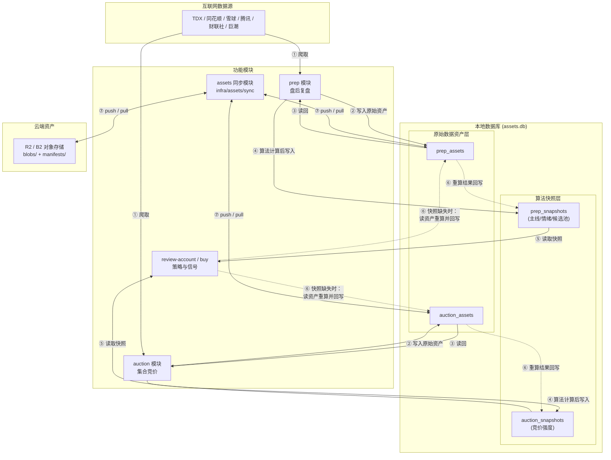
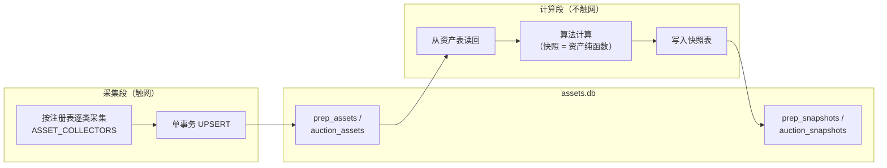
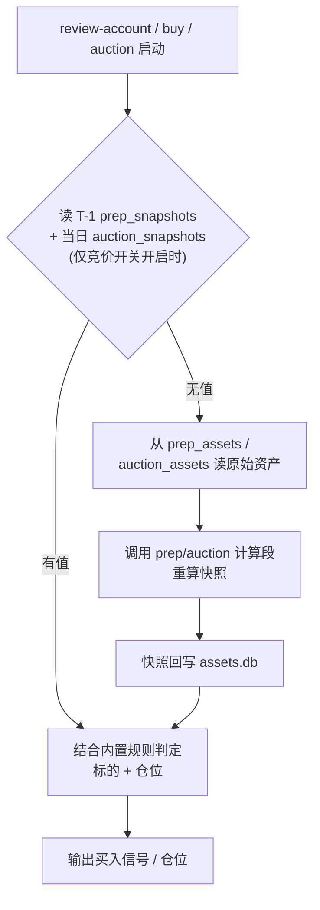
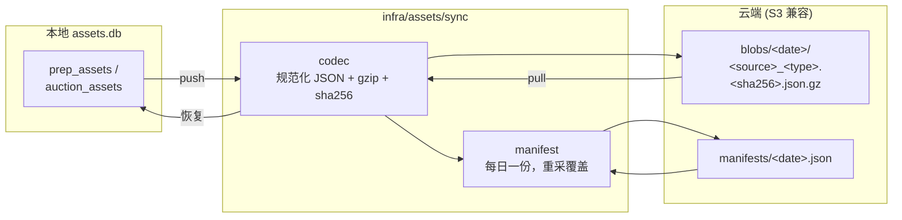

# 数据资产架构（prep / auction / review-account / assets 同步）

> 目标架构图：数据资产的**采集 → 物化 → 消费 → 云端同步**全链路。
> 图末标注了当前实现状态与目标架构的差异。

## 1. 总体组件图

## 2. prep / auction 两段式执行流

两个模块结构同构：**采集段**（触网，写原始资产）与**计算段**（纯函数，资产 → 快照）分离；`--recompute` 跳过采集段直接用已存资产重放算法。

`prep` 默认**增量采集**：先读存量资产 + `collection_report` 做健康判定——全部健康则零采集
（含 dragons 本地读取）直接进入计算段；否则只补采缺失/不健康且可采的资产（`dragons` 重采且
候选 code 集合变化时级联补采 `fund_flow`/`cninfo_announcements`）。`collection_report` 的语义是
「该日期资产的当前最佳已知状态」：只按键合并本次实际执行的 collector 条目，零采集时完全不动，
补采失败不覆盖既有健康状态（记 `last_attempt`）。`--recompute` 保持零检测零采集，直接用存量资产重放计算段。

## 3. review-account / buy 消费流（含快照缺失回退）

## 4. assets 双向同步

本地 db 是**权威副本**，云端只作异地备份（原始资产不可再生：`same_day_only` 与 `auction` 仅当日可取）。

---

## 当前实现状态对照

| 图中能力 | 状态 |
|----------|------|
| prep / auction 两段式（资产 → 快照纯函数、`--recompute`） | ✅ 已实现 |
| review-account / buy / auction 读 `prep_snapshots`（候选池 + 情绪仓位） | ✅ 已实现（`market.prep_snapshot_for` / `collect_candidates_ex` / `load_market_sentiment`）；严格 T-1，三路径共用 |
| prep 推荐集为空时回退 legacy | ✅ 已实现（`fallback_reason=all_ignored`；回退池不再应用 ignore 出池；P 按快照 verdict 标注） |
| 快照缺失时**读资产重算回写后继续**（图 3 的 ⑥ 路径） | ⚠️ 目标设计；当前实现是回退「3 日真龙并集」旧逻辑（`_legacy_candidates`），不会触发重算回写 |
| review-account / buy 消费 `auction_snapshots` | ✅ 已接线（`assets_db.list_auction_snapshots`）：`auction_ranking_enabled` / `auction_veto_enabled` 任一开启才读取；`SEMANTICS_VERIFIED=False` 期间 unverified → A 恒 Unknown |
| `auction` 采集池改为 prep 推荐 | ✅ 默认 `--pool prep`；空推荐集/缺失回退 legacy；`--pool legacy` 可复现旧口径 |
| assets 同步 push / pull / status / verify | ⚠️ M1 仅 `doctor`（连通性门槛）；push/pull 在 M2-M4 |
