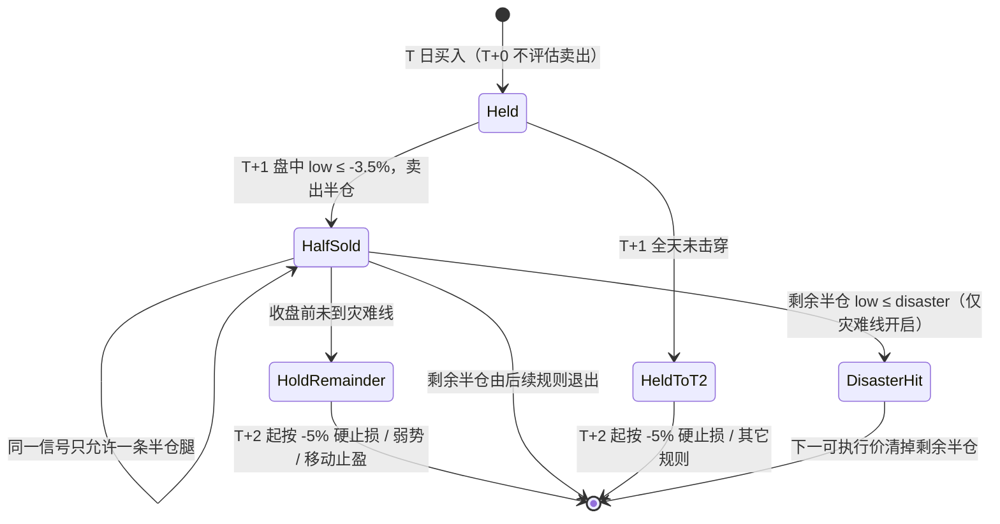

# review_account 策略规则说明

> 账户级模拟交易 `review-account` 与实盘辅助 `buy/sell` 的共享策略规范。完整调研见《择时与仓位调研.md》，技术方案见《择时与仓位技术方案.md》。

## 1. 卖出规则链（顺序即优先级，命中即短路）

`strategy.evaluate_sell` 实现为 10 条 `SellRule` 的有序责任链（`strategy/sell.py` `_SELL_RULES`）。`late_only=True` 的规则仅在 `phase == "late"` 评估（等价于原 `if phase != late: return []` 的阶段门）。

| # | name | reason_code | late_only | 默认 | 触发 |
|---|------|-------------|:---:|:---:|------|
| 1 | `first_day_stop` | first_day_stop_half / first_day_disaster_stop | ✗ | **关** | 首日（`hold_days==1`）盘中浮亏达 -3.5% 先减半；灾难线（默认 0=关）优先整清 |
| 2 | `hard_stop` | first_day_stop_loss / hard_stop_loss | ✗ | 开 | 已完成 K 最低触及止损线（首日 -3.5%，此后 -5%）；`first_day_stop` 开启时让位、只处理 `hold_days>=2` |
| 3 | `trailing` | trailing_take_profit | ✗ | 开 | 峰值浮盈 ≥ 8% 后回撤 ≥ 3.5%（可分级/ATR 化），或 14:55 失守 MA5 |
| 4 | `breakeven` | profit_back_to_cost_take_profit | ✗ | 开 | 峰值浮盈 ≥ 6% 后最低触及完整成本线 |
| 5 | `high_open_clear` | high_open_7pct/5pct_no_limit_* | ✗ | 开 | 高开 ≥7%/5% 的 5/30 分钟窗口未封板 |
| 6 | `soft_time_stop` | soft_time_stop | ✓ | **关** | 买入后 N 日未创新高且未脱离成本区（逻辑证伪） |
| 7 | `weak_close` | next_day_close_below_open / close_below_open_stop / break_intraday_ma_stop | ✓ | 开 | 14:55 弱势（收<开且跌>1% 或破 MA5 或破昨收） |
| 8 | `hard_time_stop` | hard_time_stop | ✓ | **关** | 持有达 `max_hold_days` 仍退出，封板豁免 |
| 9 | `half` | next_day_limit_up_half | ✓ | 开 | 首个可卖日 14:55 仍封板 → 减半仓 |
| 10 | `volume_spike` | volume_spike_take_profit | ✓ | 开 | 14:55 累计量 ≥ 上日全天 ×1.3 且未封板 |

顺序要点：软时间止损（逻辑证伪）先于当日弱势；弱势先于硬时间止损（更具体归因）；硬时间止损封板豁免交由半仓规则。

### 1.1 首日止损 `first_day_stop`（新增，默认关）

方案：`archived_md/review_account/2026-10-22-first-day-stoploss-redesign.md`（D3「首日浮亏减半」）。

- **触发**：仅 `hold_days == 1`。盘中 `bar_low` 触及 `first_day_stop_loss_pct`（默认 -3.5%）→ 卖出**一半**（`first_day_stop_half`）；剩余半仓从 T+2 起回到既有 -5% 硬止损 / 弱势 / 移动止盈。
- **灾难线**：`first_day_disaster_stop_pct`（默认 `0` = 关闭，取值须 `<= first_day_stop_loss_pct`）。**灾难段优先且不带半仓守卫**——首次击穿即整仓退出，已减半后再次击穿则清掉剩余半仓（`first_day_disaster_stop`）。
- **不变量**：首日止损由本规则负责；`hard_stop` 在规则开启时只处理 `hold_days >= 2`（让位判定收在 `StrategyConfig.first_day_stop_enabled()`，规则之间不互相读 toggle）。
- **半仓腿唯一性**：`took_profit_half` 语义为「该信号已完成一条半仓腿（**不分盈亏**）」，`first_day_stop_half` 与 `next_day_limit_up_half` 共用 → 首日已减半的标的，次日即使封板也不再执行「次日涨停减半」；`half_exit_reason_code` 区分止盈减半与止损减半。
- **成交价**：盘中 → 下一可执行价（跳空则开盘价）；日K兜底日 → 开盘价（若开盘已破线）或止损线/灾难线（与 `hard_stop_loss` 同一近似），**绝不补填不存在的价**。
- **兜底日两腿**：兜底日只有 `open` / `late` 两帧，每帧最多产出一条腿且都在当日成交；`late` 帧减半会短路同帧 `weak_close`，剩余半仓留到 T+2（这是 D3 单笔尾部更差 -10.42% vs -8.43% 的来源之一）。灾难线在兜底日**无法提前退出**（不是真「盘中止损」）。
- **跨日 pending**：跌停封死导致 SELL 无法成交时 pending 跨日保留，T+2 成交价与数量均按 **T+2 自己的行/持仓** 重算，不沿用 T+1 的止损线。
- **风险预算口径**：`risk_per_trade_pct > 0` 时首日风险距离改用 `StrategyConfig.first_day_risk_distance_pct()` = `(half + (disaster or stop_loss_pct)) / 2` 的**保守上界**（开启后风险预算不再按单条 -3.5% 低估；默认关时逐分不变）。
- **消融**：`first_day_stop=off`（默认，逐笔 = 旧基线）→ `on` + disaster=0（推荐起点，纯减半）→ `on` + disaster=-8/-6（加保险）。全部经 `sell_rule_toggles` / `--config` 表达，不改默认值。
- **减半不等于更安全**：它只把**单次错杀成本**减半，剩余半仓仍暴露在 -5%~-10% 区间；风险优先应选确认式（方案 §2 D5，未落地，仅作消融记录）。
- **实测（阶段 3，仅记录不改默认）**：全区间 2026-06-26→2026-10-22，基线 +23.53% / -14.22% / 27 笔 / 胜率 44.44%；D3 开启 +33.81% / -13.66% / 24 笔 / 胜率 54.17% / 最差 -10.42%。多区间不一致（06-20→08-14 支持，08-17→10-22 不支持），未达 `compare_strategies` 门槛，**默认保持关**。逐笔与多区间明细见方案 §12。

## 2. 卖出规则开关（`sell_rule_toggles`）

- `StrategyConfig.sell_rule_toggles: dict[str, bool]`，键为规则 `name`，值为是否启用。
- **空 dict = 各规则默认值：存量规则（#2-#5/#7/#9/#10）开，新增规则（`first_day_stop`/`soft_time_stop`/`hard_time_stop`）关**。
- 显式键覆盖对应规则。消融实验通过关闭单条规则实现。
- 未知键在 `StrategyConfig.from_dict` 校验期拒绝（`models.SELL_RULE_NAMES`）。

## 3. 择时与仓位新增字段（全部 default-off / =现值，向后兼容）

| 字段 | 默认 | 作用 |
|------|------|------|
| `sentiment_sizing_enabled` | False | 情绪→仓位：`budget_scale = sentiment_pct × delevel` |
| `sentiment_ban_enabled` | False | 情绪禁买：`position_pct==0` 时 `evaluate_buy` 抛 `BuyRejected("sentiment_ban")` |
| `max_daily_loss_pct` | 0 | 日级熔断（0=关）：当日已实现亏损 ≥ 净值×X% 停开新仓 |
| `drawdown_delevel_pct` | 0 | 净值回撤降仓（0=关）：-5%→×0.75，-10%→×0.5，-20%→×0.25 |
| `streak_delevel_enabled` | False | 连续亏损降仓：4-5 连亏×0.5，6+ 连亏停开新仓 |
| `soft_time_stop_days` / `soft_time_stop_floor_pct` | 0 / 0 | 软时间止损天数与「未脱离成本区」阈值 |
| `tiered_trailing_enabled` + `trailing_tier2/3_*` | False | 分级移动止盈：浮盈 ≥15%→容忍 5%、≥25%→容忍 8% |
| `dragon_comeback_*` | — | 龙回头/二波买点（`dragon_comeback_enabled=True` **默认开启**；显式 false 复现旧基线） |
| `first_day_stop_loss_pct` | -3.5 | 首日止损线；D3 下是「盘中触发减半」的线（`first_day_stop` 开启时才生效） |
| `first_day_disaster_stop_pct` | 0 | 首日灾难线（0=关闭）；非 0 时必须 `<= first_day_stop_loss_pct` **且须开启 `sell_rule_toggles["first_day_stop"]`**（否则静默失效，校验在 `StrategyConfig.from_dict` 直接报错） |

`StrategyConfig` 新增两个首日止损真值方法（`strategy` 与 `execution` 共用，避免循环依赖，**不得反向 import strategy**）：
`first_day_stop_enabled()`（读 `sell_rule_toggles["first_day_stop"]`）与 `first_day_risk_distance_pct()`（风险预算下单价口径）。
`Position` **不加字段**：D3 复用既有 `took_profit_half` 作为半仓腿唯一性守卫（live 从 `buy_sell_signals` 重建，天然一致）。

`AccountState` 新增：`realized_today`、`consecutive_losses`、`sentiment_pct`、`peak_equity`。

## 4. 组合风控（`strategy/risk.py`）

`risk_governor(cfg, state, equity) -> (delevel, allow_buy, fired_gate)` 只负责**账户维度**：

- `delevel = min(回撤系数, 连亏系数)`（默认 1.0；账户维度内部用 min 而非相乘，避免叠加至近零）。
- `allow_buy`：日级熔断 / 连亏停开新仓时 False。
- 市场维度（`sentiment_pct`）不在 RiskGovernor 内，由 engine 在开仓前做 `budget_scale = sentiment_pct × delevel`。

## 5. 回测 ↔ 实盘一致性（分叉声明）

| 机制 | 落层 | 回测 | 实盘 `buy/sell` |
|------|------|------|----------------|
| 情绪禁买 | 共享 `evaluate_buy`（`BuyRejected`） | 生效 | **自动跟随** ✓ |
| 通用前置否决 `entry_veto` | 共享 `evaluate_buy` 顶部（当前无调用方） | 保留 | 保留 |
| 竞价否决 `auction_veto_enabled` | 共享 `evaluate_buy` **信号后置闸门** | 生效（需竞价快照） | **自动跟随** ✓ |
| 情绪→仓位（sizing） | `buy_quantity` 的 `budget_scale` | 生效 | 不适用（SignalEngine 无真实预算） |
| 组合熔断 `allow_buy` | engine 层 `RiskGovernor` | 生效 | **跟随**：`live_trade/shadow.py` 从信号表按回放时点重建影子状态并调用同一 `risk_governor`；日级熔断分母为影子净值（buy-all 敞口可超 100%），`equity<=0` 额外触发破产闸 |
| 组合降仓 `delevel` | `buy_quantity` 的 `budget_scale` | 生效 | **不适用**：无 sizing，`streak_delevel` 行为 no-op（fired_gate 仍展示），`drawdown_delevel` 不触发 |
| 保本线口径 | `break_even_price`（依赖 qty/cost） | 首仓 `buy_quantity(initial_cash, initial_cash)` | **跟随**：`notional_quantity` 同口径落库冻结 |
| 半仓规则 | 共享 `_rule_half` + `apply_sell_fill` | `p.qty` 减半、`took_profit_half=True` | **跟随**：`half_close_signal` 冻结半仓腿，`status` 仍 open 供剩余半仓续跟踪；**同一信号仅一条半仓腿**（`next_day_limit_up_half` 与 `first_day_stop_half` 共用 `took_profit_half`，首日已减半则次日封板不再减半） |
| 首日止损 `first_day_stop` | 共享 `evaluate_sell` 链首规则 + `sell_quantity` / `apply_sell_fill` | 半仓腿后剩余半仓 T+2 回归 -5% 硬止损 | **跟随**：partial 走 `half_close_signal`（`half_exit_reason_code=first_day_stop_half`）；影子状态按 `took_profit_half` 重建，不会重复减半 |
| 首日风险距离 `first_day_risk_distance_pct()` | `buy_quantity` 风险预算 | 开启后按 `(half+tail)/2` 保守上界 | **跟随（间接）**：`SignalEngine` 无动态仓位，但买入数量经 `notional_quantity → buy_quantity` 落库冻结，故 `risk_per_trade_pct>0` 时实盘 qty 会继承本口径；`risk_per_trade_pct=0`（默认）时无影响 |
| 数据分级 | engine 外部 `codes = candidates ∪ positions`；`data.historical_events` 按 code 三态判定（intraday / daily / suspended） | 生效 | **跟随**：buy/sell 均纳入并集；停牌 code 跳过并进 `degraded`/`suspended_codes` |

`sentiment_pct` 装载点：`AccountSimulator.run`（回测）与 `LiveTrader._run_buy`（实盘）各自经共享 `load_market_sentiment` 读取 T-1 prep 快照；engine 只读 `state.sentiment_pct`。快照缺失/回退旧逻辑时显式降级为 sizing 1.0、禁买不生效（等效现状）。

**运维契约（`first_day_stop` 开启后）**：`buy` 命令 `evaluate_sells=False`，只有 `sell` 评估卖出。T+1 **必须至少运行一次 `sell`**，否则首日止损窗口被静默错过（T+2 起只剩 -5% 硬止损）。该契约与「峰值新鲜度依赖每个交易日至少运行一次 buy/sell」同源。

**停牌与不可用（`MarketEvent.unavailable`）**：仅对历史交易日（`day < today`）启用。当日日K缺行或 `volume`/`amount` 双零且无分时 → `suspended`：不进 `rows`、不评估买卖、复牌日自动恢复；停牌持仓按 `MarketEvent.last_closes` 保持上一交易日收盘估值（回测 marks 幂等，live 影子账户不回落成本价），且不更新峰值。剔除停牌 code 后再判断「是否全员有分时」：剩余可用 code 都有分时则走严格撮合，否则整日兜底。兜底日「分时可用但当日日K缺行」记 `daily_unavailable`（不建行，估值取当日最后一根5分钟K收盘）。停牌/不可用候选保留在 `candidates`，detail 在买窗闸门外每 code 每日产出一条（`reason_code=suspended|daily_unavailable`）。当日（盘中与收盘后）不做停牌分类，保持旧契约（缺当日日K硬报错）。

## 6. 验证基建（`evaluation.py`）

- `drawdown_decomposition(result)`：按 reason_code 归因已实现盈亏（止损/止盈/其它三桶）。
- `plateau_scan(date_from, date_to, data, cfg, param, values, metric)`：**单参数**网格 + 高原判定（邻域 80% 以上视为高原；二维热力图矩阵为后续扩展）。
- `ablation(date_from, date_to, data, cfg, rule_names, metric)`：逐条关闭卖出规则，边际贡献。
- `walk_forward(date_from, date_to, data, cfg, n_windows=4, metric)`：固定 cfg 滚动样本外评估，报告相邻窗口 OOS/IS 效率比，负值或 <0.5 判「样本外衰减」红旗（参数寻优由 plateau_scan/ablation 承担）。
- `compare_strategies(..., variant_grid=None)`：声明式额外 variant 网格 + `trial_count`（试验次数账本；>20 时报告标注 `overfitting_risk`）。

## 7. P/A 优先级与竞价否决（v4）

三值语义（True / False / Unknown）与排序键唯一实现在 `review_account/strategy/priority.py`：

- **P（prep 推荐）**：快照 `verdict ∈ {strong,light}` → True；`ignore/unrated` → False；缺 verdict（旧快照）→ Unknown。
- **A（竞价）**：有行 ∧ `unverified=False` ∧ `is_weak=False` → True；有行 ∧ verified ∧ `is_weak=True` → False；无行/损坏/`unverified`/空 items 哨兵 → Unknown。
- **排序**：`tier(A,P)`（True<Unknown<False）→ `factor_rank`（0 有分 / 1 缺失）→ `factor_score` desc → composite desc → priority desc → code。`TradingEngine` 与 `SignalEngine` 共用 `rank_key`；`buy` 的 buy-all 语义不变。
- **因子分量（P2）**：`factor_ranking_enabled` 默认 False。关闭时 `key_components` 强制 `factor_rank=0 / factor_score=0.0 / factor_mode="off"`，插入的两个零分量对所有候选相同 → 排序与旧实现逐位等价。开启时缺失候选进 `factor_rank=1` 桶排在有分者之后（缺失 ≠ 中性）；整日 `degraded`（无模型快照 / 读取失败 / 覆盖率 < `factor_min_coverage`）完全回退为关闭态。`key_components` 是唯一归零/缺失判定处，`rank_key` 只消费其输出；`priority_key` 落库携带 `factor_mode`，事后可判定当日排序是否受因子影响。
- **候选池**：`prep_verdict_filter_enabled=True` 时 `ignore` 出池；推荐集为空/快照缺失/读取异常 → 回退 legacy，回退池不再应用 ignore 过滤；P 仍按快照如实标注。
- **开关**：`auction_ranking_enabled`（A 参与排序）/ `auction_veto_enabled`（D3 否决）均默认 False；任一开启才读取 `auction_snapshots`，两者皆关时零读取/零否决/A 恒 Unknown（AC8'）。
- **否决**：`auction_veto_enabled=True` 且 A=False → `BuyRejected("auction_veto")`；`auction_veto_exempt_signals` 按买点类型豁免。`entry_veto` 仍是无调用方的通用前置钩子。
- **可观测**：detail 携带 `entry_priority` / `priority_key` / `would_veto` / `vetoed_signal`；`ranking_mode` ∈ {auction, auction_unverified, prep_only, legacy}；候选池回退输出 `fallback_reason`。`would_veto` 仅在已读取竞价数据时记录。
- **回测边界**：历史日几乎无 `auction_snapshots` → A 恒 Unknown，回测不能验证 A；不得用回测结果宣称 A 有效。D6 排序不可独立消融，与旧回测对照须先重跑基线。

## 8. 买点诊断（`checks`）

`buy` 对每个候选（买入与未买入）输出四类买点的逐条诊断；决策与诊断共用 `strategy/buy.py` 的 `_rule_*`，阈值只有一份。

| # | rule | 判定窗口 | 说明 |
|---|------|----------|------|
| ① | `buy_open_ma5_pullback` | 09:30 开盘 | 开盘回踩 MA5（量能/质量/涨跌停/MA5 上行/距离/缺口） |
| ② | `buy_open_turn_strong` | 09:35 首根5分钟K | 高开突破上日高点 + 首根K带量 |
| ③ | `buy_divergence_first_break` | 前 `divergence_confirm_bars` 根（默认 6 → 10:00） | 连续缩量一字板断板后未破昨收且企稳 |
| ④ | `buy_dragon_comeback` | 09:30 开盘（日K形态） | 第一波大涨→缩量回调→阳线吞没；默认开启 |

**状态语义**（`checks[].status`）：

- `passed`：形态通过（`selected=true` 表示该规则产生了本次决策信号，可能随后被否决/排序淘汰/未成交）。
- `failed`：该规则判定时点就在当前事件且未通过。
- `pending`：确认时点未到（09:30 的 ②③；`reason` 会附带已知不满足项）。
- `window_closed`：窗口已过，最终判定未通过（`reason` 保留窗口帧的原因）。
- `unavailable`：日K兜底/数据缺失，不可判定（②③ 在日K兜底日）。
- `skipped`：前置闸门早退（情绪禁买/综合分不足/非真龙/规则关闭），未进入形态判断。

**取帧与去重**：同一 code 人读只输出一次，取最后一条带 `checks` 的 detail；买入标的的四行取最后帧，`selected` 由 `buys[].reason_code` 回填（`already_holding` 帧不承载命中语义）。事件级闸门（风控/已卖出）输出 `buy_eval_skipped` + 四条 `skipped`；买点命中但未成交（不可成交价/超时/预算不足/回放结束）仍展示四类并标 `selected`。

**JSON**：`buy --json` 的 `details[].checks[]` 字段为 `rule` / `label` / `window` / `status` / `selected` / `reason`；detail 另带 `observed_at` / `phase`。`checks` 只进 detail JSON，不写 `buy_sell_signals`。

**window_closed 的一致性**：③ 诊断固定传 `intraday_bars[:N]`，因此 14:55（`late`）重算出的原因与 10:00 判定一致；①/②/④ 的输入为时间不变量（open/prev_row/hist_rows/first_bar）。`_no_pattern_reason` 为 phase 无关的四规则摘要，Web UI 的 `reason_text` 在 `late` 帧不再退化为兜底文案。

---

## 9. 候选池读源与回退池窗口（2026-10-23）

- **读源**：`review-account` / `buy` / `sell` 的候选池优先读 T-1 `prep_snapshots`；回退池读 **`assets.db.dragons` 镜像**（`market.candidate_loader("v2")`）。`--source v1` 是显式例外，经 `candidate_loader` 分派回 `dragon.db.dragons_v1`（镜像只承载 v2）。
- **回退池默认 5 日**：`StrategyConfig.candidate_lookback_days` 默认 `3 → 5`，与 prep 窗口一致。
- **不可比基线声明**：默认值变更是**策略默认参数变更**，本基线下的 `review-account` 结果与历史 3 日基线**不可直接比较**；复现旧基线请显式 `candidate_lookback_days=3`（`--config` 传入）。prep 命中路径不受该参数影响。
- **失败语义**：镜像 `/` 当日缺行会让池 loader fail-fast（`DragonsMirrorStale`），`review-account` 与 `buy` 中止并提示 `assets backfill-dragons`；`sell` 降级为「仅按持仓判定」并在 `degraded` 输出 `candidate_pool_unavailable`。
- **运维**：`assets backfill-dragons --dry-run` 体检；对账是单向下限，孤儿行只能靠 `--dry-run` 的 `orphan_rows` 或 `--prune` 发现。
