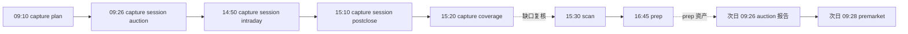

# schedule — 每日定时编排（采集 / 盘后 / 盘前）

**何时读我**：用户表达「每天自动跑 / 定时 / 无人值守 / 持续采集 / 积累 BS 数据 / capture」意图，或问「怎么让这些命令自动执行」时。

## 边界（先讲清）

- Agent 只生成并展示配置文本与安装命令；不代写 crontab / launchd、不创建或安装真实 job（用户明确授权后才协助）。`assets capture schedule` 也只输出模板。
- 定时器只跑有界 CLI 作业，不做每分钟 agent 推理；agent 每天读一次 `coverage --from D --to D --json` 复核。买卖动作永不无人值守；`auction` / `premarket` 可定时采集，但读结论与下单仍人工。cron 触发时区取宿主设置；命令内用 `TZ=Asia/Shanghai date` 计算交易日，二者独立（非 Shanghai 宿主需换算 cron 小时或设 TZ）。安装前置：用已确认交易日历预检，`1-5` 不是交易所日历，未知/节假日跳过。

## 基线日矩阵（最小可用）

| 时点（T 日） | 作业 | 依赖 / 说明 |
|---|---|---|
| 09:10 | `dragon-quant assets capture plan --date "$D" --json` | 冻结当日事前母集：本地读早于计划日的 dragons/prep、持仓与跟踪项，**写本地 assets.db**（T1）；`--sectors` 可选 |
| 09:26 | `dragon-quant assets capture session --phase auction --date "$D" --max-slots 1 --json` | 采集会话的 auction 阶段：`auction_path` + `auction_final`（T1 触网写库） |
| 14:50 | `dragon-quant assets capture session --phase intraday --date "$D" --max-slots 1 --json` | 盘中最小快照：`minute_bars` + `quote` |
| 15:10 | `dragon-quant assets capture session --phase postclose --date "$D" --max-slots 1 --json` | 收盘后：`daily_bars` + `minute_bars` |
| 15:20 | `dragon-quant assets capture coverage --from "$D" --to "$D" --json` | T0 只读复核缺口/可用性；可在 scan 前 |
| 15:30 | `dragon-quant scan --top 5` | 当日扫描，15:00 后才允许（实时 scan 无 --json） |
| 16:45 | `dragon-quant prep --json` | 当日复盘，16:40 后才允许 |
| 次日 09:26 | `dragon-quant auction --json` | **standalone 竞价报告**，写 auction 快照供 premarket（T1）；不是 capture 阶段 |
| 次日 09:28 | `dragon-quant premarket --json` | T0 只读，依赖 prep + auction 快照 |



- **日期一致**：`once/session` 显式 `--date "$D"` 或 `--plan-id`；`plan --dry-run` 只体检、不冻结，否则后续 `plan_not_found`。09:10 只读早于计划日的 scan/prep，不用 T 日盘后产物反填当天开盘前母集；15:30 scan / 16:45 prep 属当日链，次日盘前只消费其产物。**命名空间**：capture 的 `--phase auction` 只是采集会话阶段，写 `capture_*` / `market_*`；standalone `auction` 生成竞价报告快照供 premarket。二者不能互相替代，报告与调度中都按作业全名区分。

## 时窗与可选增强

| 主题 | 可采时窗 |
|---|---|
| `auction_path` | 09:15–09:26 |
| `auction_final` | 09:26–09:35 |
| `minute_bars` / `quote` | 09:30–15:05 / 09:30–15:00 |
| `daily_bars` | 15:05 起 |
| `sector_membership` | 全天，但需显式 `--sectors`，否则范围为空 |

- `session` 过早以 `window_not_open` 退出；同一 phase/slot 已 complete 会被跳过，连续采样请用多次 `once`（带真实当前时窗），不要用重复 `session` 冒充连续证据；单时槽用 `--max-slots 1`，`--interval-seconds` 是时槽间隔不是采样频率。
- 14:50 是最小快照；要连续盘中证据另加多次 `once --topics minute_bars,quote --date "$D"`，报告区分「单点快照」与「连续盘中证据」。09:16 / 09:20 / 09:24 的 `auction_path` 是**时窗内普通采样**，质量仍 `semantics_unverified`，**不是** `same_day_recovered`；后者只用于当日原时窗结束后的补采，不能把更早时点倒填。
- 板块归属需计划 `--sectors S1,S2` 且用 `once --topics sector_membership --date "$D"`，内置时槽不含该主题。

## 宿主配置

cron（Linux/传统 cron；日志目录与 `DQ_DATA_DIR` 预先存在，解释器/工作目录用绝对路径；每条作业自带当日日期）：

```cron
10 9 * * 1-5  cd /ABS/PATH && D=$(TZ=Asia/Shanghai date +\%Y\%m\%d) && DQ_DATA_DIR=/ABS/DATA /ABS/PYTHON -m dragon_quant assets capture plan --date "$D" --json >> /ABS/LOG/dq-capture-plan.log 2>> /ABS/LOG/dq-capture-plan.err.log
26 9 * * 1-5  cd /ABS/PATH && D=$(TZ=Asia/Shanghai date +\%Y\%m\%d) && DQ_DATA_DIR=/ABS/DATA /ABS/PYTHON -m dragon_quant assets capture session --phase auction --date "$D" --max-slots 1 --json >> /ABS/LOG/dq-capture-auction.log 2>> /ABS/LOG/dq-capture-auction.err.log
50 14 * * 1-5 cd /ABS/PATH && D=$(TZ=Asia/Shanghai date +\%Y\%m\%d) && DQ_DATA_DIR=/ABS/DATA /ABS/PYTHON -m dragon_quant assets capture session --phase intraday --date "$D" --max-slots 1 --json >> /ABS/LOG/dq-capture-intraday.log 2>> /ABS/LOG/dq-capture-intraday.err.log
10 15 * * 1-5 cd /ABS/PATH && D=$(TZ=Asia/Shanghai date +\%Y\%m\%d) && DQ_DATA_DIR=/ABS/DATA /ABS/PYTHON -m dragon_quant assets capture session --phase postclose --date "$D" --max-slots 1 --json >> /ABS/LOG/dq-capture-postclose.log 2>> /ABS/LOG/dq-capture-postclose.err.log
20 15 * * 1-5 cd /ABS/PATH && D=$(TZ=Asia/Shanghai date +\%Y\%m\%d) && DQ_DATA_DIR=/ABS/DATA /ABS/PYTHON -m dragon_quant assets capture coverage --from "$D" --to "$D" --json >> /ABS/LOG/dq-capture-coverage.log 2>> /ABS/LOG/dq-capture-coverage.err.log
```

- crontab 中 `%` 必须写成 `\%`；`D` 在每条作业内独立计算，安装一次即可每天运行；`--json` 的 stdout 写 `.log`（可逐日 JSON 核对），stderr 写 `.err.log`。
- **macOS 原生 flock 不可用**：用 launchd 每作业一个 label（同 label 不重叠）与独立 `StandardOutPath`/`StandardErrorPath`；Linux flock 可选；跨作业并发靠采集租约，不承诺全局串行。
- 休眠/关机/未触发都不会回补原始观测：完全没跑的作业没有 `capture_runs` 记录，`coverage` 只能报缺口；之后再跑 `session` 可把已过时槽记 `missed`，但不能重建当时观测。
- 内置 `assets capture schedule --kind launchd|systemd|cron` 只是骨架：仅含竞价 09:26、不含 plan/日期；只输出、不安装，不是完整每日管线。

示例 agent 指令（用户复制；agent 只产出配置文本）：

```text
为 dragon-quant 生成每日采集调度建议（不安装）：时区 Asia/Shanghai；工作目录/解释器/数据目录用绝对路径
（/ABS/PATH、/ABS/PATH/.venv/bin/python、DQ_DATA_DIR=/ABS/DATA），日志 /ABS/LOG 每作业独立，失败告警到 <渠道>。
作业 09:10 capture plan、09:26 capture session auction、14:50 intraday、15:10 postclose、15:20 coverage；
plan/once/session 用 --date，coverage 用 --from/--to；另保留 15:30 scan、16:45 prep、次日 09:26 standalone auction 报告、09:28 premarket（与 capture phase auction 不同作业）。休眠/错过不补跑；节假日预检后跳过，输出 cron 或 launchd 给我安装。
```

## 采集失败与质量边界

- `plan_not_found`：先补 `plan --date "$D"`（不带 `--dry-run`）冻结；`scope_empty` 补 `--sectors`；盘前空池只列出缺失的 T-1 输入或用用户显式 `--codes` 观察，**不要**用 T 日盘后 scan/prep 回填；盘中新增成员按真实 `first_seen_at` 追加 revision，不回写盘前母集。
- `window_not_open` / `missed`：等到时窗或做当日补采；历史日期 `history_not_recoverable`，调度器无法回补；`no_data` / source failed 保留原始错误，先查 TDX 与网络，空不等于 0。
- `status=complete` 只说明本计划范围达到，不等于全市场、可用证据、标签成熟、概率资格或 EV；TDX 竞价末笔虚拟匹配 ≠ 交易所终态，unverified 始终 unverified，不因「已采集」升级。
- `coverage_complete=false`、truncated、unusable、missing 都要列出；partial 也可能 exit 0，必须读 JSON（status/gaps/coverage_complete），不能只看退出码；同日补采不能倒填更早时点。
