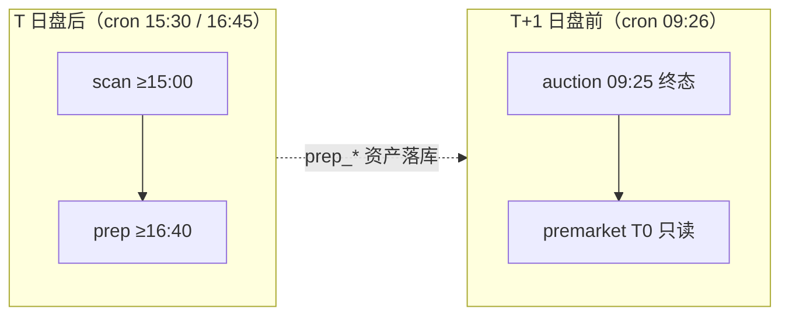

# schedule — 每日定时任务（跨时点依赖链无人值守）

**何时读我**：用户表达「每天自动跑 / 定时 / 无人值守 / cron」意图，或希望把盘后盘前链交给定时任务，或问「怎么让这些命令自动执行」时。

## 依赖链与时间窗



| 命令 | 运行门禁（代码为准） | cron 推荐时点 | 依赖 |
|---|---|---|---|
| `scan --top 5` | 15:00 后（盘中拒绝） | 15:30 | TDX/THS/腾讯，无 Cookie |
| `prep --json` | ≥16:40，自带 TDX 交易日校验 | 16:45 | 当日 scan + 宏观源 |
| `auction --json` | 09:25 终态（盘前采集） | 次日 09:26 | T-1 prep 快照 |
| `premarket --json` | T0 只读，无门禁 | 次日 09:28（可选） | prep + auction 资产 |

时间窗以各命令运行时报错为准，本文只做 cron 编排建议，不复制门禁数值；非交易日由命令自身校验兜底（prep 用 TDX 日历拒绝、scan 对同一交易日幂等去重），cron 只配周一至五即可。

## cron 模板（macOS/Linux）

```cron
# 盘后链（T 日）
30 15 * * 1-5  cd /PATH/TO/dragon-quant && flock -n /tmp/dragon-quant.lock .venv/bin/python -m dragon_quant scan --top 5 >> var/log/dq-scan.log 2>&1
45 16 * * 1-5  cd /PATH/TO/dragon-quant && flock -n /tmp/dragon-quant.lock .venv/bin/python -m dragon_quant prep --json >> var/log/dq-prep.log 2>&1
# 盘前链（T+1 日，premarket 可选）
26  9 * * 1-5  cd /PATH/TO/dragon-quant && flock -n /tmp/dragon-quant.lock .venv/bin/python -m dragon_quant auction --json >> var/log/dq-auction.log 2>&1
28  9 * * 1-5  cd /PATH/TO/dragon-quant && flock -n /tmp/dragon-quant.lock .venv/bin/python -m dragon_quant premarket --json >> var/log/dq-premarket.log 2>&1
```

- `flock -n`：同一锁防重入（手动跑与 cron 不叠加）；每步独立日志，失败不吞错误。
- `DQ_DATA_DIR` 需要固定时在 cron 行内 `export`；模板用 `.venv` 绝对解释器。
- Windows 任务计划 / macOS launchd 同理：四条独立任务，时点同上。

## Agent 行为契约

1. **触发**：(a) 用户显式表达定时/无人值守意图 → 按本文生成方案；(b) 会话内手动完成链上任一环（如刚跑完 prep）→ 结尾**主动建议一次**「这条链跨时点，可配 cron 定时运行，要我生成模板吗？」；用户不感兴趣不反复推销。
2. **边界**：agent 只**生成并展示**配置文本与安装指引（`crontab -e` 等），**不代写系统 crontab**；安装由用户执行，或用户明确授权后进行。
3. **红线**：**不为 `buy` / `sell` 生成无人值守模板**——资金动作不自动化；用户要求时说明原因并拒绝，只建议人工阅读 premarket 输出后操作。
4. **异常**：cron 日志出现失败时按 `references/playbooks.md` 对应条目分流（门禁/空数据/源失败），不建议 `--force` 绕过。

## 与其他文档的关系

- 盘后/盘前 session 语义：`references/operations.md`；竞价采集与字段：`references/premarket.md`。